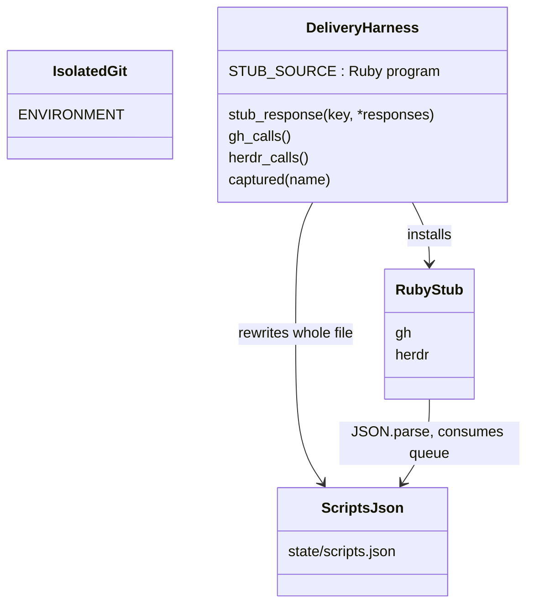
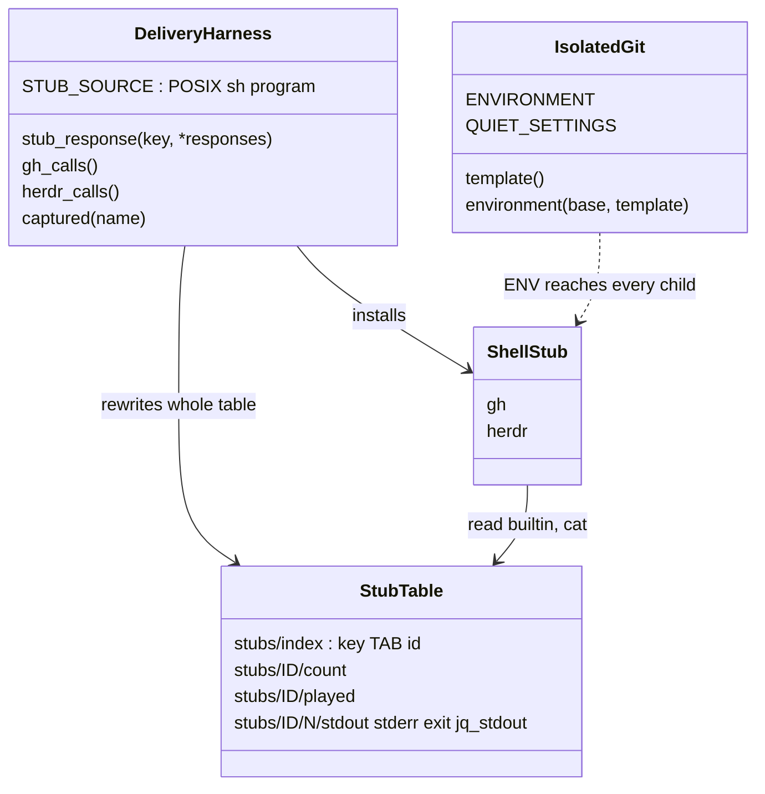

# Plan: Speed up the slowest tests: git maintenance, init template, gh and herdr stubs

From `intent.md` (2026-10-25). Status: accepted.

## Design

### Domain terms

The repository has no `GLOSSARY.md`. No intent word conflicts with an agreed term. The terms below are local to this change; auto mode adds none to a glossary, because nobody agrees them.

- **Quiet settings** — `maintenance.auto=false` and `gc.auto=0`, given to every git process of a test through `GIT_CONFIG_COUNT`/`GIT_CONFIG_KEY_n`/`GIT_CONFIG_VALUE_n`.
- **Hookless template** — a fresh git template directory per test process that holds only an empty `info/` and an empty `hooks/`. `GIT_TEMPLATE_DIR` points every `git init` and `git clone` of a test at it.
- **Stub table** — the files `stub_response` writes under `<state>/stubs/`, which the shell stub reads with shell builtins and no JSON parser.
- **Shell stub** — the POSIX `sh` program that `DeliveryHarness` installs as `gh` and `herdr`. It replaces the Ruby `STUB_SOURCE`.
- **Spread** — for three timed runs, the largest minus the smallest wall time.

### Diagrams

Before:



After:



### Signatures

`test/isolated_git.rb` — keeps git in test processes away from the machine's git config, from background upkeep and from sample hooks. It stays one self-contained file, because `isolated_git_test.rb` copies it alone into a fixture directory.

```ruby
require "fileutils"
require "tmpdir"

module IsolatedGit
  ENVIRONMENT = { "GIT_CONFIG_GLOBAL" => "/dev/null", "GIT_CONFIG_SYSTEM" => "/dev/null" }.freeze # unchanged
  QUIET_SETTINGS = { "maintenance.auto" => "false", "gc.auto" => "0" }.freeze #: Hash[String, String]

  # ENVIRONMENT, GIT_TEMPLATE_DIR => template, and both quiet settings appended after any
  # GIT_CONFIG_COUNT entries already in base. Git uses the last value of a key, so an inherited
  # maintenance.auto=true loses to the appended false.
  #: (Hash[String, String] base, String template) -> Hash[String, String]
  def self.environment(base, template)

  # A fresh Dir.mktmpdir holding empty info/ and hooks/. Removed by the process that made it:
  # through Minitest.after_run when Minitest is loaded (an at_exit here would run before the
  # tests, since minitest/autorun registers its at_exit first), else through at_exit.
  #: () -> String
  def self.template
end
ENV.update(IsolatedGit.environment(ENV.to_h, IsolatedGit.template))
```

Dropped (see Departures): the `test/delivery_harness.rb` signatures and the shell stub steps below are not in the branch.

`test/delivery_harness.rb` — public API unchanged:

```ruby
module DeliveryHarness
  STUB_SOURCE #: String — now a POSIX sh program with shebang #!/bin/sh

  # Same signature and meaning. Rewrites the whole stub table from @scripts, so every queue
  # restarts at its first response, exactly as the rewrite of scripts.json does today.
  #: (String key, *Hash[String, untyped] responses) -> void
  def stub_response(key, *responses)

  #: () -> Array[String]
  def gh_calls      # unchanged
  #: () -> Array[String]
  def herdr_calls   # unchanged
  #: (String name) -> String?
  def captured(name) # unchanged

  private

  # rm_rf <state>/stubs, then writes index ("<key>\t<id>" per line), <id>/count and, per response,
  # <id>/<n>/stdout, stderr, exit and jq_stdout (only when the response has the key).
  # Raises ArgumentError on a key with a tab or newline.
  #: () -> void
  def write_stub_table
end
```

`setup_harness` also creates `<state>/captured`, so the stub needs no `mkdir`.

The shell stub, in the order the Ruby stub works today:

1. `state=${STUB_STATE:?}`; `name=${0##*/}`.
2. Append `"$*"` (with `IFS=' '`) and a newline to `$state/$name.log`. This equals `ARGV.join(" ")`.
3. Walk the arguments once with a previous-argument variable. After `--body-file`, `cp` the value to `captured/$name-${1-}-${2-}.body`. After `--title`, `printf '%s'` the value to `.title`. Note `--watch`, and set `jq` for an argument that is exactly `--jq` or `-q`.
4. Build the keys exactly as Ruby does: `"$name "` plus the first three arguments joined by one space, then the first two, so a call with fewer arguments gets the same short key twice and zero arguments give `"$name "`. For `gh pr checks`, `gh pr checks watch` (with `--watch`) or `gh pr checks json` (otherwise) goes first. `"$name *"` goes last.
5. For each key, look it up in `stubs/index` with a `while IFS=$(printf '\t') read -r key id` loop. No key found: print `stub: no response for <keys>` to stderr and exit 1.
6. Read `count` and `played` (missing means 0) with `read`. Play response `n = played + 1` while `played < count`, else `count`. Write `played` only when `count > 1`.
7. Print `jq_stdout` when `jq` is set and that file exists, else `stdout`; then `stderr` to fd 2. Use `cat` only on a non-empty file (`[ -s ]`). Exit with the code in `exit`.

Not checked: the dotfiles repository has no Steepfile; the inline RBS comments follow `test/hook_scripts.rb`.

### Complexity

- One stub call: one `/bin/sh` exec, at most two `cat` and one `cp` per `--body-file`. Today each call boots Ruby (about 33 ms idle, more under load).
- One `stub_response`: O(total responses) small file writes, as the JSON rewrite is today.
- One `git init`: copies two empty directories. Measured on this machine: about 150 ms, against about 500 ms with git's default template.
- One commit: no `git maintenance run --auto --quiet --detach` child (seen with `GIT_TRACE=1` on git 2.54). Measured: about 30 ms less per commit.
- No database, no queries.

### Invariants

- Every git process a test starts, including a child given its own `GIT_CONFIG_GLOBAL`, reads the quiet settings at command scope. Enforced by `IsolatedGit.environment` and `ENV.update` at require time; `test_every_test_file_requires_the_helper` keeps the require in every file. A child started with `unsetenv_others` or with `GIT_CONFIG_COUNT` removed loses only the speed-up.
- `GIT_CONFIG_GLOBAL` and `GIT_CONFIG_SYSTEM` stay `/dev/null`. Enforced by `ENVIRONMENT`, proved by the existing `test_the_helper_empties_the_global_and_system_config`.
- A test repository has `.git/info/` and `.git/hooks/`, both empty. Enforced by the hookless template, which is new per test process, so no stale file can reach it.
- The quiet settings win over an inherited `GIT_CONFIG_COUNT` entry for the same key. Enforced by appending them last in `IsolatedGit.environment`.
- For every call that matches a registered key, the shell stub gives the same log lines, captured files, stdout, stderr and exit codes as the Ruby stub. A call that matches no key exits non-zero in both; only the stderr text differs (the Ruby stub printed a `KeyError` backtrace). Proved by contract tests that are written first, pass against the Ruby stub, and still pass against the shell stub.
- The stub starts no Ruby. Proved by the RUBYOPT probe test.

### Alternatives

1. **Smallest diff (architect 1).** Same git mechanism without appending to an existing `GIT_CONFIG_COUNT`; stub table as generated `keys.sh` and `<id>.<n>.sh` files that the stub sources, values quoted with `Shellwords.escape`. Rejected in part: sourcing generated shell code needs exact quoting of every key and value. Plain files read with `read` and `cat` cannot run data as code and keep bytes exact. Its git mechanism and fixed template path are kept.
2. **Maximum fidelity (architect 2).** Template byte-equal to git's default without samples (`description`, `info/exclude`); a `StubTable` class; the Ruby stub kept as a test oracle with about 25 differential tests. Rejected: the oracle is dead code after merge and adds Ruby boots to the suite. No test reads `description` or the default `info/exclude` text: they write, append or delete `info/exclude`. The contract tests in this plan pass against the Ruby stub first, which gives the same proof without keeping the oracle. Its append-to-`GIT_CONFIG_COUNT` rule, its per-process template idea and its grep findings are kept.
3. **Chosen.** Architect 1's git mechanism, with architect 2's append rule and a per-process template; plain-file stub table; contract tests written against the Ruby stub first.

Also rejected for the git settings: a test-owned `GIT_CONFIG_GLOBAL` file (many tests set their own `GIT_CONFIG_GLOBAL`, so it would not reach them, and it breaks the `/dev/null` assertion); a `config` file inside the template (reaches new repositories only and changes every `.git/config`).

## Design decisions

- **Template location.** A fresh `Dir.mktmpdir` per test process, so a stale or edited directory can never leak into a test repository. A plain `at_exit` cleanup would run before Minitest's tests, because `minitest/autorun` registers its `at_exit` first and handlers run in reverse order; so cleanup goes through `Minitest.after_run` when Minitest is loaded and `at_exit` otherwise. Only the process that made the directory removes it. A child process inherits `GIT_TEMPLATE_DIR`, and the directory lives as long as its parent test process. A fixed shared path was rejected because `mkdir_p` cannot remove stale files; a committed template directory was rejected because it needs a placeholder file, which git would copy into every `.git`.
- **Quiet settings are always appended.** Both settings go after any inherited `GIT_CONFIG_COUNT` entries, even when the key is already there, because git uses the last value. A child that requires the helper again appends them again; duplicates are harmless.
- **Stub keys may not hold a tab or a newline.** The stub table index is one `key<TAB>id` line per key. `stub_response` raises `ArgumentError` on such a key. No test registers one, and the stub builds its keys from the first three arguments, which no delivery script passes with a tab or newline. This narrows the helper contract on purpose.
- **Template content.** Empty `info/` and `hooks/`. Seven test files write `.git/info/exclude` directly, so `info/` must exist; `hooks/` keeps parity with a normal repository.
- **One mechanism for both git settings families.** `GIT_CONFIG_COUNT` for the quiet settings, `GIT_TEMPLATE_DIR` for the template. Both reach children that set their own global config. Needs git 2.31 or later; macOS has 2.54 and Ubuntu CI ships a newer git than 2.31.
- **The stub stays a heredoc in `delivery_harness.rb`,** as every other test stub in `test/` is. Shellcheck does not see heredocs, so the implementer lints it by extracting it: `ruby -Itest -rdelivery_harness -e 'print DeliveryHarness::STUB_SOURCE' | shellcheck -s sh -`.
- **The RubyGems test keeps its name and its claim.** `test_a_stub_call_starts_without_rubygems` asserts that a stub call loads no RubyGems, through a RUBYOPT probe that records `defined?(::Gem)`. A shell stub starts no Ruby, so the probe never runs and the existing body would fail on the missing probe file. The test keeps its name, its probe and its claim, and now asserts that the probe file is absent (no Ruby started, so no RubyGems loaded) and that the call succeeds. The claim holds more strictly; no test is removed. `intent.md` lists the harness tests as affected.
- **Each speed-up is its own commit,** so a speed-up that fails its timing gate is dropped by `git revert` of that commit, and the pull request says so.
- **Measurement base.** The "before" runs use this branch before its first code commit: it equals `main` (7713f122) plus `docs/changes/` only. This gives the same machine and base without a second checkout.
- **Gate.** A speed-up stays when the median of three runs of its affected files drops by more than the larger of the before and after spreads. Affected files: git settings → the four slow files; shell stub → the seven files that require `delivery_harness` (`deliver`, `ship`, `restore`, `commit_plan`, `commit_review`, `open_pr_dash`, `delivery_harness`).
- No conflict with `intent.md`'s `## Decisions`.

## Integration points

- Git 2.31+ environment config (`GIT_CONFIG_COUNT`, `GIT_TEMPLATE_DIR`); `git help config` and `git help init` document both.
- `bin/test`: unchanged; its per-file seconds and the shell's `time` give the timings.
- GitHub Actions `dotfiles-tests.yml` on `ubuntu-latest`: unchanged; it must stay green.
- Scripts under test (`deliver`, `ship`, `restore`, `commit-plan`, `commit-review`, `open-pr-dash.sh`, `worktree-create`, the herdr scripts, `consent-guard.rb`): unchanged.

## Files that change

- `test/isolated_git.rb` — requires `fileutils` and `tmpdir`; adds `QUIET_SETTINGS`, `environment(base, template)` and `template`; the header comment names the quiet settings and the hookless template. It stays self-contained.
- `test/isolated_git_test.rb` — new tests for the quiet settings and the template (see Proof). Existing tests unchanged; `run_child` also clears `GIT_CONFIG_COUNT` and `GIT_TEMPLATE_DIR`.
- Dropped (see Departures): `test/delivery_harness.rb` — `STUB_SOURCE` becomes the shell stub; `stub_response` writes the stub table; `setup_harness` creates `captured/`; the header comment describes the stub table instead of `scripts.json`.
- Dropped (see Departures): `test/delivery_harness_test.rb` — the RubyGems test becomes the no-Ruby test; new stub contract tests.
- At most a few further test files, only for a cause the profile finds (step 7), each small and in test code.
- `docs/changes/231-…/profile.md` — where each of the four slow files spends its time.
- `docs/changes/231-…/timings.md` — the before and after tables, per speed-up and for the full suite.

## Order of work

Run every timing with the machine as idle as possible, and the same `-j` (the default, `Etc.nprocessors`).

1. Baseline. On this branch before any code change, run `time bin/test` three times. Record each wall time, the median, the spread and the per-file seconds of the eleven affected files in `timings.md`. Record any file that fails on `main`; it must fail the same way, or pass, afterwards.
2. Affected-file baselines. Run `time bin/test test/herdr_worker_scripts_test.rb test/deliver_test.rb test/consent_guard_test.rb test/worktree_create_test.rb` three times, and the same for the seven harness files. Record median and spread.
3. Profile. For each of the four slow files, run `ruby -Itest test/<file> -v`, sort the per-test seconds, and record the ten slowest tests and the total. For the slowest tests, count process starts by kind (`git init`, other git, Ruby script under test, Ruby stub) with `GIT_TRACE=<file>` and the stub logs. Write `profile.md`: per file, where the time goes, in a few lines each.
4. Git settings, tests first. Add the `isolated_git_test.rb` tests from Proof. Run the file and watch the new tests fail for the right reason (setting missing, sample hooks present).
5. Implement `IsolatedGit.environment`, `IsolatedGit.template` and `QUIET_SETTINGS`. Run `isolated_git_test.rb`, then the four slow files, then the full suite. Commit. Time the four slow files three times, apply the gate, and record the result. Revert the commit if it fails the gate.
6. Dropped (see Departures). Shell stub, tests first. Add the stub contract tests to `delivery_harness_test.rb` and run them against the current Ruby stub: they must pass, which pins today's behaviour. Then change the body of `test_a_stub_call_starts_without_rubygems` to assert the probe file is absent, and watch it fail. Replace `STUB_SOURCE` and `stub_response`'s storage. Run `delivery_harness_test.rb`, then the seven harness files, then the full suite. Commit. Time the seven files three times, apply the gate, record, and revert if it fails.
7. Other causes. For each cause in `profile.md` that a small test-only change removes (for example, the Ruby `gh`/`herdr` stubs inside `worktree_create_test.rb` boot full RubyGems with `require "json"`), make that change in its own commit with its tests still green, time its file three times and apply the gate. A cause that needs a change outside test code goes into `timings.md` and the pull request as a follow-up, unchanged here.
8. Final. Run `time bin/test` three times. Record the median and spread next to the baseline. Confirm every file that passed in step 1 passes, and that the test and assertion counts per file equal the baseline or exceed it (Minitest prints `N runs, M assertions`).
9. Lint. `rubocop` on every touched `.rb` file. Shellcheck on the extracted stub (see Design decisions). Re-read the full diff against `main`.

## Risks

- Ubuntu CI git could lack `GIT_CONFIG_COUNT` support. It needs git 2.31 (2021); `ubuntu-latest` ships newer. CI proves it.
- A script under test that runs `git gc` or `git maintenance` explicitly would now see `gc.auto=0`. A grep of the scripts found none; command-line `-c` and explicit `git gc` still work.
- A test process killed with KILL leaves its template directory in `Dir.tmpdir`. It holds two empty directories and is never reused.
- The stub's error text for a missing key differs from Ruby's KeyError backtrace. Exit status stays non-zero; no test reads that text. The invariant is stated for registered calls only.
- Concurrent calls of the stub race on `played`, as they race on `scripts.json` today. No test calls the stub concurrently with a queued key.
- The machine is loaded; one run is noise. The gate uses medians of three and the spread, as `intent.md` decides.
- Rejected: building a repository once per file, splitting files across workers, a changed-files mode (all out of scope in `intent.md`).

Out of scope: the scripts under test, the hook scripts, `.github/workflows/`, `bin/test`, test stubs outside `delivery_harness.rb` unless step 7's profile names them.

## Proof

- `bin/test` median of three runs after is lower than on `main`, both tables in the pull request → check: step 1 and step 8 tables in `timings.md`, copied into the pull request body.
- Every file that passes on `main` still passes, with the same tests and assertions → check: step 8 compares per-file pass/fail and `N runs, M assertions` against step 1.
- A speed-up stays only when its affected files' median drops by more than the spread → check: the per-speed-up gate rows in `timings.md`, and a `git revert` for any that fail.
- Dropped (see Departures), the stub did not change: A test that reads a stub's recorded calls sees the same calls after the stub becomes shell → `test/delivery_harness_test.rb` `test_a_call_is_logged_as_one_line_of_its_arguments`, `test_the_body_file_and_title_are_captured_at_call_time`, plus the unchanged `deliver_test.rb`, `ship_test.rb`, `restore_test.rb`, `commit_plan_test.rb`, `commit_review_test.rb` and `open_pr_dash_test.rb` passing.
- The change folder names where each of the four slow files spends its time → check: `profile.md` has a section per file.
- Invariant: every git child reads the quiet settings at command scope, enforced by `IsolatedGit.environment` → `test/isolated_git_test.rb` `test_the_helper_turns_off_automatic_maintenance_and_gc`, `test_the_quiet_settings_win_over_a_childs_own_global_config`.
- Invariant: a commit under the helper starts no maintenance, enforced by `QUIET_SETTINGS` → `test/isolated_git_test.rb` `test_a_commit_under_the_helper_starts_no_maintenance`.
- Invariant: a test repository has empty `info/` and `hooks/` and no sample hooks, enforced by `IsolatedGit.template` → `test/isolated_git_test.rb` `test_git_init_under_the_helper_copies_no_sample_hooks`.
- Invariant: the template outlives the tests of the process that made it and is removed after them, enforced by `IsolatedGit.template` → `test/isolated_git_test.rb` `test_a_test_file_keeps_the_template_until_its_tests_end`, `test_the_helper_loads_on_its_own`.
- Dropped (see Departures): Invariant: the stub starts no Ruby and so loads no RubyGems, enforced by `STUB_SOURCE` → `test/delivery_harness_test.rb` `test_a_stub_call_starts_without_rubygems`.
- Invariant: inherited `GIT_CONFIG_COUNT` entries survive and lose to the quiet settings, enforced by `IsolatedGit.environment` → `test/isolated_git_test.rb` `test_the_helper_keeps_earlier_git_config_count_entries`, `test_the_quiet_settings_win_over_an_inherited_conflicting_entry`.

Per changed file, the unit tests expected, named as behaviour:

- `test/isolated_git.rb` (tested in `test/isolated_git_test.rb`): `test_the_helper_turns_off_automatic_maintenance_and_gc` (`git config --show-scope --get` gives `command` `false` and `command` `0`), `test_the_quiet_settings_win_over_a_childs_own_global_config` (git itself gets its own `GIT_CONFIG_GLOBAL`: `user.name` reads back from it at `global` scope, the quiet settings still read back at `command` scope), `test_a_commit_under_the_helper_starts_no_maintenance` (`GIT_TRACE` holds no `maintenance run`), `test_git_init_under_the_helper_copies_no_sample_hooks` (init and bare init: `info/` and `hooks/` exist and are empty), `test_the_helper_keeps_earlier_git_config_count_entries`, `test_the_quiet_settings_win_over_an_inherited_conflicting_entry` (inherited `maintenance.auto=true` reads back `false`), `test_the_helper_loads_on_its_own` (the copied helper alone, run with `ruby -r./isolated_git -e`, exits 0 and removes its template), `test_a_test_file_keeps_the_template_until_its_tests_end` (a Minitest file sees its template while its test runs; the template is gone after the process ends), and the unchanged `test_the_helper_empties_the_global_and_system_config`.
- Dropped (see Departures), none of these tests are in the branch: `test/delivery_harness.rb` (tested in `test/delivery_harness_test.rb`): `test_a_stub_call_starts_without_rubygems` (probe file absent, call succeeds), `test_a_call_is_logged_as_one_line_of_its_arguments` (per tool, one line per call, an empty argument keeps its double space), `test_the_three_word_key_wins_over_the_two_word_key_and_the_wildcard`, `test_a_call_with_fewer_than_three_arguments_matches_its_short_key`, `test_gh_pr_checks_answers_to_the_watch_and_json_keys`, `test_several_responses_play_in_order_and_repeat_the_last`, `test_registering_a_key_restarts_every_queue`, `test_jq_stdout_is_printed_only_with_jq_or_q`, `test_stdout_stderr_and_the_exit_code_pass_through_byte_for_byte` (trailing newline, no trailing newline, `%`, `$`, backslash; exit 0, 1, 2), `test_the_body_file_and_title_are_captured_at_call_time` (body file deleted after the call; title without a newline), `test_a_key_with_spaces_colons_and_slashes_matches_only_itself` (`herdr pane get w1:pA`, `gh api repos/a/b`), `test_a_call_with_no_matching_key_fails` (non-zero exit), `test_a_key_with_a_tab_or_newline_is_refused` (`stub_response` raises `ArgumentError`).

Test setup: the harness tests call the installed stubs directly with `Open3.capture3` and `STUB_STATE`, using `setup_harness`/`stub_response`; no git repository is needed. The isolated_git tests run child Ruby processes with `-Itest -risolated_git`, as the existing tests in that file do, in a temporary directory.

---
Domain skills applied: software-design, glossary, diagrams, object-oriented-design, ruby-style. Rails skills: none (no Rails code).

## Critique

### Round 1 (codex exec -p terra)

- The planned `isolated_git.rb` uses `FileUtils` and `Dir.tmpdir` without requiring them, and the fixture test copies the helper alone → fixed (Signatures add the fileutils and tmpdir requires; new test_the_helper_loads_on_its_own)
- Skipping a quiet setting already present in an inherited GIT_CONFIG_COUNT lets an inherited maintenance.auto=true win → fixed (both settings are always appended last; new test_the_quiet_settings_win_over_an_inherited_conflicting_entry)
- A fixed template path under Dir.tmpdir cannot remove stale files, so the empty-template invariant can break → fixed (fresh Dir.mktmpdir per test process, removed through Minitest.after_run or at_exit by its owner)
- Replacing the RubyGems test drops its Gem assertion, against intent's no-lost-assertion constraint → fixed (the test keeps its name, probe and claim; it asserts the probe file is absent, so no RubyGems loaded)
- The stub invariant promises equal stderr for every call while the missing-key message changes → fixed (invariant limited to registered calls; unmatched calls exit non-zero, text recorded as different in Risks)
- Rejecting tab and newline keys silently narrows stub_response → fixed (recorded as a Design decision with a test_a_key_with_a_tab_or_newline_is_refused test)

## Departures

Steps 6 and 7 changed out when the gate ran: the shell stub (two designs) and the `--disable-gems` shebang in `worktree_create_test.rb` did not beat the run-to-run spread, so neither is in the branch. The git quiet settings and the hookless template stayed. `timings.md` has the three pair tables. The gate also moved to interleaved base/branch pairs because the machine load swamped separate runs; `timings.md` explains.
