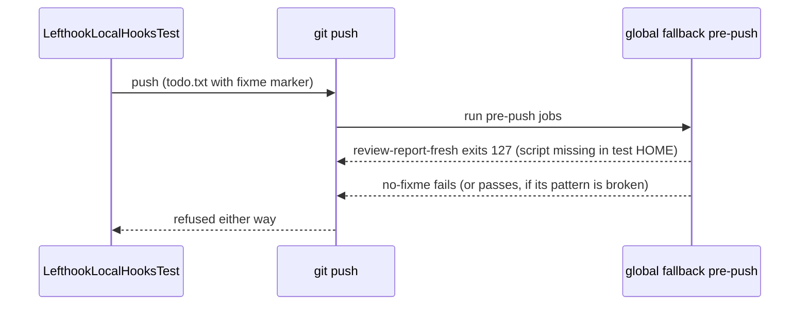
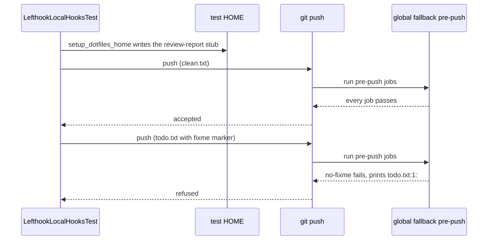

# Plan: The pushed-fixme hook test passes without the fixme check

From `intent.md` (2026-10-21). Status: accepted.

## Design

### Domain terms

The repository has no `GLOSSARY.md`. These terms are not agreed yet; this plan does not write them to a glossary.

- **Global fallback** — the copy of `lefthook.yml` at `~/Developer/dotfiles/lefthook.yml` in the test HOME. The global hook scripts run it in a repository without its own lefthook config.
- **Review-report check** — the pre-push job `review-report-fresh` in `lefthook.yml`. It runs `~/.config/git/worktree-tools/review-report-fresh --skip-without-pr`.
- **Review-report stub** (new) — an executable `#!/bin/sh\nexit 0\n` at `~/.config/git/worktree-tools/review-report-fresh` in the test HOME. `test/lefthook_rubocop_git_gem_test.rb` (`stub_review_report_check`) and `test/branch_guard_test.rb` (`setup_fallback_repo`) already write the same stub.
- **Clean push** (new) — a push whose files hold no fixme marker and no do-not-commit marker.
- **Fixme marker** — the word the `no-fixme` grep searches for. Tests build it as two string halves joined with `+`, so the test file itself passes the hook. Change docs never spell it out, for the same reason.

### Diagrams

Before: the review-report check refuses every push, so the fixme refusal is redundant.



After:



### Signatures

Only `test/lefthook_local_hooks_test.rb` changes. It gets no new method.

`LefthookLocalHooksTest` — runs the global hook scripts through real git commits and pushes in a temporary HOME.

```ruby
# Copies the global fallback into the test HOME, links the markdownlint config and writes the
# review-report stub, so a pre-push runs every other job on its own merits.
#: () -> void
def setup_dotfiles_home            # private, changed: 4 more lines

#: () -> void
def test_pre_push_uses_global_fallback_and_rejects_a_pushed_fixme   # changed: clean push first
```

The implementer adds the `#: () -> void` comment directly above both changed methods, as the `ruby-style` skill requires on personal projects. The rest of the file keeps its current comments.

Not checked: the dotfiles repository has no Steepfile.

### Complexity

No queries. Each test setup writes one more small file. The fixme test runs one more commit and one more real pre-push run, about one second.

### Invariants

- A clean push through the global fallback in the test HOME succeeds. Enforced by the review-report stub in `setup_dotfiles_home`; proved by the clean-push assertion in the fixme test.
- A refused push in the fixme test comes only from the `no-fixme` job. Enforced by the clean push in the same repository just before it, which shows no other job refuses; pinned by the assertion that the output names `todo.txt:1:`.
- The stub lives only in the test HOME. `lefthook.yml` and the hook scripts do not change.

### Alternatives

1. **Inline stub in `setup_dotfiles_home`, clean push as a step of the fixme test** — chosen. Four lines in an existing method, the same inline form as `branch_guard_test.rb`. Every test in the class gets a stowed-like HOME, so a future pre-push test in this class does not fall into the same trap. The pre-commit tests never run pre-push, and the two logging-stub pre-push tests never run lefthook jobs, so no other test changes behaviour.
2. **Helper called only by the fixme test** — rejected. More lines (a method, a call), and it leaves the trap open for the next pre-push test in this class.
3. **Shared `ReviewReportStub` module in `test/review_report_stub.rb`, used by this test, `lefthook_rubocop_git_gem_test.rb` and `branch_guard_test.rb`** — rejected for this change. It removes the stub path from three places, but it edits two test files the intent does not name. Playbook rule 21 sends that orthogonal improvement to its own branch.

## Design decisions

- The clean push is a step inside `test_pre_push_uses_global_fallback_and_rejects_a_pushed_fixme`, not a separate test. The intent requires the clean push "in the same test setup", and the class comment asks each chained test to put its refused step last.
- The refused push also asserts that the output matches `/todo\.txt:1:/`. This pins the refusal to the grep in the `no-fixme` job. Checked on 2026-10-25 in a scratch copy: the assertion passes against the current `lefthook.yml`.
- Inline RBS on the two changed methods only. The `ruby-style` skill requires signatures on methods in personal projects. Annotating the untouched methods is outside this change.
- Intent `## Decisions`: test only, hook behaviour untouched. This plan changes no hook and no `lefthook.yml` line. No conflict.

## Integration points

- `lefthook.yml` pre-push `no-fixme` and `review-report-fresh` jobs, read by the test through the copy in `setup_dotfiles_home`. Read only.
- `git/.config/git/hooks/` through `HookScripts.directory`. Read only.
- The native lefthook from `LefthookBinary.locate`. The test skips without it.

## Files that change

- `test/lefthook_local_hooks_test.rb` — `setup_dotfiles_home` writes the review-report stub; the fixme test commits and pushes `clean.txt` first and asserts success, then pushes the marker file, refutes success and asserts the output names `todo.txt:1:`.

Nothing else changes. `docs/changes/233-the-pushed-fixme-hook-test-passes-without-the-fixme-check/` holds this plan and the intent.

## Order of work

1. Regression test first. In `test_pre_push_uses_global_fallback_and_rejects_a_pushed_fixme`, after `stub_real_lefthook`, add:

   ```ruby
   commit_file("clean.txt", "hello\n")
   _out, _err, status = push
   assert(status.success?, "Expected a clean push to pass the global fallback")
   ```

   Keep the marker commit and push after it. Run `ruby -Itest test/lefthook_local_hooks_test.rb -n test_pre_push_uses_global_fallback_and_rejects_a_pushed_fixme`. Watch it fail on the clean-push assertion, because `review-report-fresh` exits 127. Commit the failing test.
2. In `setup_dotfiles_home`, after the markdownlint symlink, write the stub, and add `#: () -> void` above the method and above the fixme test:

   ```ruby
   stub = File.join(@tmpdir, ".config", "git", "worktree-tools", "review-report-fresh")
   FileUtils.mkdir_p(File.dirname(stub))
   File.write(stub, "#!/bin/sh\nexit 0\n")
   FileUtils.chmod("+x", stub)
   ```

   Run the single test again. It passes.
3. On the refused push, capture `out, err, status = push`, keep the `refute`, then add `assert_match(/todo\.txt:1:/, out + err)`. Run the single test. It passes.
4. Mutation check, in a disposable copy, never in the worktree. Copy `test/`, `lefthook.yml`, `git/` and `markdownlint/` into a fresh scratch directory. In the copy, change the pre-push `no-fixme` pattern in `lefthook.yml` (the fixme marker on the line before `"{push_files}"`) to the marker with an `X` appended, run the single test from the copy, and confirm it fails. Repeat with `NOSUCHMARKER`. Run it once with the unchanged pattern and confirm it passes. Delete the copy. Confirm `git diff lefthook.yml` in the worktree is empty. Record the three runs in the review evidence.
5. Run the whole file: `ruby -Itest test/lefthook_local_hooks_test.rb`. Then the suite: `bin/test`.
6. Lint: `rubocop test/lefthook_local_hooks_test.rb`. Fix every offence without disable comments.
7. Re-read the diff. Only `test/lefthook_local_hooks_test.rb` changes. Commit steps 2 and 3 as the fix.

## Risks

- The stub hides a real regression in `review-report-fresh` from this test. Accepted: `test/review_report_check_test.rb` and `test/review_push_hook_test.rb` cover that script and its `run:` line.
- The stub path is now written in three test files. A move of the script means three edits. The shared module (Alternative 3) is the follow-up, on its own branch.
- A pre-push job added to `lefthook.yml` later that fails on a plain text file in a clean repository breaks the clean-push step. That is the wanted signal: it would also hide the fixme check.
- The repository's own pre-commit `no-fixme` and `no-nocommit` jobs refuse any committed file that spells either marker word, change docs included. Commit messages, `review.md` and other evidence name the mutations without spelling the marker.
- Rejected: changing the hook so `review-report-fresh` skips quietly when the script is missing. The intent puts that in a separate issue.

## Out of scope

- The pre-commit `no-fixme` check and its tests.
- Other pre-push jobs' behaviour.
- The 127 exit of `review-report-fresh` on a machine without the stowed worktree-tools.
- Extracting a shared review-report stub helper for the three test files.
- `test/lefthook_no_fixme_test.rb`.

## Proof

- Changing the pre-push fixme pattern in `lefthook.yml` to the marker with an `X` appended, or to `NOSUCHMARKER`, makes the test fail → `test/lefthook_local_hooks_test.rb` `test_pre_push_uses_global_fallback_and_rejects_a_pushed_fixme`, plus check: order-of-work step 4, both mutated runs fail, the restored run passes.
- A push of a file without the marker succeeds in the same test setup → `test/lefthook_local_hooks_test.rb` `test_pre_push_uses_global_fallback_and_rejects_a_pushed_fixme` (clean-push assertion).
- Invariant: a refused push in the fixme test comes only from `no-fixme`, enforced by the preceding clean push and the `todo.txt:1:` output match → `test/lefthook_local_hooks_test.rb` `test_pre_push_uses_global_fallback_and_rejects_a_pushed_fixme`.
- Regression first: the clean-push assertion fails before the stub exists → check: order-of-work step 1, run watched fail.

Per changed file, the unit tests expected:

- `test/lefthook_local_hooks_test.rb`: no new test; `test_pre_push_uses_global_fallback_and_rejects_a_pushed_fixme` gains the clean push and the output match. Every other test in the file stays green.

Test setup: the existing temporary HOME, bare origin and `stub_real_lefthook`; the review-report stub added in `setup_dotfiles_home`.

---
Domain skills applied: software-design, rails-testing (Minitest conventions), ruby-style.

## Critique

### Round 1 (codex exec -p terra)

- The plan said not to add inline RBS, but the ruby-style skill requires signatures on methods in personal projects → fixed (Signatures, Design decisions and Order of work step 2 now add a void inline RBS signature above both changed methods)
- Restoring the mutated lefthook.yml with git checkout can discard concurrent uncommitted work in the worktree → fixed (Order of work step 4 now runs every mutation in a disposable scratch copy)
