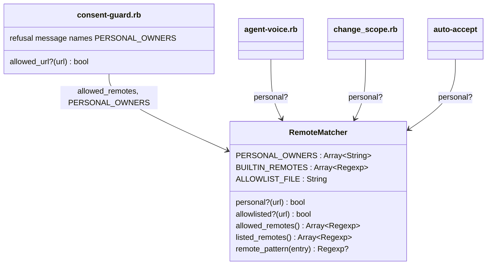

# Plan: Treat `eirvandelden-dev` repositories as personal

From `intent.md` (2026-11-10). Status: accepted.

## Design

### Domain terms

- **Personal repository** (GLOSSARY.md) — the definition changes: a repository whose `origin` is under `github.com:<owner>/` or `github.com/<owner>/` for a personal owner.
- **Personal owner** (new) — a GitHub user or organisation whose repositories are personal: `eirvandelden` and `eirvandelden-dev`. `RemoteMatcher::PERSONAL_OWNERS` holds the list. Avoid: personal account, because `eirvandelden-dev` is an organisation.

### Diagrams



`ghp` (zsh) and the gh-dash "Personal PRs" filter cannot read the Ruby constant. A test holds each of them to `PERSONAL_OWNERS`.

### Signatures

`claude/.claude/hooks/remote_matcher.rb` — `RemoteMatcher`, shared remote matching for the consent guard, agent-voice, change-scope and auto-accept.

```ruby
PERSONAL_OWNERS = %w[eirvandelden eirvandelden-dev].freeze
BUILTIN_REMOTES = PERSONAL_OWNERS.map { |owner| %r{github\.com[:/]#{Regexp.escape(owner)}/} }.freeze

#: (String url) -> bool
def personal?(url)        # unchanged body; now true for both owners
```

The other public methods keep their signatures and bodies.

`claude/.claude/hooks/consent-guard.rb` — one new top-level helper builds the owner part of the refusal text:

```ruby
#: -> String
def personal_owner_globs
  RemoteMatcher::PERSONAL_OWNERS.map { |owner| "#{owner}/*" }.join(", ")
end
```

The refusal renders as `pushing to remote '<remote>' isn't on the unattended allowlist — eirvandelden/*, eirvandelden-dev/*, plus whatever ~/.claude/consent-guard-allowed-remotes.txt lists (playbook rule 19).`

`zsh/.config/zsh/functions/gh.zsh` — `ghp [repo] [path...]`:

```zsh
ghp() {
  local owner=eirvandelden
  if (( $# )) && gh api "repos/eirvandelden-dev/$1" --silent >/dev/null 2>&1; then
    owner=eirvandelden-dev
  fi
  open "https://github.com/$owner/${(j:/:)@}"
}
```

`github/.config/gh-dash/config.yml` — "Personal PRs" filter: `is:open user:eirvandelden user:eirvandelden-dev draft:false`. GitHub ORs repeated `user:` qualifiers, so no `OR` keyword is needed.

Not checked: the dotfiles repository has no Steepfile; signatures stay inline `#:` comments.

### Complexity

- `personal?` and `allowed_remotes`: two regexes instead of one; constant cost per call.
- `ghp <repo>`: one GitHub API call (`gh api repos/eirvandelden-dev/<repo>`) before `open`. Bare `ghp` makes no call.
- No database; no queries.

### Invariants

- A URL is personal only when its owner segment equals a personal owner exactly, followed by `/`. `eirvandelden-devtools/x` and `eirvandeldenx/x` are not personal. Enforced by the trailing `/` in each `BUILTIN_REMOTES` pattern.
- The consent guard matches from the start of the `github.com/<path>` canonical form, so a foreign host that contains a personal path is not allowed. Enforced by `allowed_url?` (unchanged).
- `ghp` never fails to open a page: any lookup failure falls back to `eirvandelden`. Enforced by the `if` in `ghp`.
- `PERSONAL_OWNERS`, the gh-dash filter, `ghp`, the GLOSSARY entry, PLAYBOOK rule 19 and §7a, and the three `settings.json` trust lines name the same owners. Enforced by tests: adding an owner to the constant fails them until each file follows.

### Alternatives

- **A. One regex with an optional suffix**, `%r{github\.com[:/]eirvandelden(-dev)?/}`. Smallest diff. Rejected: the refusal message, gh-dash and `ghp` then spell the owners separately, and nothing ties them together.
- **B. A `PERSONAL_OWNERS` list in `RemoteMatcher`, patterns derived from it (chosen).** One Ruby source for the owners; the guard message reads it; tests tie gh-dash and `ghp` to it. Two more lines than A.
- **C. Personal owners in a data file read by Ruby, zsh and a gh-dash generator.** Rejected: gh-dash reads a static YAML file, so a generator or a template step is new tooling for two owners.

## Design decisions

- `ghp` checks `eirvandelden-dev` first and falls back to `eirvandelden`. The intent says "opens `eirvandelden-dev` when that repository exists, else `eirvandelden`". The check uses `gh api repos/eirvandelden-dev/<repo> --silent`: it exits non-zero on 404, on no network and when `gh` is not signed in, which all fall back as the intent requires. Checked on 2026-11-10: `gh api repos/eirvandelden-dev/clocky --silent` exits 1 (404), `gh api repos/eirvandelden/clocky --silent` exits 0.
- `ghp` calls `gh` by name. Interactive shells route `gh` through the 1Password plugin; the function inherits that, so it uses the same sign-in as every other `gh` call.
- The refusal message lists the owners from `PERSONAL_OWNERS` instead of a literal string, so a third owner later changes one line.
- No conflict with intent's `## Decisions`.

## Integration points

- GitHub REST API through `gh api` (only `ghp`).
- GitHub issue search syntax (gh-dash filter).
- Every caller of `RemoteMatcher`: `consent-guard.rb` (Claude `settings.json` and Codex `config.toml` run the same script), `agent-voice.rb`, `finish/scripts/change_scope.rb` and `change-scope`, `plan/scripts/auto-accept`.

## Files that change

- `claude/.claude/hooks/remote_matcher.rb` — add `PERSONAL_OWNERS`; derive `BUILTIN_REMOTES`; update the header comment.
- `claude/.claude/hooks/consent-guard.rb` — refusal message names every personal owner.
- `zsh/.config/zsh/functions/gh.zsh` — `ghp` picks the owner.
- `github/.config/gh-dash/config.yml` — "Personal PRs" filter takes both owners.
- `GLOSSARY.md` — "Personal repository" names both owners; add "Personal owner".
- `agents/.agents/PLAYBOOK.md` — rule 19 and §7a name both owners (`claude/.claude/PLAYBOOK.md` is a symlink to it; do not touch the link).
- `claude/.claude/settings.json` — the `autoMode.environment` "Source control", "Trusted repo" and "Routine pushes" lines name both owners.
- `agents/.agents/skills/finish/scripts/change-scope`, `agents/.agents/skills/finish/scripts/change_scope.rb`, `agents/.agents/skills/plan/scripts/auto-accept` — header comments only, where they say "Etienne's own GitHub account" (make them say "a personal owner"). No logic change.
- `test/remote_matcher_test.rb` (new) — unit tests of `RemoteMatcher.personal?` and `allowed_remotes`.
- `test/consent_guard_test.rb` — owner-dependent URLs go through one `personal_url(repository)` helper and the fixture origin through `self.class::REPOSITORY`; a subclass `ConsentGuardPersonalOrgTest` overrides both with `eirvandelden-dev`, so every existing case runs for both owners. Plus near-miss owners and the refusal message.
- `test/change_scope_test.rb` — `eirvandelden-dev` origin prints `personal`.
- `test/auto_accept_test.rb` — accepts with an `eirvandelden-dev` origin.
- `test/agent_voice_test.rb` — persona in an `eirvandelden-dev` repository.
- `test/gh_dash_config_test.rb` — expected "Personal PRs" tokens; owners equal `PERSONAL_OWNERS`.
- `test/ghp_test.rb` (new) — `ghp` with PATH stubs for `gh` and `open`.
- `test/personal_owners_parity_test.rb` (new) — the GLOSSARY entry, PLAYBOOK rule 19 and §7a, and the three `settings.json` trust lines each name every owner in `PERSONAL_OWNERS`.

## Order of work

1. Write the consent guard acceptance test: a push to `git@github.com:eirvandelden-dev/clocky.git` exits 0. Run `bin/test test/consent_guard_test.rb`; watch it fail with the allowlist refusal.
2. Route the owner-dependent URLs in `consent_guard_test.rb` through `personal_url` and the fixture through `self.class::REPOSITORY`, with no behaviour change; run the file green. Add `ConsentGuardPersonalOrgTest < ConsentGuardTest` with an `eirvandelden-dev` origin fixture and `personal_url`; watch its push cases fail. Add the near-miss guard tests (`eirvandelden-devtools`, `eirvandeldenx`, a foreign host containing `github.com/eirvandelden-dev/`); they pass already and stay as regression guards.
3. Write `test/remote_matcher_test.rb`; watch the `eirvandelden-dev` cases fail.
4. Change `remote_matcher.rb`: add `PERSONAL_OWNERS`, derive `BUILTIN_REMOTES`. Run steps 1–3 green.
5. Add the `eirvandelden-dev` tests to `change_scope_test.rb`, `auto_accept_test.rb` and `agent_voice_test.rb`; run each file green (they pass through `RemoteMatcher`).
6. Write the refusal-message test (both owners named); change `consent-guard.rb`; run green.
7. Update `gh_dash_config_test.rb` (new tokens; owners equal `PERSONAL_OWNERS`); watch it fail; change `config.yml`; run green.
8. Write `test/ghp_test.rb`; watch it fail; change `gh.zsh`; run green.
9. Write `test/personal_owners_parity_test.rb`; watch it fail. Update the texts: `GLOSSARY.md`, `PLAYBOOK.md` rule 19 and §7a, `settings.json` autoMode lines. Run it green. Update the three script header comments.
10. Run `bin/test`, then `lefthook run pre-commit --all-files` (rubocop, shellcheck-zsh, yamllint, no-hardwrap). Run `git grep -n "eirvandelden/\*\|eirvandelden\` GitHub user"` and confirm no rule text still names only one owner.
11. Verify by hand: `ruby -e 'require "./claude/.claude/hooks/remote_matcher"; p RemoteMatcher.personal?("https://github.com/eirvandelden-dev/appkit.git")'` prints `true`; `zsh -c 'source zsh/.config/zsh/functions/gh.zsh; open() { print -r -- "$*" }; ghp homelab-iac; ghp'` prints the two `eirvandelden` URLs.

## Risks

- GitHub has two issue search modes. Legacy search (GraphQL `type: ISSUE`) ORs repeated `user:` qualifiers; advanced search (`type: ISSUE_ADVANCED`) ANDs them. Checked on 2026-11-10 with two existing owners: `gh api graphql -f query='{ search(type: ISSUE, query: "is:pr is:open user:eirvandelden user:basecamp", first: 100) { issueCount } }'` gives 928 (76 + 852, both owners); the same query with `ISSUE_ADVANCED` gives 0. The installed gh-dash v4.26.2 queries with `type: ISSUE` (found in its binary with `strings`), so the filter works today. If a later gh-dash moves to advanced search, the section shows nothing; the filter then needs `(user:eirvandelden OR user:eirvandelden-dev)` and `test_no_filter_uses_or` needs an exception. Out of scope now. The org has no repositories yet, so the `eirvandelden-dev` half is proven in gh-dash only after the first move (manual check below).
- `ghp` gets slower by one API round trip, and offline it waits for `gh` to fail. Accepted: the intent asks for the lookup.
- A test that runs `ghp` must never reach the real `gh` or `open`. The test runs `zsh -f` with stub `gh` and `open` first on `PATH`.
- Settings text drift: `settings.json` holds free text an auto-mode classifier reads. Change only the three lines named; keep the JSON valid (`ruby -rjson -e 'JSON.parse(File.read("claude/.claude/settings.json"))'`).
- The work allowlist (dotfiles-work) is out of scope and unchanged; `listed_remotes` keeps its behaviour.
- Out of scope: moving repositories, gem source examples in skills, README links, the work allowlist, uncommitted edits in the main checkout.

## Proof

- Push to `git@github.com:eirvandelden-dev/clocky.git` passes the guard → `test/consent_guard_test.rb` `test_pushing_to_a_personal_org_url_is_allowed`
- `https://github.com/eirvandelden-dev/appkit.git` origin → `change-scope` prints `personal` → `test/change_scope_test.rb` `test_the_personal_org_remote_is_personal`
- `auto-accept` flips a plan in an `eirvandelden-dev` repository → `test/auto_accept_test.rb` `test_accepts_an_artifact_in_the_personal_org`
- A session in an `eirvandelden-dev` repository gets a persona → `test/agent_voice_test.rb` `test_a_personal_org_repository_session_gets_a_persona`
- Near-miss owners are not personal → `test/remote_matcher_test.rb` `test_an_owner_that_only_shares_the_prefix_is_not_personal`, and `test/consent_guard_test.rb` `test_pushing_to_a_near_miss_owner_needs_consent`
- Existing guard cases behave the same for `eirvandelden-dev` → `test/consent_guard_test.rb` `ConsentGuardPersonalOrgTest`: it inherits every `ConsentGuardTest` case (origin pushes, explicit URLs, mirror and `-C` remotes, push-URL overrides, force-with-lease, plain-force refusal, compound commands, Codex payloads) and runs each with an `eirvandelden-dev` origin and `personal_url`
- gh-dash "Personal PRs" takes both owners → `test/gh_dash_config_test.rb` `test_personal_section_takes_every_ready_pr_in_my_repositories` and `test_personal_section_names_every_personal_owner`; after the first repository moves → check: open `gh dash` and see a pull request from `eirvandelden-dev/clocky` and one from `eirvandelden/homelab-iac` under "Personal PRs"
- `ghp clocky issues` opens the `eirvandelden-dev` URL when the repo is there → `test/ghp_test.rb` `test_opens_the_personal_org_when_it_has_the_repository`
- `ghp homelab-iac` opens the `eirvandelden` URL → `test/ghp_test.rb` `test_opens_the_user_account_when_the_org_lacks_the_repository`
- Bare `ghp` opens `https://github.com/eirvandelden/` and calls no `gh` → `test/ghp_test.rb` `test_bare_ghp_opens_the_profile_without_a_lookup`
- Lookup failure falls back to `eirvandelden` → `test/ghp_test.rb` `test_a_failed_lookup_opens_the_user_account` (stub `gh` exits 1 with an error on stderr)
- GLOSSARY, PLAYBOOK and the guard message name both owners → `test/consent_guard_test.rb` `test_the_refusal_names_every_personal_owner`, `test/personal_owners_parity_test.rb` `test_the_glossary_names_every_personal_owner`, `test_playbook_rule_19_and_7a_name_every_personal_owner`, `test_the_settings_trust_lines_name_every_personal_owner`
- Invariant: an owner matches only as a whole path segment, enforced by the trailing `/` in `BUILTIN_REMOTES` → `test/remote_matcher_test.rb` `test_an_owner_that_only_shares_the_prefix_is_not_personal`
- Invariant: gh-dash and `ghp` name the same owners as `PERSONAL_OWNERS`, enforced by tests → `test/gh_dash_config_test.rb` `test_personal_section_names_every_personal_owner`, `test/ghp_test.rb` `test_ghp_uses_exactly_the_personal_owners` (the set of the owner `gh` was asked about and the fallback owner in the opened URL equals `PERSONAL_OWNERS`, so a third owner in the constant fails it)

Per changed file, the unit tests expected:
- `claude/.claude/hooks/remote_matcher.rb`: `RemoteMatcher.personal? accepts both owners over ssh and https`, `refuses a near-miss owner`, `refuses a foreign owner`, `allowed_remotes holds a pattern per personal owner plus the listed remotes`.
- `claude/.claude/hooks/consent-guard.rb`: the cases named in Proof.
- `zsh/.config/zsh/functions/gh.zsh`: the four `ghp` cases in Proof, plus `test_passes_the_path_segments_through`.
- `github/.config/gh-dash/config.yml`: the two gh-dash tests in Proof.

Test setup: reuse each test file's existing fixture (`GitFixture`, its temp home, `add_remote`). `ConsentGuardPersonalOrgTest` defines its own `REPOSITORY` fixture with origin `git@github.com:eirvandelden-dev/dotfiles.git`. `test/remote_matcher_test.rb` requires the module directly and sets `HOME` to a temp directory so `listed_remotes` reads no machine allowlist. `test/ghp_test.rb` writes PATH stubs for `gh` (exit 0 or 1, logs its arguments) and `open` (logs its argument) into a temp bin directory and runs `zsh -f -c "source gh.zsh; ghp ..."` with that bin first on `PATH`.

---
Domain skills applied: software-design, glossary, ruby-style, dotfiles-maintenance.

## Critique

### Round 1 (codex gpt-6.1-sol, medium)

- The gh-dash evidence command used `-f` without `-X GET`, and repeated owners are an OR only in legacy search, not in advanced search → fixed (the original check did pass `-X GET`; Risks now cites a GraphQL check with two existing owners in both modes, 928 against 0, and shows the installed gh-dash v4.26.2 uses legacy `type: ISSUE`; the advanced-search risk is named)
- Proof named only four guard cases, not every existing owner-dependent case → fixed (`ConsentGuardPersonalOrgTest` subclasses `ConsentGuardTest` with an `eirvandelden-dev` origin and `personal_url`, so every existing case runs for both owners; Files, Order of work and Proof updated)
- The `ghp` test only checked membership in `PERSONAL_OWNERS`, so a third owner would not fail it → fixed (the test now asserts set equality with `PERSONAL_OWNERS`)
