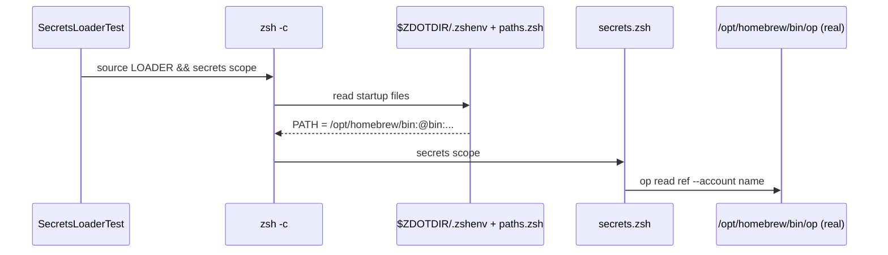
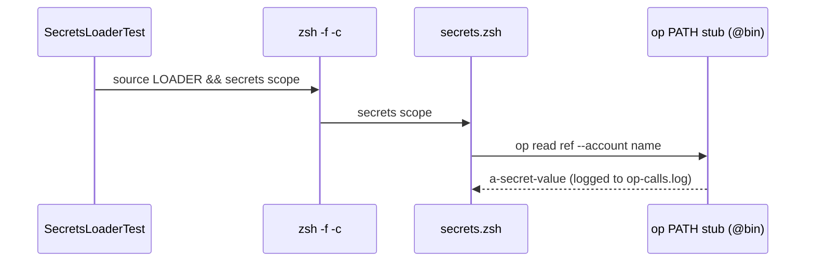
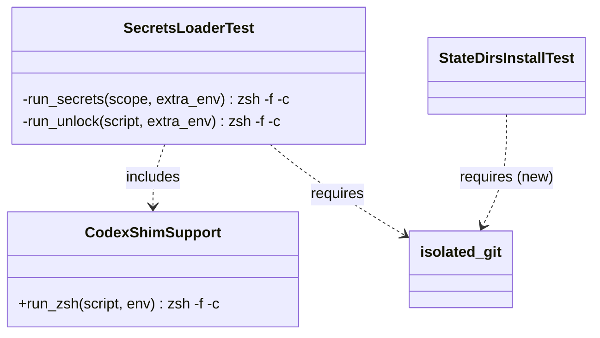

# Plan: Drop conductor from the repo agents file

From `intent.md` (2026-11-13). Status: accepted.

## Design

### Domain terms

- **Repo agents file** (glossary) — the root `agents.md`; `CLAUDE.md` is a symlink to it.
- **PATH stub** (glossary) — the `op` script that `SecretsLoaderTest#stub_op` writes into `@bin`. Not "shim": that word belongs to the unlocked-bin `codex` shim.
- **STOW list** — the `STOW=( ... )` array in `packages.conf`, the source of truth for stow packages. Plan-local; no glossary entry.
- **Helper line** — `require_relative "isolated_git"` on its own line, which every `test/*_test.rb` must hold. Plan-local; no glossary entry.
- **Startup files** — `.zshenv`, `.zprofile` and `.zshrc` under `ZDOTDIR`. zsh reads them unless it gets `-f`. Plan-local; no glossary entry.

### Diagrams

Before: `run_secrets` lets zsh read the startup files, and `paths.zsh` puts `/opt/homebrew/bin` ahead of the PATH stub.



After: `-f` skips the startup files, so the PATH stub stays first.





### Signatures

No public method changes. The one touched method is private, in a test class:

`SecretsLoaderTest` — proves `secrets` and `unlock` against a PATH stub `op`.

```ruby
#: (String scope, ?Hash[String, String?] extra_env) -> [String, String, Process::Status]
def run_secrets(scope, extra_env = {})
  Open3.capture3(env.merge(extra_env), "zsh", "-f", "-c", "source #{LOADER} && secrets #{scope}")
end
```

The inline `#:` comment is optional here; the file has none today, and the change does not add one.

`StateDirsInstallTest` — runs `install/tasks/54_prepare_state_dirs.sh` against a scratch `$HOME`. Gains the helper line as line 6, after `require "tmpdir"`; no method changes.

Not checked: the repository has no `Steepfile`.

### Complexity

Not affected: no new path, no query. Each `run_secrets` call starts one zsh process, as before, and skips the startup files.

### Invariants

- Every `test/*_test.rb` holds the helper line. Enforced by `IsolatedGitTest#test_every_test_file_requires_the_helper`, unchanged.
- Every `op` call in `SecretsLoaderTest` reaches the PATH stub, never a real `op`. Enforced by `-f` on every direct `Open3` zsh launch in the file (`run_secrets`, `run_unlock`, lines 158, 177 and 261). This machine has no `/etc/zshenv`, the one startup file `-f` does not skip. Two nested shells read startup files on purpose and call no `op`: line 156 sources `paths.zsh` and prints `$path[1]`; line 167 runs `unlock` in the `-f` outer shell, then a login shell that runs only `command -v codex`.
- Within one zsh process, every `op` call resolves to the same executable: `secrets.zsh` changes PATH only to prepend `unlocked-bin`, which holds no `op`. So each test proves its process used the stub through one of three signs: a stub entry in `op-calls.log`; the stub's value `a-secret-value` in stdout; or `assert_equal "", op_calls` with no `op` call. A real call fails a success-path test too: the fake references such as `op://Private/token/credential` do not exist in any vault, so the real CLI exits non-zero and `secrets` reports `op read failed`.
- The package line in `agents.md` names exactly the STOW list. Enforced by `RepoAgentsFileTest#test_names_no_package_that_packages_conf_dropped` and `#test_names_every_stow_package`, unchanged.
- `agents.md` stays at or under 40 lines. Enforced by `RepoAgentsFileTest#test_fits_on_one_page`.

### Alternatives

- **Two one-line test edits (chosen).** Add `"-f"` to `run_secrets`; add the helper line to `test/state_dirs_install_test.rb`. Matches `run_unlock` and `CodexShimSupport#run_zsh`, which already pass `-f`. Smallest diff; the intent names exactly these two files.
- **One zsh spawn point plus a guard test (rejected).** Route every zsh call in `SecretsLoaderTest` through a private `capture_zsh`, rename `run_unlock` to `run_loader` at 18 call sites, and add `test/zsh_startup_isolation_test.rb`, which fails on any `zsh -c` without `-f` in `test/*.rb`. It stops the bug class from coming back, but adds a file and about 25 changed lines to a CI-fix chore whose intent names only the two existing files. A good candidate for its own intent.
- **Reset PATH after the startup files run (rejected).** The startup files still run, so a later edit to them can defeat the fix again.
- **Reuse `CodexShimSupport#run_zsh` (rejected).** Its `shell_env` sets `SECRETS_WORK_OP_ACCOUNT=employer`, a fixed `/usr/bin:/bin` PATH and `FAKE_CODEX_LOG`; the secrets tests would inherit codex fixture settings.

## Design decisions

- The `agents.md` edit already landed in commit b4e29224 (`Drop conductor from the repo agents file package list`). This plan keeps it and only re-verifies it.
- Each fix is its own commit: one logical change each (playbook rule 18).
- No conflict with intent's `## Decisions`: the isolated_git require and the secrets loader fix are both folded into this PR, as decided on 2026-11-13; the wider Conductor cleanup stays out.

## Integration points

- `CLAUDE.md` (symlink to `agents.md`) picks up the earlier edit with no edit of its own.
- `zsh/.config/zsh/functions/secrets.zsh` is the code under test; it does not change. It still finds `unlocked-bin` through `ZDOTDIR`, which `env` exports and `-f` does not clear.
- GitHub Actions CI on the fix's pull request and on `main`.

## Files that change

- `test/state_dirs_install_test.rb` — insert `require_relative "isolated_git"` as line 6, after `require "tmpdir"`, at column 0.
- `test/secrets_loader_test.rb` — `run_secrets` (line 370): `"zsh", "-c"` becomes `"zsh", "-f", "-c"`.
- `agents.md` — no further change; commit b4e29224 already removed `` `conductor` ``.

## Order of work

1. Run `bin/test test/isolated_git_test.rb`. Confirm `test_every_test_file_requires_the_helper` fails with `Expected ["state_dirs_install_test.rb"] to be empty.` The regression test exists and does not change.
2. Insert the helper line into `test/state_dirs_install_test.rb`. Run `bin/test test/isolated_git_test.rb test/state_dirs_install_test.rb`; both pass.
3. Commit: `Require isolated_git in the state dirs install test`.
4. Run `which -a op` and confirm `/opt/homebrew/bin/op` exists. Run `bin/test test/secrets_loader_test.rb`. Confirm the 5 `run_secrets` tests fail (lines 35, 45, 54, 64, 186), with the real CLI's `isn't an item in the "Private" vault` error or an empty `op_calls`. This local run is the regression proof; CI has no real `op`.
5. Add `"-f"` to `run_secrets`. Run `bin/test test/secrets_loader_test.rb`; 28 runs, 0 failures.
6. Commit: `Run the secrets loader tests without zsh startup files`.
7. Run `bin/test test/repo_agents_file_test.rb`; all pass.
8. Run `rubocop --force-exclusion test/secrets_loader_test.rb test/state_dirs_install_test.rb`; no offenses.
9. Run `bin/test` in full; every file passes.
10. Run the checks in `## Proof` that have no test name.

## Risks

- A `run_secrets` test might rely on something `.zshenv` sets. Checked: the five tests assert only on `export` lines, `op_calls` and the `SECRETS_WORK_OP_ACCOUNT` warning; none reads `EDITOR`, `LANG`, `TMPDIR` or Homebrew paths. `run_unlock` already calls `secrets` under `-f` and passes.
- The helper line changes git behaviour for `StateDirsInstallTest`. Checked: the step script runs no git; the helper only sets `GIT_*` variables and a temporary template directory.
- Another test file can still start zsh without `-f` later. Accepted for this chore; the guard-test alternative is the follow-up.
- A full `bin/test` failure unrelated to this change keeps the PR red. Playbook rule 25 sends it to its own worktree and pull request.

## Proof

- The package line no longer names `conductor`, and still names every STOW package → `test/repo_agents_file_test.rb` `test_names_no_package_that_packages_conf_dropped` and `test_names_every_stow_package`
- `bin/test test/repo_agents_file_test.rb` passes → check: `bin/test test/repo_agents_file_test.rb`
- `bin/test test/isolated_git_test.rb` passes: every test file requires `isolated_git` → `test/isolated_git_test.rb` `test_every_test_file_requires_the_helper`
- With `/opt/homebrew/bin/op` installed, `bin/test test/secrets_loader_test.rb` passes, and no test reaches the real 1Password CLI → `test/secrets_loader_test.rb` `test_the_work_overlay_is_read_from_the_account_the_environment_names`, `test_secrets_both_without_the_work_account_warns_and_loads_personal`, `test_the_personal_file_is_read_from_the_personal_account`, `test_the_personal_mapping_unlocks_the_home_assistant_gate_token`, `test_the_personal_mapping_resolves_the_journal_assistant_token_from_1password`, each asserting a stub entry in `op_calls` or the stub's exit status; the other 23 tests of the file prove it through the signs in `### Invariants`; plus check: `which -a op` lists `/opt/homebrew/bin/op`, and `grep -nE 'zsh"?,? *"?-c|zsh -c' test/secrets_loader_test.rb` prints nothing
- `bin/test` passes in full → check: `bin/test`
- CI on the fix's pull request is green → check: `gh pr checks <pr>` after `deliver` opens the pull request
- Invariant: `agents.md` stays at or under 40 lines, enforced by `test_fits_on_one_page` → `test/repo_agents_file_test.rb` `test_fits_on_one_page`
- `agents.md` passes the `no-hardwrap` lint → check: `markdownlint --config ~/.config/markdownlint/no-hardwrap.json --rules ~/.config/markdownlint/no-hardwrap.cjs agents.md`

Per changed file, the unit tests expected:
- `test/state_dirs_install_test.rb`: none new; `IsolatedGitTest#test_every_test_file_requires_the_helper` covers it.
- `test/secrets_loader_test.rb`: none new; its five `run_secrets` tests are the regression tests.

Test setup: none new. `SecretsLoaderTest` keeps its scratch `XDG_CONFIG_HOME` and PATH stub `op`; the local regression run needs the real `op` at `/opt/homebrew/bin/op`.

Out of scope: the wider Conductor cleanup (`README.md`, `git/.config/git/worktree-tools/README.md`, playbook rule 22, `docs/plans/worktree-init-hostname.md`, worktree-tools `lib/common.rb`, `lib/config.rb`, `lib/detect.rb` and their tests, the Codex trust entry in `codex/.codex/config.toml`); any change to `packages.conf`, `test/repo_agents_file_test.rb`, `test/isolated_git_test.rb` or the secrets loader (`zsh` package); a guard test against `zsh -c` without `-f`.

---
Domain skills applied: software-design, glossary, diagrams, dotfiles-maintenance.

## Critique

### Round 1 (codex gpt-6.1-sol, medium)

- The invariant claims every zsh spawn uses `-f`, but line 167 runs `zsh -l -c` on purpose, and `-f` still reads `/etc/zshenv` → fixed (the invariant now covers direct `Open3` launches only, names the two nested shells at lines 156 and 167 that call no `op`, and records that this machine has no `/etc/zshenv`)
- The Proof does not show that no test reaches the real 1Password CLI: stub log entries cannot exclude extra real calls, and the grep misses nested shells; a launch trace across all 28 tests is proposed → fixed (a new invariant shows one `op` per zsh process and names the stub-only sign each test asserts; the Proof grep now matches both spellings of a bare `zsh -c`)
  - The process trace itself is not adopted: on macOS it needs `dtrace` or `fs_usage` as root, a system-tool step that playbook rule 8 reserves for Etienne. The per-process argument gives the same guarantee without it.
