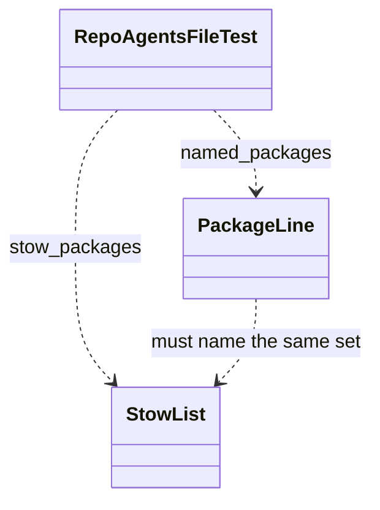

# Plan: Drop conductor from the repo agents file

From `intent.md` (2026-11-13). Status: draft.

## Design

### Domain terms

- **Repo agents file** (glossary) — the root `agents.md`; `CLAUDE.md` is a symlink to it.
- **STOW list** — the `STOW=( ... )` array in `packages.conf`, the source of truth for stow packages. No glossary entry; this plan adds none, because the term lives only in this change.
- **Package line** — line 7 of `agents.md`, `- Packages in \`packages.conf\`: ...`, which `RepoAgentsFileTest#named_packages` parses.

### Diagrams

### Signatures

Not affected: no Ruby code changes; the one edit removes the token `` `conductor` `` and one adjacent space from the package line.

Not checked: no signature changes, and the repository has no `Steepfile`.

### Complexity

Not affected: the test still reads two files and takes a set difference.

### Invariants

- The package line names every STOW package, in STOW order. `test_names_every_stow_package` only checks that each name appears in backticks anywhere in `agents.md` (`rubocop` also appears in the linter line), so the package-line check in `## Proof` enforces it for this change.
- The package line names no package outside the STOW list. `test_names_no_package_that_packages_conf_dropped` enforces it; it fails today with `Expected ["conductor"] to be empty.`
- `agents.md` stays at or under 40 lines. `test_fits_on_one_page` enforces it; the line count does not change.

### Alternatives

- **Delete `conductor` from the package line (chosen).** One token, one file. After the edit the list also matches the STOW order exactly.
- **Drop the inline list and point at `packages.conf` (rejected).** `test_names_every_stow_package` fails and `named_packages` raises `NoMethodError` on nil, so it needs a test change, which the intent forbids.
- **Generate the list from `packages.conf` with a script and a lefthook hook (rejected).** New machinery the intent does not ask for.

## Design decisions

- Keep the STOW order in the package line. The test compares sets, so order is free; the STOW order makes the list easy to compare by eye.
- No conflict with intent's `## Decisions`: this is the CI fix only, the wider Conductor cleanup stays out.

## Integration points

- `CLAUDE.md` (symlink to `agents.md`) picks up the edit with no edit of its own.
- GitHub Actions CI on the fix's pull request and on `main`; PRs #286 and #287 rebase onto it after it merges.

## Files that change

- `agents.md` — remove `` `conductor` `` from the package line (line 7).

## Order of work

1. Run `bin/test test/repo_agents_file_test.rb` and confirm `test_names_no_package_that_packages_conf_dropped` fails with `Expected ["conductor"] to be empty.` The regression test already exists and is not changed.
2. Edit line 7 of `agents.md`: delete `` `conductor` `` and one adjacent space.
3. Run `bin/test test/repo_agents_file_test.rb`; all 9 tests pass.
4. Run `bin/test` in full; every file passes.
5. Run the package-line check from `## Proof`; it exits 0.
6. Run `markdownlint --config ~/.config/markdownlint/no-hardwrap.json --rules ~/.config/markdownlint/no-hardwrap.cjs agents.md` directly and require exit 0. The `no-hardwrap` lefthook job ends in `exit 0`, so the commit hook cannot prove the lint passed.
7. Commit with one logical change: `Drop conductor from the repo agents file package list`.

## Risks

- A full `bin/test` failure unrelated to this change would keep CI red. It must be fixed in its own worktree and pull request (playbook rule 25), not bundled here.
- The list stays hand-copied from `packages.conf`; a later STOW edit can break the test again. The test catches it only in CI or a manual `bin/test`: the lefthook pre-push Minitest job runs only for `app/**/*.rb`, so no hook runs `RepoAgentsFileTest` or `bin/test`. Accepted: a guard is out of scope.

## Proof

- The package line no longer names `conductor`, and still names every STOW package → `test/repo_agents_file_test.rb` `test_names_no_package_that_packages_conf_dropped` and `test_names_every_stow_package`
- `bin/test test/repo_agents_file_test.rb` passes, and `bin/test` passes in full → check: `bin/test test/repo_agents_file_test.rb && bin/test`
- The package line equals the STOW list, in order → check: `` ruby -e 'line = File.read("agents.md")[/^- Packages in `packages\.conf`: (.*)$/, 1].scan(/`([^`]+)`/).flatten; stow = File.read("packages.conf")[/^STOW=\((.*?)^\)/m, 1].lines.map { _1.sub(/#.*/, "").strip }.reject(&:empty?); abort "#{line - stow} / #{stow - line}" unless line == stow' ``
- `agents.md` passes the `no-hardwrap` lint → check: `markdownlint --config ~/.config/markdownlint/no-hardwrap.json --rules ~/.config/markdownlint/no-hardwrap.cjs agents.md`
- CI on the fix's pull request is green → check: `gh pr checks <pr>` after `deliver` opens the pull request
- Invariant: `agents.md` stays at or under 40 lines, enforced by `test_fits_on_one_page` → `test/repo_agents_file_test.rb` `test_fits_on_one_page`

Per changed file, the unit tests expected:
- `agents.md`: none new; the existing `RepoAgentsFileTest` covers it.

Test setup: none; the test reads the real `agents.md` and `packages.conf` in the repository root.

Out of scope: Conductor text in `README.md`, `git/.config/git/worktree-tools/README.md`, playbook rule 22 and `docs/plans/worktree-init-hostname.md`; Conductor support in worktree-tools `lib/common.rb`, `lib/config.rb`, `lib/detect.rb` and their tests; the Codex trust entry in `codex/.codex/config.toml`; any change to `packages.conf` or `test/repo_agents_file_test.rb`.

---
Domain skills applied: software-design, glossary, diagrams, dotfiles-maintenance.

## Critique

### Round 1 (codex gpt-6.1-sol, medium)

- The lint step relies on the commit hook, but the `no-hardwrap` job in `lefthook.yml` ends in `exit 0` and skips when tools are missing, so it cannot prove lint success → fixed (Order of work step 6 and a Proof line run markdownlint directly and require exit 0)
- The Risks section says `lefthook.yml` runs no tests, but its pre-push hook runs Minitest and RSpec for matching application files → fixed (Risks now says no hook runs `RepoAgentsFileTest` or `bin/test`, because the Minitest job matches only `app/**/*.rb`)
- The Invariants section says `test_names_every_stow_package` enforces package-line completeness, but it searches the whole file, so a name elsewhere (such as `rubocop` in the linter line) hides an omission → fixed (Invariants describe the test accurately; a read-only package-line check in Proof and Order of work step 5 compares the parsed line with STOW, and the test stays unchanged)
