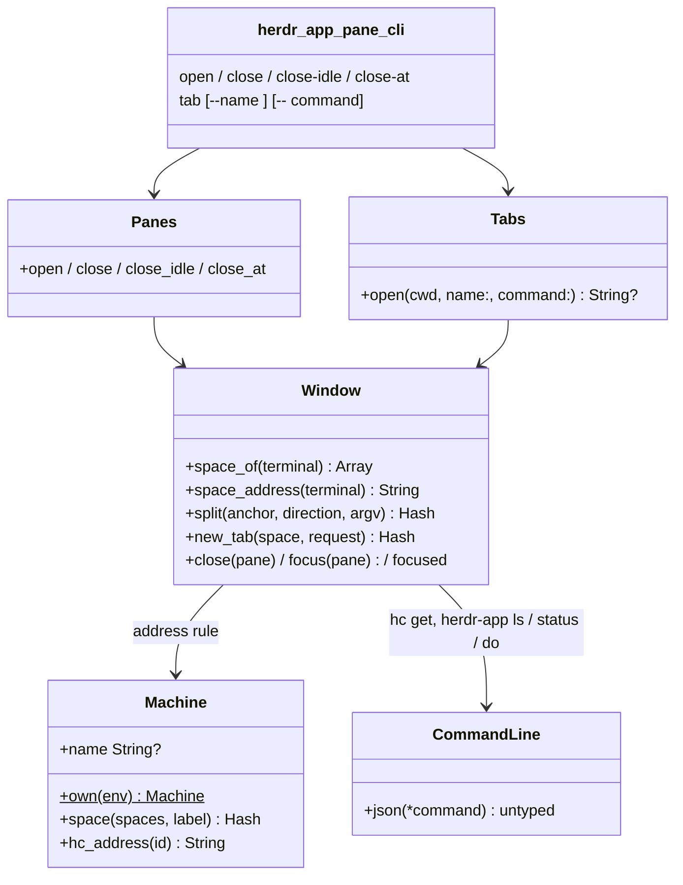
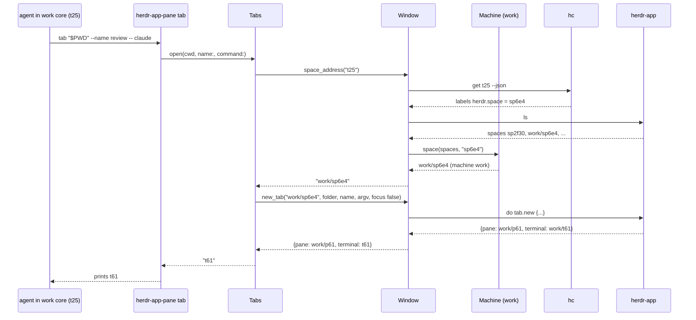

# Plan: Agents open herdr-app tabs in their own core

From `intent.md` (2026-11-19). Status: accepted.

## Context

An agent that opens a herdr-app tab today lands in the focused space, or reaches for the herdr TUI or the stale skills of the old app. `herdr-app-pane open`, `close`, `close-idle` and `close-at` also refuse from a terminal in the `work` core. This change teaches the `herdr-app-pane` library the address rule of herdr-app once, so every command works from both cores. It adds one command, `herdr-app-pane tab`, that opens a tab in the space of the agent's own terminal, and one skill, `herdr-app-tabs`, that tells agents to use it and nothing else.

This plan replaces the plan of commit `0b797d96`. That plan left the work-core refusal out of scope; `intent.md` now puts it in scope.

Facts verified live on 2026-11-19 (herdr-app with herdr-core 0.1.21):

- `herdr-app ls` lists default-core spaces, tabs, terminals and panes with bare ids (`sp2f30…`, `t3t`, `p36b8…`, `machine: null`). It lists every work-core id with a `work/` prefix (`work/sp6e4…`, `work/tb a18…`, `work/t25`, `work/pc209…`, `machine: "work"`).
- A work-core terminal carries `HC_SESSION=work`, `HC_TERMINAL_ID=t25` (bare) and `HC_TERMINAL_SOCKET=~/.local/state/herdr-core/work/work.sock`. `hc get "$HC_TERMINAL_ID" --json` from that terminal reaches the work core and answers `labels["herdr.space"] = "sp6e4…"`, bare.
- A default-core terminal has no `HC_SESSION`; its socket is `…/herdr-core/default/default.sock`; its `herdr.space` label equals its `herdr-app ls` space id.
- `Window#space_of` in `herdr-app/.local/share/herdr-app-pane/panes.rb` matches the bare label against the listed ids exactly. From a work-core terminal no id matches, so every `Panes` command refuses ("herdr-app lists no space for t25"). Past that, `Panes` compares listed terminal ids (`work/t25`) with the bare `HC_TERMINAL_ID`, and `await_agent` would send `hc get work/t61`; both fail too.
- The pipeline scripts (`hand-off-plan.sh`, `start-review.sh`) pass and receive hc addresses: the coordinator is `$HC_TERMINAL_ID`, and the printed terminal goes to `hc send`. Row records hold hc addresses (`GLOSSARY.md`, "Row record").
- `herdr-app do tab.new` takes `name`, `space`, `folder`, `argv`, `task`, `mod`, `props` and `focus`. It has no `machine` argument. Without `space` it uses the selected space, which is the cause of the wrong-core tabs. `focus: false` adds the tab last in its space and keeps the shown space. `space.new` takes `machine` and `focus`; `space.close` and `tab.close` take `id` and `confirmed`.
- herdr-app has no browser or web-page command.
- `~/.local/bin/herdr-app-pane` is a stow link into the main checkout (`~/Developer/dotfiles/herdr-app/.local/bin/herdr-app-pane`), not into this worktree. Agents get the changes once the branch is merged into main, with no stow run. Until then, run this worktree's copy by its absolute path; it loads its library relative to itself.
- The `work` machine's name equals its session name, `work`: `install/tasks/27_register_work_core.sh` registers it with `--name work --session work`.
- Two existing tests, `test_open_refuses_a_space_id_listed_on_two_machines` and `test_close_idle_closes_nothing_when_the_space_id_is_ambiguous` (`test/herdr_app_panes_test.rb`), list the bare id `sp0` on machine `null` and on machine `work`. herdr-app no longer lists a work space with a bare id.

## Design

### Domain terms

From `GLOSSARY.md`: **Core**, **Machine**, **Space**, **Personal space**, **Work space**, **herdr-app**, **herdr TUI**, **Row record**.

New terms, written into `GLOSSARY.md` by the implement stage (step 12):

- **herdr-app address** — the id `herdr-app ls` and `herdr-app do` use for a space, tab, pane or terminal; outside the `default` core it carries a `<machine>/` prefix, such as `work/t25`. Avoid: global id.
- **hc address** — the id the own core's `hc` uses for the same object, never prefixed, such as `t25`: the part of a herdr-app address after its last `/`. Avoid: local id.
- **Own core** — the core the agent's terminal runs in: `HC_SESSION`, `default` when unset. Its machine is null for `default` and the core's name otherwise.
- **Own space** — the space that holds a terminal of the own core: the one listed space on the own core's machine whose hc address is that terminal's `herdr.space` label. Avoid: current space, focused space.

The intent says "Herdr UI" for the old app. `GLOSSARY.md` lists "Herdr UI" as a word to avoid. The skill never uses it; it names the stale skills (`herdr-gpui-browser`, `herdr-automations`), `herdr-automate` and `HERDR_ENV` instead.

### Diagrams

Before: `Window#space_of` matches the label against listed ids exactly and answers listed rows as they are; `Panes` compares their `work/`-prefixed terminals with bare hc addresses; there is no tab path.

After:





The `Panes` paths run the same lookup through `Window#space_of`, which answers the space's rows with each `terminal` as an hc address and each `pane` as a herdr-app address.

### Signatures

`herdr-app/.local/share/herdr-app-pane/machine.rb` — new. `HerdrAppPane::Machine`: the own core's machine as herdr-app shows it, and the one owner of the address rule between herdr-app addresses and hc addresses. Sends no command.

```ruby
# The machine of HC_SESSION; an empty or unset HC_SESSION, or "default", is this computer.
#: (?Hash[String, String] env) -> Machine
def self.own(env = ENV)

# name: nil for this computer (the default core), else the core's name.
#: (String? name) -> void
def initialize(name)

# The name herdr-app lists as a space's "machine": nil for this computer.
#: -> String?
def name

# The one listed space on this machine whose hc address is label. Refuses when none, or more than one,
# matches; a space of another machine never matches.
#: (Array[Hash[String, untyped]] spaces, String? label) -> Hash[String, untyped]
def space(spaces, label)

# The part of a herdr-app address after its last "/"; an hc address answers itself.
#: (String id) -> String
def hc_address(id)
```

`HerdrAppPane::Window` (in `panes.rb`, which stays the only sender of `herdr-app ls` and `herdr-app do`) changes:

```ruby
#: (?CommandLine command_line, ?machine: Machine) -> void
def initialize(command_line = CommandLine.new, machine: Machine.own)

# The terminals listed in the own space of terminal, across its tabs: {"terminal","pane","status","app",...},
# "terminal" as an hc address, "pane" as a herdr-app address. Refuses as Machine#space does.
#: (String terminal) -> Array[Hash[String, untyped]]
def space_of(terminal)

# The herdr-app address of the own space of terminal.
#: (String terminal) -> String
def space_address(terminal)

# Answers {"pane","terminal"} of the new pane, the terminal as an hc address.
#: (String anchor, String direction, Array[String] argv) -> Hash[String, String]
def split(anchor, direction, argv)

# Sends tab.new for space with request ("folder", "name", "argv", "focus") and answers {"pane","terminal"},
# the terminal as an hc address, nil when herdr-app names none.
#: (String space, Hash[String, untyped] request) -> Hash[String, String?]
def new_tab(space, request)
```

`shows?`, `shell_at?`, `await_agent`, `focused`, `focus` and `close` keep their signatures. Terminal arguments are hc addresses; pane arguments are herdr-app addresses, opaque to `Panes`.

`HerdrAppPane::Panes` — one change: `initialize` takes `window: Window.new` in place of `command_line:`, so it keeps four parameters and a test injects `Window.new(fake, machine: Machine.new("work"))`. Its methods and their comparisons stay as they are: they already compare hc addresses, and now `Window` hands them hc addresses.

```ruby
#: (?own: String, ?coordinator: String?, ?common_dir: String?, ?window: Window) -> void
def initialize(own: ENV.fetch("HC_TERMINAL_ID"), coordinator: ENV.fetch("HERDR_APP_COORDINATOR", nil),
               common_dir: nil, window: Window.new)
```

`herdr-app/.local/share/herdr-app-pane/tabs.rb` — new. `HerdrAppPane::Tabs`: opens a herdr-app tab in the own space, whatever space has focus.

```ruby
#: (?own: String, ?window: Window) -> void
def initialize(own: ENV.fetch("HC_TERMINAL_ID"), window: Window.new)

# Opens a tab in the own space, rooted in cwd, named name when given, running command (herdr-app's default
# shell when empty), with focus false; answers the hc address of its terminal, or nil when herdr-app names
# none. Raises Refusal when the own space is not listed exactly once.
#: (String cwd, ?name: String?, ?command: Array[String]) -> String?
def open(cwd, name: nil, command: [])
```

`herdr-app/.local/bin/herdr-app-pane` — the CLI. One new arm: `tab <cwd> [--name <name>] [-- <command>...]`. Bad arguments exit 1 with the usage before any herdr-app or hc call, as today. `parse` answers a lambda for each arm; the `tab` arm's lambda builds a `Tabs`, the others a `Panes`, after the `HC_TERMINAL_ID` check as today.

```ruby
# Answers the cwd and the keywords of Tabs#open.
#: (Array[String] arguments) -> [String, Hash[Symbol, untyped]]
def tab_arguments(arguments)

# Prints the new tab's terminal address; refuses when herdr-app names none.
#: (String cwd, Hash[Symbol, untyped] options) -> ^(HerdrAppPane::Tabs) -> void
def tab_call(cwd, options)
```

`CommandLine`, `RowRecord`, `Terminal`: not affected.

Not checked: the dotfiles repository has no Steepfile.

### Complexity

- `herdr-app-pane tab`: three external calls whatever the number of spaces — one `hc get`, one `herdr-app ls`, one `herdr-app do tab.new`. No `herdr-app status`: the focused space is never read. In memory: O(spaces) to find the own space.
- `Panes` paths: the same call counts as today, in both cores. The address rule adds O(rows of the own space) string work per `space_of`.

### Invariants

1. Every space `Window` resolves is on the own core's machine, and its hc address is the terminal's `herdr.space` label: `work/<id>` for a work-core terminal, the bare id for a default-core one. A space with the same hc address on another machine never matches. Enforced by `Machine#space`.
2. No `tab.new`, `pane.split` or `pane.close` goes out unless exactly one listed space on the own machine matches. Enforced by `Machine#space`, which raises `Refusal` first.
3. Every `tab.new` that `Tabs` sends names a `space`, so the focused space never picks the target. Enforced by `Tabs#open`, which only reaches `Window#new_tab` with the result of `Window#space_address`.
4. Nothing outside `Window` sees a herdr-app terminal address: `space_of`, `split` and `new_tab` answer terminals as hc addresses, so the printed terminal, the row record and every `hc` call use hc addresses. Pane addresses go back to herdr-app unchanged. Enforced by `Window` through `Machine#hc_address`.
5. Among the pipeline files, only `panes.rb` sends `herdr-app ls` or `herdr-app do`. Enforced by keeping all calls in `Window`; the existing `HerdrAppCommandOwnerTest` globs `herdr-app-pane/*.rb`, so it covers `machine.rb` and `tabs.rb`.
6. The skill never offers the herdr TUI, `HERDR_ENV` or a command of the stale skills. Enforced by the skill text and its test.

### Alternatives

- **A. Skill-only shell recipe, plus a minimal `space_of` patch**: the skill holds an `hc get | jq` plus `case "$HC_SESSION"` recipe that builds the space id and calls `herdr-app do tab.new`; `Window#space_of` strips the prefix before it compares, and `Panes` strips it before each terminal comparison. Rejected: the address rule then lives in Markdown and in four places in `Panes`, and a code-fence test is fragile (connascence of position).
- **B. Strip the prefix in `Window`, with no own core** (architect "smallest change"): a private `bare(id)` in `Window`; `space_of` matches spaces whose stripped id equals the label, and answers stripped terminals; `Panes` and its constructor do not change. Rejected: `Window` never knows which core it serves, so a space id shared by two cores refuses instead of picking the own one, and the tab path would inherit that guess. It also keeps the two unrealistic fixtures. Knowing the machine costs one small class and one keyword.
- **B2. Translate at every `Panes` comparison**: `Panes` keeps herdr-app addresses and compares `"#{prefix}#{@own}"`. Rejected: `Panes` (166 lines) grows, the prefix rule spreads over five methods, and `hc get` then needs the reverse translation.
- **C. One address boundary in `Window`, the rule in `Machine`, a `Tabs` class beside `Panes`** — chosen. The rule lives once, in `Machine`; `Window` translates at its boundary, so `Panes` only swaps `command_line:` for `window:`; agents get one command for tabs. Both architects reached this boundary; the "one address boundary" architect supplied the `Machine` name and the `window:` injection.

## Design decisions

- The intent's in-scope line names `herdr-app do … --machine <own core>`. `tab.new` has no `machine` argument, so the tool passes `space` instead. The behaviour agreed in intent (own core, not focused space) is unchanged.
- The own core comes from `HC_SESSION`, `default` when unset (`Machine.own`). A work-core terminal carries `HC_SESSION=work`; a default one carries none. `HC_TERMINAL_SOCKET` is not parsed: one source is enough, and `herdr-app-agents` keeps its own socket rule. `Machine#space` matches both the machine and the hc address, so a space of another core never qualifies. This relies on machine name equal to session name, which `27_register_work_core.sh` sets; a mismatch refuses, it never opens in the wrong core.
- The two existing tests that list the bare id `sp0` on two machines move to the shape herdr-app lists today (`sp0` and `work/sp0`). From a default terminal, `open` now picks `sp0`, and `close_idle` closes the default pane, rather than refusing. A new fixture lists the same hc address twice on the own machine, and the refusal is proven there. In the live herdr-app this changes nothing for a default terminal: its label never matched a `work/` id before, and does not now.
- `Window` keeps pane addresses as herdr-app addresses: `Panes` only hands them back to herdr-app (`pane.split`, `pane.close`, `pane.focus`), so they need no translation.
- `Tabs` sends `focus: false`. A tab an agent opens does not pull Etienne away from what he looks at. The skill says to tell Etienne the tab's name.
- `Tabs` passes `folder` and `argv` to `tab.new`, not the `sh -c` rooted wrapper of `Panes`: `tab.new` takes a folder of its own.
- The harness keys `hc get` answers by herdr-app address (`t20` in the default core, `work/t20` in the work core), and the `hc` stub builds that key from `HC_SESSION` and the hc address it is asked for. Existing worlds keep their bare keys and need no change.
- Glossary terms go in at implement time (step 12), because this plan stage touches only `plan.md`.
- No conflict with intent's `## Decisions`: the tab opens in the own core, the work-core refusal is fixed in this change, and delivery stays autonomous with no Codex review.

## Integration points

- herdr-app `herdr-app ls`, `herdr-app status` and `herdr-app do tab.new`, `pane.split`, `pane.close`, `pane.focus` (the shape of the `tab.new` answer is probed in step 1).
- herdr-core `hc get <terminal> --json` of the own core.
- The pipeline scripts `hand-off-plan.sh`, `start-review.sh`, `open-pr-dash.sh`, `deliver` and `worktree-pane` call `herdr-app-pane`; their arguments and the printed terminal stay hc addresses. They do not change.
- `~/.local/bin/herdr-app-pane`, a stow link into the main checkout: reaches agents after merge.
- Claude and Codex skill loading: `agents/.agents/skills/<name>/` with `agents/openai.yaml`, linked from `claude/.claude/skills/<name>`.

## Files that change

- `herdr-app/.local/share/herdr-app-pane/machine.rb` — new `HerdrAppPane::Machine`.
- `herdr-app/.local/share/herdr-app-pane/panes.rb` — `Window` takes `machine:`, finds the space through `Machine#space`, answers hc terminal addresses from `space_of` and `split`, gains `space_address` and `new_tab`; `Panes#initialize` takes `window:` in place of `command_line:`; `require_relative "machine"`; class comment of `Window` updated.
- `herdr-app/.local/share/herdr-app-pane/tabs.rb` — new `HerdrAppPane::Tabs`.
- `herdr-app/.local/bin/herdr-app-pane` — `tab` arm, `tab_arguments`, usage line, header comment.
- `test/herdr_app_harness.rb` — `World#split` and a new `World#tab_new` prefix new ids with the target space's machine (`work/p61`, `work/t61`) and store the hc answer under that herdr-app address; the `hc` stub and `FakeCommandLine` look answers up under `<HC_SESSION>/<address>` outside `default`; `FakeCommandLine.new(state, calls, core: "default")`; `CLEARED_ENV` gains `HC_SESSION`; `herdr_app_env` takes `core:`; header documents the address rule and the `tab.new` shape; fixture `work_world(cwd:)`.
- `test/herdr_app_machine_test.rb` — new, unit tests of `Machine`.
- `test/herdr_app_tabs_test.rb` — new, unit tests of `Tabs` and `Window#space_address` / `#new_tab`.
- `test/herdr_app_panes_test.rb` — the two fixture moves above; new work-core tests for `open`, `close`, `close_idle` and `close_at`; the `panes` helper builds a `Window` with a `Machine` and passes `window:`.
- `test/herdr_app_pane_cli_test.rb` — acceptance tests of `tab` from both cores, of `open` and `close` from a work terminal; bad-argument cases for `tab`.
- `agents/.agents/skills/herdr-app-tabs/SKILL.md` — new skill.
- `agents/.agents/skills/herdr-app-tabs/agents/openai.yaml` — new.
- `claude/.claude/skills/herdr-app-tabs` — new relative link to `../../../agents/.agents/skills/herdr-app-tabs`.
- `test/herdr_app_tabs_skill_test.rb` — new, skill-content tests.
- `SKILLS-INDEX.md` — one line under "Working with git and pull requests" or the section that lists the pipeline tools.
- `GLOSSARY.md` — four terms (step 12).

## Order of work

1. Probe the `tab.new` answer in a sandbox: a scratch `HERDR_APP_HOME` (short path, for SUN_LEN) and a scratch core (`HC_SESSION=tabprobe`), both set on every probe command under `env -i`; never the `default` or `work` core; stop the sandbox by pid, never `app.quit`; never `hc server status` without the scratch `HC_SESSION`, which would start a core. Run `herdr-app do tab.new '{"space":"<id>","folder":"/tmp","focus":false}'`, then `herdr-app ls`. Record the answer shape in the harness header. If it lacks `terminal`, `Window#new_tab` answers `"terminal" => nil` and `Tabs#open` answers nil; the CLI refuses with exit 1 and one stderr line.
2. Harness: the address rule in `World` (prefixed ids for new panes and terminals in a machine's space, hc answers stored and looked up by herdr-app address, the core from `HC_SESSION` or `FakeCommandLine`'s `core:`), `World#tab_new`, `CLEARED_ENV`, `herdr_app_env(core:)`, `work_world(cwd:, work_cwd:)`: personal space `sp2` with agent `t20`/`p20` and shell `t11`/`p11`, hc answers labelled `sp2`, folder `cwd`; work space `work/sp3` (machine `work`) with agent `work/t20`/`work/p20` and shell `work/t11`/`work/p11`, hc answers labelled `sp3`, folder `work_cwd`; and a decoy work space `work/sp2` with agent `work/t30`/`work/p30`. Both cores reuse the hc addresses `t20` and `t11`, but with different labels, folders and statuses (the work shell is the only one at `work_cwd`). So a test that asks the wrong core gets the wrong label and folder, and a match without the machine meets the decoy; either fails. Every `hc` call the harness logs is asserted to carry no `/`. Run `bin/test test/herdr_app_panes_test.rb test/herdr_app_pane_cli_test.rb test/herdr_app_worker_scripts_test.rb test/herdr_app_open_pr_dash_test.rb`: still green.
3. Write the work-core acceptance tests in `test/herdr_app_pane_cli_test.rb` (`open` and `close` from `work/t20`'s terminal), run them, watch them fail on "herdr-app lists no space for t20".
4. Write `test/herdr_app_machine_test.rb`; move the two fixtures and add the work-core tests in `test/herdr_app_panes_test.rb`; watch them fail.
5. Add `machine.rb`; change `Window` and `Panes#initialize`, and the `panes` helper. Run steps 3–4 green, then the whole `herdr_app_*` set.
6. Write the two `tab` acceptance tests in `test/herdr_app_pane_cli_test.rb`; watch them fail on the missing `tab` arm.
7. Write `test/herdr_app_tabs_test.rb`; watch it fail.
8. Add `Window#space_address` and `#new_tab`, `tabs.rb` and the CLI arm. Run steps 6–7 green.
9. Write `test/herdr_app_tabs_skill_test.rb`; watch it fail.
10. Add the skill, its `openai.yaml`, the Claude link and the `SKILLS-INDEX.md` line. The skill says: inside herdr-app (`HC_TERMINAL_ID` set), open a tab with `herdr-app-pane tab "<folder>" --name "<name>" [-- <command>...]`; it opens in the own space, in the own core, whatever has focus; tell Etienne the tab's name. Panes beside the agent come from `herdr-app-pane open`. Outside herdr-app, open no tab. Never: `herdr pane`, `herdr tab`, `HERDR_ENV`, `herdr-automate`, the `herdr-gpui-browser` and `herdr-automations` skills, a bare `herdr-app do tab.new` without `space`. herdr-app has no browser tab: give Etienne the URL or file path instead. The skill also states the own core: `HC_SESSION=work` is the work core; unset, empty or `default` is the personal core; `herdr-app-pane` reads it itself, so the agent passes no core or space. Run step 9 green and `test/skill_parity_test.rb`.
11. `bin/test` (full suite), `rubocop` on touched Ruby, markdownlint on touched Markdown.
12. Add the four glossary terms to `GLOSSARY.md` in their own commit.
13. Live check (rule 22), with this worktree's executable by absolute path (`<worktree>/herdr-app/.local/bin/herdr-app-pane`), not the installed link. Make one scratch space per core with `herdr-app do space.new '{"machine":"work","name":"probe-work","folder":"/tmp","focus":false}'` and the same with `"machine":""` and `probe-default`; read their terminals and hc addresses from `herdr-app ls`. Focus a space of the other core first. For each scratch terminal, run the worktree executable with that terminal's environment (`HC_TERMINAL_ID=<hc address>`, `HC_SESSION=work` and the work socket for the work one; no `HC_SESSION` and the default socket for the default one): `tab /tmp --name probe-tab`, then `open /tmp --unlisted`, then `close <printed terminal>`. Confirm with `herdr-app ls` and `herdr-app status` that the tab and the pane sat in the scratch space of the right core, that focus stayed put, and that `close` removed the pane. Close both scratch spaces with `space.close` and `"confirmed":true`. Record the evidence for delivery. Round 2 evidence, 2026-11-19, worktree executable, scratch spaces `probe-work` and `probe-default` (both closed afterwards). Work core, terminal `t2p`: `tab` printed `t2q` and added a second tab to `probe-work` only; `close t2q` removed that tab, `work/t2p` stayed. Default core, terminal `t132`: `tab` printed `t133` in `probe-default`; `close t133` removed it. `herdr-app status` `focused_pane` stayed `work/p7cfdb3b738f8170e45225ed60176a043` before and after both `tab` calls. That pane sat in a work space, so for the default core focus sat in the other core; for the work core it sat in another work space, not a personal one.

## Risks

- The `tab.new` answer shape is unverified; step 1 probes it before any code. `Tabs`' interface does not change with the shape.
- `pane.split`, `pane.close` and `pane.focus` with a `work/` pane address are unverified live; `herdr-app ls` lists those addresses, so they are herdr-app's own. Step 13 proves them.
- `focus: false` may still move focus in some herdr-app version; step 13 shows it. A fix would restore focus like `Panes#split` does; not planned.
- The address rule (`<machine>/<hc address>`) is herdr-app's convention, verified live today; `Machine` is the only place that knows it.
- `Window` grows to about 95 lines, near the class-size limit; the address rule sits in `Machine` to keep it there. `Panes` stays at 166 lines, over the limit already; this change adds one keyword.
- The two moved fixtures change what two existing tests assert. The refusal they proved stays proven, within one machine.
- `close_idle` and `close_at` now close panes from a work terminal that they refused to touch before. Their filters (own, coordinator, intent terminals; agent status; real cwd) are unchanged and get work-core tests.
- A row record holds hc addresses only, and its path names only the slug, so it does not say which core wrote it. A change whose row ran in one core and then in the other could see a foreign `t61` match an own-space terminal. One change runs under one coordinator, in one space, and `Machine#space` limits every match to the own space, so this needs the same slug driven from both cores. Not fixed here (critique round 1).
- Out of scope, unchanged: the herdr TUI stays installed; the stale skills stay until Etienne trashes them; the pipeline scripts.

## Proof

- An agent in the `work` core that opens a tab gets it in the `work` core, while the personal space has focus → `test/herdr_app_pane_cli_test.rb` `test_tab_from_the_work_core_opens_in_the_work_space_while_a_personal_space_has_focus`
- An agent in the `default` core that opens a tab gets it in the `default` core, while the work space has focus → `test/herdr_app_pane_cli_test.rb` `test_tab_from_the_default_core_opens_in_the_personal_space_while_a_work_space_has_focus`
- An agent that reads the skill never runs the `herdr` CLI or the old app's browser command to open a tab → `test/herdr_app_tabs_skill_test.rb` `test_the_skill_opens_tabs_with_herdr_app_pane_tab`, `test_the_skill_forbids_the_herdr_tui_herdr_env_and_the_stale_skills` and `test_no_code_fence_runs_the_herdr_tui`
- A way for an agent to find its own core, stated in the skill → `test/herdr_app_tabs_skill_test.rb` `test_the_skill_states_how_hc_session_names_the_own_core`
- A pipeline pane opened with `herdr-app-pane open` from a `work` terminal opens beside that terminal, and `herdr-app-pane close` from it closes the right pane → `test/herdr_app_pane_cli_test.rb` `test_open_from_a_work_terminal_splits_beside_it_and_prints_an_hc_address` and `test_close_from_a_work_terminal_closes_its_own_pane`
- The same commands from a `default` terminal still work as before → the existing `test/herdr_app_pane_cli_test.rb` and `test/herdr_app_panes_test.rb` tests, unchanged except the two fixtures named in Design decisions, plus `test/herdr_app_panes_test.rb` `test_open_from_a_default_terminal_ignores_a_work_space_with_the_same_hc_address`
- The skill appears in `SKILLS-INDEX.md` → `test/herdr_app_tabs_skill_test.rb` `test_skills_index_lists_herdr_app_tabs`; the link and `openai.yaml` → existing `test/skill_parity_test.rb`
- Query count: `herdr-app-pane tab` makes three calls, one `hc get`, one `herdr-app ls`, one `herdr-app do tab.new`, and never `herdr-app status` → `test/herdr_app_tabs_test.rb` `test_open_makes_three_calls_and_never_reads_focus`
- Query count: `Panes#close` from a work terminal makes the same calls as from a default one: one `hc get`, one `herdr-app ls`, one `pane.close` → `test/herdr_app_panes_test.rb` `test_close_from_a_work_terminal_makes_the_same_calls_as_from_a_default_one`
- Invariant: every resolved space is on the own machine with the label as its hc address, enforced by `Machine#space` → `test/herdr_app_machine_test.rb` `test_space_answers_the_work_space_for_the_work_core`, `test_space_answers_the_bare_space_for_the_default_core` and `test_space_never_answers_a_space_of_another_machine`
- Invariant: no action without exactly one matching space on the own machine, enforced by `Machine#space` → `test/herdr_app_machine_test.rb` `test_space_refuses_when_none_matches` and `test_space_refuses_an_hc_address_listed_twice_on_the_own_machine`; `test/herdr_app_tabs_test.rb` `test_open_refuses_and_sends_no_tab_new_when_herdr_app_lists_no_own_space`; `test/herdr_app_panes_test.rb` `test_open_refuses_an_hc_address_listed_twice_on_the_own_machine` and `test_close_idle_closes_nothing_when_the_own_space_is_ambiguous`
- Invariant: every `tab.new` names the own space, enforced by `Tabs#open` → `test/herdr_app_tabs_test.rb` `test_open_sends_the_herdr_app_address_of_the_own_space`
- Invariant: nothing outside `Window` sees a herdr-app terminal address, enforced by `Window` through `Machine#hc_address` → `test/herdr_app_tabs_test.rb` `test_open_answers_the_hc_address_of_the_new_terminal`; `test/herdr_app_panes_test.rb` `test_open_from_a_work_terminal_records_and_awaits_the_hc_address`
- Invariant: only `panes.rb` sends `herdr-app ls`/`do` → existing `test/herdr_app_panes_test.rb` `HerdrAppCommandOwnerTest#test_only_panes_rb_sends_herdr_app_commands`
- Live behaviour → check: step 13, `herdr-app ls` and `herdr-app status` after `tab`, `open` and `close` from a scratch terminal of each core.

Per changed file, the unit tests expected:

- `herdr-app/.local/share/herdr-app-pane/machine.rb`: `Machine.own answers the machine of HC_SESSION`, `Machine.own answers this computer when HC_SESSION is unset, empty or default`, `Machine#name is nil for this computer`, `Machine#hc_address strips the machine prefix`, `Machine#hc_address answers a bare address itself`, plus the `Machine#space` Proof lines above.
- `herdr-app/.local/share/herdr-app-pane/panes.rb`: `Window#space_of answers hc terminal addresses and herdr-app pane addresses`, `Window#split answers an hc terminal address`, `Window#space_address refuses when hc gives no space label`; `Panes#open from a work terminal anchors on the coordinator's work pane`, `Panes#open from a work terminal places a column right of the row's last live pane`, `Panes#close_idle from a work terminal closes idle work panes and keeps the own and coordinator`, `Panes#close_at from a work terminal closes work shells at cwd only`, plus the Proof lines above.
- `herdr-app/.local/share/herdr-app-pane/tabs.rb`: `Tabs#open sends the folder, name and command`, `Tabs#open without a command sends no argv`, `Tabs#open sends focus false`, `Tabs#open answers nil when herdr-app names no terminal`, plus the Proof lines above.
- `herdr-app/.local/bin/herdr-app-pane`: `test_refuses_bad_arguments_before_any_call` gains `%w[tab]`, `["tab", dir, "--name"]`, `["tab", dir, "--bogus"]`, `["tab", "--name", "x"]`; `test_tab_prints_the_terminal_address`; `test_tab_runs_outside_a_git_repository`.
- `agents/.agents/skills/herdr-app-tabs/SKILL.md`: the skill tests above.

Test setup: `HerdrAppHarness` stubs only — `FakeCommandLine` (with `core:`) in process for `Window`, `Panes` and `Tabs`, each `Window` built with the `Machine` of that core; stub `herdr-app` and `hc` executables for the CLI, each child run with an explicit `HC_SESSION` (or none for `default`). `work_world(cwd:, work_cwd:)` puts the same hc addresses in both cores, with different labels and folders, plus a decoy work space; the world's focus sits in the other core's space for each acceptance test. No test reaches a real herdr-app or hc.

Out of scope: `space.new` and `pane.split` guidance for agents beyond `herdr-app-pane`; uninstalling the herdr TUI; deleting the stale skills; the pipeline scripts; herdr-app and herdr-core themselves.

---
Domain skills applied: software-design, object-oriented-design, ruby-style, glossary, diagrams, dotfiles-maintenance.

## Critique

### Round 1 (codex gpt-6.1-sol, medium)

- Shared row records lose core identity: a record holds bare terminals under a slug-only path, so a personal `t61` could match a work terminal and `close_idle` could close it → dismissed: one change runs under one coordinator in one space, and `Machine#space` limits every match to the own space, so a collision needs the same slug driven from both cores; recorded under Risks, and core-tagged records would change the Row record term and `deliver`, outside this intent
- The fixtures do not prove wrong-core routing fails, because both cores answer the same label `sp2` and the same folders → fixed (step 2: the work world gives the work core label `sp3`, its own folder and statuses, and a decoy `work/sp2`; every logged `hc` call is asserted to carry no `/`)
- The skill omits how an agent finds its own core, an in-scope item of intent → fixed (step 10 states the `HC_SESSION` rule in the skill; new Proof line `test_the_skill_states_how_hc_session_names_the_own_core`)
