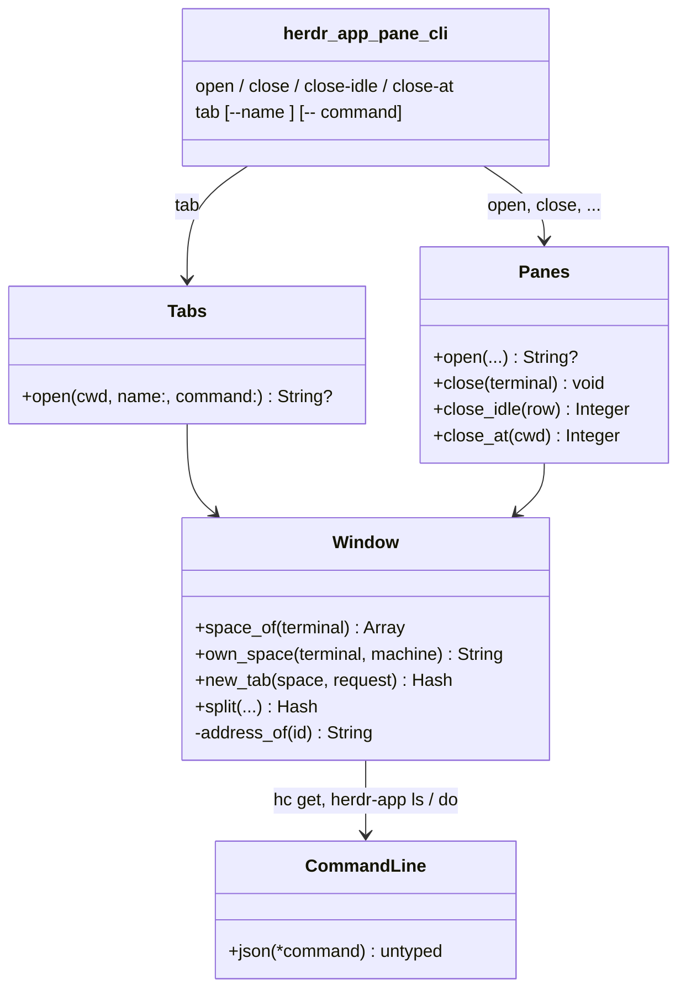
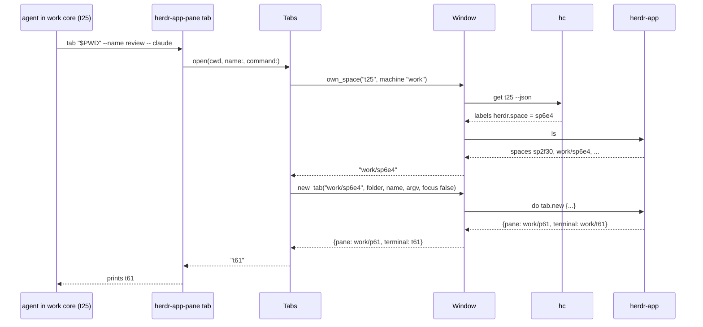

# Plan: Agents open herdr-app tabs in their own core

From `intent.md` (2026-11-19). Status: accepted.

## Context

An agent that opens a herdr-app tab today lands in the focused space, or reaches for the herdr TUI or the stale skills of the old app. This change gives agents one command, `herdr-app-pane tab`, that opens a tab in the space of the agent's own terminal, and one skill, `herdr-app-tabs`, that tells agents to use it and nothing else.

Facts verified live on 2026-11-19 (herdr-app with herdr-core 0.1.21):

- `herdr-app do tab.new` takes `name`, `space`, `folder`, `argv`, `task`, `mod`, `props` and `focus`. It has no `machine` argument. Without `space` it uses the selected space, which is the cause of the wrong-core tabs. Only `space.new` takes `machine`.
- `herdr-app ls` lists default-core spaces with bare ids (`sp2f30…`, `machine: null`). It lists work-core spaces, terminals and panes with a `work/` prefix (`work/sp6e4…`, `work/t25`, `work/p5e7…`, `machine: "work"`).
- A work-core terminal carries `HC_SESSION=work`, `HC_TERMINAL_ID=t25` (bare) and `HC_TERMINAL_SOCKET=~/.local/state/herdr-core/work/work.sock`. `hc get "$HC_TERMINAL_ID" --json` from that terminal reaches the work core and answers `labels["herdr.space"] = "sp6e4…"`, bare.
- A default-core terminal has no `HC_SESSION`; its socket is `…/default/default.sock`; its `herdr.space` label equals its `herdr-app ls` space id.
- `Window#space_of` in `herdr-app/.local/share/herdr-app-pane/panes.rb` matches the bare label against the listed ids exactly. It therefore refuses for a work-core terminal today. That defect is out of scope here (see Design decisions).
- herdr-app has no browser or web-page command.
- `~/.local/bin/herdr-app-pane` is a stow link into the main checkout (`~/Developer/dotfiles/herdr-app/.local/bin/herdr-app-pane`), not into this worktree. Agents get the new subcommand once the branch is merged into main, with no stow run. Until then, run this worktree's copy by its absolute path; it loads its library relative to itself.
- The `work` machine's name equals its session name, `work`: `install/tasks/27_register_work_core.sh` registers it with `--name work --session work`.

## Design

### Domain terms

From `GLOSSARY.md`: **Core**, **Machine**, **Space**, **Personal space**, **Work space**, **herdr-app**, **herdr TUI**.

New terms, written into `GLOSSARY.md` by the implement stage (step 9):

- **herdr-app address** — the id `herdr-app ls` and `herdr-app do` use for a space, tab, pane or terminal; outside the `default` core it carries a `<machine>/` prefix, such as `work/t25`. Avoid: global id.
- **hc address** — the id the own core's `hc` uses for the same object, never prefixed, such as `t25`; the part of a herdr-app address after its last `/`. Avoid: local id.
- **Own core** — the core the agent's terminal runs in: `HC_SESSION`, else the core named by `HC_TERMINAL_SOCKET` (`<state>/herdr-core/<core>/<core>.sock`), else `default`. Its machine is null for `default` and the core's name otherwise.
- **Own space** — the space that holds the agent's own terminal (`HC_TERMINAL_ID`): the one listed space on the own core's machine whose hc address is that terminal's `herdr.space` label. Avoid: current space, focused space.

The intent says "Herdr UI" for the old app. `GLOSSARY.md` lists "Herdr UI" as a word to avoid. The skill never uses it; it names the stale skills (`herdr-gpui-browser`, `herdr-automations`), `herdr-automate` and `HERDR_ENV` instead.

### Diagrams

Before: `Panes` and `Window` only; no tab path; `Window#space_of` matches labels exactly.

After:





### Signatures

`herdr-app/.local/bin/herdr-app-pane` — the CLI. One new arm: `tab <cwd> [--name <name>] [-- <command>...]`. Bad arguments exit 1 with the usage before any herdr-app or hc call, as today.

```ruby
# Answers the cwd and the keywords of Tabs#open.
#: (Array[String] arguments) -> [String, Hash[Symbol, untyped]]
def tab_arguments(arguments)
```

`parse` gains `in [ "tab", _ ] then tab_call(*tab_arguments(arguments))`, and the Panes-only lambdas stay. The CLI builds a `HerdrAppPane::Tabs` for the `tab` arm and a `HerdrAppPane::Panes` for the others; the `HC_TERMINAL_ID` check stays before either.

`herdr-app/.local/share/herdr-app-pane/tabs.rb` — new. `HerdrAppPane::Tabs`: opens a herdr-app tab in the own space, whatever space has focus.

```ruby
# core: the own core's name; "default" maps to machine nil, any other name to the machine of that name.
#: (?own: String, ?core: String, ?command_line: CommandLine) -> void
def initialize(own: ENV.fetch("HC_TERMINAL_ID"), core: Tabs.own_core, command_line: CommandLine.new)

# HC_SESSION, else the <core> of HC_TERMINAL_SOCKET's <core>/<core>.sock, else "default".
#: -> String
def self.own_core

# Opens a tab in the own space, rooted in cwd, named name when given, running command (herdr-app's
# default shell when empty), with focus false; answers the hc address of its terminal, or nil when
# herdr-app names no terminal. Raises Refusal when herdr-app lists no own space, or more than one.
#: (String cwd, ?name: String?, ?command: Array[String]) -> String?
def open(cwd, name: nil, command: [])
```

`HerdrAppPane::Window` (in `panes.rb`, which stays the only sender of `herdr-app ls` and `herdr-app do`) gains:

```ruby
# The herdr-app address of the space of terminal: the one listed space on machine (nil: this computer) whose
# hc address is the terminal's herdr.space label. Refuses when none, or more than one, matches.
#: (String terminal, String? machine) -> String
def own_space(terminal, machine)

# Sends tab.new for space with request ("folder", "name", "argv", "focus") and answers {"pane", "terminal"},
# the terminal as an hc address.
#: (String space, Hash[String, untyped] request) -> Hash[String, String?]
def new_tab(space, request)

private

# The hc address of a herdr-app address: the part after its last "/".
#: (String id) -> String
def address_of(id)
```

`HerdrAppPane::Panes`, `Terminal`, `CommandLine`, `RowRecord`: not affected.

Not checked: the dotfiles repository has no Steepfile.

### Complexity

- `herdr-app-pane tab`: three external calls whatever the number of spaces — one `hc get`, one `herdr-app ls`, one `herdr-app do tab.new`. In memory: O(spaces) to match the own space.
- No `herdr-app status` call: the focused space is never read.
- Panes paths: unchanged call counts.

### Invariants

1. Every `tab.new` that `Tabs` sends names a `space`, so the focused space never picks the target. Enforced by `Tabs#open`, which only reaches `Window#new_tab` with the result of `Window#own_space`.
2. The `space` sent is the herdr-app address of the own terminal's space on the own core's machine: `work/<id>` for a work-core terminal, the bare id for a default-core one. A space with the same hc address on another machine never matches, even when it is the only one listed. Enforced by `Window#own_space`, which matches machine and hc address.
3. No `tab.new` is sent unless exactly one listed space matches. Enforced by `Window#own_space`, which raises `Refusal` first.
4. `Tabs` prints only hc addresses. Enforced by `Window#new_tab` through `address_of`.
5. Among the pipeline files, only `panes.rb` sends `herdr-app ls` or `herdr-app do`. Enforced by keeping all calls in `Window`; the existing `HerdrAppCommandOwnerTest` globs `herdr-app-pane/*.rb`, so it covers `tabs.rb`.
6. The skill never offers the herdr TUI, `HERDR_ENV` or a command of the stale skills. Enforced by the skill text and its test.

### Alternatives

- **A. Skill-only shell recipe** (architect "smallest change"): the skill holds an `hc get | jq` plus `case "$HC_SESSION"` recipe that builds the space id and calls `herdr-app do tab.new`. No Ruby. Rejected: the address rule lives in Markdown, is tested by extracting a code fence (fragile connascence of position), and every agent retypes a three-line pipeline. It also adds a second, divergent copy of the address rule beside `Window`.
- **B. Deep `Panes#tab` plus a work-core fix for every Panes path** (architect "deepest module"): one command, and `space_of`, `split`, `close`, `close_idle` and `close_at` all learn to translate addresses. Rejected for this branch: it changes the pipeline's stage-pane behaviour in the work core, which is orthogonal to tabs (playbook rule 21) and touches the out-of-scope pipeline path; it also grows `Panes` (already 166 lines). Its address idea is kept, limited to the tab path.
- **C. A new `Tabs` class beside `Panes`, sharing `Window`** — chosen. Agents get one command; the address rule lives once in `Window`; `Panes` does not grow; the stage-pane path stays untouched.

## Design decisions

- The intent's in-scope line names `herdr-app do … --machine <own core>`. `tab.new` has no `machine` argument, so the tool passes `space` instead. The behaviour agreed in intent (own core, not focused space) is unchanged.
- The own core comes from `HC_SESSION`, else `HC_TERMINAL_SOCKET`, else `default` (`Tabs.own_core`). `Window#own_space` matches both the machine and the hc address, so a space of another core never qualifies. This relies on machine name equal to session name, which `27_register_work_core.sh` sets; a mismatch refuses, it never opens in the wrong core.
- `Tabs` sends `focus: false`. A tab an agent opens does not pull Etienne away from what he looks at. The skill says to tell Etienne the tab's name.
- `Tabs` passes `folder` and `argv` to `tab.new`, not the `sh -c` rooted wrapper of `Panes`: `tab.new` takes a folder of its own.
- The pre-existing work-core refusal of `herdr-app-pane open/close/close-idle/close-at` stays out of this branch. It is a separate branch (see Decision needed in the report).
- Glossary terms go in at implement time (step 9), because this plan stage touches only `plan.md`.
- No conflict with intent's `## Decisions`: the tab opens in the own core, and delivery stays autonomous with no Codex review.

## Integration points

- herdr-app `herdr-app ls` and `herdr-app do tab.new` (shape of the `tab.new` answer is probed in step 1).
- herdr-core `hc get <terminal> --json` of the own core.
- `~/.local/bin/herdr-app-pane`, a stow link into the main checkout: reaches agents after merge.
- Claude and Codex skill loading: `agents/.agents/skills/<name>/` with `agents/openai.yaml`, linked from `claude/.claude/skills/<name>`.

## Files that change

- `herdr-app/.local/share/herdr-app-pane/tabs.rb` — new `HerdrAppPane::Tabs`.
- `herdr-app/.local/share/herdr-app-pane/panes.rb` — `Window#own_space`, `Window#new_tab`, private `Window#address_of`. Nothing else in the file.
- `herdr-app/.local/bin/herdr-app-pane` — `tab` arm, `tab_arguments`, `tab_call`, usage line, header comment.
- `test/herdr_app_harness.rb` — `World#action` answers `tab.new`; new ids take the target space's `<machine>/` prefix; hc answers are keyed by core and terminal; the hc stub reads `HC_SESSION`; `FakeCommandLine` takes `core:`; `CLEARED_ENV` gains `HC_SESSION`; header documents the `tab.new` shape; fixture `work_world(cwd:)`.
- `test/herdr_app_tabs_test.rb` — new, unit tests of `Tabs` and the new `Window` methods.
- `test/herdr_app_pane_cli_test.rb` — acceptance tests of `herdr-app-pane tab`, bad-argument cases.
- `agents/.agents/skills/herdr-app-tabs/SKILL.md` — new skill.
- `agents/.agents/skills/herdr-app-tabs/agents/openai.yaml` — new.
- `claude/.claude/skills/herdr-app-tabs` — new relative link to `../../../agents/.agents/skills/herdr-app-tabs`.
- `test/herdr_app_tabs_skill_test.rb` — new, skill-content tests.
- `SKILLS-INDEX.md` — one line under a fitting section (tools/workflow).
- `GLOSSARY.md` — three terms (step 9).

## Order of work

1. Probe the `tab.new` answer in a sandbox: a scratch `HERDR_APP_HOME` (short path, for SUN_LEN) and a scratch core (`HC_SESSION=tabprobe`), both set on every probe command under `env -i`; never the `default` or `work` core; stop the sandbox by pid, never `app.quit`; never `hc server status` without the scratch `HC_SESSION`, which would start a core. Run `herdr-app do tab.new '{"space":"<id>","folder":"/tmp","focus":false}'`, then `herdr-app ls`. Record the answer shape in the harness header. If it lacks `terminal`, `Window#new_tab` answers `"terminal" => nil` and `Tabs#open` answers nil; the CLI prints nothing.
2. Harness, core-aware after `herdr_app_agents_harness.rb`: hc answers live per core (`world["cores"][core]["terminals"]`, existing worlds under `default`); the hc stub picks the core from `HC_SESSION` ("default" when unset) and logs it; `FakeCommandLine.new(world, calls, core: "default")`; `CLEARED_ENV` gains `HC_SESSION` and `herdr_app_env` takes `core:`. Teach `World#action` `tab.new` (append a tab to `request["space"]`, ids prefixed with the space's machine, hc answer stored under that core by hc address, labelled with the bare space id; `focus: false` keeps focus). Add `work_world(cwd:)`: personal space `sp2` with agent `t20`/`p20` and shell `t11`/`p11`; work space `work/sp2` (machine `work`) with agent `work/t20`/`work/p20`. Both cores reuse terminal `t20` and space id `sp2`, so a test that asks the wrong core fails. Existing panes tests stay green.
3. Write the two acceptance tests in `test/herdr_app_pane_cli_test.rb`, run them, watch them fail on the missing `tab` arm.
4. Write `test/herdr_app_tabs_test.rb`; watch it fail.
5. Add `Window#own_space`, `#new_tab`, `#address_of`; add `tabs.rb`; add the CLI arm. Run steps 3–4 green.
6. Write `test/herdr_app_tabs_skill_test.rb`; watch it fail.
7. Add the skill, its `openai.yaml`, the Claude link and the `SKILLS-INDEX.md` line. The skill says: inside herdr-app (`HC_TERMINAL_ID` set), open a tab with `herdr-app-pane tab "<folder>" --name "<name>" [-- <command>...]`; it opens in the own space, whatever has focus; tell Etienne the tab's name. Outside herdr-app, open no tab. Never: `herdr pane`, `herdr tab`, `HERDR_ENV`, `herdr-automate`, the `herdr-gpui-browser` and `herdr-automations` skills, a bare `herdr-app do tab.new` without `space`. herdr-app has no browser tab: give Etienne the URL or file path instead. Run step 6 green and `test/skill_parity_test.rb`.
8. `bin/test` (full suite), `rubocop` on touched Ruby, markdownlint on touched Markdown.
9. Add the three glossary terms to `GLOSSARY.md` in their own commit.
10. Live check (rule 22), with this worktree's executable by absolute path (`<worktree>/herdr-app/.local/bin/herdr-app-pane`), not the installed link: from a work-core terminal with a personal space focused, run `<worktree>/herdr-app/.local/bin/herdr-app-pane tab "$PWD" --name probe-work`; confirm with `herdr-app ls` the tab sits under the `work/…` own space; reverse from the default core with a work space focused. Close both probe tabs with `herdr-app do tab.close`. Record the evidence for delivery.

## Risks

- The `tab.new` answer shape is unverified; step 1 probes it before any code. `Tabs`' interface does not change with the shape.
- `focus: false` may still move focus in some herdr-app version; the live check (step 10) shows it. A fix would restore focus like `Panes#split` does; not planned.
- The address rule (`<machine>/<hc address>`) is herdr-app's convention, verified live today; `address_of` and `own_space` are the only places that know it.
- `Window` grows from 82 to about 100 lines, the class-size limit. The next change to it should split out the address rule.
- A space id present in two cores refuses rather than guessing; ids are random hashes, so this is rare and safe.
- Out of scope, unchanged: `herdr-app-pane open/close/...` still refuse in the work core; the herdr TUI stays installed; the stale skills stay until Etienne trashes them; the pipeline scripts.

## Proof

- An agent in the `work` core that opens a tab gets it in the `work` core, while the personal space has focus → `test/herdr_app_pane_cli_test.rb` `test_tab_from_the_work_core_opens_in_the_work_space_while_a_personal_space_has_focus`
- An agent in the `default` core that opens a tab gets it in the `default` core, while the work space has focus → `test/herdr_app_pane_cli_test.rb` `test_tab_from_the_default_core_opens_in_the_personal_space_while_a_work_space_has_focus`
- An agent that reads the skill never runs the `herdr` CLI or the old app's browser command to open a tab → `test/herdr_app_tabs_skill_test.rb` `test_the_skill_opens_tabs_with_herdr_app_pane_tab` and `test_the_skill_forbids_the_herdr_tui_herdr_env_and_the_stale_skills` and `test_no_code_fence_runs_the_herdr_tui`
- The skill appears in `SKILLS-INDEX.md` → `test/herdr_app_tabs_skill_test.rb` `test_skills_index_lists_herdr_app_tabs`; the link and `openai.yaml` → existing `test/skill_parity_test.rb`
- Query count: `herdr-app-pane tab` makes three calls, one `hc get`, one `herdr-app ls`, one `herdr-app do tab.new`, and never `herdr-app status` → `test/herdr_app_tabs_test.rb` `test_open_makes_three_calls_and_never_reads_focus`
- Invariant: every `tab.new` names the own space, enforced by `Window#own_space` → `test/herdr_app_tabs_test.rb` `test_open_sends_the_herdr_app_address_of_the_own_space`
- Invariant: no `tab.new` without exactly one matching space on the own machine, enforced by `Window#own_space` → `test/herdr_app_tabs_test.rb` `test_open_refuses_and_sends_no_tab_new_when_herdr_app_lists_no_own_space`, `test_open_refuses_when_only_another_core_lists_the_space_id` and `test_open_refuses_a_space_id_listed_twice_on_the_own_machine`
- Invariant: `Tabs` answers hc addresses, enforced by `Window#new_tab` → `test/herdr_app_tabs_test.rb` `test_open_answers_the_hc_address_of_the_new_terminal`
- Invariant: only `panes.rb` sends `herdr-app ls`/`do` → existing `test/herdr_app_panes_test.rb` `HerdrAppCommandOwnerTest#test_only_panes_rb_sends_herdr_app_commands`
- Live behaviour → check: step 10, `herdr-app ls` after `herdr-app-pane tab` from each core.

Per changed file, the unit tests expected:

- `herdr-app/.local/share/herdr-app-pane/tabs.rb`: `Tabs.own_core answers HC_SESSION`, `Tabs.own_core reads the core from HC_TERMINAL_SOCKET`, `Tabs.own_core defaults to default`, `Tabs#open sends the folder, name and command`, `Tabs#open without a command sends no argv`, `Tabs#open sends focus false`, `Tabs#open answers nil when herdr-app names no terminal`, plus the Proof lines above.
- `herdr-app/.local/share/herdr-app-pane/panes.rb`: `Window#own_space answers the bare id in the default core`, `Window#own_space answers the work/ address in the work core`, `Window#own_space refuses when hc gives no space label`; `Window#new_tab` covered through `Tabs`.
- `herdr-app/.local/bin/herdr-app-pane`: `test_refuses_bad_arguments_before_any_call` gains `%w[tab]`, `["tab", dir, "--name"]`, `["tab", dir, "--bogus"]`, `["tab", "--name", "x"]`; `test_tab_prints_the_terminal_address`; `test_tab_runs_outside_a_git_repository`.
- `agents/.agents/skills/herdr-app-tabs/SKILL.md`: the skill tests above.

Test setup: `HerdrAppHarness` stubs only — `FakeCommandLine` (with `core:`) in process for `Tabs`, stub `herdr-app` and `hc` executables for the CLI, each child run with an explicit `HC_SESSION` (or none for `default`). `work_world(cwd:)` puts the same terminal and space id in both cores; the world's focus sits in the other core's space for each acceptance test. No test reaches a real herdr-app or hc.

Out of scope: work-core support for `herdr-app-pane open/close/close-idle/close-at`; `space.new` and `pane.split` guidance for agents; uninstalling the herdr TUI; deleting the stale skills; pipeline scripts; herdr-app and herdr-core themselves.

---
Domain skills applied: software-design, object-oriented-design, ruby-style, glossary, diagrams, dotfiles-maintenance.

## Critique

### Round 1 (codex gpt-6.1-sol, medium)

- Matching the bare space id across the whole listing does not prove the space belongs to the own core; if the own space disappears, another core's space with that id becomes the sole match → fixed (added `Tabs.own_core` and the Own core term; `Window#own_space` now takes the machine and matches machine and hc address; new test `test_open_refuses_when_only_another_core_lists_the_space_id`)
- The step 1 sandbox isolates the app home but not herdr-core → fixed (step 1 now sets a scratch `HC_SESSION=tabprobe` with the scratch `HERDR_APP_HOME` on every probe command under `env -i`, and keeps `default` and `work` out)
- The harness keys hc answers by bare terminal id and leaves `HC_SESSION` uncleared, so tests pass when hc asks the wrong core → fixed (step 2 makes the harness core-aware after `herdr_app_agents_harness.rb`, clears and sets `HC_SESSION`, gives `FakeCommandLine` a `core:`, and reuses terminal `t20` and space `sp2` in both cores)
- The installed `herdr-app-pane` links into the main checkout, so the live check would run the old code and the claim that agents get the subcommand without a stow run was wrong for the branch → fixed (Context corrected: agents get it after merge; step 10 runs this worktree's executable by absolute path)
