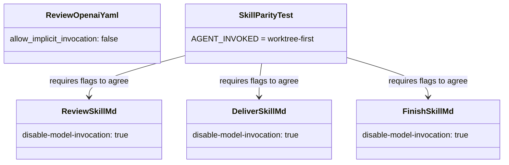
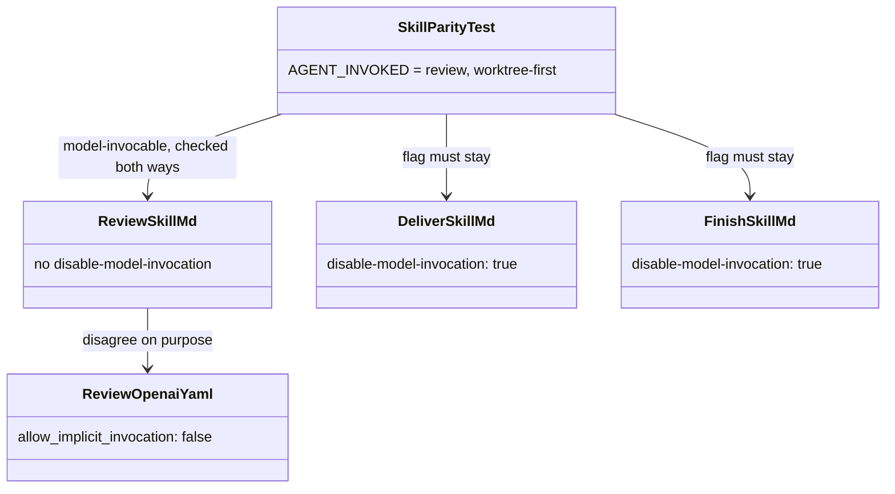

# Plan: Let the autonomous coordinator invoke the review skill

From `intent.md` (2026-10-25). Status: accepted.

## Design

### Domain terms

- **Model-invocable skill**: a Claude skill without `disable-model-invocation: true` in its `SKILL.md` frontmatter. The Skill tool runs it, and Claude lists it among its available skills.
- **Agent-invoked skill**: an entry of `SkillParityTest::AGENT_INVOKED`. It is model-invocable on Claude and keeps `allow_implicit_invocation: false` on Codex. Today: `worktree-first`. After this change: `review` and `worktree-first`.
- Coordinator, `review`, `deliver` and `finish` keep their meaning from `intent.md`.
- The repository has no `GLOSSARY.md`. This change adds no domain term that needs one.

### Diagrams

Before:

After:

### Signatures

No production Ruby changes. The production change is one frontmatter line in `agents/.agents/skills/review/SKILL.md`.

- `SkillParityTest` — the drift guard between Claude and Codex skill folders.
  - `AGENT_INVOKED = %w[review worktree-first].freeze`
  - `test_agent_invoked_skills_are_model_invocable_on_claude_and_deny_implicit_invocation_on_codex` (new)
  - `test_deliver_and_finish_stay_disabled_for_model_invocation` (new)
- `DeliveryContractTest` — pins the skill text that carries each hand-over.
  - `test_review_names_no_merge_command` (new)

The surrounding test files carry no inline RBS comments, so the new test methods carry none either.

Not checked: dotfiles has no Steepfile.

### Complexity

Not affected: the new tests read a few small files each, with no subprocess and no network.

### Invariants

- Every `AGENT_INVOKED` skill has no `disable-model-invocation: true` and has `allow_implicit_invocation: false`. Enforced in `SkillParityTest`. Today the list only exempts a skill from the parity test and asserts nothing about it.
- `deliver` and `finish` keep `disable-model-invocation: true`. Enforced in `SkillParityTest`.
- Every skill outside `AGENT_INVOKED` has matching Claude and Codex flags. Enforced by the existing `test_implicit_invocation_policy_matches_between_frontmatter_and_openai_yaml`.
- `review/SKILL.md` names no merge command. Enforced in `DeliveryContractTest`.

### Alternatives

1. Minimal: delete the flag, add `review` to `AGENT_INVOKED`, add one regression test for `review` and one guard for `deliver` and `finish`. Rejected as it stands: the `AGENT_INVOKED` exemption keeps asserting nothing, so a later edit can re-disable `review` and the parity test still passes.
2. Explicit `USER_ONLY = %w[deliver finish]` list, with a test that the skills carrying the flag are exactly that set. Rejected: a second hand-kept list for two entries. Each new user-only skill then needs a test edit, which is out of proportion for a bug fix.
3. Chosen: alternative 1, plus one test that checks every `AGENT_INVOKED` skill in both directions, plus a text guard that `review` names no merge. The exemption list then asserts what it means, and no new list appears.

## Design decisions

- The regression test iterates `AGENT_INVOKED` rather than naming `review` alone. It is red before the fix because `review` still carries the flag, and it also covers `worktree-first`.
- `test_review_names_no_merge_command` lives in `DeliveryContractTest`, beside the other merge-text guards (`test_only_finish_auto_mode_names_the_ship_no_merge_script`). It refutes `gh pr merge` and `finish/scripts/ship` in `review/SKILL.md`.
- No other text describes `review` as model-disabled. A search of `agents/`, `claude/`, `codex/`, `SKILLS-INDEX.md`, `agents.md` and `test/` finds the flag only in the three frontmatters and the parity test. The only text update is the comment above `AGENT_INVOKED`.
- No conflict with `intent.md`'s `## Decisions`: the flag is dropped, `intent/SKILL.md` keeps its wording, and the Codex `allow_implicit_invocation: false` stays.

## Integration points

- Claude Code's Skill tool reads `~/.claude/skills/review/SKILL.md`. That path links to the main checkout, so the change reaches live sessions only after the merge.
- Codex reads `~/.agents/skills/review/agents/openai.yaml`. It does not change.
- `intent/SKILL.md` Autonomous delivery step 5 tells the coordinator to follow the `review` skill in auto mode. It does not change.

## Files that change

- `test/skill_parity_test.rb` — add `review` to `AGENT_INVOKED`, extend the comment above it, add the two new tests.
- `test/delivery_contract_test.rb` — add `test_review_names_no_merge_command` and `test_review_hands_over_to_deliver_only_for_a_review_the_user_typed`.
- `agents/.agents/skills/review/SKILL.md` — also gate the `Review clean:` hand-over to `deliver` on a review the user started (review round 1).
- `agents/.agents/skills/review/SKILL.md` — delete the line `disable-model-invocation: true`.

## Order of work

1. In `test/skill_parity_test.rb`, add `review` to `AGENT_INVOKED` and add `test_agent_invoked_skills_are_model_invocable_on_claude_and_deny_implicit_invocation_on_codex`. Run `ruby -Itest test/skill_parity_test.rb`. Watch the new test fail on `review` because its frontmatter still has the flag.
2. Delete `disable-model-invocation: true` from `agents/.agents/skills/review/SKILL.md`. Run the file again; it is green.
3. Extend the comment above `AGENT_INVOKED`: `review` is model-invocable because the autonomous coordinator calls it through the Skill tool; Codex coordinators follow the file. Keep the `worktree-first` reason.
4. Add `test_deliver_and_finish_stay_disabled_for_model_invocation` to `test/skill_parity_test.rb`. Run it; it is green.
5. Add `test_review_names_no_merge_command` to `test/delivery_contract_test.rb`. Run `ruby -Itest test/delivery_contract_test.rb`; it is green.
6. Run the full suite with `bin/test`. Run the repository's lefthook pre-commit linters on the touched files (`lefthook run pre-commit`).
7. Commit in two commits: the test and the frontmatter fix together (one logical change), then the two guard tests.
8. Run the checks under `## Proof` and record the evidence in the report.

## Risks

- In step-by-step mode Claude may now start `/review` on its own. `intent.md` accepts this: the skill is report-only.
- A Claude coordinator that runs the `review` skill in step-by-step mode reaches "run `deliver` without asking" under "After either backend". Review round 1 found this routes around `deliver`'s flag, so commit 14817b86 gates the hand-over on a review the user started: a typed `/review`, or a re-review inside a `/code-review` the user asked for. A review Claude starts on its own reports and stops. `test_review_hands_over_to_deliver_only_for_a_review_the_user_typed` pins it.
- The tests prove the frontmatter, not the Skill tool's runtime behaviour. The live skill path links to the main checkout, so the runtime check can run only after the merge. Rejected: a pre-merge probe with a disposable `CLAUDE_CONFIG_DIR`, because it is not deterministic and needs its own credentials setup. The structural test is the formal proof, and the live check is a required post-merge validation (see `## Proof`).
- Out of scope: `deliver` and `finish` flags and behaviour, the review skill's backends and auto-mode steps, the reviewer agent, and the wording of `intent/SKILL.md`.

## Proof

- A Claude coordinator in autonomous delivery invokes the `review` skill through the Skill tool without a refusal → `test/skill_parity_test.rb` `test_agent_invoked_skills_are_model_invocable_on_claude_and_deny_implicit_invocation_on_codex`. This structural test is the formal proof before delivery. Required post-merge validation, listed in the coordinator's account for Etienne: after the merge reaches the main checkout, a fresh Claude session lists `review` among its available skills, and a Skill-tool call for `review` is not refused.
- The parity test passes with `review` model-invocable on Claude and denied implicit invocation on Codex → `test/skill_parity_test.rb` `test_agent_invoked_skills_are_model_invocable_on_claude_and_deny_implicit_invocation_on_codex` and the existing `test_implicit_invocation_policy_matches_between_frontmatter_and_openai_yaml`.
- `deliver` and `finish` stay refused for the Skill tool → `test/skill_parity_test.rb` `test_deliver_and_finish_stay_disabled_for_model_invocation`.
- The merge stays a human step: no skill in autonomous mode runs a merge → `test/delivery_contract_test.rb` `test_review_names_no_merge_command`, plus the existing `test_only_finish_auto_mode_names_the_ship_no_merge_script` and `test_finish_auto_mode_runs_ship_no_merge`.
- Invariant: every `AGENT_INVOKED` skill is model-invocable on Claude and denies implicit invocation on Codex, enforced by `SkillParityTest` → `test/skill_parity_test.rb` `test_agent_invoked_skills_are_model_invocable_on_claude_and_deny_implicit_invocation_on_codex`.
- Invariant: `deliver` and `finish` keep `disable-model-invocation: true`, enforced by `SkillParityTest` → `test/skill_parity_test.rb` `test_deliver_and_finish_stay_disabled_for_model_invocation`.

Per changed file, the unit tests expected, named as behaviour:
- `test/skill_parity_test.rb`: `agent-invoked skills are model-invocable on Claude and deny implicit invocation on Codex`, `deliver and finish stay disabled for model invocation`.
- `test/delivery_contract_test.rb`: `review names no merge command`.
- `agents/.agents/skills/review/SKILL.md`: covered by the parity tests above.

Test setup: the tests read the real repository files through the existing `frontmatter` and `skill` helpers. No fixtures, no subprocess.

---
Domain skills applied: software-design, glossary, diagrams.

## Critique

### Round 1 (codex exec -p terra)

- The runtime proof is not an executable acceptance gate: it gives no command for the `CLAUDE_CONFIG_DIR` probe, no way to observe the Skill-tool call, and allows a post-merge fallback for a pre-delivery criterion → fixed (the structural parity test is now the formal proof; the live Skill-tool check is a required post-merge validation in the account; the disposable-config probe is recorded as rejected under Risks)
