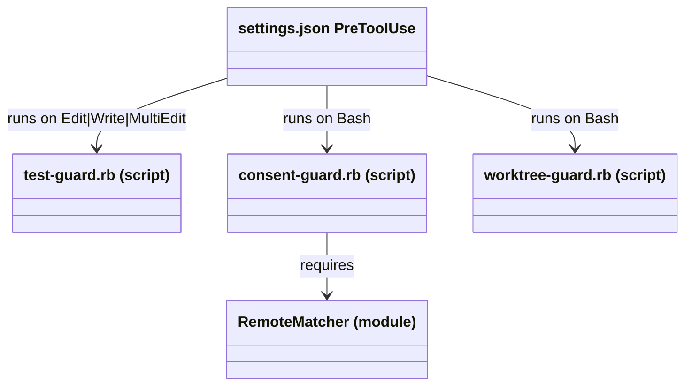
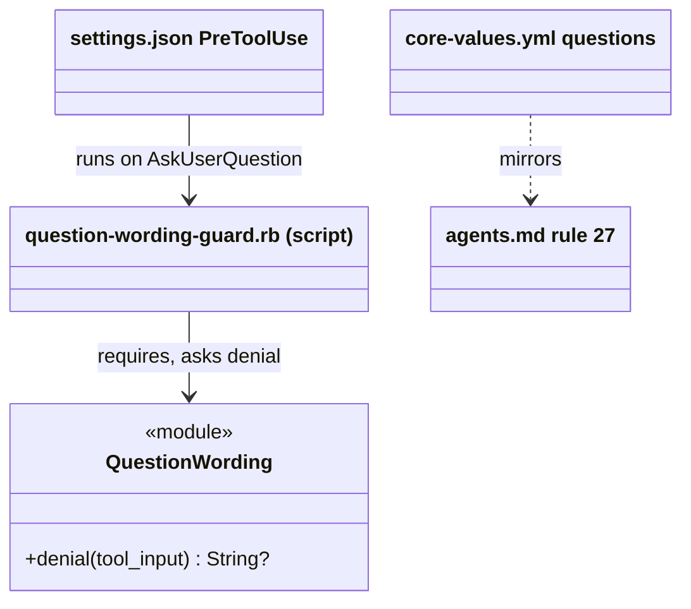
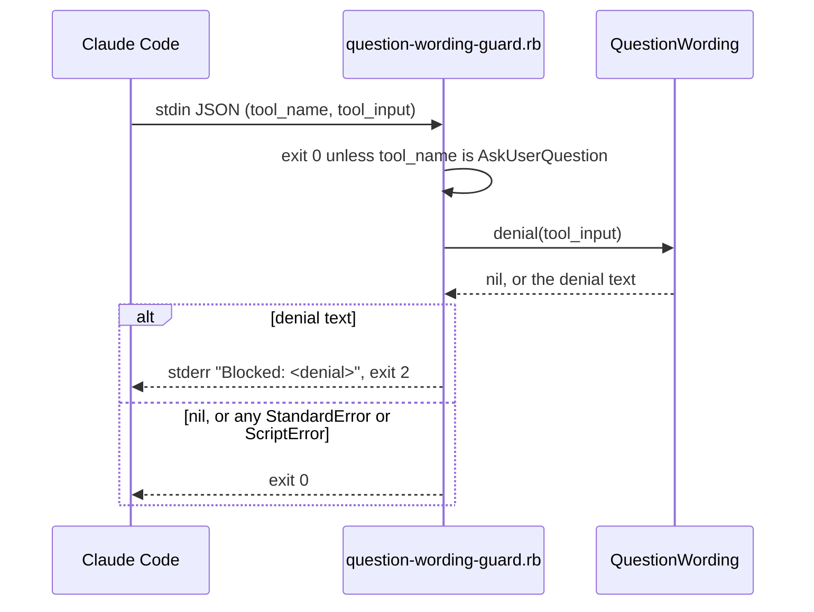

# Plan: Clear wording in agent questions

From `intent.md` (2026-10-26). Status: accepted.

## Design

### Domain terms

The repository has no `GLOSSARY.md`, so no avoid list applies. The terms below are new. They stay in this plan until Etienne agrees them for the glossary.

- **Actor**: the one who does a step, Claude or Etienne. A question or option label names the actor.
- **Banned word**: one of I, I'll, I'm, I've, I'd, me, my, you, you'll, you're, you'd, you've, your, yours. The match is a whole word and ignores case. A curly apostrophe (’) counts as a straight one (').
- **Code span**: text between a run of N backticks and the next run of exactly N backticks. A backtick right after a backslash opens no span. The hook does not check a code span. A backtick run with no closing run is literal text and is checked.
- **Checked text**: the `question` string of each question and the `label` string of each option. Headers, descriptions and previews are never checked.
- **Finding**: one banned word as written, with its place, for example `"I'll" in question 1 [Push], option 2 label`.
- **Denial**: the message that blocks the call. It lists every finding and tells Claude how to rewrite.

### Diagrams

Before: the PreToolUse hooks today.



After: one new script and one new module, in the `remote_matcher.rb` pattern.



One call:



### Signatures

New file `claude/.claude/hooks/question_wording.rb`:

```ruby
# Finds the banned words in an AskUserQuestion call's question texts and option labels.
module QuestionWording
  # The denial that lists every finding, or nil when every checked text names its actor.
  # Raises KeyError or TypeError when tool_input does not have the AskUserQuestion shape.
  #: (Hash[String, untyped] tool_input) -> String?
  def self.denial(tool_input)
end
```

Private module functions (no tests of their own): `checked_texts(tool_input)` returns `[place, text]` pairs; `banned_words_in(text)` returns the banned words as written, in order, with code spans removed.

Private constants:

- `BANNED = Set["i", "i'll", "i'm", "i've", "i'd", "me", "my", "you", "you'll", "you're", "you'd", "you've", "your", "yours"].freeze`.
- `CODE_SPAN = /(?<![`\\])(`+)(?!`).*?(?<!`)\1(?!`)/m`. A backtick after a backslash opens no span. Each match becomes one space, so the words on each side do not join.
- `WORD = /[\p{L}\p{N}_]+(?:['’][\p{L}\p{N}_]+)*/`. A token is a run of letters, digits and underscores, joined inside only by an apostrophe. A slash, dot or hyphen ends a token.

A token is a banned word when its downcase, with `’` changed to `'`, is in `BANNED`.

New file `claude/.claude/hooks/question-wording-guard.rb`: an executable script with no public methods. It runs `require_relative "question_wording"` inside `begin`. It parses stdin and exits 0 unless `tool_name == "AskUserQuestion"`. It writes `Blocked: <denial>` to stderr and exits 2 when `QuestionWording.denial` returns text. It rescues `StandardError` and `ScriptError`, warns `question-wording-guard: <message>` and exits 0. `SystemExit` is not rescued, so exit 2 gets through.

Denial text, pinned by a test in substance (each finding, the banned list, the fix line):

```text
AskUserQuestion names no actor. Fix every finding in one new call:
- "I" in question 1 [Rebase] text
- "I'll" in question 1 [Rebase], option 2 label
Banned in question texts and option labels: I, I'll, I'm, I've, I'd, me, my, you, you'll, you're, you'd, you've, your, yours.
Name the actor (Claude or Etienne). Write each option label as an order to Claude, such as "Rebase onto main".
Text inside backticks is not checked. Option descriptions are not checked, so "You do:" lines stay.
```

Not checked: dotfiles has no Steepfile, so `steep check` does not run here. The `#:` comments are for the reader and the editor.

### Complexity

- The work is linear in the characters of the checked texts. AskUserQuestion carries at most four questions with four options each, so that is a few hundred characters.
- One `gsub` and one `scan` per checked text, and one Set lookup per token.
- No database, no queries, no file reads, no subprocess. The cost is one Ruby start (about 50 ms) per AskUserQuestion call. Other tools never start the script.

### Invariants

1. A banned word outside a code span, in a question text or an option label, denies the call. Enforced by `QuestionWording.denial`.
2. A header, description or preview never causes a denial. Enforced by `checked_texts`, which reads only `question` and `label`.
3. Text in a closed code span, with any backtick count, never causes a denial. Enforced by the `CODE_SPAN` replacement.
4. A banned word joined to other text by a slash, dot or hyphen (`you/Claude`, `me-first`, `I/O`) causes a denial. A word that only contains a banned word (`UI`, `my_var`, `MySQL`) does not. Enforced by the `WORD` token rule and the fixed `BANNED` list.
5. The denial names every finding, as written, with its place. Enforced by `denial`, which checks all texts before it builds the message.
6. The hook never blocks on unreadable input or on its own error. Enforced by the script's single rescue and by the absence of any other `exit 2`.
7. No tool other than AskUserQuestion is affected. Enforced by the `settings.json` matcher and the script's `tool_name` check.
8. Every line of playbook rule 27 is also a line of `core-values.yml`. Enforced by `test/question_rule_mirror_test.rb`.

### Alternatives

Three architects each built one design for one goal.

- **A. Fewest moving parts** (rejected): one script with top-level functions, like `test-guard.rb`. Its functions cannot be called from a test, so it has no unit tests of public methods (playbook rule 3). Its stem regex also flags words that only start with a banned word, which is looser than the fixed list.
- **B. Deep module** (chosen): one public method, `QuestionWording.denial`, in a library beside a thin script, the `remote_matcher.rb` pattern. Every edge case has a fast in-process unit test. It keeps the house PreToolUse contract: `exit 2` with stderr.
- **C. Clearest feedback** (partly taken): a `QuestionWording` class, a `BannedWords` module and a `Finding` value, with a JSON `permissionDecision: "deny"` on stdout. Three public types is a shallow split of one job. The JSON deny breaks the style of the three other PreToolUse guards, and how Claude shows it is not verified here. Its message format is taken into B: every finding, with question number, header and option number, in one denial.

## Design decisions

- **Exit 2 with stderr, not a JSON deny.** The three existing PreToolUse guards use it, and this setup already proves Claude gets the stderr text.
- **The word list is the intent's list.** It holds the contractions `I'd`, `you're`, `you'd` and `you've` too, which Etienne added after the plan stage; `intent.md` records the decision.
- **Any unexpected input shape allows the whole call.** The intent says malformed input is allowed. `denial` uses `fetch` and type checks, so a wrong shape raises and the script exits 0. Readable parts of a broken input are not checked.
- **Only an apostrophe joins a token.** A slash, dot or hyphen is a word boundary, so `you/Claude` and `me-first` are denied, as the intent's whole-word rule asks. The cost: `I/O`, `i.e.` and `my-branch` are denied too. Claude puts such a literal term in backticks; the denial says so.
- **The script also checks `tool_name`.** The matcher already routes, but the check makes "other tools untouched" testable in the script itself.
- **Rule 27 goes at the end of playbook §7.** Its six bullets go verbatim into a new `questions` section of `core-values.yml`. The mirror test compares the parsed YAML strings, because YAML quoting changes the raw text.
- No conflict with intent's `## Decisions`.

## Integration points

- Claude Code PreToolUse hook contract: stdin JSON with `tool_name` and `tool_input`; exit 2 blocks and sends stderr to Claude; any other non-zero exit is a non-blocking hook error.
- `claude/.claude/hooks/core-values.rb` prints every section of `core-values.yml` at session start, so the new `questions` section is injected with no code change.
- Stow: `~/.claude/hooks/` holds one link per file. The new script and library reach `~/.claude/hooks/` only after Etienne runs `stow -R -t "$HOME" claude` after the merge. Agents never run stow (rule 12).
- Codex reads the same `agents.md`, so rule 27 reaches Codex's numbered options. No Codex hook.

## Files that change

- `claude/.claude/hooks/question_wording.rb` (new): the `QuestionWording` module.
- `claude/.claude/hooks/question-wording-guard.rb` (new, executable): the PreToolUse script.
- `claude/.claude/settings.json`: a new `PreToolUse` entry, `"matcher": "AskUserQuestion"`, command `"$HOME/.claude/hooks/question-wording-guard.rb"`, timeout 10.
- `agents.md` (also `claude/.claude/PLAYBOOK.md` through its link): rule 27 "Agent questions" at the end of §7.
- `claude/.claude/core-values.yml`: a new `questions` section with the six bullets of rule 27.
- `test/question_wording_test.rb` (new): unit tests of `QuestionWording.denial`.
- `test/question_wording_guard_test.rb` (new): runs the script with `Open3.capture3`, and checks the `settings.json` entry.
- `test/question_rule_mirror_test.rb` (new): playbook rule and `core-values.yml` mirror, and the session-start injection.

Rule 27 text, one line per bullet:

```markdown
27. Agent questions, in `AskUserQuestion` and in Codex's numbered plain-text options:
    - Name the actor, Claude or Etienne. Never write "I" or "you" in a question or an option label.
    - Write each option label as an order to Claude.
    - Give each option description three lines: "Claude does:", "You do:" and "Result:".
    - Put the recommended option first, with one reason.
    - Give a single-select question with side effects (push, delete, install, config, deploy) a preview with `[Claude]` and `[You]` tagged lines. Codex puts that preview in a fenced block under the option.
    - In Claude Code, the `question-wording-guard.rb` hook denies a question or an option label that holds I, I'll, I'm, I've, I'd, me, my, you, you'll, you're, you'd, you've, your or yours outside backticks.
```

## Order of work

1. Write `test/question_wording_guard_test.rb` with the first acceptance test ("Should I rebase the branch?" is denied and the message names "I"). Run it with `ruby -Itest test/question_wording_guard_test.rb`. Watch it fail because the script does not exist.
2. Write `test/question_wording_test.rb` with the unit tests below. Watch them fail.
3. Write `claude/.claude/hooks/question_wording.rb` until the unit tests pass.
4. Write `claude/.claude/hooks/question-wording-guard.rb` (`chmod +x`) until the script tests pass. Add the remaining acceptance tests to the script test file and make them pass.
5. Add the settings test, then the `settings.json` entry.
6. Write `test/question_rule_mirror_test.rb`. Watch it fail. Add rule 27 to `agents.md` and the `questions` section to `core-values.yml`.
7. Run `bin/test`, `rubocop` on every new and changed Ruby file, `yamllint claude/.claude/core-values.yml`, `markdownlint` with the no-hardwrap rule on `agents.md`, and `ruby -rjson -e 'JSON.parse(File.read("claude/.claude/settings.json"))'`.
8. Verify by hand (rule 22): pipe one denied and one allowed sample payload into the script and record the exit codes and stderr.

## Risks

- Until Etienne restows the `claude` package after the merge, `settings.json` names a script that is not in `~/.claude/hooks/`. Each AskUserQuestion call then shows a non-blocking hook error, and nothing is checked.
- A PreToolUse hook on AskUserQuestion is not yet exercised in this setup. The live check (a real denial in a session) can only run after the restow, so it is deferred to Etienne.
- False positives: `I/O`, `i.e.`, `my-branch` and a roman numeral `i.` list marker outside backticks. A false positive costs Claude one rewrite; the denial tells it to use backticks for a literal term.
- A pronoun in an `AskUserQuestion` call from a skill's own fixed text is denied too. The intent puts skill rewording out of scope; Claude rewrites the call at run time.
- Rejected: a JSON deny (style break, unverified display), stem matching (widens the agreed list), checking descriptions (false positives on "You do:").

## Proof

- A question "Should I rebase the branch?" is denied and the message names the banned word → `test/question_wording_guard_test.rb` `test_a_question_with_i_is_denied_and_the_message_names_the_word`
- An option label "I'll push first" is denied → `test/question_wording_guard_test.rb` `test_a_label_with_i_will_is_denied`
- Label "Rebase onto main" with the description "Claude does: rebases. You do: nothing. Result: linear history." is allowed → `test/question_wording_guard_test.rb` `test_a_label_that_names_no_pronoun_with_a_full_description_is_allowed`
- A description with "You do: nothing" is allowed → `test/question_wording_guard_test.rb` `test_a_description_with_you_do_is_allowed`
- A label with `git rebase` in backticks is allowed; a label with "I" only inside backticks is allowed → `test/question_wording_guard_test.rb` `test_banned_words_inside_backticks_are_allowed`
- A call with malformed input is allowed → `test/question_wording_guard_test.rb` `test_malformed_input_is_allowed`
- A call to any other tool is untouched → `test/question_wording_guard_test.rb` `test_another_tool_is_untouched`
- The playbook rule and the `core-values.yml` mirror say the same thing → `test/question_rule_mirror_test.rb` `test_core_values_carry_every_line_of_rule_27`
- A session start injects the rule → `test/question_rule_mirror_test.rb` `test_the_session_start_hook_prints_the_question_rule` (asserts the `SessionStart` entry in `settings.json` runs `core-values.rb full`, then runs that hook against the real `core-values.yml`)
- Claude Code runs the hook on AskUserQuestion → `test/question_wording_guard_test.rb` `test_settings_run_the_guard_on_ask_user_question`
- Invariant: headers and previews never cause a denial, enforced by `checked_texts` → `test/question_wording_test.rb` `test_headers_and_previews_are_not_checked`
- Invariant: closed code spans of any length hide their text, and an escaped or unclosed backtick hides nothing, enforced by `CODE_SPAN` → `test/question_wording_test.rb` `test_triple_backtick_spans_hide_their_text`, `test_an_unclosed_backtick_hides_nothing`, `test_an_escaped_backtick_opens_no_span`
- Invariant: `UI`, `my_var` and `MySQL` are not banned words; `you/Claude`, `me-first` and `I/O` hold one, enforced by `WORD` and `BANNED` → `test/question_wording_test.rb` `test_words_that_only_contain_a_banned_word_are_allowed`, `test_a_slash_dot_or_hyphen_ends_a_word`
- The contractions I'd, you're, you'd and you've are denied → `test/question_wording_test.rb` `test_contractions_with_i_and_you_are_denied`
- Invariant: the denial names every finding with its place, enforced by `denial` → `test/question_wording_test.rb` `test_the_denial_lists_every_finding_with_its_place`
- Invariant: the hook never blocks on its own error, enforced by the script's rescue → `test/question_wording_guard_test.rb` `test_malformed_input_is_allowed` (invalid JSON, `tool_input` a string, `questions` a string, a `nil` label)
- Query count: not affected, no database.

Per changed file, the unit tests expected:

- `claude/.claude/hooks/question_wording.rb`: `QuestionWording.denial returns nil for clean wording`, `denies each banned word in a question text`, `denies a banned word in an option label`, `matches case-insensitively` (`YOU`, `My`), `treats a curly apostrophe as straight` (`I’ll`), `ignores headers, descriptions and previews`, `ignores single and triple backtick spans`, `checks text after an unclosed backtick`, `checks text after an escaped backtick`, `allows UI, my_var and MySQL`, `denies I'd, you're, you'd and you've`, `denies you/Claude, me-first and I/O`, `lists every finding with question number, header and option number`, `quotes each word as written`, `raises on a tool_input without questions`.
- `claude/.claude/hooks/question-wording-guard.rb`: the script tests in the Proof lines above: exit 2 with `Blocked:` stderr on a denial, exit 0 and no output on clean wording, exit 0 on invalid JSON and on wrong shapes, exit 0 for `tool_name` `Bash`.
- `claude/.claude/settings.json`: `test_settings_run_the_guard_on_ask_user_question`.
- `agents.md` and `claude/.claude/core-values.yml`: the two mirror tests.

Test setup: tool inputs are Ruby hashes built in each test, in the AskUserQuestion shape (`questions` → `question`, `header`, `multiSelect`, `options` → `label`, `description`, `preview`). Script tests pipe `JSON.generate` of `{ "tool_name" => ..., "tool_input" => ... }` into the script with `Open3.capture3`. The session-start test first reads the `SessionStart` entry of `settings.json`, then runs `core-values.rb full` with `HOME` set to a temporary directory that holds a link to the repository's `core-values.yml`, as `test/core_values_test.rb` does.

Out of scope: a Codex hook, checking option descriptions or the "Claude does:" template, rewording any skill's own questions, rewriting past text.

---
Domain skills applied: software-design, diagrams, glossary, ruby-style, object-oriented-design, dotfiles-maintenance.

## Critique

### Round 1 (codex exec -p terra)

- The token rule let `you/Claude`, `me-first` and `my-branch` pass, against the intent's whole-word rule → fixed (only an apostrophe joins a token now; slash, dot and hyphen end it; invariant 4, design decision, risks and tests updated)
- The code-span regex claimed CommonMark but opened a span on an escaped backtick → fixed (a lookbehind keeps a backtick after a backslash from opening a span; the CommonMark claim is gone; `test_an_escaped_backtick_opens_no_span` added)
- The session-start proof ran `core-values.rb full` directly and would pass without the `SessionStart` registration → fixed (the test first asserts the `SessionStart` entry runs `core-values.rb full`)
- The before diagram left out `worktree-guard.rb` → fixed (added to the before diagram)
