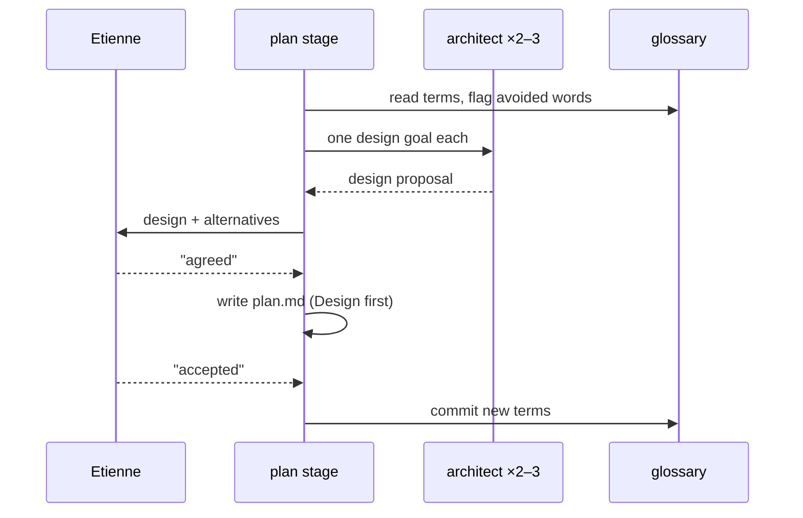

# Plan: Design altitude in plans

From `intent.md` (2026-10-09). Status: accepted.

## Context

Plans today stay at file-and-task level. This change adds a design section to every plan, a lasting glossary, a design skill, a read-only architect agent, a diagrams skill with terminal rendering, a design pass in review, and inline RBS signatures. Everything lands in this dotfiles repository, in one branch and one pull request, as about ten small commits. The repository is personal (`origin` is `eirvandelden/dotfiles`); delivery is step-by-step, not autonomous.

## Design decisions

- **Three new shared skills, one per concern**: `software-design` (principles and how to write the plan's design section), `glossary` (file, format, challenge rule, ADR rule), `diagrams` (Mermaid conventions, the "before" picture, rendering). Each is linked for Codex under `agents/.agents/skills/` and gets `agents/openai.yaml`. Rejected: one large `design` skill — it would load diagram tooling for a glossary question. Rejected name `design`: too close to the artifact-design skill.
- **The existing `object-oriented-design`, `rails-architecture`, `ruby-style` stay Claude-only** (`CLAUDE_ONLY` in `test/skill_parity_test.rb`). Codex reaches them through `SKILLS-INDEX.md` as today. The intent's Codex criterion names only the design, diagrams and glossary skills.
- **Plan template**: a new `## Design` section directly under the header, before `## Design decisions`. Subsections: `### Domain terms`, `### Diagrams`, `### Signatures`, `### Complexity`, `### Invariants`, `### Alternatives`. A subsection the change does not touch is one line: `Not affected: <why>.` `## Design decisions` stays (the test pins it) and keeps holding the non-structural choices.
- **Design gate**: a new `here` step between reading the code and writing `plan.md`. The agent runs two or three architect agents in parallel, shows the design and the alternatives, and waits. The design moves on only on the literal "agreed" or "accepted", the same words as the stage gates. Claude shows alternatives with `AskUserQuestion` previews; Codex shows them as a numbered list with one fenced block each.
- **Steps renumber**: the `here` list grows from 7 to 8 steps. `test/approval_word_test.rb` pins step 7; it moves to step 8 in the same commit.
- **Auto mode**: the architects still run; nobody waits. The cross-model critique must cover `## Design`; that critique stands in for Etienne's agreement (intent's flagged concern).
- **Design proof lines** sit in `## Proof` after the acceptance criteria, same arrow format:
  - `- Query count: <claim> → \`<test file>\` \`<test name>\``
  - `- Invariant: <statement>, enforced by <where> → \`<test file>\` \`<test name>\``
  - `fill-pr-template` picks them up as criteria; `implement` builds them like any criterion. No parser changes.
- **Signatures line**: `### Signatures` ends with `Checked by: steep check` or `Not checked: <project> declined Steep and rbs_rails.`
- **Glossary location by scope**: `~/.claude/skills/finish/scripts/change-scope` decides. `personal` → `GLOSSARY.md` at the repository root, committed. `work` → `GLOSSARY.local.md`, added to `git/.config/git/ignore.global` so it is never committed. Format: one bullet per term, `- **Term** — definition. Avoid: x, y.` An ADR is earned when a decision is costly to reverse, contradicts an earlier one, or will surprise a later reader; work ADRs go where `finish` step 2 already puts them; personal ADRs go to `docs/adr/NNNN-<slug>.md`.
- **Glossary commits**: the intent and plan stages write new terms. In a personal repo the glossary gets its own commit, `docs: glossary terms for <slug>`, so "commit `plan.md` alone" and "commit `intent.md` alone" still hold.
- **Before ERD**: rails-erd 2.x writes Mermaid by default (`erd.mmd`, no Graphviz), run as `bundle exec erd` limited to the touched models with `only=`. The skill reads the rails-erd version from `Gemfile.lock` first. 2.x: run it. Missing, or 1.x (Graphviz only): ask to add or upgrade it. Declined: build the `erDiagram` from `db/schema.rb`. The plan stage generates the before picture itself; architects only read it.
- **Renderer**: one Ruby script, `~/.claude/skills/diagrams/scripts/mermaid-show`, plus a ten-line Node helper `mermaid-ascii.mjs` that imports `renderMermaidASCII` from the global `beautiful-mermaid` (ESM only, no CLI; it resolves the path with `npm root -g`). Modes:
  - `mermaid-show <file.mmd>` prints Unicode text.
  - `mermaid-show <file.md>` prints each Mermaid fence as text.
  - `mermaid-show --markdown` reads markdown on stdin and writes it back with each Mermaid fence replaced by a text fence.
  - `mermaid-show --image <file>` runs `mmdc` to a PNG in a temp dir, then `timg`.
  - Tests stub `node`, `mmdc` and `timg` on `PATH`, the pattern `test/editor_test.rb` uses. ImageMagick is not needed: `mmdc` crops and sets the background itself.
- **Packages**: add `mermaid-cli` and `timg` to `BREW` and `beautiful-mermaid` to `NPM_PACKAGES` in `packages.conf` (approved in the intent). `imagemagick` stays undeclared because nothing uses it.
- **The pull request carries the design**: `fill-pr-template` copies the whole `## Design` section, its `###` subsections and Mermaid fences included, to the top of the Implementation part, so GitHub renders the diagrams after `finish` removes the change folder. A new helper reads a section up to the next heading of the same or a higher level; `section_body` stays as it is.
- **Viewer**: the herdr file viewer has no hook, only a replaceable `markdown` command whose output keeps SGR codes only. The wrapper would be `mermaid-show --markdown | glow -s <bundled style> …`. It is kept only if the check in step 14 passes; otherwise the viewer config stays untouched and the PR body records why.
- **YARD**: dropped from `ruby-style` and `rails-architecture`, including the custom `@action` and `@route` tags. Every class and method gets a prose summary and an inline RBS comment, both scopes. This also removes the current contradiction ("Personal: YARD-document every method" against "Personal: no doc comments"). `rubocop-yard` stays in `rubocop/.rubocop.yml`: without tags its cops are silent, and removing it is a dependency change for its own branch.

## Design

This change is skills, an agent definition and one script; there is no domain model.

### Domain terms

- **Design section**: the `## Design` part of `plan.md`.
- **Design gate**: the stop where Etienne agrees the design before the file-level plan.
- **Architect**: the read-only agent that proposes one design for one goal.
- **Glossary**: `GLOSSARY.md` or `GLOSSARY.local.md`. Avoid: dictionary, vocabulary.

### Diagrams



### Signatures

`mermaid-show` (Ruby, inline RBS, prose summary per method):

```ruby
# Renders Mermaid as text or as an image in the terminal.
class MermaidShow
  # Reads the mode and the input from the command line.
  #: (Array[String] argv, ?out: IO, ?input: IO) -> void
  def initialize(argv, out: $stdout, input: $stdin)
  # Renders the input in the chosen mode; returns the exit status.
  #: () -> Integer
  def run
  # Replaces each Mermaid fence with a text fence of its rendering.
  #: (String markdown) -> String
  def replace_fences(markdown)
  # Renders one diagram as Unicode text.
  #: (String source) -> String
  def text_for(source)
  # Renders one diagram to a PNG and shows it with timg.
  #: (String source) -> void
  def show_image(source)
end
```

Not checked: this repository has no Steep.

### Complexity

`replace_fences` is one linear pass over the lines, plus one `node` process per fence. No database.

### Invariants

- `mermaid-show --markdown` changes only Mermaid fences; every other byte passes through. Enforced by the fence scanner; proved by `test/mermaid_show_test.rb` `test_markdown_mode_leaves_everything_but_mermaid_fences_alone`.
- A design subsection is never missing; it is either filled or one `Not affected:` line. Enforced by the template text; proved by `test/design_section_test.rb`.

### Alternatives

1. Chosen: three skills plus one agent, design gate inside the plan stage.
2. Rejected: a separate `design` stage between intent and plan — another pane, another gate, another artifact, against the intent's "every plan opens with a design discussion".
3. Rejected: render diagrams only as images — Codex and herdr panes cannot show them; text works everywhere.

## Integration points

- `auto-accept` reads the first `Status:` line and everything from `## Critique` to the end. `## Design` comes after the header and never holds a `## Critique` line.
- `fill-pr-template` reads `## Files that change`, `## Order of work

Each numbered step is one commit. In every step the named tests are written first, run, and watched fail for the right reason before any skill, agent, script or config text changes. Run one file with `ruby -Itest test/<file>.rb`.

1. Write `test/design_section_test.rb` `test_the_plan_template_puts_the_design_section_before_the_files_that_change`. Run it; watch it fail.
2. Plan skill. Tests first: the other `test/design_section_test.rb` tests in Proof, and `test/approval_word_test.rb` moved to step 8. Then the template, the design gate step, proof lines, Signatures line, auto mode, critique and Codex text. Green.
3. `software-design` skill. Test first: `test/design_section_test.rb` `test_the_software_design_skill_covers_deep_modules_messages_crc_connascence_and_solid`. Then the skill, `agents/openai.yaml` and its link.
4. Architect agent. Tests first: `test/architect_agent_test.rb`. Then `architect.md`, then `bin/generate-codex-agents`. Also run `test/codex_agent_generation_test.rb`.
5. Glossary. Tests first: `test/glossary_skill_test.rb`, including `test_git_ignores_glossary_local_md`, which runs `git check-ignore` with `ignore.global` as `core.excludesFile` in a temp repo. Then the skill, its link, the intent and plan skill edits, `ignore.global`.
6. `mermaid-show`. Tests first: `test/mermaid_show_test.rb` with stubbed `node`, `mmdc` and `timg`. Then the script and the Node helper.
7. Diagrams skill. Tests first: `test/diagrams_skill_test.rb`. Then the skill, `agents/openai.yaml` and its link. Read the rails-erd README for the `bundle exec erd` options before writing them down.
8. Packages. Test first: `test/diagrams_skill_test.rb` `test_packages_conf_declares_the_diagram_tools` (`mermaid-cli`, `timg` in `BREW`; `beautiful-mermaid` in `NPM_PACKAGES`). Then `packages.conf`.
9. Design review pass. Tests first: `test/design_review_pass_test.rb`. Then `reviewer.md` (regenerate its toml), the `REVIEW.md` template, `start-review.sh`. Also run `test/herdr_worker_scripts_test.rb`.
10. Signatures. Tests first: `test/ruby_signatures_test.rb`. Then `ruby-style`, `rails-architecture` and its examples, `implement`, `object-oriented-design`.
11. PR body. Tests first: the two `test/fill_pr_template_test.rb` tests in Proof. Then `fill-pr-template`.
12. Codex parity. Test first: `test/skill_parity_test.rb` `test_codex_gets_the_design_diagrams_and_glossary_skills`, which also asserts `SKILLS-INDEX.md` lists all three. Then `SKILLS-INDEX.md`.
13. Real render check: run `mermaid-show` on one class, ER, sequence and state diagram, as text in a herdr pane and with `--image` in Ghostty. Record the output in `docs/changes/design-altitude-in-plans/evidence.md`.
14. Viewer check: pipe a markdown file with a Mermaid fence through the candidate wrapper and glow with the bundled style, then open it in the viewer at a narrow and a wide pane. Keep the config change only if headings keep the palette and the diagram does not wrap; else record the result for the PR body.
15. Full checks:
    - Suite: `for f in test/*_test.rb; do ruby -Itest "$f" || exit 1; done`.
    - `rubocop` on `mermaid-show`, `fill-pr-template` and every new or changed test file.
    - `yamllint` on the three new `agents/openai.yaml` files.
    - `node --check` on `mermaid-ascii.mjs` (no hook covers `.mjs`).
    - `bash -n packages.conf` and `shellcheck` on `start-review.sh`.
    - markdownlint no-hardwrap on every touched `.md`.
    - Re-read the diff.

## Risks

- **`approval_word_test` pins step 7.** Renumbering is deliberate; the test moves with it in the same commit, its assertion text unchanged.
- **Longer plan conversations.** The one-line `Not affected:` rule keeps a config tweak short.
- **`timg` inside herdr.** Kitty graphics may not pass through herdr. `timg` then falls back to block characters; if those are unreadable, `--image` opens a new Ghostty window running `timg`. Decided in step 13 with evidence.
- **Viewer re-wraps wide lines.** A wide text diagram breaks; that is what step 14 checks before keeping the config.
- **`beautiful-mermaid` is ESM-only and global.** The helper resolves it with `npm root -g`; a missing package prints a one-line install hint and exits 1.
- **rails-erd version.** 1.x has no Mermaid output; the skill treats it like a missing gem. Option names are read from the README in step 7, not assumed.
- **Rejected:** a separate design stage (see Alternatives); ImageMagick in the pipeline (unused); removing `rubocop-yard` (separate branch); changing `auto-accept` (not needed); `Bash` for the architect (it could write).

## Out of scope

- Formal methods, mutation testing, property tests.
- Inline Mermaid images in Neovim.
- A stored architecture document besides the glossary and ADRs; `finish` still removes the change folder.
- Changing the `rubocop-eirvandelden` gem; removing `rubocop-yard` from `rubocop/.rubocop.yml`.
- Rewriting existing YARD comments anywhere.
- Linking `object-oriented-design`, `rails-architecture`, `ruby-style` for Codex.

## Proof

- A plan for a model method opens with a design section before the files that change → `test/design_section_test.rb` `test_the_plan_template_puts_the_design_section_before_the_files_that_change`, `test_the_design_section_asks_for_terms_a_class_diagram_signatures_and_complexity`
- A change with no design impact shows each subsection as one line that says why → `test/design_section_test.rb` `test_each_design_subsection_shrinks_to_one_line_that_says_why`
- Two or three alternatives, reasons for rejection, wait for agreement → `test/design_section_test.rb` `test_the_plan_waits_for_the_design_to_be_agreed_after_showing_alternatives`
- A query-count claim names its test in Proof → `test/design_section_test.rb` `test_a_query_count_claim_names_its_test_in_proof`
- An invariant names where it is enforced and its test → `test/design_section_test.rb` `test_an_invariant_names_its_enforcement_and_its_test`
- An agreed term survives `finish` in `GLOSSARY.md` or `GLOSSARY.local.md` → `test/glossary_skill_test.rb` `test_the_glossary_lives_outside_the_change_folder_by_scope`
- An avoided word gets the glossary term and a question → `test/glossary_skill_test.rb` `test_an_avoided_word_gets_the_glossary_term_and_a_question`
- The before ERD comes from rails-erd, asks when missing, falls back to `db/schema.rb` → `test/diagrams_skill_test.rb` `test_the_before_erd_comes_from_rails_erd_or_schema_rb`
- Mermaid class, ER, sequence and state diagrams print as text and show as an image → `test/mermaid_show_test.rb` `test_prints_a_diagram_as_text`, `test_image_mode_renders_a_png_and_shows_it_with_timg`; check: step 13 real render, recorded in `evidence.md`
- Two or three architects at once with different goals; Codex gets the same agent → `test/architect_agent_test.rb` `test_the_plan_runs_two_or_three_architects_with_different_goals`, `test_the_architect_is_read_only_and_generated_for_codex` (no `Bash`; `architect.toml` exists and matches the generator)
- The reviewer reports unsigned public methods, Law of Demeter violations, N+1 loops, avoided words → `test/design_review_pass_test.rb` `test_the_design_pass_names_all_four_findings`
- New Ruby code has a prose summary and inline RBS per method, no YARD tags → `test/ruby_signatures_test.rb` `test_ruby_style_asks_for_a_summary_and_inline_rbs_per_method`, `test_no_skill_asks_for_yard_tags`; `test/mermaid_show_test.rb` `test_every_method_has_a_summary_and_an_inline_signature`
- `steep check` passes where accepted; otherwise the plan says signatures are not checked → `test/ruby_signatures_test.rb` `test_signatures_are_checked_by_steep_or_marked_not_checked`
- Codex loads the same design, diagrams and glossary skills and the same plan template → `test/skill_parity_test.rb` `test_codex_gets_the_design_diagrams_and_glossary_skills`
- GitHub renders the plan's diagrams in the pull request → `test/fill_pr_template_test.rb` `test_the_plans_design_section_lands_in_the_implementation_part_with_its_mermaid_fence`, `test_an_appended_implementation_section_starts_with_the_design`
- Invariant: `--markdown` changes only Mermaid fences, enforced by the fence scanner → `test/mermaid_show_test.rb` `test_markdown_mode_leaves_everything_but_mermaid_fences_alone`

Per changed file, the unit tests expected, named as behaviour:
- `claude/.claude/skills/diagrams/scripts/mermaid-show`: `prints a .mmd file as text`, `prints each fence of a .md file`, `markdown mode replaces only mermaid fences`, `image mode calls mmdc then timg`, `a missing beautiful-mermaid prints the install hint and exits 1`, `an unknown flag prints usage and exits 2`.
- `claude/.claude/agents/architect.md`: `has no Bash`, `is read-only`, `takes one design goal`, `returns the design section format`, `generated toml matches`.
- `claude/.claude/agents/reviewer.md`: `runs a Design pass`, `still runs Bugs, Security, Compliance`.
- `herdr/.config/herdr/scripts/start-review.sh`: `prompt names the Design pass`.
- `claude/.claude/skills/finish/scripts/fill-pr-template`: `copies Design with its subsections`, `keeps a Mermaid fence intact`, `a plan without Design fills as before`.

Test setup: plain Minitest text-contract tests that read skill and agent text, like `test/artifact_chain_skills_test.rb`. `mermaid-show` tests run the script with `Open3` in a temp dir with stub `node`, `mmdc` and `timg` on `PATH` that log their arguments, like `test/editor_test.rb`.

---
Domain skills applied: dotfiles-maintenance, object-oriented-design, ruby-style, dependencies.

## Critique

### Round 1 (codex)

- The pull request will not carry the diagrams, since `fill-pr-template` skips `## Design` and `finish` deletes the folder → fixed (`fill-pr-template` copies `## Design` into Implementation; two tests in Proof)
- The architect keeps `Bash`, which can write; the drift test misses an absent `architect.toml` → fixed (tools are `[Read, Grep, Glob]`; `test/architect_agent_test.rb` asserts the toml exists and matches)
- Proof covers placement only, not terms, class diagram, signatures and complexity; `MermaidShow` lacks prose comments and no test checks the script itself → fixed (subsection test added; signature sketch carries summaries; `test_every_method_has_a_summary_and_an_inline_signature` reads the script)
- Steps 2, 3 and 11 describe text before tests; the packages step has no test → fixed (every step names its failing tests first; package and `git check-ignore` tests added)
- Final checks skip new Ruby tests, YAML, `packages.conf` and the `.mjs` helper → fixed (step 15 lists rubocop, yamllint, `node --check`, `bash -n`, shellcheck)
- rails-erd version handling is deferred → fixed (version read from `Gemfile.lock`; 1.x treated as missing)
- Homebrew `mermaid-cli` is unsupported upstream → dismissed: Etienne approved and installed it on 2026-10-09; `mmdc` 12.0.0 runs, and step 13 exercises it for real
