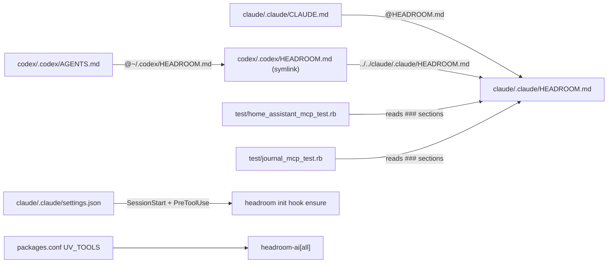
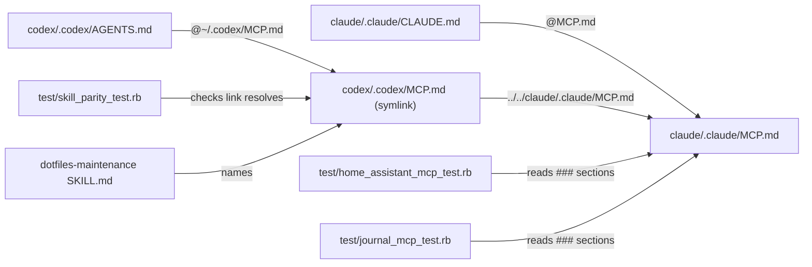

# Plan: Drop headroom

From `intent.md` (2026-10-29). Status: accepted.

## Design

### Domain terms

- **MCP doc** (new): `claude/.claude/MCP.md`, the one shared file of one-time MCP setup notes for Claude and Codex. It also keeps the Codex daemon rules for unlocked sessions. It replaces `claude/.claude/HEADROOM.md`.
- **Codex link** (new): `codex/.codex/MCP.md`, a git symlink to `../../claude/.claude/MCP.md`. Codex imports the MCP doc through it, as it does for `WORKTREES.md` today.
- **Scope** (glossary): not touched.
- Glossary conflict: the current doc and two test names call `zsh/.config/zsh/unlocked-bin/codex` a "shim". `GLOSSARY.md` lists "shim" as a word to avoid for **Binstub**, which is a different thing. New text in this change does not use "shim". The existing `SHIM` constant, the `codex_unlocked_shim_test.rb` file name and the other "shim" test names stay; renaming them is out of scope.

### Diagrams

Before:



After:



Heading layout of the new `claude/.claude/MCP.md`. Every kept section body stays word for word, except the reworded unlock paragraph:

```text
# MCP

One-time MCP server setup for Claude Code and Codex, and the Codex daemon rules after `unlock`.

## Claude
### Semble (semantic code search MCP)
### Home MCP servers (email, fizzy, homeassistant, journal)
### TREK MCP server

## Codex
### Unlocked sessions     (was "### Launch"; its headroom code block goes)
### TREK MCP login
```

Removed: the `# Headroom` title, the "Context compression layer" intro line, the Claude `### Launch` and `### Meta commands` sections, the Codex launch code block and the Codex `### Meta commands` section. `## Claude` stays, so the file never jumps from H1 to H3 (markdownlint MD001).

`### Unlocked sessions` holds two paragraphs. First, the reworded one:

> After `unlock`, `codex` runs in-process (`--no-daemon`) through `zsh/.config/zsh/unlocked-bin/codex`, off the shared daemon, so its sessions do not show in `codex agents`.

Then the "Never start the background server from an unlocked session" paragraph, word for word.

### Signatures

Not affected: no class gains or changes a public method. Test-only renames:

- `HomeAssistantMcpTest` and `JournalMcpTest`: constant `HEADROOM` → `MCP_DOC` (`claude/.claude/MCP.md`); helper `headroom_section_naming` → `mcp_doc_section_naming`; `test_headroom_*` → `test_mcp_doc_*`; flunk message `"MCP.md has no ### section naming #{name}"`.
- `CodexUnlockTest#test_after_unlock_headroom_finds_the_shim_…` → `#test_after_unlock_a_launcher_finds_the_shim_and_its_session_runs_off_the_shared_daemon_with_the_secrets`; its message becomes `a launcher would run $resolved`.
- `CodexUnlockedShimTest#test_headroom_config_prefix_still_starts_a_session_with_no_daemon` → `#test_a_config_prefix_still_starts_a_session_with_no_daemon`.
- New `SkillParityTest#test_codex_mcp_doc_resolves_to_the_claude_one`.

Not checked: the dotfiles test files carry no RBS signatures; no class signature changes.

### Complexity

Not affected: no new code path. Each Claude session start or resume runs one process fewer, and each Bash or PowerShell tool call runs one process fewer.

### Invariants

- Claude and Codex read the same MCP doc. Enforced by the git symlink `codex/.codex/MCP.md` → `../../claude/.claude/MCP.md`.
- The MCP doc has a `### ` section naming `homeassistant` and one naming `journal`, each with its `claude mcp add` command and its "run `unlock` before `claude`" note. Enforced by the two MCP tests.
- The MCP doc warns never to start the background server from an unlocked session. Enforced by the doc text; checked by `grep`.
- No headroom reference remains in the repository. Checked by `git grep -i headroom`.

### Alternatives

1. **Shared doc behind a symlink (chosen).** Rename in place, re-point the Codex link, drop the headroom lines. Smallest diff. Keeps the one-source pattern of `WORKTREES.md` and the "share everything once" parity goal.
2. **Split into two real files, one per tool.** Rejected. Each tool would load only its own notes, about 250 to 600 tokens fewer per session. But it reverses the shared-doc pattern, duplicates the TREK notes so they can drift, and makes a structural choice that `intent.md` did not record.
3. **Delete both docs and move the notes elsewhere** (for example into `PLAYBOOK.md`). Rejected. It contradicts the intent decision "Rename … to `MCP.md` instead of deleting it" and bloats the playbook.

## Design decisions

- Keep one shared file with the Codex symlink re-pointed, not two files. Reason: parity goal and the `WORKTREES.md` precedent; the intent says "rename", not "split".
- Add `test_codex_mcp_doc_resolves_to_the_claude_one` next to `test_codex_worktrees_doc_resolves_to_the_claude_one` in `test/skill_parity_test.rb`. Reason: `git mv` keeps the old link target, so a missed re-point leaves Codex with a dangling import and no error. This test is the walking skeleton and costs six lines. It does not change any agreed behaviour.
- Replace the tracked Codex link `codex/.codex/HEADROOM.md` with `codex/.codex/MCP.md`. Reason: `intent.md` In scope, accepted by Etienne, names this rename; that is the explicit instruction rule 12 asks for. The change touches only the link inside the `codex` package. It never touches a stowed link in `~/` and never runs stow.
- Rename the Codex `### Launch` heading to `### Unlocked sessions`. Reason: without the headroom block the section holds only the unlock rules.
- Title the doc `# MCP`. Reason: matches the file name the intent chose.
- No conflict with `intent.md`'s `## Decisions`.

## Integration points

- Claude Code loads `~/.claude/MCP.md` through the `@MCP.md` import in `~/.claude/CLAUDE.md`, once Etienne restows the `claude` package.
- Codex loads `~/.codex/MCP.md` through `~/.codex/AGENTS.md`, once Etienne restows the `codex` package.
- `install/tasks/42_install_uv_tools.sh` reads `UV_TOOLS` from `packages.conf`. It handles a one-item array unchanged.
- Claude Code reads `claude/.claude/settings.json` hooks at session start.

## Files that change

- `test/skill_parity_test.rb` — add `test_codex_mcp_doc_resolves_to_the_claude_one` (symlink check plus equal `File.realpath`).
- `claude/.claude/HEADROOM.md` → `claude/.claude/MCP.md` — `git mv`, then the heading layout above.
- `codex/.codex/HEADROOM.md` → `codex/.codex/MCP.md` — `git rm` the old link, then `ln -s ../../claude/.claude/MCP.md codex/.codex/MCP.md` and `git add` it. This is a link inside the repository, not a stowed target in `~/`.
- `claude/.claude/CLAUDE.md` — `@HEADROOM.md` → `@MCP.md`.
- `codex/.codex/AGENTS.md` — `@/Users/etienne.vandelden/.codex/HEADROOM.md` → `@/Users/etienne.vandelden/.codex/MCP.md`.
- `agents/.agents/skills/dotfiles-maintenance/SKILL.md` — line 50: `codex/.codex/HEADROOM.md` → `codex/.codex/MCP.md`.
- `test/home_assistant_mcp_test.rb` — comment line 7 says `MCP.md`; the renames under Signatures.
- `test/journal_mcp_test.rb` — the same renames.
- `test/codex_unlock_test.rb` — test name and message, per Signatures.
- `test/codex_unlocked_shim_test.rb` — test name, per Signatures.
- `claude/.claude/settings.json` — delete the SessionStart entry with matcher `startup|resume` and the PreToolUse entry with matcher `Bash|PowerShell`; both run only `headroom init hook ensure`. Leave every other entry and its order unchanged.
- `packages.conf` — delete `"headroom-ai[all]"` from `UV_TOOLS`; `"semble[mcp]"` stays.

## Order of work

1. Add `test_codex_mcp_doc_resolves_to_the_claude_one` to `test/skill_parity_test.rb`. Run `ruby -Itest test/skill_parity_test.rb -n test_codex_mcp_doc_resolves_to_the_claude_one` and watch it fail: `codex/.codex/MCP.md` does not exist.
2. Point the two MCP tests at `claude/.claude/MCP.md` with the renames. Run both files; watch them fail on the missing file.
3. `git mv claude/.claude/HEADROOM.md claude/.claude/MCP.md`. Replace the Codex link. Edit the doc to the layout above. Run the three test files from steps 1 and 2; all green.
4. Update the imports in `claude/.claude/CLAUDE.md` and `codex/.codex/AGENTS.md`, and the pointer in the `dotfiles-maintenance` skill. Commit: "Rename HEADROOM.md to MCP.md and drop headroom notes".
5. Rename the headroom wording in `test/codex_unlock_test.rb` and `test/codex_unlocked_shim_test.rb`. Run both files; green. Commit.
6. Delete the two headroom hook entries from `claude/.claude/settings.json`. Check the JSON parses and holds no headroom command (Proof). Run `test/agent_voice_test.rb`, `test/guard_parity_test.rb`, `test/question_rule_mirror_test.rb`, `test/question_wording_guard_test.rb` and `test/vendored_skills_test.rb`, which read this file. Commit.
7. Delete `"headroom-ai[all]"` from `packages.conf`. Commit.
8. Run `! git grep -i headroom -- ':!docs/changes/drop-headroom'`; expect no output and exit 0. Run `bin/test`, then RuboCop on the changed Ruby files and the no-hardwrap markdownlint on the changed Markdown files.

## Risks

- `git mv` on the Codex link keeps the target `../../claude/.claude/HEADROOM.md`, which no longer exists. The link must be recreated. The new parity test catches a miss.
- The main checkout has uncommitted edits to `claude/.claude/settings.json` (and `codex/.codex/config.toml`). Etienne's later rebase or stash pop of those edits may conflict with the hook removal. The worktree is based on `origin/main`; the plan does not touch the main checkout.
- Until Etienne restows `claude` and `codex`, `~/.claude/HEADROOM.md` and `~/.codex/HEADROOM.md` dangle and `~/.claude/MCP.md` and `~/.codex/MCP.md` do not exist, so neither tool loads the MCP doc. The stowed `settings.json` is a link into the repository's main checkout, so the hooks stop only after this branch merges into main.
- Heading changes could break the MCP tests, which split on `^(?=### )` and match the first line of a section. The home-servers heading keeps "homeassistant" and "journal", so both still match.
- Rejected: splitting the doc per tool (see Alternatives).

## Out of scope

- `semble`: uninstall, reinstall or registration change.
- Running `uv tool uninstall headroom-ai`, `stow` or anything else outside the repository, including `~/.headroom`.
- Any change to `zsh/.config/zsh/unlocked-bin/codex` behaviour.
- Renaming "shim" in existing test names, constants or file names.
- A test that the background-server warning stays in the MCP doc.
- Splitting the MCP doc per tool.

## Proof

- `git grep -i headroom` finds nothing outside the change folder → check: `! git grep -i headroom -- ':!docs/changes/drop-headroom'` prints nothing and exits 0.
- Starting Claude no longer runs a headroom hook → check: `ruby -rjson -e 's = JSON.parse(File.read("claude/.claude/settings.json")); abort "headroom hook" if s["hooks"].values.flatten.flat_map { _1["hooks"] }.any? { _1["command"].include?("headroom") }'` exits 0.
- `packages.conf` installs `semble[mcp]` and no longer lists `headroom-ai[all]` → check: `bash -c 'source packages.conf; printf "%s\n" "${UV_TOOLS[@]}"'` prints only `semble[mcp]`.
- Home Assistant and journal notes found in `claude/.claude/MCP.md` → `test/home_assistant_mcp_test.rb` `test_mcp_doc_registers_home_assistant_for_claude_with_the_token_left_unexpanded`, `test_mcp_doc_says_to_unlock_before_starting_claude_for_home_assistant`; `test/journal_mcp_test.rb` `test_mcp_doc_registers_journal_for_claude_with_the_token_left_unexpanded`, `test_mcp_doc_says_to_unlock_before_starting_claude_for_journal`.
- A Codex session after `unlock` still runs with `--no-daemon` and the secrets → `test/codex_unlock_test.rb` `test_after_unlock_a_launcher_finds_the_shim_and_its_session_runs_off_the_shared_daemon_with_the_secrets`; `test/codex_unlocked_shim_test.rb` `test_a_config_prefix_still_starts_a_session_with_no_daemon`.
- `codex/.codex/MCP.md` still warns never to start the background server from an unlocked session → check: `grep -F "Never start the background server from an unlocked session" codex/.codex/MCP.md` matches.
- Full suite and linters green → check: `bin/test` exits 0; `rubocop` on the five changed test files exits 0; `markdownlint --config ~/.config/markdownlint/no-hardwrap.json --rules ~/.config/markdownlint/no-hardwrap.cjs claude/.claude/MCP.md claude/.claude/CLAUDE.md codex/.codex/AGENTS.md agents/.agents/skills/dotfiles-maintenance/SKILL.md` exits 0.
- Invariant: Claude and Codex read the same MCP doc, enforced by the `codex/.codex/MCP.md` symlink → `test/skill_parity_test.rb` `test_codex_mcp_doc_resolves_to_the_claude_one`.

Per changed file, the unit tests expected:

- `test/skill_parity_test.rb`: `SkillParityTest#test_codex_mcp_doc_resolves_to_the_claude_one`.
- `test/home_assistant_mcp_test.rb`, `test/journal_mcp_test.rb`, `test/codex_unlock_test.rb`, `test/codex_unlocked_shim_test.rb`: renames only, no new tests.
- `claude/.claude/settings.json`, `packages.conf`, the Markdown files: configuration, no tests.

Test setup: none new. The tests read repository files in place; the codex tests keep their existing PATH stubs.

---
Domain skills applied: dotfiles-maintenance, software-design, glossary, diagrams.

## Critique

### Round 1 (codex exec -p terra)

- Replacing the tracked Codex symlink breaks the rule against modifying symlinks directly → fixed (Design decisions record that the accepted intent names this rename as the explicit instruction, and that only the in-package link changes, never a stowed link in `~/`)
- The markdownlint check omits the changed `CLAUDE.md` and `AGENTS.md` → fixed (Proof lint command now lists `claude/.claude/CLAUDE.md` and `codex/.codex/AGENTS.md`)
- The grep check excludes every change folder and expects exit 1, which can hide a stray reference → fixed (step 8 and Proof now run `! git grep -i headroom -- ':!docs/changes/drop-headroom'`, which exits 0 when clean)
