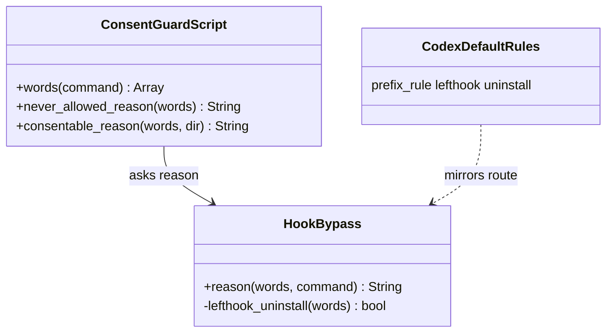

# Plan: Consent guard asks before any way of skipping the git hooks

From `intent.md` (2026-10-07, amended 2026-10-12 and 2026-11-10). Status: accepted.

## Context

The consent guard (`claude/.claude/hooks/consent-guard.rb`) is a PreToolUse hook. Claude runs it from `claude/.claude/settings.json`, Codex from the inline `[[hooks.PreToolUse]]` table in `codex/.codex/config.toml`. Both run `"$HOME/.claude/hooks/consent-guard.rb"`. It reads the tool call as JSON on stdin, turns the command into words, and exits 2 with a reason on stderr when the command needs consent. A command that starts with `I_HAVE_USER_CONSENT=1 ` goes through, except a plain `--force` push and the `gh pr create`/`gh pr merge` refusals, which nothing unlocks.

Main's `words(command)` copies the command character by character: outside quotes it turns `;`, `|`, `&`, `&&` and a newline into separate words, drops redirects whole (`2>/dev/null`) and drops comments. Quoted text stays one word, through `Shellwords.split`. An unmatched quote falls back to a whitespace split that also separates the operators. Probed 2026-10-13:

- `git push --force origin feature; echo done` gives `--force` and `;` as separate words, so it is refused; `--force-with-lease ...; echo done` goes through. The intent's splitting criterion holds on main.
- `export LEFTHOOK=0; git commit -m x` gives `export`, `LEFTHOOK=0`, `;`, `git`, `commit`, ….
- `git commit -m "LEFTHOOK=0 is refused"` keeps `LEFTHOOK=0 is refused` as one word. `git commit -m "--no-verify;x"` gives the one word `--no-verify;x`.
- `LEFTHOOK_CONFIG="/tmp/hook dir/x.yml" git commit -m x` gives the one word `LEFTHOOK_CONFIG=/tmp/hook dir/x.yml`.
- `echo $(git commit -n -m x)` gives `$(git` and `x)`; `` echo `git commit -n -m x` `` gives `` `git `` and `` x` ``; `(git commit -n -m x)` gives `(git` and `x)`. Substitution and subshell punctuation stays glued to the word.

### State of the branch (2026-11-10)

The first implementation is on this branch, reviewed in three rounds (`docs/changes/guard-hook-bypasses/review.md`): `917b7a4a` (`HookBypass`, wiring, tests), `2fa7b73d` (Codex rules), `7dfd488f`, `4ba2ff54`, `f06d1849`, `4c7aa254`, `49f0122e` and `1a6b4a54` (round fixes). It asks before `lefthook install`, `lefthook uninstall` and `lefthook add`.

ADR 0001 (`docs/adr/0001-per-repo-lefthook-remotes.md`, 2026-11-09) removed the global git hooks. The dotfiles repository sets no `core.hooksPath` and ships no hook scripts; `git/.config/git/hooks/` no longer exists. Each repository arms its own hooks with `lefthook install`. The `new-repo-setup` skill (step 3) and `git/.config/git/worktree-tools/README.md:161-168` now prescribe `lefthook install`. Etienne amended and accepted `intent.md` on 2026-11-10: only `lefthook uninstall` waits; `lefthook install`, `lefthook add pre-commit` and `lefthook dump` go through.

This revision changes only the lefthook route, its Codex rule, its parity entries, its tests and the stale text around them. Every other route stays as built and reviewed.

`origin/main` (`57ed17bb`) moved past the branch's base (`41065473`). Main touched `consent-guard.rb` (one comment above `change_folder?`) and `test/consent_guard_test.rb` (one new test and a `stage:` keyword on `start_change`). `git merge-tree --write-tree HEAD origin/main` reports no conflicts (checked 2026-11-10).

## Design

### Domain terms

- **Git hooks**: the hooks that `lefthook install` writes into one repository's `.git/hooks`, from its Repo config and the Shared config. There are no global hooks since ADR 0001, so no reason text says "global".
- **Route**: one way of skipping or disarming the git hooks that shows in a command's words, with one `[bool, reason]` pair in `HookBypass.routes`.
- Repo config and Shared config keep their glossary meaning. No new glossary term. The plan says "the former global hooks" where earlier text said "global shims": the glossary lists "shim" as a word to avoid for Binstub.

### Diagrams

The shape does not change. One predicate, one constant, one reason text, one Codex rule and the parity list get narrower.



### Signatures

`HookBypass` (`claude/.claude/hooks/hook_bypass.rb`): names the route by which a command skips the git hooks, or returns nil. The public method does not change.

```ruby
LEFTHOOK_UNINSTALL = "uninstall".freeze

#: (Array[String] words, String command) -> String?
def reason(words, command) # unchanged

# In routes, the last entry becomes:
[ lefthook_uninstall?(words), "lefthook uninstall removes a repository's git hooks, which are what keep commits off main (playbook rule 19)." ]

#: (Array[String] words) -> bool
def lefthook_uninstall?(words) # renamed from lefthook_install?
  start = words.index { |word| File.basename(word) == "lefthook" }
  !start.nil? && words.drop(start + 1).include?(LEFTHOOK_UNINSTALL)
end
```

Codex rule in `codex/.codex/rules/default.rules`, replacing the `["lefthook", ["install", "uninstall", "add"]]` rule:

```
prefix_rule(
    pattern = ["lefthook", "uninstall"],
    decision = "prompt",
    justification = "removes the repository's git hooks",
    match = [["lefthook", "uninstall"]],
    not_match = [["lefthook", "install"], ["lefthook", "add", "pre-commit"], ["lefthook", "dump"]],
)
```

Not checked: the dotfiles repository has no Steepfile; signatures are inline `#:` comments only, as `ruby-style` says.

### Complexity

`lefthook_uninstall?` is one `index` and one `include?` over the words: O(n) in the number of words, the same as before. No subprocess, no file read. The guard's run time does not change.

### Invariants

- A command with a `lefthook` word (by basename) followed later by an `uninstall` word gets a reason. Enforced by `HookBypass.lefthook_uninstall?`.
- `lefthook install`, `lefthook add …` and `lefthook dump` get no reason from any route. Enforced by `lefthook_uninstall?` matching only `LEFTHOOK_UNINSTALL`.
- Codex prompts for `lefthook uninstall`, and no allow rule loosens it. Enforced by the prefix rule and `test/guard_parity_test.rb` over `GUARDED_COMMANDS`.
- A chained `lefthook uninstall&&echo done` still waits. Enforced by main's `words`, which splits `&&` outside quotes.

### Alternatives

- A, chosen: the least change. Rename the predicate, keep its "any later word" scan, match only `uninstall`. Two lines of logic change; nothing generalises. False questions stay possible (`lefthook install && brew uninstall foo`) but are rare with a single, uncommon word, and the scan errs towards asking, as the guard's header asks.
- B, rejected: the fewest false questions. Split the words into statements and pipe stages, pair `uninstall` only with a `lefthook` word in the same statement, catch `echo uninstall | xargs lefthook`, wrappers such as `npx lefthook@latest`, any case, and exempt plain help requests (`lefthook uninstall --help`). It adds four constants and about eight private methods, takes the module from 118 to about 145 lines, adds five glossary terms, and puts a possible miss inside a help exemption that rests on how lefthook's flag parser treats `--help`, `-h` and `--`. The review's false-question case (`which lefthook && git add .`) disappears with `add` anyway. Too much structure for one word, against the guard's word-presence style.
- C, rejected: scope the scan to the same statement only (B's smaller form). It would duplicate statement splitting that main's `words` already exposes as separator words, for a false question that `uninstall` rarely triggers.

## Design decisions

1. **No `CommandPieces`. `HookBypass` reads main's `words`.** Main's tokenizer already splits chained commands outside quotes, so a second splitter would duplicate it. The coordinator decided this on 2026-10-13.
2. **Module `HookBypass` in `claude/.claude/hooks/hook_bypass.rb`.** Same shape as `remote_matcher.rb`: a `module` with `module_function`, standard library only. One public method, `HookBypass.reason(words, command)`, returns a refusal reason or `nil`. It takes the guard's words and the raw command (decision 5). The `--no-verify` check lives in the module because it is the same family.
3. **Wiring.** `consent-guard.rb` has `require_relative "hook_bypass"`. The script computes `reason = HookBypass.reason(command_words, command) || consentable_reason(command_words, working_directory)`, and `consentable_reason` holds no inline `--no-verify` lines. Hook-skipping routes are checked first. `never_allowed_reason` runs before both, unchanged. One header sentence says the guard also asks before every way of skipping the git hooks it can see in the words.
4. **Bare words inside `HookBypass`.** Before matching, `HookBypass` strips leading `$(`, `(`, `{` and `` ` `` and trailing `)`, `}` and `` ` `` from each word that holds no whitespace (the private `bare`). So `$(git`, `(git` and `` `git `` read as `git`, and `-n)` reads as `-n`. A word with whitespace came from quotes: it is prose and stays whole. Main's other checks keep their own handling.
5. **Route rules.** Each rule checks which bare words are present. Every rule errs towards asking.
   - `--no-verify` and its abbreviations: a word that is a prefix of `--no-verify` and at least as long as `--no-v`. Probed 2026-10-12 with git 2.54.0: `git commit --no-veri` and `--no-verif` skip a failing hook; `--no-v`, `--no-ve` and `--no-ver` are ambiguous with `--no-verbose` and git refuses them. Asking for those too is the safe direction and covers `push`, `merge` and `am`. The reason keeps the text `--no-verify` (`test_an_unreadable_command_still_asks_about_a_guarded_flag` asserts `/no-verify/`).
   - `git commit -n`: a `git` word, a commit word and a short-option cluster that holds `n`, matched by `/\A-[A-Za-z]*n[A-Za-z]*\z/`. That catches `-n`, `-nm` and `-an`. A commit word is `commit` or `ci`, the alias `git/.config/git/config` defines for `commit`; `HookBypass::COMMIT_WORDS` holds both. `git push -n origin feature` has no commit word, so it goes through.
   - lefthook switches: a word that starts with `LEFTHOOK=`, `LEFTHOOK_EXCLUDE=`, `LEFTHOOK_BIN=` or `LEFTHOOK_CONFIG=` and holds no whitespace, whatever the value. This covers inline, `export`, `env` and `typeset -x` forms. lefthook treats `0` and `false` as off, so the guard lists no values; `LEFTHOOK=1` asks too. lefthook's own stock hook script runs `$LEFTHOOK_BIN` in place of lefthook when it is set (this repository's `.git/hooks/pre-commit:13`). A quoted sentence such as `"LEFTHOOK=0 is refused"` holds whitespace, so it is prose and goes through. One exception: a switch word that holds whitespace still counts when the raw command holds an unquoted assignment with a quoted value, such as `LEFTHOOK_CONFIG="/tmp/hook dir/x.yml"`. The check is quote-aware: `QUOTED_SWITCH` swallows escapes and whole quoted strings first and counts only a match of its capture group, so a switch name inside a quoted sentence never matches. Probed on Ruby 3.4.11 and 4.0.7.
   - `core.hooksPath`: compared case-insensitively, because git config keys are.
     - A word `GIT_CONFIG_KEY_<n>=core.hooksPath`, or a word that starts with `GIT_CONFIG_PARAMETERS=` and whose value contains `core.hookspath`. No `git` word is needed: an `export` alone arms every later command.
     - With a `git` word: a word that starts with `core.hookspath=` (the `-c` form, and `--config-env <key>=<var>`), or with `--config-env=core.hookspath=`.
     - With `git` and `config` words: a bare `core.hookspath` word, unless the word right before it is a read (`READS`: `--get`, `--get-all`, `--get-regexp`, `get`). The check runs per occurrence, so `git config --get core.hooksPath; git config core.hooksPath x` asks. The bare read `git config core.hooksPath` asks too. Without a `config` word, `rg core.hooksPath` goes through.
     - With `git` and `config` words: a section operation on `core` (`SECTION_OPERATIONS`), which unsets `core.hooksPath` without naming it.
     - The `core.hookspath=` and `GIT_CONFIG_PARAMETERS=` prefixes may hold whitespace: a hooks path can contain a space, and `GIT_CONFIG_PARAMETERS` is a space-separated list.
   - Plumbing: a `git` word plus a `commit-tree` or `update-ref` word.
   - lefthook (changed 2026-11-10): a `lefthook` word with an `uninstall` word somewhere after the first `lefthook` word, through `lefthook_uninstall?` and the constant `LEFTHOOK_UNINSTALL`. `lefthook install`, `lefthook add pre-commit` and `lefthook dump` go through: since ADR 0001, `install` and `add` arm a repository's hooks. `brew uninstall lefthook` goes through, because `uninstall` comes first. The reason: "lefthook uninstall removes a repository's git hooks, which are what keep commits off main (playbook rule 19)."
   - Program words match by basename of the bare word: `File.basename(word) == "git"` (and `"lefthook"`), so `/usr/bin/git commit -n`, `bin/lefthook uninstall` and `$(git commit -n)` count.
6. **One reason per route family.** Each reason names the route and says why it matters. The guard keeps adding its "Ask the user first … I_HAVE_USER_CONSENT=1" tail.
7. **Consent stays as it is.** `command.start_with?(CONSENT_MARKER)` unlocks every hook-skipping route.
8. **No restow needed.** `~/.claude/hooks/*.rb` are per-file stow links into the main checkout; `hook_bypass.rb` has none. `require_relative` resolves the real path of the running script, so the guard finds the new file next to its real self (probed 2026-10-07 on Ruby 4.0.7). Never run `stow` (playbook rule 12).
9. **Codex prefix rules, only where the route starts with fixed words.** A prefix rule matches a command's leading tokens exactly; a list inside a pattern is a set of alternatives for that position. Rules in `codex/.codex/rules/default.rules` have `decision = "prompt"`, each with `match` and, where useful, `not_match` examples, which Codex validates when it loads the file:
   - `["git", ["commit", "ci"], "-n"]`, with `not_match` `git push -n origin x`.
   - `["git", ["commit", "ci", "push", "merge", "pull", "am"], ["--no-verify", "--no-verif", "--no-veri"]]`.
   - `["git", ["commit-tree", "update-ref"]]`.
   - `["lefthook", "uninstall"]` (changed 2026-11-10), with `not_match` `lefthook install`, `lefthook add pre-commit` and `lefthook dump`. The header comment above the guarded rules names `lefthook uninstall` in place of "lefthook install and add".
   - `core.hooksPath` writes, with `KEY = ["core.hooksPath", "core.hookspath"]` and the scope and set/unset alternatives `U`: `["git", "config", KEY]`, `["git", "config", U, KEY]` and `["git", "config", U, U, KEY]`. `not_match` holds `git config --get core.hooksPath`.
   - Section operations on `core`: `["git", "config", S, "core"]`, `["git", "config", U, S, "core"]` and `["git", "config", S, U, "core"]`.
   - No rule for the routes a prefix cannot express: the `LEFTHOOK*` and `GIT_CONFIG_*` assignments, `git -c` and `--config-env`, `-n` after other flags, and wrapped forms such as `npx lefthook uninstall` or `lefthook --verbose uninstall`. Codex splits a plain chain and applies the rules to each part, and treats a command with assignments, redirections or a background `&` as one opaque shell call. The hook covers all of these in Codex too.
   - `codex execpolicy check` takes tokens and does no shell parsing (probed 2026-10-12). Step 7 checks direct tokens only.
10. **The parity test reads alternatives.** `test/guard_parity_test.rb`'s `rules` expands each pattern into every concrete pattern (`Array#product` over its positions) before the checks run. `GUARDED_COMMANDS` holds `git commit -n`, `git ci -n`, `git ci --no-verify`, `git commit --no-veri`, `git config core.hooksPath`, `git config --global --unset core.hooksPath`, `git config --remove-section core`, `git config --rename-section core`, `git commit-tree`, `git update-ref` and `lefthook uninstall`. It drops `lefthook install` and `lefthook add` (changed 2026-11-10). The allow rule `["git", "commit"]` stays: execpolicy applies the most restrictive matching decision.
11. **The commit alias stays in step.** A test reads the `[alias]` section of `git/.config/git/config` and asserts that every alias whose expansion starts with `commit` is in `HookBypass::COMMIT_WORDS`.
12. **Rebase first (2026-11-10).** The implement stage rebases the branch onto `origin/main` before it changes code, as playbook rule 20 says. No conflict is expected.
13. **A constant for the lefthook word (2026-11-10).** The coordinator asked for a named word set like `READS`. With one word left, the constant is the string `LEFTHOOK_UNINSTALL`, like `NO_VERIFY`.

No conflict with `intent.md`. The intent has no `## Decisions` section; its Constraints (word-based, errs towards asking, quoted prose goes through, standard library only, parity) hold for every decision above.

## Integration points

- Claude's PreToolUse hook (matcher `Bash`) and Codex's `[[hooks.PreToolUse]]` (matcher `^Bash$`) run the same script. No wiring change; `test_codex_runs_the_same_consent_guard_command_as_claude_for_shell_commands` keeps them equal.
- Main's `words` tokenizer is the input. `HookBypass` does not change it.
- The live hook is the main checkout's file, through `~/.claude/hooks/consent-guard.rb`. The worktree's guard takes effect only after merge. Verification runs the worktree's script directly.
- `.github/workflows/dotfiles-tests.yml` runs every `test/*_test.rb` on Ruby 3.4. The module and tests must run on 3.4.
- `lefthook-local.yml`'s parity command runs `ruby -Itest test/guard_parity_test.rb` when the rules, `config.toml`, `settings.json` or `claude/.claude/hooks/*.rb` change.
- `codex/.codex/rules/default.rules` is the live, stowed rules file. Codex appends `allow` rules to it on "always allow"; the parity test guards against an allow rule that loosens a guarded route. An allow rule for `lefthook install` or `lefthook add` is now permitted.
- Agent workflows: the `new-repo-setup` skill and `git/.config/git/worktree-tools/README.md` prescribe `lefthook install`; after this change the guard lets it through. `claude/.claude/settings.json:422` still tells the auto-mode classifier that `lefthook install` needs an explicit user request. That text is outside this change (see Out of scope).
- Tests that call `git -c core.hooksPath=…` or `git update-ref` do so inside Ruby, not as an agent's command, so they are unaffected.

## Files that change

- `claude/.claude/hooks/hook_bypass.rb`: add `LEFTHOOK_UNINSTALL`; rename `lefthook_install?` to `lefthook_uninstall?` and match only that word; new reason text in `routes`.
- `codex/.codex/rules/default.rules`: the lefthook rule becomes `["lefthook", "uninstall"]` with the new `match`, `not_match` and justification; the header comment says `lefthook uninstall`.
- `test/consent_guard_test.rb`: `test_installing_or_uninstalling_lefthook_waits_for_consent` becomes `test_uninstalling_lefthook_waits_for_consent`; `test_adding_a_lefthook_hook_waits_for_consent` becomes `test_installing_or_adding_lefthook_hooks_runs_without_a_question`; in `test_a_hook_skip_chained_or_substituted_still_waits_for_consent`, `lefthook install&&echo done` becomes `lefthook uninstall&&echo done`.
- `test/hook_bypass_test.rb`: in `test_git_and_lefthook_match_by_basename`, `bin/lefthook install` becomes `bin/lefthook uninstall`; `test_adding_a_lefthook_hook_has_a_reason` becomes `test_installing_or_adding_lefthook_hooks_has_no_reason`; new `test_lefthook_uninstall_has_a_reason`.
- `test/guard_parity_test.rb`: `GUARDED_COMMANDS` drops `%w[lefthook install]` and `%w[lefthook add]`.

`consent-guard.rb` does not change in this revision.

## Order of work

1. Rebase onto `origin/main`: `git fetch origin && git rebase origin/main`. Run `ruby -Itest test/consent_guard_test.rb`, `ruby -Itest test/hook_bypass_test.rb` and `ruby -Itest test/guard_parity_test.rb`: all green before any change.
2. Regression tests first. In `test/consent_guard_test.rb`, replace `test_adding_a_lefthook_hook_waits_for_consent` with `test_installing_or_adding_lefthook_hooks_runs_without_a_question` (`assert_runs` for `lefthook install` and `lefthook add pre-commit`). In `test/hook_bypass_test.rb`, replace `test_adding_a_lefthook_hook_has_a_reason` with `test_installing_or_adding_lefthook_hooks_has_no_reason`. Run each with `-n` and watch both fail: exit 2 instead of 0, and a reason instead of `nil`.
3. In `hook_bypass.rb`, add `LEFTHOOK_UNINSTALL`, rename the predicate to `lefthook_uninstall?`, match only that word, and write the new reason. Run the two tests from step 2: green.
4. Rename `test_installing_or_uninstalling_lefthook_waits_for_consent` to `test_uninstalling_lefthook_waits_for_consent` with `lefthook uninstall` only. Change the chained test's `lefthook install&&echo done` to `lefthook uninstall&&echo done`. Run the whole guard test file: green.
5. In `test/hook_bypass_test.rb`, change `bin/lefthook install` to `bin/lefthook uninstall` in `test_git_and_lefthook_match_by_basename` and add `test_lefthook_uninstall_has_a_reason`. Run the file: green.
6. In `test/guard_parity_test.rb`, drop `%w[lefthook install]` and `%w[lefthook add]` from `GUARDED_COMMANDS`. Change the Codex rule and its header comment. Run the parity test: green.
7. Check that Codex loads the rules and decides as intended, and record the output: `codex execpolicy check --rules codex/.codex/rules/default.rules <tokens>` for `git commit -n -m x` (prompt), `git ci -n -m x` (prompt), `git commit --no-veri -m x` (prompt), `git merge --no-verify x` (prompt), `git config --global --unset core.hooksPath` (prompt), `git config --global remove-section core` (prompt), `git config --rename-section core core2` (prompt), `lefthook uninstall` (prompt), `git config --get core.hooksPath` (no prompt rule), `git push -n origin feature` (allow only), `lefthook install`, `lefthook add pre-commit` and `lefthook dump` (no prompt rule).
8. Verify as a human would: pipe a Claude payload and a Codex payload for each lefthook acceptance command (`lefthook uninstall`, `lefthook install`, `lefthook add pre-commit`, `lefthook dump`, `lefthook uninstall&&echo done`) into the worktree's `claude/.claude/hooks/consent-guard.rb`. Record exit status and stderr. Write the payloads to a file in the scratchpad first: the live guard reads the agent's own command line.
9. Run `rubocop` and `ruby -c` on every touched Ruby file. Then run `bin/test`. Record any failure in a file this change does not touch as pre-existing, with its output, and check whether it fails on `origin/main` too.

## Risks

- More questions. Harmless `core.hooksPath` writes and plumbing ask. The intent accepted this trade. `lefthook install` and `lefthook add` no longer ask.
- `lefthook install` with an edited `lefthook.yml` can arm weaker hooks. Editing the config is a file edit, which the intent puts out of scope; `LEFTHOOK_CONFIG=` on the command line still asks.
- The `uninstall` scan reads any later word: `lefthook install && brew uninstall foo` or `which lefthook && make uninstall` ask. Accepted: rare, and a question, not a miss.
- `bare` strips punctuation from any word without whitespace. `HEAD^{tree}` reads as `HEAD^{tree`, harmless. A one-word quoted argument such as `'(git'` reads as `git`; the error is a question.
- The `--force` check stays word-presence: `git push --force-with-lease a; git push --force b` still passes it, as on main. The coordinator kept this as an accepted risk.
- A `LEFTHOOK*` value with an escaped space, `LEFTHOOK_CONFIG=/tmp/a\ b.yml`, goes through. Accepted: rare, and the prose constraint needs the whitespace rule.
- A one-word quoted message, `git commit -m "LEFTHOOK=0"`, asks. Accepted: it is not prose.
- A heredoc body is unquoted, so its lines become words. `git commit -F - <<'EOF'` with the line `Refuse LEFTHOOK=0 and git commit -n` asks. Accepted: a question, not a miss.
- Only the `ci` alias is known. A commit alias in a repository's own config, or `git -c alias.c='commit -n' c`, is not seen.
- The `-n` cluster rule asks for `git log -n 5 && git commit -m x` and for `git commit -mn`. Accepted.
- A bare read, `git config core.hooksPath`, asks. Use `--get` or `get` to read without a question.
- A malformed rule or a failing `match` example stops Codex from loading `default.rules`. Step 7 catches it before commit.
- CI runs Ruby 3.4. Avoid Ruby 4.0-only syntax and methods.
- The rebase could meet a conflict if main moves again. Resolve each file on its merits (playbook rule 20).
- Rejected: design B and C under `### Alternatives`.
- Rejected: keeping `install` and `add` guarded. ADR 0001 made `lefthook install` the step that arms a repository; the amended intent frees it.
- Rejected: teaching main's `words` to split `$(`, `(` and backticks. That changes what the `gh pr` and remote checks see.
- Rejected: parsing shell syntax. The guard's header rejects it, and the intent keeps the guard word-based.
- Rejected: a Codex rule for every `git -c`. It would prompt for `git -c color.ui=false log`.
- Rejected: asking for every `LEFTHOOK_*=` assignment. `LEFTHOOK_VERBOSE` and `LEFTHOOK_QUIET` change no checks.

## Out of scope

- Everything `intent.md` lists as out of scope: routes hidden in scripts, `sh -c`, `eval` or hook-file edits; lefthook's auto-sync during `lefthook run`; the unborn-branch hole; the other checks' logic; `GIT_CONFIG_GLOBAL=`, `XDG_CONFIG_HOME=` and `HOME=` overrides; the work repositories' lefthook setup.
- Sequencer commits that skip `pre-commit`, such as `git cherry-pick` and `git am` (Etienne: known gap).
- Any change to main's `words` tokenizer or to the `gh pr create`/`gh pr merge` checks.
- Restowing, or any change to `settings.json` or `config.toml`. That includes `claude/.claude/settings.json:422`, whose auto-mode text still says `lefthook install` needs an explicit user request; it is raised as a decision for the coordinator.
- The every-later-word reach of the `uninstall` scan (design B).

## Proof

- `git commit -n -m "x"` waits for consent → `test/consent_guard_test.rb` `test_commit_n_waits_for_consent`
- `git push -n origin feature` goes through → `test/consent_guard_test.rb` `test_a_push_dry_run_runs_without_a_question`
- `LEFTHOOK=0 git commit -m "x"`, `LEFTHOOK=false git commit -m "x"` and `export LEFTHOOK=0; git commit -m "x"` wait → `test/consent_guard_test.rb` `test_turning_lefthook_off_waits_for_consent`
- `LEFTHOOK_EXCLUDE=no-push-to-main git commit -m "x"` waits → `test/consent_guard_test.rb` `test_excluding_a_lefthook_command_waits_for_consent`
- `git -c core.hooksPath=/dev/null commit -m "x"` waits → `test/consent_guard_test.rb` `test_overriding_core_hooks_path_for_one_command_waits_for_consent`
- `core.hooksPath` through `GIT_CONFIG_PARAMETERS` or `GIT_CONFIG_COUNT`/`GIT_CONFIG_KEY_0` waits → `test/consent_guard_test.rb` `test_setting_core_hooks_path_through_the_environment_waits_for_consent`
- `git config core.hooksPath /dev/null` and `git config --global --unset core.hooksPath` wait → `test/consent_guard_test.rb` `test_writing_or_unsetting_core_hooks_path_waits_for_consent`; the section forms → `test/consent_guard_test.rb` `test_removing_or_renaming_the_core_section_waits_for_consent`
- `git config --get core.hooksPath` goes through → `test/consent_guard_test.rb` `test_reading_core_hooks_path_runs_without_a_question`
- `git commit-tree HEAD^{tree} -p HEAD -m "x"` and `git update-ref refs/heads/main <sha>` wait → `test/consent_guard_test.rb` `test_plumbing_that_skips_the_commit_hooks_waits_for_consent`
- `lefthook uninstall` waits → `test/consent_guard_test.rb` `test_uninstalling_lefthook_waits_for_consent`
- `lefthook install` and `lefthook add pre-commit` go through → `test/consent_guard_test.rb` `test_installing_or_adding_lefthook_hooks_runs_without_a_question`
- `lefthook dump` goes through → `test/consent_guard_test.rb` `test_lefthook_dump_runs_without_a_question`
- `I_HAVE_USER_CONSENT=1 git commit -n -m "x"` goes through → `test/consent_guard_test.rb` `test_commit_n_runs_once_the_user_has_consented`
- `git commit --no-veri -m "x"` waits → `test/consent_guard_test.rb` `test_an_abbreviated_no_verify_waits_for_consent`
- `LEFTHOOK_BIN=true git commit -m "x"` and `LEFTHOOK_CONFIG=/tmp/empty.yml git commit -m "x"` wait → `test/consent_guard_test.rb` `test_replacing_lefthook_or_its_config_waits_for_consent`
- `git push --force origin feature; echo done` is refused outright → `test/consent_guard_test.rb` `test_a_plain_force_push_chained_to_another_command_is_refused`
- `git push --force-with-lease origin feature; echo done` goes through → `test/consent_guard_test.rb` `test_a_force_with_lease_push_chained_to_another_command_is_allowed`
- `git commit -m "explain why LEFTHOOK=0 is refused"` goes through → `test/consent_guard_test.rb` `test_a_message_naming_a_hook_switch_runs_without_a_question`
- Every check sees chained commands as separate words, for the new routes too (`git commit -n; echo done`, `lefthook uninstall&&echo done`, `echo $(git commit -n -m x)`, `` echo `git commit -n -m x` ``) → `test/consent_guard_test.rb` `test_a_hook_skip_chained_or_substituted_still_waits_for_consent`
- Codex prompts for each route a prefix rule can express, and the parity test passes → `test/guard_parity_test.rb` `test_every_guarded_command_has_a_prompt_or_forbidden_rule_under_the_hook` and `test_no_allow_rule_begins_with_a_guarded_command`; the Codex hook path → `test/consent_guard_test.rb` `test_a_codex_payload_is_refused_with_the_same_message_as_a_claude_payload`; plus the recorded `codex execpolicy check` output from step 7.
- Invariant: `install`, `add` and `dump` get no reason from any route, enforced by `HookBypass.lefthook_uninstall?` → `test/hook_bypass_test.rb` `test_installing_or_adding_lefthook_hooks_has_no_reason`
- Invariant: a `lefthook` word followed by `uninstall` gets a reason, by basename too, enforced by `HookBypass.lefthook_uninstall?` → `test/hook_bypass_test.rb` `test_lefthook_uninstall_has_a_reason` and `test_git_and_lefthook_match_by_basename`

Per changed file, the unit tests expected:

- `test/hook_bypass_test.rb` (`HookBypass.reason`): `test_an_ordinary_commit_has_no_reason`, `test_no_verify_still_has_a_reason`, `test_every_unambiguous_abbreviation_of_no_verify_has_a_reason`, `test_a_short_prefix_that_is_not_no_verify_has_no_reason`, `test_an_n_inside_a_short_option_cluster_has_a_reason`, `test_the_ci_alias_with_n_has_a_reason`, `test_every_commit_alias_in_the_git_config_is_a_commit_word`, `test_quoted_prose_that_starts_with_a_switch_has_no_reason`, `test_substitution_punctuation_does_not_hide_a_word`, `test_git_and_lefthook_match_by_basename` (`/usr/bin/git commit -n`, `bin/lefthook uninstall`), `test_core_hooks_path_matches_in_any_case`, `test_config_env_has_a_reason`, `test_git_config_set_and_unset_subcommands_have_a_reason`, `test_git_config_reads_have_no_reason`, `test_a_read_does_not_hide_a_later_write`, `test_a_bare_key_without_a_read_flag_has_a_reason`, `test_searching_for_the_key_has_no_reason`, `test_installing_lefthook_itself_has_no_reason` (`brew install lefthook`), `test_an_exported_switch_has_a_reason`, `test_a_quoted_switch_value_with_a_space_has_a_reason`, `test_a_quoted_switch_value_inside_backticks_has_a_reason`, `test_a_quoted_switch_assignment_inside_a_quoted_sentence_has_no_reason`, `test_renaming_the_core_section_has_a_reason`, `test_lefthook_uninstall_has_a_reason` (`lefthook uninstall`, `lefthook --verbose uninstall`), `test_installing_or_adding_lefthook_hooks_has_no_reason` (`lefthook install`, `lefthook add pre-commit`, `lefthook dump`).
- `test/guard_parity_test.rb`: the two coverage tests hold over the narrowed `GUARDED_COMMANDS`.
- `claude/.claude/hooks/consent-guard.rb`: unchanged in this revision; every existing test in `test/consent_guard_test.rb` stays green.

Test setup: the guard tests keep their helpers. `setup` makes a temporary repository with an `origin` remote and a temporary `HOME`; `run_guard` and `run_codex_guard` pipe a payload into the script. `test/hook_bypass_test.rb` loads the module with `require_relative` and builds words with `Shellwords.split(command)`, writing any operator as its own word. No network, no real hooks, no lefthook run.

---
Domain skills applied: software-design (alternatives, deep module), glossary (no new term; "shim" avoided), diagrams (class diagram), dotfiles-maintenance (stow layout, rule 12), object-oriented-design (module boundaries), ruby-style (method shape, inline RBS). No conflicts between them.

## Coordinator decisions (2026-10-13)

- Main changed under this plan: #186 rewrote `words` and added the `gh pr` checks. The plan was revised against `origin/main` (`c01d6282`).
- The splitting criterion already holds on main. Tests pin it.
- `CommandPieces` is dropped; `HookBypass` builds on main's `words`.
- Scope, out of scope and acceptance criteria in `intent.md` are unchanged. Sequencer commits (`cherry-pick`, `am`) stay out of scope (Etienne: known gap). The mixed `--force-with-lease a; --force b` case stays an accepted risk.

## Coordinator decisions (2026-11-10)

ADR 0001 (`docs/adr/0001-per-repo-lefthook-remotes.md`, 2026-11-09) removed the global git hooks: each repository arms its own hooks with `lefthook install`. Etienne amended and accepted `intent.md` on 2026-11-10: only `lefthook uninstall` stays guarded. Revise the plan against `origin/main`, then run a new critique round.

- `HookBypass`: drop `install` and `add`; keep `uninstall`. Name the word set as a constant, like `READS` and `SECTION_OPERATIONS`. Rewrite the reason: there are no global hooks to replace.
- Codex rule: `["lefthook", "uninstall"]` only. Parity test: `GUARDED_COMMANDS` keeps `lefthook uninstall` and drops `lefthook install` and `lefthook add`.
- Tests: `lefthook uninstall` waits; `lefthook install`, `lefthook add pre-commit` and `lefthook dump` go through. Replace the round-2 tests that make `lefthook add` ask. `lefthook install&&echo done` in the chained test becomes `lefthook uninstall&&echo done`.
- Review round 3's Nit (`add` after any `lefthook` word, across chain operators) is moot once `add` is gone.

## Critique

### Round 1 (codex exec -p terra)

- `git ci -n` skips the hooks through the global alias `ci = commit` in `git/.config/git/config`, and the plan matched only `commit` → fixed (decision 5 treats `ci` as a commit word, decision 9 adds `ci` to the `-n` and `--no-verify` rules, decision 11 adds a test that keeps `HookBypass::COMMIT_WORDS` in step with the config's commit aliases)
- `GIT_CONFIG_GLOBAL=/dev/null`, `HOME` and `XDG_CONFIG_HOME` overrides hide the global `core.hooksPath`; include them or amend the intent → dismissed: the amended intent of 2026-10-12 lists them as a known limit, out of scope
- `git config remove-section core` and `rename-section core` unset `core.hooksPath` without naming the key → fixed (decision 5 adds the section operations on `core`, decision 9 adds Codex rules for them, Proof adds `test_removing_or_renaming_the_core_section_waits_for_consent`)
- Splitting every word on shell operators breaks the quoted-prose constraint, and a `LEFTHOOK=` prefix match catches the quoted sentence `"LEFTHOOK=0 is refused"` → fixed (the lefthook switch rule requires a word without whitespace, Proof adds `test_quoted_prose_that_starts_with_a_switch_has_no_reason`)
  - Since main's rewrite, `words` splits only outside quotes, so quoted prose stays one word without a second splitter.

### Round 2 (codex exec -p terra)

- `git -c core.hooksPath commit` sets the key to `true` without `=`, a relative hooks directory that is normally empty → dismissed: probed 2026-10-12 with git 2.54.0, git refuses it with "missing value for 'core.hookspath'" and makes no commit
- `git am -n` is also `--no-verify`, and `git am`, `git merge` and `git pull --no-verify` have no Codex rule → fixed (decision 9 merges the commit and push `--no-verify` rules into one rule over `commit`, `ci`, `push`, `merge`, `pull` and `am`, and step 8 checks `git merge --no-verify`; the `am -n` part is left out because the global shims install no `applypatch-msg` or `pre-applypatch` hook, so `git am -n` skips nothing)
- Shell variable indirection, such as `key=core.hooksPath; git -c "$key=/dev/null" commit`, hides the key from every predicate → dismissed: a value the shell computes is the same class as `eval` and `sh -c` strings, which the intent puts out of scope, and catching it means evaluating shell, which the guard's header rejects
- The whitespace rule lets `LEFTHOOK_CONFIG="/tmp/hook dir/empty.yml"` through and makes the one-word message `git commit -m "LEFTHOOK=0"` ask → fixed (decision 5 counts a switch word with whitespace when the raw command holds the switch name followed by `="` or `='`, `HookBypass.reason` takes the raw command, Proof adds `test_a_quoted_switch_value_with_a_space_has_a_reason`; the one-word message keeps asking, recorded under Risks, because it is not prose)
- Backtick substitution leaves `` `git `` and `` -n` `` unmatched → fixed (decision 4 strips substitution punctuation inside `HookBypass`, Proof adds `test_substitution_punctuation_does_not_hide_a_word` and `test_a_hook_skip_chained_or_substituted_still_waits_for_consent`)
  - Main's `words` keeps `$(`, `(` and backticks glued (probed 2026-10-13), so the fix moved from `CommandPieces` into `HookBypass`.
- The plan misstated how Codex applies rules to chained commands, and step 8 proves neither case → fixed (decision 9 now says Codex splits plain chains and treats assignments, redirections and a background `&` as opaque, both covered by the hook; a `zsh -lc` check is left out because `codex execpolicy check` does no shell parsing, probed 2026-10-12)

### Round 3 (codex exec -p terra)

- The quoted-value exception prompts for quoted prose: `git commit -m 'LEFTHOOK_CONFIG="/tmp/hook dir/x.yml" is refused'` is one quoted word, but a plain raw-command regex still matches it → fixed (decision 5 replaces the raw regex with a quote-aware scan that swallows escapes and quoted strings first, probed on Ruby 3.4.11 and 4.0.7; Proof adds the sentence to `test_a_message_naming_a_hook_switch_runs_without_a_question` and adds `test_a_quoted_switch_assignment_inside_a_quoted_sentence_has_no_reason`)
- The `rename-section` closure from round 1 has no proof: the reused tests and the parity list exercise only `remove-section` → fixed (decision 10 adds `git config --rename-section core` to `GUARDED_COMMANDS`, step 8 checks `git config --rename-section core core2`, Proof adds it to `test_removing_or_renaming_the_core_section_waits_for_consent` and adds `test_renaming_the_core_section_has_a_reason`)
- The full-suite loop stops at the known-red `test/review_report_check_test.rb` because of `|| exit 1`, so later files never run → fixed (step 10 runs that file alone and records its failure, then loops over every other file)

### Round 4 (codex exec -m gpt-6.1-sol -c model_reasoning_effort=medium)

No findings.
