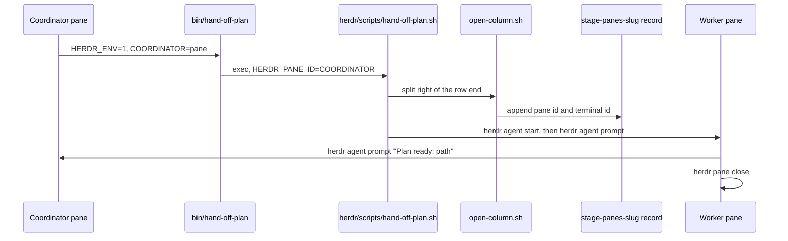
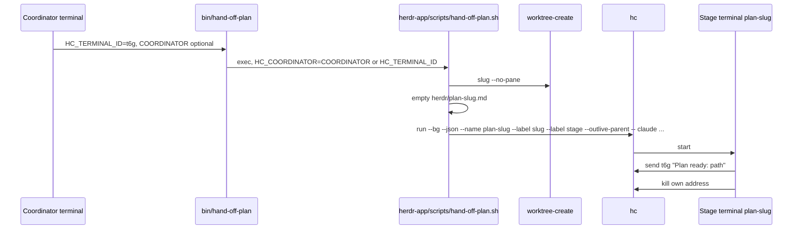
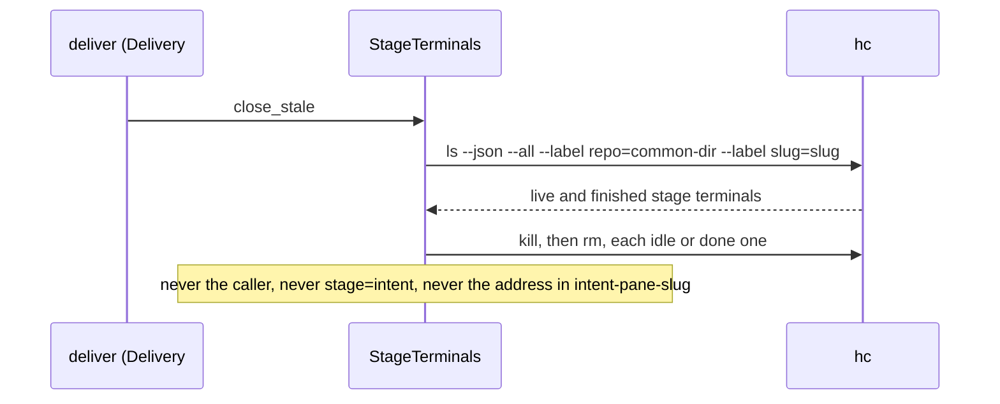
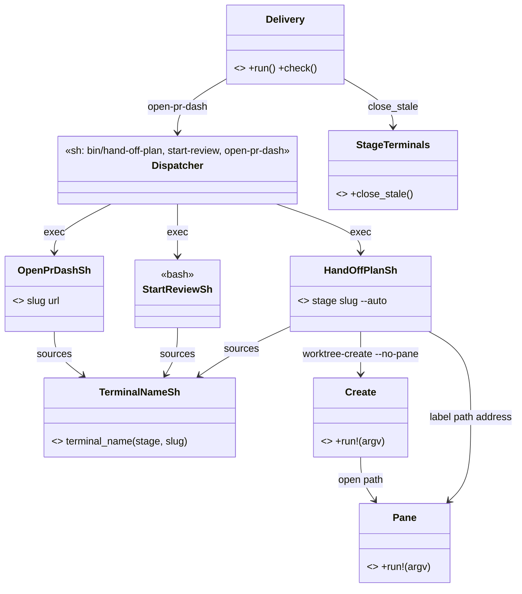

# Plan: Move the stage hand-off from herdr-tui to herdr-core (`hc`)

From `intent.md` (2026-11-11). Status: accepted.

## Design

### Domain terms

Glossary terms used: **Core** (never "server"), **herdr-app**, **herdr TUI**, **Change folder**, **PATH stub**, **Personal repository**. No avoided word appears in the intent or this plan.

New terms, proposed here. Etienne has not agreed them, so the glossary does not get them in this change (see the last `Decision needed:` in the report):

- **Terminal**: one `hc` terminal in a core, as `hc ls` lists it. Avoid: pane, block.
- **Terminal address**: the id `hc` gives a terminal, such as `t6h`. Inside the terminal, `$HC_TERMINAL_ID` holds it. Avoid: pane id, block id.
- **Coordinator**: the terminal that a worker sends its ready line to. The dispatcher sets it from `$COORDINATOR`, else `$HC_TERMINAL_ID`, and passes it on as `HC_COORDINATOR`.
- **Stage terminal**: a terminal that `hand-off-plan` or `start-review` started for a change. It carries the labels `repo=<git-common-dir>` (absolute, so two repositories that share a slug never mix), `slug=<slug>` and `stage=<intent|plan|implement|review>`. Avoid: stage pane, column.
- **Worktree terminal**: the shell terminal that `worktree-pane open` started for a worktree. It carries the label `worktree=<realpath>` and no `slug` label.
- **Terminal name**: `<stage>-<slug>`, lower case, every character outside `a-z 0-9 - _` replaced by `-`, cut to 32 characters. `hc` keeps names unique among live terminals.

### Diagrams

Before: the herdr TUI path (the Rex path has the same shape).



After: the `hc` path.



Delivery cleanup:



Objects after the change:



### Signatures

Shell entry points (new, in the existing `herdr-app` package; `HC_SCRIPTS_DIR` overrides the directory, default `$HOME/.config/herdr-app/scripts`):

- `herdr-app/.config/herdr-app/scripts/hand-off-plan.sh <stage> <slug> [--auto]` — hands one stage to a new stage terminal. A copy of the herdr script with the same argument checks, stage `case`, auto logic, main-checkout and submodule resolution, report directory and prompt parts. Only the transport changes:
  - Guard: `HC_TERMINAL_ID` and `HC_COORDINATOR` set, else exit 1 with a message that names `HC_TERMINAL_ID`.
  - Before anything else is written: `hc ls --json` lists a live terminal with the terminal name → exit 1 with "<name> is still running", and leave the worktree and the report alone. A refused duplicate never empties a live worker's report.
  - The report is `<git-common-dir>/herdr/<stage>-<slug>.md` (full slug), emptied after that check and before `hc run`.
  - `hc run --bg --json --no-notify --outlive-parent --name "$(terminal_name "$stage" "$slug")" --cwd "$worker_cwd" --label "repo=$common_git_dir" --label "slug=$slug" --label "stage=$stage" -- claude --model "$model" --permission-mode auto "$prompt"`. The address comes from the JSON `address` field (`ruby -rjson`, no `jq`). If `hc run` still refuses (a race with another launch), the script exits non-zero with `hc`'s message.
  - `worktree-pane label "$worker_cwd" "$address"` labels it, as the herdr script did.
  - Stage `intent` only: write the new address, one line, to `<git-common-dir>/herdr/intent-pane-<slug>`.
  - Prompt transport sentences: "your coordinator's terminal address is `$HC_COORDINATOR`"; the reply is `hc send $HC_COORDINATOR "<ready word> <path>"`, retried after a few seconds at most twelve times; then `hc kill "$HC_TERMINAL_ID"` (the worker's own address from its shell) to end its own terminal. The intent branch tells an autonomous intent coordinator to pass its own `$HC_TERMINAL_ID` to every stage and to send `Delivery done:` to `$HC_COORDINATOR`.
  - Prints `Handed the <stage> stage of docs/changes/<slug> to <name> (<address>). Its report will land in <report>.`
- `herdr-app/.config/herdr-app/scripts/start-review.sh` — copy of the herdr script. With a change folder: name `review-<slug>`, labels `repo=<git-common-dir>`, `slug=<slug>` and `stage=review`, after the same live-name check. Without one: no name, no labels, so delivery never closes it. Runs `claude --model opus --permission-mode auto "<prompt>"` with `--outlive-parent`. The reply goes through `hc send` with the same `Review clean:` / `Review ready:` rule; after a line gets through, `hc kill "$HC_TERMINAL_ID"`; after twelve failures the terminal stays open.
- `herdr-app/.config/herdr-app/scripts/open-pr-dash.sh <slug> <pr-url>` — copy of the herdr script. Writes the same gh-dash config, then `hc run --bg --json --no-notify --outlive-parent --name "$(terminal_name dash "$slug")" --cwd <toplevel> -- gh dash --config <config>`. No `slug` label, so delivery never closes it. Outside `hc` it prints the URL and exits 0, as now.
- `herdr-app/.config/herdr-app/scripts/terminal-name.sh` (sourced) — `terminal_name <stage> <slug>` prints the terminal name.
- `agents/.agents/bin/{hand-off-plan,start-review,open-pr-dash}` — first branch: `HC_TERMINAL_ID` set → `export HC_COORDINATOR="${COORDINATOR:-$HC_TERMINAL_ID}"`, then `exec "${HC_SCRIPTS_DIR:-$HOME/.config/herdr-app/scripts}/<name>.sh" "$@"`. `HC_TERMINAL_ID` is never overwritten, because `hc` reads it to find the parent. After the removal commits the hc branch is the only one; otherwise `<name>: run it inside an hc terminal (HC_TERMINAL_ID is not set).` and exit 1.

Ruby (inline RBS, plain `ruby`, not `rv`):

```ruby
# git/.config/git/worktree-tools/lib/common.rb
module WorktreeTools::Helpers
  # True inside an hc terminal with hc on PATH (HC_BIN_PATH overrides the binary for tests).
  #: -> bool
  def hc_env?
  #: -> String
  def hc_bin
end
```

```ruby
# git/.config/git/worktree-tools/worktree-pane — the hc branch comes first in run!.
# Opens, closes or labels the terminal rooted in a worktree's directory.
class WorktreeTools::Pane
  #: (Array[String] argv) -> void
  def run!(argv)
  # Terminals are found by label, never by cwd: hc's cwd is the launch folder, not the current one.
  # open:  hc ls --json --label worktree=<target>; none live:
  #        hc run --bg --json --no-notify --outlive-parent --cwd <target>
  #           --label worktree=<target> --label branch=<repo>/<branch>
  #        (no argv: hc starts the machine's own shell)
  # close: hc ls --json --label worktree=<target>; hc kill, then hc rm, each live worktree terminal
  #        with no slug label and no status; warn and keep every other one (an agent, a program that
  #        has not reported a status yet, any stage terminal)
  # label: hc label <address> worktree=<target> branch=<repo>/<branch>
end
```

```ruby
# agents/.agents/skills/deliver/scripts/stage_terminals.rb — new, self-contained (Open3 and JSON
# only, no Shell from deliver), so a live check can require it. deliver requires it, as it requires
# rex_panes.rb today. Replaces Panes and RexPanes once they go.
# Closes the idle stage terminals of one change; never the caller, never the intent terminal.
class StageTerminals
  CLOSABLE = %w[idle done].freeze

  #: (String slug, String common_dir) -> void
  def initialize(slug, common_dir)

  # No-op without HC_TERMINAL_ID. hc ls --json --all --label repo=<common_dir> --label slug=<slug>;
  # only a known stage (plan, implement, review) is a candidate; hc kill then hc rm each closable
  # live one; hc rm each finished one. A failure warns; the PR exists by now.
  #: -> void
  def close_stale
end
```

`Delivery#panes_class` (private) returns `StageTerminals` first when `HC_TERMINAL_ID` is set, until the removal commits delete it and `finish` calls `StageTerminals` directly.

Not checked: the dotfiles repository declined Steep and rbs_rails; it has no `Steepfile`. Signatures are comments.

### Complexity

- `hand-off-plan`: one `worktree-create`, one `hc run`, one `hc label`, whatever the number of terminals in the core.
- `start-review`: one `hc run`. `open-pr-dash`: one `gh repo view`, one `hc run`.
- `deliver` cleanup: one `hc ls`, then at most two calls (`kill`, `rm`) per closable stage terminal of the slug: O(k). `hc` filters by label, so other terminals in the core cost nothing.
- `worktree-pane open|close`: one `hc ls`, then at most one `hc run`, or two calls per terminal at the path.
- No database.

### Invariants

- The report file is empty when the worker starts: the script empties it before `hc run`.
- Every stage terminal and the dash terminal outlive their parent: each `hc run` in the three scripts passes `--outlive-parent`.
- A terminal name is 1–32 characters of `a-z 0-9 - _`: `terminal_name` enforces it.
- `HC_TERMINAL_ID` is never overwritten by a dispatcher; the coordinator travels in `HC_COORDINATOR`.
- Delivery never closes the caller (`$HC_TERMINAL_ID`), a `stage=intent` terminal, the address in `intent-pane-<slug>`, a `working` or `blocked` terminal, or the dash terminal (no `slug` label): `StageTerminals#closable?` (private) and the dash's missing label.
- Outside `hc` a dispatcher exits 1, names `HC_TERMINAL_ID`, and runs no `git` or `hc` command (after the removal commits).
- A second live `<stage>-<slug>` is refused before the report is emptied: the live-name check in `hand-off-plan.sh` and `start-review.sh`, backed by `hc`'s own name rule.
- Delivery only touches terminals of its own repository: the `repo=<git-common-dir>` label filter in `StageTerminals`.
- `worktree-pane close` only kills a worktree terminal it can positively identify (its `worktree` label, no `slug` label, no status).

### Alternatives

- **A — least change (chosen, with B's cleanup):** dispatcher → per-tool `hc` script → shared helper, a copy of the herdr and Rex shape. Matches the intent's "a new `hc` hand-off script with the arguments and stage logic of the herdr script" and keeps the existing tests' shape, so the prompt-text assertions port almost line for line.
- **B — fewest moving parts:** inline the `hc` logic into the three dispatchers and use `hc` labels instead of the `stage-panes-<slug>` record. The labels part is taken: `hc ls --label slug=` is the record, so `open-column.sh` and the record file have no `hc` twin. Inlining is rejected: the intent asks for dispatchers that choose, and a 200-line dispatcher hides that seam.
- **C — deepest module:** one Ruby `StageTerminals` object for open and close, plus a `StagePrompt` object for the prompt text. Rejected: about 80% of `hand-off-plan.sh` is prompt text, so moving it into Ruby is a rewrite the intent rules out ("no change to the content of the stage prompts beyond the transport"), and every dispatcher call would start Ruby. Its one sound idea, labels as the record, is in the chosen design.

## Design decisions

- Labels replace the `stage-panes-<slug>` record for `hc`. Only `intent-pane-<slug>` stays a file, because the intent requires it. It holds one line, the terminal address.
- The intent record has two writers with the same value: `hand-off-plan.sh intent` writes the new terminal's address, and the intent skill writes `$HC_TERMINAL_ID` for an intent session started by hand.
- New scripts live in `herdr-app/.config/herdr-app/scripts/`, beside the precedent of `herdr/.config/herdr/scripts/` and `rex/.config/rex/scripts/`. No new stow package. The package links file by file, so Etienne restows `herdr-app` before `~/.agents/bin/hand-off-plan` finds them; the agent never runs `stow`.
- `worktree-pane` gets its `hc` branch inline (first in `run!`), not a `worktree-pane-hc` twin: fewer files, and the herdr code simply goes in the last commit. The `label` verb stays, as the intent says ("open and label via `hc`"), and becomes `hc label <address> worktree=<realpath> branch=<repo>/<branch>`. `open` and `close` find terminals by the `worktree` label, not by `cwd`, because `hc ls` reports the launch folder.
- `worktree-create` needs no `hc` code: it opens through `worktree-pane`, and its herdr record returns early without `HERDR_PANE_ID`. The `AgentWorktree` record has no `hc` reader, so `hc` writes none. The Rex and herdr recording go in their removal commits.
- The worker ends itself with `hc kill "$HC_TERMINAL_ID"`, the transport twin of `herdr pane close`. The twelve-try reply loop stays: `hc send` refuses a blocked program without `--force`, and the prompt must not answer the coordinator's dialog.
- Terminal names are mapped and cut, not refused: a branch name such as `Fix_Thing` still works. The report file uses the full slug, so two long slugs collide only on the live name, which `hc` refuses loudly.
- Acceptance criterion 6 is checked on the agent-workflow files only: `agents/.agents/bin/`, `agents/.agents/skills/`, `herdr-app/.config/herdr-app/scripts/`, `git/.config/git/worktree-tools/{worktree-create,worktree-pane}`. Files outside the hand-off still mention the old calls and stay, because the intent puts them out of scope ("Retiring Rex itself", no viewer, no gh-dash keys): `worktree-viewer`, `worktree-viewer-rex`, `lib/common.rb` (`rex_only_env?` for the viewers), `lib/agent_worktree.rb` (comment), `rex/.config/rex/scripts/play-tone.sh` (Claude's tone hooks), `rex/.config/rex/launchers.lua`, `github/.config/gh-dash/config.yml`. This narrows the literal criterion, so it is a `Decision needed:` line in the report. The coordinator settles it before the implement stage starts (intent skill, Autonomous delivery, step 2). If Etienne picks the literal reading, the removal commits also delete or rewrite those files, and step 13 below grows by that list; the `hc` path commits do not change either way.
- Conflicts with `intent.md` `## Decisions`: none. Reports stay in `<git-common-dir>/herdr/`; start-review and open-pr-dash are ported; Rex goes; herdr TUI goes later, in its own commit, after the `hc` path is proven; `.github/workflows/` is not touched.

## Integration points

- `hc` (herdr-core CLI, on PATH as `~/.local/bin/hc`): `run --bg --json`, `send`, `label`, `ls --json --label`, `kill`, `rm`. Verified in this session: `hc run --bg --json` prints `{"address":…,"name":…,"parent":…}`; label values may hold `/` and `.`; `hc ls` reports `cwd` as given (`/tmp`, not `/private/tmp`), so `worktree-pane` compares realpaths; a killed terminal stays `finished` until `hc rm`; `hc send` to an unknown terminal exits 3; a plain program has no `status`; a Claude terminal has `status` `working` or `done`.
- herdr-app shows every new terminal in its core; there is no split or column to place.
- `claude` CLI: `--model`, `--permission-mode auto`, positional prompt (the running plan worker was started this way).
- Skills `intent`, `plan`, `implement`, `review`, `deliver`, `finish`, and the coordinator in the intent skill's Autonomous delivery section.
- Stow: Etienne restows `herdr-app` (new `scripts/`) and later sees the deleted herdr and Rex scripts leave dangling links (memory: restow leaves dangling skill links). The delivery account lists both.

## Files that change

Commit group 1 — `hc` path (one logical change per commit):

- `herdr-app/.config/herdr-app/scripts/terminal-name.sh` — new, `terminal_name`.
- `herdr-app/.config/herdr-app/scripts/hand-off-plan.sh` — new, the `hc` hand-off.
- `herdr-app/.config/herdr-app/scripts/start-review.sh` — new, the `hc` reviewer.
- `herdr-app/.config/herdr-app/scripts/open-pr-dash.sh` — new, the `hc` gh-dash terminal.
- `agents/.agents/bin/{hand-off-plan,start-review,open-pr-dash}` — `hc` branch first.
- `git/.config/git/worktree-tools/lib/common.rb` — `hc_env?`, `hc_bin`.
- `git/.config/git/worktree-tools/worktree-pane` — `hc` branch for `open`, `close`, `label`.
- `agents/.agents/skills/deliver/scripts/stage_terminals.rb` — new, `StageTerminals`.
- `agents/.agents/skills/deliver/scripts/deliver` — requires `stage_terminals`; `panes_class` chooses `StageTerminals` first.
- `agents/.agents/skills/{intent,plan,implement,review,deliver,finish}/SKILL.md` — `HC_TERMINAL_ID` and the terminal address replace `HERDR_PANE_ID` and `herdr pane current` in the backend choice, the coordinator rule and the intent record. The skills' `description` lines say "terminal" for "pane".
- `test/hc_worker_scripts_test.rb` — new, from `herdr_worker_scripts_test.rb` with an `hc` PATH stub.
- `test/hc_open_pr_dash_test.rb` — new, from `open_pr_dash_test.rb`.
- `test/dispatchers_test.rb`, `test/deliver_test.rb`, `test/delivery_harness.rb`, `test/worktree_pane_test.rb`, `test/delivery_contract_test.rb`, `test/worktree_first_skill_test.rb`, `test/herdr_app_package_test.rb` (four new tracked files) — `hc` cases.
- `test/design_review_pass_test.rb` — read the review prompt from `herdr-app/.config/herdr-app/scripts/start-review.sh` (it reads the herdr script today, which commit 3 deletes).
- `test/pull_request_flow_test.rb` — its scan of `herdr/.config/herdr/scripts/*` also covers `herdr-app/.config/herdr-app/scripts/*`, and only that directory after commit 3.
- `test/fixtures/hc_ls_stage_terminals.json` — real `hc ls --json --all --label …` output captured in step 10, so `deliver_test` parses the true format.
- `herdr-app` README or `herdr/.config/herdr/README.md` hand-off section, `git/.config/git/worktree-tools/README.md`, `SKILLS-INDEX.md`, `README.md` — describe the `hc` path.

Commit 2 — Rex path removal:

- Delete `rex/.config/rex/scripts/{hand-off-plan,start-review,open-pr-dash,open-column,worker-ready}.sh`, `agents/.agents/skills/deliver/scripts/rex_panes.rb`, `git/.config/git/worktree-tools/worktree-pane-rex`.
- Remove the Rex branch from the three dispatchers, `panes_class`, `worktree-pane` (`exec … worktree-pane-rex`), `worktree-create` (`record_for_rex_block`), and the Rex paragraphs of the skills.
- Delete `test/{rex_worker_scripts,rex_open_column,rex_open_pr_dash,worktree_pane_rex}_test.rb`; remove the Rex cases from `dispatchers_test`, `deliver_test`, `worktree_create_test`, `delivery_harness`. `rex_harness_compat.rb` stays only if a kept Rex test still needs it.
- Keep `play-tone.sh`, `launchers.lua`, `worktree-viewer-rex`, and `rex_only_env?`/`rex_bin` in `common.rb` while the viewer uses them.

Commit 3 — herdr TUI path removal:

- Delete `herdr/.config/herdr/scripts/{hand-off-plan,start-review,open-pr-dash,open-column}.sh`. `quieter-tones.sh` and `sync-solunized-theme.sh` stay.
- Remove the herdr branch from the three dispatchers (the refusal names `HC_TERMINAL_ID`), the `Panes` class and `panes_class` from `deliver`, the herdr code from `worktree-pane`, `record_for_herdr_pane` and `terminal_id_of` from `worktree-create`, and the herdr sentences from the skills.
- Delete `test/{herdr_worker_scripts,herdr_open_column,open_pr_dash}_test.rb`; remove the herdr cases from `dispatchers_test`, `deliver_test`, `delivery_harness`, `worktree_create_test`, `worktree_pane_test`, `pull_request_flow_test`. `herdr_quieter_tones_test` and `herdr_sync_solunized_theme_test` stay with their scripts.

## Order of work

1. Write the acceptance test `test_a_plan_hand_off_starts_a_named_worker_and_empties_its_report` in `test/hc_worker_scripts_test.rb` (stub `hc` logs its argv and the report's size at `run` time, answers `{"address":"t9a",…}`). Run it, watch it fail: no script.
2. Add `terminal-name.sh` and `hand-off-plan.sh`. Port the herdr test cases one by one (argument checks, `--auto`, intent branch, submodule, report path). Green.
3. Add the intent record write and its acceptance test.
4. Add `start-review.sh` and `open-pr-dash.sh` with their tests.
5. Add the `hc` branch to the three dispatchers, with the dispatcher tests (`HC_TERMINAL_ID` wins, `COORDINATOR` default, `HC_TERMINAL_ID` untouched).
6. Add `hc_env?`/`hc_bin` and the `worktree-pane` `hc` branch with tests.
7. Add `stage_terminals.rb` with its acceptance test, then require it in `deliver` and add the `panes_class` choice.
8. Change the six skills and their text tests; update the READMEs and `SKILLS-INDEX.md`.
9. Run `bin/test`, `rubocop`, `shellcheck` on every touched file. Commit each step above as its own commit.
10. Prove the `hc` path live, before any removal, with the real `hc`, the real scripts and a stub `claude`. Every path points into this worktree, never at the installed links: `HC_SCRIPTS_DIR=<worktree>/herdr-app/.config/herdr-app/scripts`, `WORKTREE_TOOLS_DIR=<worktree>/git/.config/git/worktree-tools`, `CLAUDE_SKILLS_DIR=<worktree>/agents/.agents/skills`.
    - Setup: a throwaway repository in the scratchpad with a bare `origin`, `.worktrees` excluded, and a change folder `docs/changes/probe-slug/`. A stub `claude` first on `PATH` (scratchpad only) reads its last argument, takes the coordinator address and the report path from the prompt, writes "probe" into the report, runs the real `hc send <coordinator> "<ready word> <report>"`, then `hc kill "$HC_TERMINAL_ID"`. A disposable coordinator terminal, `hc run --bg --name probe-coordinator -- sh -c 'read line; printf "%s\n" "$line" > <scratch>/received'`, receives the line.
    - Hand-off: `COORDINATOR=<probe-coordinator address> <worktree>/agents/.agents/bin/hand-off-plan plan probe-slug`. Check: `hc ls --all --label slug=probe-slug` showed `plan-probe-slug` with `cwd` `<scratch>/.worktrees/probe-slug` and the three labels; `<scratch>/received` holds `Plan ready: <report>`; the report path is under `<scratch>/.git/herdr/`; the worktree terminal carries `worktree=` and `branch=` labels after `worktree-pane label`.
    - Intent: the same for `intent`; `<scratch>/.git/herdr/intent-pane-probe-slug` holds the intent terminal's address.
    - Review and dash: `start-review` from the probe worktree delivers `Review … :` to a fresh probe coordinator; `open-pr-dash probe-slug https://example.invalid/pr/1` with a stub `gh` starts `dash-probe-slug` without a `slug` label.
    - Cleanup: capture `hc ls --json --all --label repo=<scratch common dir> --label slug=probe-slug` into `test/fixtures/hc_ls_stage_terminals.json`, which `deliver_test` parses. Then run `ruby -r<worktree>/agents/.agents/skills/deliver/scripts/stage_terminals.rb -e 'StageTerminals.new("probe-slug", "<scratch>/.git").close_stale'` from the probe coordinator's environment. Check: the idle and finished probe stage terminals are gone; the intent terminal and the dash stay.
    - Tear down every probe terminal with `hc kill` and `hc rm`, and trash the scratch repository. Record every command and its output in the delivery account.
11. Before commit 2, confirm the coordinator settled the criterion-6 `Decision needed:` line; apply its answer to the removal lists.
12. Commit 2: the Rex removal. Run `bin/test`. Green.
13. Commit 3: the herdr TUI removal. Run `bin/test` and the grep check below. Green.

## Risks

- **Restow.** Until Etienne restows `herdr-app`, `~/.agents/bin/hand-off-plan` in an `hc` terminal execs a script that is not linked yet and fails with "No such file". Step 10 uses the worktree paths for that reason. The delivery account says to restow.
- **Coordinator busy.** `hc send` refuses while the coordinator's program is blocked; twelve retries a few seconds apart may not be enough. The report file is the durable record, as the intent's flagged concern chose.
- **Orphans.** `--outlive-parent` leaves a stage terminal behind when no delivery follows. Accepted by the intent.
- **Name collision.** A worker that failed to kill itself blocks a re-run of the same stage. `hc` refuses loudly; Etienne closes the old one.
- **Status values.** Only `working` and `done` were seen live. `idle` comes from `hc send --if idle|working`. A status outside the closable list keeps the terminal open, which is the safe side.
- **Viewer records.** After commit 3 nothing writes `AgentWorktree` records, so `worktree-viewer` falls back to the pane's own folder. The viewer is herdr TUI only and out of scope.
- **Rejected:** the `stage-panes-<slug>` record for `hc` (labels hold the same fact without a second source of truth); `HC_TERMINAL_ID=$COORDINATOR` in the dispatcher (it would make `hc` file the worker under the wrong parent); `hc run --rm` for workers (a crashed worker's screen would vanish).

## Proof

- A plan hand-off from an `hc` terminal starts a worker terminal named `plan-<slug>` in the change's worktree → `test/hc_worker_scripts_test.rb` `test_a_plan_hand_off_starts_a_named_worker_and_empties_its_report`, plus step 10's live check.
- Its `Plan ready: <path>` line arrives in the coordinator's terminal → `test/hc_worker_scripts_test.rb` `test_the_prompt_tells_the_worker_to_send_plan_ready_to_the_coordinator` (the prompt names `hc send <coordinator> "Plan ready: <report>"`), plus check: step 10's live round trip, where `<scratch>/received` holds `Plan ready: <report>` sent through the real `hc`.
- The report file lands under `<git-common-dir>/herdr/` and is empty when the worker starts → `test/hc_worker_scripts_test.rb` `test_a_plan_hand_off_starts_a_named_worker_and_empties_its_report`.
- An intent hand-off records the intent terminal address in `<git-common-dir>/herdr/intent-pane-<slug>` → `test/hc_worker_scripts_test.rb` `test_an_intent_hand_off_records_the_intent_terminal_address`.
- Delivery closes the idle stage terminals of the change and leaves the intent terminal open → `test/deliver_test.rb` `test_delivery_closes_idle_stage_terminals_and_keeps_the_intent_terminal`, plus check: step 10's live cleanup.
- Invariant: delivery only touches terminals of its own repository, enforced by the `repo` label filter → `test/deliver_test.rb` `test_delivery_leaves_another_repositorys_terminals_with_the_same_slug`.
- Invariant: a refused duplicate never empties a live worker's report, enforced by the live-name check → `test/hc_worker_scripts_test.rb` `test_a_duplicate_hand_off_is_refused_and_keeps_the_report`.
- Invariant: `worktree-pane close` kills only identified worktree terminals, enforced in `Pane#close` (private) → `test/worktree_pane_test.rb` `test_close_keeps_terminals_without_the_worktree_label_or_with_a_status`.
- Outside `hc` the dispatcher exits 1 with a message that names `HC_TERMINAL_ID` → `test/dispatchers_test.rb` `test_each_dispatcher_refuses_outside_hc_and_names_hc_terminal_id`.
- After the removal commits, no agent-workflow script or skill mentions `HERDR_PANE_ID`, `herdr pane` or `REX_SESSION` → `test/dispatchers_test.rb` `test_no_agent_workflow_file_mentions_herdr_panes_or_rex_sessions`, and check: `grep -rnE 'HERDR_PANE_ID|herdr pane|REX_SESSION' agents/.agents/bin agents/.agents/skills herdr-app/.config/herdr-app/scripts git/.config/git/worktree-tools/worktree-create git/.config/git/worktree-tools/worktree-pane` prints nothing.
- Invariant: every stage terminal and the dash outlive their parent, enforced by each `hc run` in the three scripts → `test/hc_worker_scripts_test.rb` `test_every_stage_terminal_outlives_its_parent`, `test/hc_open_pr_dash_test.rb` `test_the_dash_terminal_outlives_its_parent_and_has_no_slug_label`.
- Invariant: a terminal name is 1–32 characters of `a-z 0-9 - _`, enforced by `terminal_name` → `test/hc_worker_scripts_test.rb` `test_a_long_mixed_case_slug_gives_a_valid_terminal_name`.
- Invariant: the dispatcher never overwrites `HC_TERMINAL_ID`, enforced in the dispatchers → `test/dispatchers_test.rb` `test_coordinator_travels_in_hc_coordinator_and_hc_terminal_id_stays`.
- Invariant: delivery never closes the caller, a working terminal or the dash, enforced by `StageTerminals#closable?` → `test/deliver_test.rb` `test_delivery_keeps_the_caller_and_working_terminals_open`.
- Query count: not affected, no database.

Per changed file, the unit tests expected, named as behaviour:

- `herdr-app/.config/herdr-app/scripts/hand-off-plan.sh`: refuses outside hc; refuses an unknown stage; refuses `--auto` on intent; refuses a slug that looks like an option; uses opus for intent and plan and sonnet for implement; passes `--permission-mode auto`; auto prompt carries `Decision needed:` and no chain; non-auto prompt names the coordinator for the chain; intent prompt carries the autonomous branch with `$HC_TERMINAL_ID`; worker starts in the main checkout's `.worktrees/<slug>` from a linked worktree and from a submodule; labels the terminal through `worktree-pane label`; exits non-zero when `hc run` refuses a duplicate name.
- `herdr-app/.config/herdr-app/scripts/start-review.sh`: names `review-<slug>` with labels in a change folder; no name and no labels without one; prompt replies with `Review clean:` / `Review ready:` through `hc send`; refuses without a base branch.
- `herdr-app/.config/herdr-app/scripts/open-pr-dash.sh`: writes the gh-dash config; runs `gh dash` in `dash-<slug>`; prints the URL and opens nothing outside hc.
- `herdr-app/.config/herdr-app/scripts/terminal-name.sh`: lowercases; maps other characters to `-`; cuts to 32.
- `agents/.agents/bin/*`: `hc` branch wins over herdr and Rex while they exist; `COORDINATOR` defaults to `HC_TERMINAL_ID`; refusal names `HC_TERMINAL_ID`.
- `git/.config/git/worktree-tools/worktree-pane`: `open` starts a shell terminal at the path with the `worktree` and `branch` labels; `open` does nothing when a live terminal with that `worktree` label exists, whatever its `cwd`; `close` kills and removes identified worktree terminals and keeps agents, unreported programs and stage terminals; `label` sets `worktree=<realpath>` and `branch=<repo>/<branch>`.
- `agents/.agents/skills/deliver/scripts/stage_terminals.rb` (`StageTerminals#close_stale`): closes idle and done stage terminals of the slug in this repository; removes finished ones; keeps the caller, `stage=intent`, the recorded intent address, working terminals, unknown stages and other repositories' terminals; does nothing outside hc; warns and carries on when `hc` fails; parses the captured real `hc ls` fixture.
- Skills: `delivery_contract_test` and `worktree_first_skill_test` assert the `hc` wording and the coordinator rule.

Test setup: an `hc` PATH stub per test (`HC_BIN_PATH` for the Ruby tools) that appends its argv as one JSON line to a log, answers `run` with `{"address":"t9a","name":…}`, answers `ls` from a fixture file, and exits 3 for a name in a "taken" file. Git fixtures from `git_fixture.rb` and `isolated_git.rb`, as the herdr tests use. Every test sets `HC_TERMINAL_ID` explicitly (or unsets it), because the suite itself now runs inside `hc` terminals.

Out of scope: moving the report directory; herdr-app itself; models; prompt content beyond transport; `hc` templates; Rex as an application (`play-tone.sh`, `launchers.lua`, `rex` hooks in `claude/.claude/settings.json`); `worktree-viewer` and `worktree-viewer-rex`; the gh-dash `C` key binding; `herdr-app-migrate`; the glossary entries.

---
Domain skills applied: software-design, glossary, diagrams, ruby-style (signature comments). No Rails skill applies.

## Critique

### Round 1 (codex gpt-6.1-sol, medium)

- Cleanup filters the whole core by `slug` alone, so two repositories that share a slug can close each other's workers → fixed (stage terminals carry `repo=<git-common-dir>`; `StageTerminals` filters on `repo` and `slug` and accepts only known stages; new invariant and test `test_delivery_leaves_another_repositorys_terminals_with_the_same_slug`)
- A refused duplicate launch empties the live worker's report before `hc run` refuses the name → fixed (`hand-off-plan.sh` and `start-review.sh` check for a live terminal with that name before writing anything; new test `test_a_duplicate_hand_off_is_refused_and_keeps_the_report`)
- A missing status does not prove a terminal runs a shell, so `worktree-pane close` could kill a starting agent or another program → fixed (close acts only on terminals with the `worktree` label, no `slug` label and no status; everything else is kept with a warning; new test)
- `hc ls` reports the launch folder as `cwd`, so matching worktree terminals by `cwd` breaks after a `cd` → fixed (`worktree-pane` finds terminals by the `worktree=<realpath>` label, never by `cwd`)
- Step 10 killed the worker before its reply, so the `hc` path was not proven before the removal commits → fixed (step 10 is now a full live round trip with the real `hc`, the real scripts and a stub `claude`: plan and intent hand-offs, review, dash and cleanup, all before commit 2)
- The live check used the installed `worktree-create` and `worktree-pane`, which lack the `hc` code → fixed (step 10 also sets `WORKTREE_TOOLS_DIR` and `CLAUDE_SKILLS_DIR` to this worktree and checks the worktree labels)
- `test/design_review_pass_test.rb` reads the herdr `start-review.sh`, which commit 3 deletes → fixed (added to the files that change, pointed at the `hc` script; `pull_request_flow_test.rb` added for the same reason)
- The plan narrows acceptance criterion 6 without Etienne's acceptance → fixed (the narrowing stays a `Decision needed:` line, step 11 makes the removal commits wait until the coordinator has settled it, and the design decision names what the removal lists gain under the literal reading)
