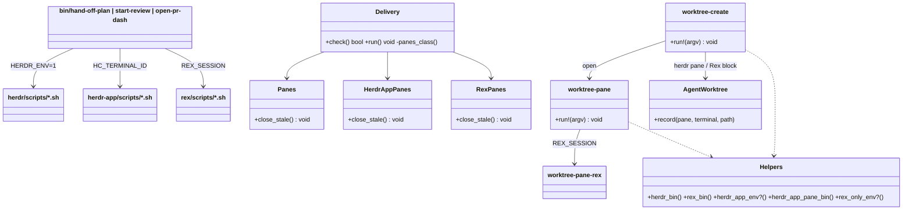
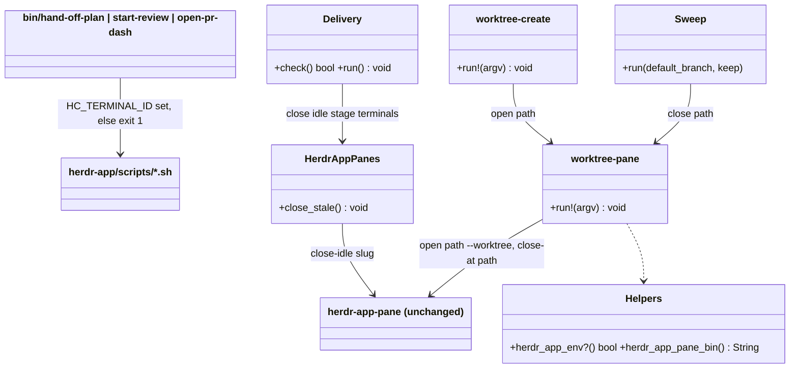
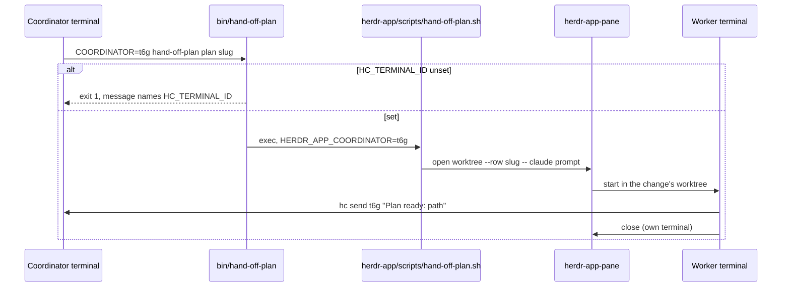

# Plan: Retire herdr TUI and Rex from the agent workflow and the repository

From `intent.md` (2026-11-12). Status: accepted.

## Design

### Domain terms

Glossary terms used: **Coordinator**, **Row record**, **Stage pane**, **herdr-app**, **herdr TUI**, **Core**, **PATH stub**, **Change folder**, **Personal repository**. No avoided word appears in the intent or this plan.

New terms, agreed in `intent.md` `## Decisions`. Step 11 of the order of work writes them to `GLOSSARY.md` in alphabetical order, in its own commit `docs: glossary terms for hand-off-plan-hc`:

- **Terminal**: one `hc` terminal in a core, as `hc ls` lists it.
- **Terminal address**: the id `hc` gives a terminal, such as `t6g`. Inside the terminal, `$HC_TERMINAL_ID` holds it. A row record holds terminal addresses. Avoid: pane id, block id.
- **Coordinator** (rewritten): the terminal a stage worker reports to. A dispatcher passes `COORDINATOR` on as `HERDR_APP_COORDINATOR`; without it, the caller's own `HC_TERMINAL_ID`.
- **Stage terminal**: a terminal that `hand-off-plan` or `start-review` opened for one change and listed in its row record. Avoid: stage block. The out-of-scope `herdr-app-pane` code still says "stage pane"; the old **Stage pane** entry is replaced by this one.
- **Worktree terminal**: the shell terminal that `worktree-pane open` opens for a worktree, through `herdr-app-pane open <path> --worktree`. No row record lists it.
- **Terminal name**: the name `hc ls` shows for a terminal: 1 to 32 characters of `a-z 0-9 - _`, unique among live terminals.

The same commit removes the entries that only name retired code, once `git grep` finds no use of the term outside `docs/changes/` and `GLOSSARY.md`: **Pane state**, **Jump**, **Snapshot**, **Switcher**, **Switcher row**, **Viewer**, **View**, **Notice**, **Root**, **Base**, **Changed file**, **Dist tables**, **Drift**, **Solunized block**. It also removes the migration terms that `intent.md` names, **herdr TUI**, **Pairing**, **Running agent** and **Workspace**, and **Stale space**, whose only users are `herdr-app-migrate stale` and the runbook section that goes with it. It rewrites **Row record** to `<git-common-dir>/herdr-app/stage-panes-<slug>`, one terminal address per line. It rewrites **Pane backend**, which the `intent`, `plan`, `implement`, `review` and `new-repo-setup` skills still use, to: the backend that hands a stage to a fresh stage terminal, picked when `HC_TERMINAL_ID` is set.

### Diagrams

Before: three transports, picked from the environment in every dispatcher, in `deliver` and in `worktree-pane`.



After: one transport.





### Signatures

- `agents/.agents/bin/hand-off-plan`, `start-review`, `open-pr-dash` (POSIX sh; usage unchanged: `[COORDINATOR=<address>] <name> <args>...`): runs the herdr-app stage script of the same name, else refuses.
  - `HC_TERMINAL_ID` empty: print `<name>: run it inside a herdr-app terminal (HC_TERMINAL_ID is unset).` to stderr, exit 1. `HERDR_ENV` and the Rex session variable no longer count.
  - Otherwise: `COORDINATOR`, when set, becomes `HERDR_APP_COORDINATOR`; then `exec "${HERDR_APP_SCRIPTS_DIR:-$HOME/.config/herdr-app/scripts}/<name>.sh" "$@"`.
- `agents/.agents/skills/deliver/scripts/deliver`. `Panes`, `RexPanes`, `require_relative "rex_panes"` and `Delivery#panes_class` go; `Delivery#finish` calls `HerdrAppPanes.new(@slug).close_stale`.

  ```ruby
  # Closes the idle stage terminals of one change through herdr-app-pane; outside an hc terminal it does nothing.
  class HerdrAppPanes
    #: (String slug) -> void
    def initialize(slug)
    #: -> void
    def close_stale # returns at once when HC_TERMINAL_ID is empty; else runs `herdr-app-pane close-idle <slug>`, warns on failure
  end
  ```

- `git/.config/git/worktree-tools/worktree-pane` (usage: `worktree-pane open|close <path>`): opens or closes the worktree terminal through `herdr-app-pane`; outside an hc terminal it does nothing and exits 0.

  ```ruby
  class WorktreeTools::Pane
    USAGE = "Usage: worktree-pane open|close <path>"
    COMMANDS = %w[open close].freeze
    #: (Array[String] argv) -> void
    def self.run!(argv)
    #: (Array[String] argv) -> void
    def run!(argv) # herdr_app(argv) if herdr_app_env?
  end
  ```

  `label` goes: its only caller, `herdr/.config/herdr/scripts/hand-off-plan.sh`, goes with the `herdr` package, and in herdr-app it already did nothing.
- `git/.config/git/worktree-tools/worktree-create` (`WorktreeTools::Create`): `run!(argv)` and `--no-pane` unchanged. `record_for_herdr_pane`, `record_for_rex_block`, `terminal_id_of`, `require "agent_worktree"` and `require "json"` go.
- `git/.config/git/worktree-tools/lib/common.rb` (`WorktreeTools::Helpers`): `herdr_bin`, `rex_bin` and `rex_only_env?` go.

  ```ruby
  # True inside an hc terminal.
  #: -> bool
  def herdr_app_env? # !ENV["HC_TERMINAL_ID"].to_s.empty?
  #: -> String
  def herdr_app_pane_bin # unchanged
  ```

- `tones/.local/bin/quieter-tones` (moved from `herdr/.config/herdr/scripts/quieter-tones.sh`, usage: `quieter-tones <source.mp3>...`): writes each tone at 0.3 of its level to `~/Documents/Tones/herdr/`, which `herdr-app/.config/herdr-app/settings.json` reads. Only its text changes, not its behaviour.
- `test/retired_transport_test.rb` (new):

  ```ruby
  # Proves that hc is the only transport left: no tracked file names a retired token, no herdr or rex package remains.
  class RetiredTransportTest < Minitest::Test
    # Built from parts, so this file never holds a whole token.
    RETIRED = [ %w[HERDR PANE ID].join("_"), %w[herdr pane].join(" "), %w[REX SESSION].join("_") ].freeze
    def test_no_tracked_file_outside_docs_changes_names_a_retired_token
    def test_packages_conf_and_the_tree_hold_neither_herdr_nor_rex
  end
  ```

  It lists files with `git ls-files -z` from the repository root (with `GIT_DIR`, `GIT_WORK_TREE` and `GIT_INDEX_FILE` cleared), drops paths under `docs/changes/`, reads only regular files that are not symlinks, and matches each token case-sensitively. The failure message names each offending path and token. The packages test strips comments from each `packages.conf` line, splits the rest on whitespace and `(`, `)`, and fails when a whole element equals `herdr` or `rex`, or starts with `herdr=` (a regex word boundary would also match `herdr-app`, so it is not used). It also fails while `herdr/` or `rex/` exists.

Not checked: the dotfiles repository has no Steepfile.

### Complexity

- Dispatcher: one environment test, one `exec`.
- `deliver`: zero processes for stage terminals outside hc, one (`herdr-app-pane close-idle`) inside. Before, the herdr path ran `herdr pane list` plus one close per stage pane.
- `worktree-create`: one process fewer per run (no `herdr pane get`).
- `worktree-pane`: unchanged inside hc (one `realpath`, one `git rev-parse`, one `exec`); zero calls outside hc.
- The guard test: one `git ls-files -z` and one read of each tracked file, linear in the repository size.
- No database. No query counts.

### Invariants

- A dispatcher never runs a stage script without `HC_TERMINAL_ID`. Enforced by the guard line in each dispatcher.
- `deliver` never calls `herdr-app-pane` and never warns about stage terminals outside an hc terminal. Enforced by the first line of `HerdrAppPanes#close_stale`.
- Delivery never closes the intent terminal or its own terminal. Enforced by `herdr-app-pane close-idle` (unchanged, out of scope).
- `worktree-pane` never calls `herdr-app-pane` outside an hc terminal, so `worktree-create` and the sweep stay silent in a plain shell and in CI. Enforced by the guard in `Pane#run!`.
- No tracked file outside `docs/changes/` names `HERDR_PANE_ID`, `herdr pane` or `REX_SESSION`. Enforced by `test/retired_transport_test.rb`.
- `packages.conf` holds no `herdr` or `rex` word, and no `herdr/` or `rex/` directory exists. Enforced by the same test file.
- Reports and row records stay where the hc path writes them today: `<git-common-dir>/herdr-app/`. Nothing in this change names that directory anew.
- In the `herdr-app/` package only the migration tool goes: `herdr-app/.local/bin/herdr-app-migrate` and `herdr-app/.local/share/herdr-app-migrate/*`, deleted. No other file there changes. Checked by `git diff --name-status main -- herdr-app/` in step 12: every line is `D` and names one of those paths.

### Alternatives

1. **Delete branches, keep the remaining interfaces (chosen).** Every herdr TUI and Rex branch goes; `COORDINATOR`, `HERDR_APP_COORDINATOR`, `HERDR_APP_SCRIPTS_DIR`, `HERDR_APP_PANE`, `HerdrAppPanes` and `herdr_app_env?` keep their names. Two cuts from alternative 2 are taken because they remove dead code, not rename live code: `worktree-pane label` goes, and `herdr_app_env?` drops its `HERDR_ENV` clause. The herdr-app tests stay valid with small edits.
2. **Simplest end state (rejected).** Rename `HerdrAppPanes` to `StageTerminals`, move `herdr_app_env?` and `herdr_app_pane_bin` out of `Helpers` into `worktree-pane` as `hc_terminal?` and `pane_cli`, check `worktree-pane` arguments outside hc too. A cleaner read, but it renames live code and rewrites tests that still pass, and it changes `worktree-pane`'s behaviour in a plain shell. The intent asks for removal and cleanup, not a rename; a rename can follow as its own change.
3. **Port instead of delete (rejected).** Keep the gh-dash `C` key and the Rex tone hooks by giving them an hc branch. The intent puts porting retired keys out of scope, and herdr-app already plays its own tones.

## Design decisions

- **Report directory.** Reports and row records stay in `<git-common-dir>/herdr-app/`, as `intent.md` decides. Nothing moves.
- **`herdr-app-migrate` goes, the runbook stays trimmed.** `intent.md` puts the migration tooling in scope with no exception: `herdr-app/.local/bin/herdr-app-migrate`, the seven files in `herdr-app/.local/share/herdr-app-migrate/`, and their tests `herdr_app_migrate_cli_test` and `herdr_app_migration_test` are deleted. This is the one exception to the out-of-scope line "any change to herdr-app": the intent names these files itself. The runbook `herdr-app-cores.md` also covers the work core, the cores layout, core restarts and the leader keys, which stay in use; so only its herdr TUI parts go: the title clause "and the migration from the herdr TUI", the sections "Stale spaces" and "Migration, per side", the sentence "Ratios of splits are not kept…", and "or use the id from the pairing list". `dotfiles-maintenance/SKILL.md` line 33 drops "and the TUI migration".
- **`Tones/herdr` stays.** `herdr-app/.config/herdr-app/settings.json` and `quieter-tones` name the folder `~/Documents/Tones/herdr/`. It is a folder name on disk, not a mention of the herdr TUI, and renaming it would change a herdr-app file outside the migration tooling and move Etienne's tone files. The guard does not match it.
- **`herdr` and `go` leave BREW.** The acceptance criterion "`packages.conf` lists neither `herdr` nor `rex`" covers the BREW entry. `hc` comes from herdr-core (`~/.local/share/herdr-core`), not from the `herdr` formula, and with `herdr-app-migrate` gone nothing that stays needs it. `go` only built herdr plugins; `intent.md` approves dropping it (playbook rule 11).
- **`jq` stays.** `install/tasks/26_install_herdr_app.sh`, `27_register_work_core.sh` and `consent-guard.rb` still use it; its comment is rewritten to name them.
- **`quieter-tones.sh` moves to the `tones` package** as `tones/.local/bin/quieter-tones`. It is the only producer of `~/Documents/Tones/herdr/*.mp3`, which herdr-app's `settings.json` plays; deleting it with the `herdr` package would lose that ability on a new machine. Its test moves to `test/quieter_tones_test.rb`. The folder name `Tones/herdr` stays, because herdr-app's `settings.json` names it.
- **The herdr hooks in `claude/.claude/settings.json` go**: `herdr-claude-session-title.sh` (3 entries), `herdr-agent-state.sh`, the `rex __internal session-start` SessionStart entry and the three `play-tone.sh` entries. The `Notification` key goes if it becomes empty. The words "herdr, " go from the "Org-specific CLIs" line. The hook files themselves live untracked in `~/.claude/hooks/` (herdr wrote them), so the delivery account lists them for Etienne to trash.
- **The gh-dash `C` key ("deep review (octo.nvim)") goes.** It has only herdr TUI and Rex branches; porting is out of scope.
- **Glossary cleanup** joins the glossary commit (step 11), since the intent widens removal to every herdr TUI or Rex mention.
- **Implement mode: `here single`.** Every step deletes production code together with the tests that cover only it, and rewrites tests that lean on it, in one commit. Split mode commits tests first and keeps the implementer out of test files, which cannot do that.
- **Test files keep no whole retired token.** A negative test that must set a retired variable builds its name from parts (`%w[REX SESSION].join("_")`), like the guard. Helpers and stubs that only served removed code are deleted, not renamed.

## Integration points

- herdr-app scripts `herdr-app/.config/herdr-app/scripts/{hand-off-plan,start-review,open-pr-dash}.sh` and `herdr-app/.local/bin/herdr-app-pane`: called, never changed. `herdr-app-migrate` is deleted; nothing calls it.
- `hc` (herdr-core): called by those scripts, never changed.
- `install.sh` and `install/tasks/*`: the installer stops running tasks 52 and 53.
- Claude Code hooks (`claude/.claude/settings.json`), Codex rules and config (`codex/.codex/rules/default.rules`, `codex/.codex/config.toml`), gh-dash (`github/.config/gh-dash/config.yml`).
- Stow: no `stow` runs. The delivery account lists dangling links for Etienne: `~/.config/herdr`, `~/.config/rex`, `~/Library/LaunchAgents/com.eirvandelden.rex-golden-ratio.plist`, `~/.config/git/worktree-tools/{worktree-pane-rex,worktree-viewer,worktree-viewer-rex,lib/agent_worktree.rb}`, `~/.agents/skills/deliver/scripts/rex_panes.rb` if linked file by file, `~/.local/bin/herdr-app-migrate` and `~/.local/share/herdr-app-migrate`, and the untracked `~/.claude/hooks/herdr-*` files; and the restow `tones` needs for `~/.local/bin/quieter-tones`.

## Files that change

Dispatchers:
- `agents/.agents/bin/hand-off-plan`, `start-review`, `open-pr-dash`: drop the herdr and Rex branches and header lines; new refusal text.

Delivery:
- `agents/.agents/skills/deliver/scripts/deliver`: drop `Panes`, the `rex_panes` require, `panes_class`; `HerdrAppPanes` gets the hc guard and loses its unused `common_dir` parameter.
- `agents/.agents/skills/deliver/scripts/rex_panes.rb`: delete.

Worktree tools:
- `git/.config/git/worktree-tools/worktree-pane`: herdr-app branch only; `label` goes; drop `json` and `open3` requires if unused.
- `git/.config/git/worktree-tools/worktree-create`: drop the pane and block records.
- `git/.config/git/worktree-tools/lib/common.rb`: drop `herdr_bin`, `rex_bin`, `rex_only_env?`; simplify `herdr_app_env?`.
- `git/.config/git/worktree-tools/worktree-pane-rex`, `worktree-viewer`, `worktree-viewer-rex`, `lib/agent_worktree.rb`: delete.
- `git/.config/git/worktree-tools/README.md`: describe `worktree-pane` as hc only; drop viewer and Rex lines.

Configuration:
- `claude/.claude/settings.json`: the hook entries and the CLI-list words above.
- `codex/.codex/rules/default.rules`: drop the `herdr` and `rex` prefix rules (lines 270–285 today).
- `codex/.codex/config.toml`: drop the herdr and Rex clauses from the hooks comment.
- `github/.config/gh-dash/config.yml`: drop the `C` key.

Packages and install:
- `herdr/` and `rex/`: delete every tracked file (`git rm -r herdr rex`), after moving `quieter-tones.sh`.
- `tones/.local/bin/quieter-tones`: moved script. Its header and body text stop naming herdr as the player and `quieter-tones.sh` as the command: herdr-app plays the copies, and the usage line says `quieter-tones`.
- `packages.conf`: drop BREW `herdr`, BREW `go` with its comment, the `HERDR_PLUGINS` header, comment and array, STOW `herdr` and `rex`, STOW_SHARED `herdr` and the herdr clause of its comment; rewrite the `jq` comment.

Migration tooling:
- `herdr-app/.local/bin/herdr-app-migrate`, `herdr-app/.local/share/herdr-app-migrate/{agent_session,command_line,layout,machine,stale_spaces,tui_session,workspace}.rb`: delete.
- `agents/.agents/skills/dotfiles-maintenance/references/herdr-app-cores.md`: drop the herdr TUI parts named in `## Design decisions`; the rest stays.
- `agents/.agents/skills/dotfiles-maintenance/SKILL.md` line 33: drop "and the TUI migration".
- `install.sh`: drop the `run_task` lines for 52 and 53.
- `install/tasks/52_install_herdr_plugins.sh`, `install/tasks/53_configure_rex_defaults.sh`: delete.
- `install/tasks/24_configure_launchd_path.sh` lines 10–14: the reason text names herdr plugin panes and the file viewer; reword it to the general case (a `brew services` program finds no `/opt/homebrew/bin` tool). The task itself stays.
- `install/utils.sh`: drop `herdr_plugin_state` and `install_herdr_plugins` with their section header.
- `agents.md`: drop `herdr` and `rex` from the package list.

Docs and skills:
- `README.md`: drop the "Reading files in herdr" section and the herdr README link.
- `agents/.agents/skills/dotfiles-maintenance/references/herdr-app-look.md`: drop the comparison "as in the herdr TUI" on line 3. It describes the look, not the migration.
- `SKILLS-INDEX.md`: review and deliver lines name herdr-app terminals.
- `agents/.agents/PLAYBOOK.md` rule 24: "The herdr-app stage terminals set their own model in `hand-off-plan.sh`". `claude/.claude/core-values.yml` mirrors no herdr text, so it stays.
- Skills `intent`, `plan`, `implement`, `review`, `deliver`, `worktree-first`: backend choice names only `HC_TERMINAL_ID` ("set: pane backend; unset or `here`: this session"); `intent` keeps only the herdr-app `intent-pane-<slug>` record; the coordinator is `$HC_TERMINAL_ID`; "herdr pane" and "Rex block" wording goes. `finish` and the `dotfiles-maintenance` `SKILL.md` hold no herdr TUI or Rex text that this change must touch (verify with `git grep`).
- `GLOSSARY.md`: step 11.

Tests:
- Delete (cover only removed code): `herdr_config_test`, `herdr_open_column_test`, `herdr_plugins_install_test`, `herdr_sync_solunized_theme_test`, `herdr_worker_scripts_test`, the thirteen `rex_*_test` files (`rex_config_test`, `rex_defaults_install_test`, `rex_golden_ratio_config_test`, `rex_golden_ratio_live_test`, `rex_golden_ratio_test`, `rex_open_column_test`, `rex_open_pr_dash_test`, `rex_project_script_test`, `rex_switcher_rows_test`, `rex_switcher_scripts_test`, `rex_tone_test`, `rex_viewer_scripts_test`, `rex_worker_scripts_test`), `rex_harness_compat.rb`, `open_pr_dash_test`, `worktree_viewer_test`, `worktree_viewer_rex_test`, `worktree_pane_rex_test`, `agent_worktree_test`, `agent_coexistence_config_test`, `herdr_app_migrate_cli_test`, `herdr_app_migration_test`.
- Comment only: `herdr_app_look_test` line 9 drops "herdr TUI's", in the step that edits `herdr-app-look.md`.
- Move: `herdr_quieter_tones_test.rb` → `quieter_tones_test.rb`, pointed at `tones/.local/bin/quieter-tones`.
- Rewrite: `dispatchers_test`, `deliver_test`, `delivery_harness.rb`, `delivery_harness_test`, `herdr_app_harness.rb` (drop the retired keys from the cleared environment), `herdr_app_worker_scripts_test` (rename `test_auto_changes_the_prompt_as_in_rex` to `test_auto_changes_the_prompt`), `herdr_app_panes_test` (drop the `play-tone.sh` path), `worktree_pane_test`, `worktree_pane_herdr_app_test`, `worktree_create_test`, `gh_dash_config_test`, `stow_package_roots_test` (drop `"rex" => ["Library"]`), `artifact_chain_skills_test`, `autonomy_contract_test`, `pull_request_flow_test`, `design_review_pass_test`, `delivery_contract_test`, `worktree_first_skill_test`, `worktree_sweep_test`.
- New: `retired_transport_test.rb`.

## Order of work

Implement in `here single` mode (see `## Design decisions`). Each numbered step is one commit, and `bin/test` is green after each commit. The rule for every step: run `bin/test`; every test that fails because of this step's removal is deleted (when it covers only removed code) or rewritten, in this same commit. Shared test infrastructure (a harness stub, constant or helper) goes in the commit that removes its last consumer. Before each commit, `git grep -n -E 'HERDR_ENV|REX_|herdr: true|rex: true' test/` shows what still leans on removed code. Run the narrowest test file first, then `bin/test`, then lint every touched file: lefthook for `*.rb`, `*.sh`, `*.yml` and `*.md`, plus, because lefthook selects by extension, `rubocop -c rubocop/.rubocop.yml agents/.agents/skills/deliver/scripts/deliver git/.config/git/worktree-tools/worktree-create git/.config/git/worktree-tools/worktree-pane` and `shellcheck agents/.agents/bin/hand-off-plan agents/.agents/bin/start-review agents/.agents/bin/open-pr-dash tones/.local/bin/quieter-tones` for the files a step touches.

1. Walking skeleton, not committed alone. In `test/dispatchers_test.rb`, add `test_each_dispatcher_refuses_a_herdr_pane_and_a_rex_block_and_names_hc_terminal_id` (`HERDR_ENV=1` alone, then the Rex session variable alone, its name built from parts: exit 1, stderr matches `/HC_TERMINAL_ID/`, no stub called). Run it and watch it fail: today the herdr and Rex stubs run. It goes into the step 2 commit.
2. Dispatchers. Drop the herdr and Rex branches in the three dispatchers. In `dispatchers_test`, delete the herdr and Rex tests (lines 38–131, `test_herdr_wins_over_herdr_app`, `test_herdr_app_wins_over_rex`) and their stubs, run the pass-through test in hc, rename line 170's test to `test_each_dispatcher_refuses_outside_a_herdr_app_terminal_and_names_hc_terminal_id`. Add the launch contract test `test_plan_handoff_through_the_dispatcher_launches_a_worker_told_to_report_plan_ready` in `herdr_app_worker_scripts_test` (dispatcher → real herdr-app `hand-off-plan.sh` with `HC_BIN`, `HERDR_APP_BIN` and `WORKTREE_TOOLS_DIR` PATH stubs: the worker argv holds the change's worktree, and the prompt holds `hc send <coordinator>` and `Plan ready:`). In the same commit: delete `open_pr_dash_test` and `rex_open_pr_dash_test#test_the_dispatcher_opens_the_rex_block_in_a_rex_block`; move `deliver_test#test_a_closed_review_ends_in_a_draft_pr_without_the_change_folder` to hc; delete `deliver_test#test_deliver_opens_the_dash_through_the_dispatcher_in_a_rex_block`; delete any other test in `herdr_*_test` or `rex_*_test` that calls a dispatcher. Subject: `Remove the herdr and Rex branches from the dispatchers`.
3. Delivery. Edit `deliver`, delete `rex_panes.rb`. In `deliver_test`, delete the herdr and Rex pane tests (293–454) and their helpers, drop the herdr and Rex asserts from `test_deliver_runs_close_idle_in_herdr_app`, rename 507 to `test_outside_a_herdr_app_terminal_prints_the_pr_url_and_opens_no_pane`. Add `test_deliver_closes_idle_stage_terminals_and_keeps_the_intent_terminal` (real `herdr-app-pane` with `HC_BIN`/`HERDR_APP_BIN` stubs, a row record and an `intent-pane-<slug>` record). `delivery_harness.rb` keeps its herdr stub, constants and `herdr:` parameter: `herdr_open_column_test` still uses them until step 8. Subject: `Remove the herdr and Rex stage pane closers from deliver`.
4. Worktree tools. Edit `worktree-pane`, `worktree-create`, `lib/common.rb`, the README; delete `worktree-pane-rex`, `worktree-viewer`, `worktree-viewer-rex`, `lib/agent_worktree.rb`. Delete `worktree_pane_rex_test`, `worktree_viewer_test`, `worktree_viewer_rex_test`, `agent_worktree_test`. In `worktree_create_test` delete the record tests and rewrite the pane tests on the `HERDR_APP_PANE` stub. In `worktree_pane_test` keep the usage, path and shebang tests and restate "outside" for hc. In `worktree_pane_herdr_app_test` drop `test_herdr_env_keeps_the_herdr_path` and the `HERDR_ENV` and Rex rows, replace the `label` test at line 102 with `test_label_is_refused_with_the_usage_line`, and add `test_outside_a_herdr_app_terminal_worktree_pane_calls_nothing`. In `worktree_sweep_test` drop the `HERDR_ENV` key. Subject: `Remove the herdr and Rex paths from the worktree tools`.
5. Agent and gh-dash configuration. `settings.json`, `default.rules`, `config.toml`, gh-dash `C` key. Delete `agent_coexistence_config_test`; delete the `rex_config_test` tests that assert the session-start hook, the three tone hooks and the startup matcher; delete the deep-review tests (lines 72–96) and the `run_deep_review` helper from `gh_dash_config_test`. Validate `settings.json` with `ruby -rjson -e 'JSON.parse(File.read(ARGV[0]))' claude/.claude/settings.json`. Subject: `Remove herdr and Rex hooks, rules and bindings`.
6. Move `quieter-tones.sh` to `tones/.local/bin/quieter-tones` with `git mv`, update its header, body text and usage line, move its test to `quieter_tones_test.rb`. Subject: `Move quieter-tones into the tones package`.
7. Migration tooling. Delete `herdr-app/.local/bin/herdr-app-migrate` and `herdr-app/.local/share/herdr-app-migrate/`, and the tests `herdr_app_migrate_cli_test` and `herdr_app_migration_test`. Trim `herdr-app-cores.md` and line 33 of `dotfiles-maintenance/SKILL.md` as `## Design decisions` says. Subject: `Remove the herdr TUI migration tooling`.
8. Retire the packages. `git rm -r herdr rex`; edit `packages.conf`, `install.sh`, `install/utils.sh`, `agents.md` and the reason text of task 24; delete tasks 52 and 53; delete the remaining `herdr_*` (not `herdr_app_*`) and `rex_*` tests and `rex_harness_compat.rb`; strip the herdr stub, constants and `herdr:` parameter from `delivery_harness.rb` and `delivery_harness_test`; fix `stow_package_roots_test`, `herdr_app_panes_test`, `design_review_pass_test`, `pull_request_flow_test` and `autonomy_contract_test` paths that pointed into `herdr/` or `rex/`. Subject: `Retire the herdr and rex packages`.
9. Skills and docs. The six skills, `README.md`, `SKILLS-INDEX.md`, `PLAYBOOK.md` rule 24, `herdr-app-look.md` and the matching comment on line 9 of `herdr_app_look_test`. In the same commit: `delivery_contract_test#test_intent_records_its_pane_on_accept` asserts `HC_TERMINAL_ID` and `herdr-app/intent-pane-<slug>`; `artifact_chain_skills_test#test_a_plain_worktree_first_invocation_still_opens_a_pane` and its `LIVE_PATHS` follow the new wording; `worktree_first_skill_test` follows the new wording. Subject: `Name only HC_TERMINAL_ID in the skills and docs`.
10. Guard. Drop the retired variables from `herdr_app_harness.rb` (`HERDR_ENV`, `HERDR_WORKSPACE_ID`, `REX_BLOCK` and the two retired tokens). Add `test/retired_transport_test.rb`; it scans `test/` like every other tracked file. Run it; it must pass now. Check once by hand that it fails when a token is put back (a scratch edit, then revert). Subject: `Guard against the retired herdr and Rex transports`.
11. Glossary. Add the six terms, rewrite **Coordinator** and **Row record**, drop the retired entries listed in `### Domain terms`. Subject: `docs: glossary terms for hand-off-plan-hc`.
12. Full `bin/test`, every linter, and a re-read of the whole diff against `main`. Verify `git grep -n -E 'HERDR_ENV|REX_BLOCK|HERDR_SCRIPTS_DIR|REX_SCRIPTS_DIR' -- ':!docs/changes'` is empty; `git grep -n -i -E 'herdr TUI|TUI migration|herdr-app-migrate' -- ':!docs/changes'` is empty; `git diff --name-status main -- herdr-app/` lists only `D` lines for the migration tool.

## Risks

- **A test file outside the lists leans on `herdr/` or `rex/` paths.** The step's `bin/test` run fails loudly; fix the path, or delete the test only when it covers removed code alone.
- **`settings.json` breaks JSON.** A broken file disables every hook. Step 5 parses it before the commit.
- **Dangling stow links** under `~/.config/herdr`, `~/.config/rex`, `~/.config/git/worktree-tools`, `~/Library/LaunchAgents`. No agent runs `stow` or deletes links; the delivery account lists them.
- **herdr's own hook files** in `~/.claude/hooks/herdr-*` and any herdr entries in `~/.codex/hooks.json` stay on disk, untracked. Listed in the account.
- **Lost features**: the herdr file viewer keys (`prefix+f`), the gh-dash `C` deep-review key, Rex golden ratio and switcher. Porting is out of scope by the intent.
- **The migration tooling is gone.** A herdr TUI session left on any machine can no longer be imported into herdr-app. Accepted by `intent.md`: no replacement is planned.
- **The guard's word match is too wide or too narrow.** `herdr pane` as a phrase also matches prose such as "a herdr pane" in a comment that survives; step 12's run shows it, and the fix is to reword the comment, not to narrow the guard.
- **Memory note** `project-herdr-solunized-sync-followup` (sync herdr TUI theme tables) becomes moot once `herdr/.config/herdr/config.toml` is gone.
- Rejected: a single combined commit (too large to review); landing the guard first as skipped (no skipped tests).

## Proof

- With `HC_TERMINAL_ID` unset, `hand-off-plan`, `start-review` and `open-pr-dash` exit 1 with a message that names `HC_TERMINAL_ID` → `test/dispatchers_test.rb` `test_each_dispatcher_refuses_outside_a_herdr_app_terminal_and_names_hc_terminal_id`, `test_each_dispatcher_refuses_a_herdr_pane_and_a_rex_block_and_names_hc_terminal_id`
- With `HC_TERMINAL_ID` set, a plan hand-off starts a worker terminal for the change's worktree → `test/herdr_app_worker_scripts_test.rb` `test_plan_handoff_through_the_dispatcher_launches_a_worker_told_to_report_plan_ready` (a launch and prompt contract; the stubs run no Claude)
- Its `Plan ready: <path>` line reaches the coordinator terminal → check, by the coordinator after implementation, in its own herdr-app terminal: write a scratch script `hand-off-plan.sh` into a scratch folder that runs `hc send "$HERDR_APP_COORDINATOR" "Plan ready: /tmp/smoke.md"`, run `COORDINATOR=$HC_TERMINAL_ID HERDR_APP_SCRIPTS_DIR=<scratch folder> <worktree>/agents/.agents/bin/hand-off-plan plan smoke`, and record in the delivery account that the line arrived. Together with `git diff main -- herdr-app/.config/herdr-app/scripts herdr-app/.local/bin/herdr-app-pane herdr-app/.local/share/herdr-app-pane` being empty (the hc stage script is the one that already delivered this plan stage's own `Plan ready:` line), this shows the changed dispatcher reaches a real coordinator.
- Delivery closes the change's idle stage terminals and leaves the intent terminal open → `test/deliver_test.rb` `test_deliver_closes_idle_stage_terminals_and_keeps_the_intent_terminal`, `test_deliver_runs_close_idle_in_herdr_app`
- `packages.conf` lists neither `herdr` nor `rex`, and the repository has no `herdr/` or `rex/` directory → `test/retired_transport_test.rb` `test_packages_conf_and_the_tree_hold_neither_herdr_nor_rex`
- No tracked file outside `docs/changes/` mentions `HERDR_PANE_ID`, `herdr pane` or `REX_SESSION` → `test/retired_transport_test.rb` `test_no_tracked_file_outside_docs_changes_names_a_retired_token`
- `bin/test` and every linter pass → check: `bin/test`; `lefthook run pre-commit --all-files`; the explicit `rubocop` and `shellcheck` commands for the extensionless files in `## Order of work`
- Invariant: outside an hc terminal `deliver` calls no `herdr-app-pane` and warns nothing about stage terminals, enforced by `HerdrAppPanes#close_stale` → `test/deliver_test.rb` `test_outside_a_herdr_app_terminal_prints_the_pr_url_and_opens_no_pane`
- Invariant: outside an hc terminal `worktree-pane` calls no `herdr-app-pane`, enforced by `Pane#run!` → `test/worktree_pane_herdr_app_test.rb` `test_outside_a_herdr_app_terminal_worktree_pane_calls_nothing`
- Invariant: in `herdr-app/` only the migration tool is deleted → check: `git diff --name-status main -- herdr-app/` lists only `D` lines under `herdr-app/.local/bin/herdr-app-migrate` and `herdr-app/.local/share/herdr-app-migrate/`
- Intent scope: no herdr TUI mention is left in the migration tooling, the runbook or the glossary → check: `git grep -n -i -E 'herdr TUI|TUI migration|herdr-app-migrate|pairing list' -- ':!docs/changes'` is empty, and `grep -n -E '^- \*\*(herdr TUI|Pairing|Running agent|Workspace|Stale space)\*\*' GLOSSARY.md` is empty
- Invariant: `quieter-tones` still writes the quieter copies → `test/quieter_tones_test.rb` (the moved tests, unchanged in substance)

Per changed file, the unit tests expected:
- `agents/.agents/bin/*`: `dispatches to the herdr-app script with HC_TERMINAL_ID`, `passes the arguments through unchanged`, `COORDINATOR becomes HERDR_APP_COORDINATOR`, `refuses a herdr pane and a Rex block`, `refuses without HC_TERMINAL_ID`.
- `deliver`: `HerdrAppPanes#close_stale runs close-idle inside hc`, `does nothing outside hc`, `warns when close-idle fails`.
- `worktree-pane`: `open runs herdr-app-pane open --worktree`, `close runs close-at`, `label is refused with the usage line`, `calls nothing outside hc`, `dies on a missing path inside hc`.
- `worktree-create`: `opens the worktree terminal unless --no-pane`, `records nothing per pane`.
- `lib/common.rb`: `herdr_app_env? is true exactly when HC_TERMINAL_ID is set` (table without `HERDR_ENV` and Rex rows).
- `tones/.local/bin/quieter-tones`: the moved tests.

Test setup: PATH stubs for `hc`, `herdr-app` and `herdr-app-pane` through `HC_BIN`, `HERDR_APP_BIN`, `HERDR_APP_PANE` and `HERDR_APP_SCRIPTS_DIR`, as `test/herdr_app_harness.rb` already provides; `gh` stubbed by `delivery_harness.rb`; git fixtures from `isolated_git`. No real core, no network.

---
Domain skills applied: software-design, glossary, diagrams, dotfiles-maintenance, dependencies (rule 11 on `go`), ruby-style.

## Critique

### Round 1 (codex gpt-6.1-sol, medium)

- The report-directory conflict with intent.md stays unresolved; amend intent.md before implementation → dismissed: the plan stage may not edit the accepted intent.md; the plan keeps the directory that exists today, names the conflict in Design decisions, and raises it as a Decision needed line for Etienne
- Step 1 commits a failing test → fixed (step 1 is run red but goes into the step 2 commit)
- Step 2 leaves dispatcher-dependent tests failing in deliver_test and rex_open_pr_dash_test → fixed (step 2 moves or deletes them, and every step now deletes or rewrites the tests its removal breaks in the same commit)
- Step 3 removes the DeliveryHarness herdr stub while herdr_open_column_test still uses it → fixed (the stub stays until step 7; shared test infrastructure goes with its last consumer)
- Step 4 leaves the worktree_pane_herdr_app_test label assertion → fixed (replaced by test_label_is_refused_with_the_usage_line in step 4)
- Step 5 removes hooks that rex_config_test still asserts → fixed (step 5 deletes those rex_config_test tests)
- Steps 7 and 8 split the worktree-first wording from its artifact_chain_skills_test assertion → fixed (the assertion change moves into step 8)
- Split mode cannot do coordinated test deletions → fixed (Design decisions select here single)
- Test sources would keep whole retired tokens (negative tests, stubs, run_deep_review) → fixed (negative tests build names from parts; obsolete helpers and stubs are deleted; the guard scans test/)
- The hand-off test only proves a launch and prompt contract, not arrival → fixed (renamed as a contract test; arrival gets a real hc check through the changed dispatcher, recorded in the delivery account)
- Keeping herdr-app-migrate contradicts the widen-removal decision → fixed (named as a conflict in Design decisions and raised as a Decision needed line)
- herdr-app-look.md and the moved quieter-tones text are missed → fixed (both added to Files that change)
- Lefthook misses extensionless executables → fixed (explicit rubocop and shellcheck commands in Order of work and Proof)
- The Rex test count is wrong → fixed (the thirteen files are listed by name)

### Round 2 (codex gpt-6.1-sol, medium)

- The packages guard's whole-word `herdr` match also hits `herdr-app` → fixed (the test splits each line into elements and compares whole elements with `herdr` and `rex`, plus a `herdr=` prefix)
- **Pane backend** cannot be deleted: the `intent`, `plan`, `implement`, `review` and `new-repo-setup` skills still use it → fixed (the entry is rewritten for hc instead of removed)
- The scope check's `Pairing|Running agent` search matches unrelated prose in `review_report_check_test.rb` and an agents-done mod comment → fixed (the repository search drops those words; a separate grep checks the glossary headings)
- The arrival proof still needs `git diff main -- herdr-app/` empty, which step 7 makes false → fixed (the diff is limited to the stage scripts and the herdr-app-pane files)
- `install/tasks/24_configure_launchd_path.sh` lines 10–14 still describe herdr plugin panes and the viewer → fixed (added to Files that change and to step 8; the task stays)
