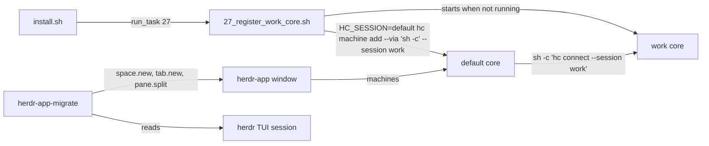
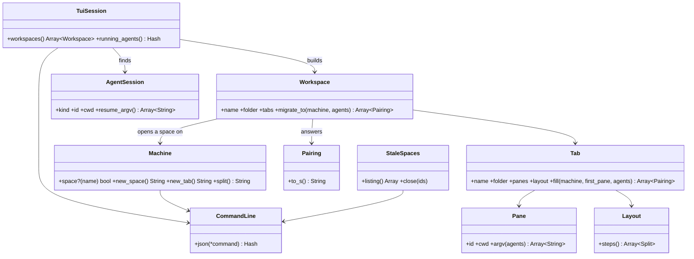
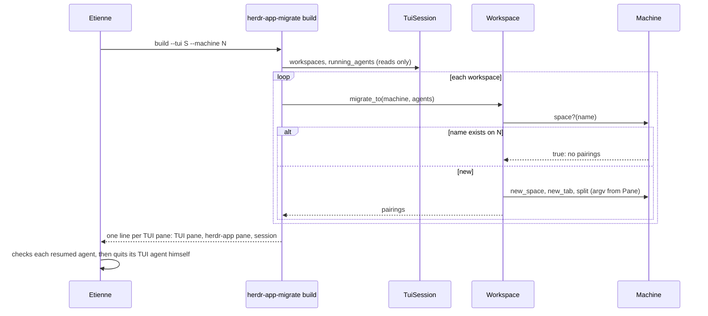

# Plan: herdr-app phase 2 — cores

From `intent.md` (2026-11-10). Status: accepted.

Scope: phase 2 of five ("Cores") only. Phase 1 shipped in PR #275. Phases 3–5 (keys, look, pipeline) each get their own plan after this phase merges. This plan ships as one pull request on branch `herdr-app-cores`.

## Design

### Domain terms

From the glossary: **Core**, **herdr-app**, **herdr TUI**, **PATH stub**. No avoided word is used: not "server", not "Herdr UI".

Proposed new terms. They go into `GLOSSARY.md` after acceptance, as the `glossary` skill says:

- **Machine** — one core as herdr-app shows it: this computer (the `default` core, `''` on the command line), or a core that `hc machine add` registered with the default core, such as `work`. herdr-app shows each machine as one sidebar group.
- **Space** — a herdr-app space: a named place to work on one machine, with tabs.
- **Workspace** — a herdr TUI workspace, the source of one space.
- **Running agent** — a herdr TUI pane that `herdr agent list` lists now, with its kind (`claude` or `codex`), session id and folder.
- **Pairing** — one herdr TUI pane next to the herdr-app pane built for it, with the session it resumed, if any.
- **Stale space** — a space on this computer left from the 2026-10-30 import, whose agents were lost on 2026-11-05.

### Diagrams

What talks to what after phase 2:



The migration objects:



One `build` run:



A TUI pane's way through `build`:

```mermaid
stateDiagram-v2
  [*] --> Skipped: its workspace name is a space on the machine
  [*] --> Shell: no running claude or codex agent
  [*] --> Resumed: running claude or codex agent
  Shell --> Paired: login shell in its folder
  Resumed --> Paired: same session id, its folder, shell after exit
  Paired --> [*]: printed; the TUI pane is left running
```



### Signatures

Ruby 4, inline RBS comments as `ruby-style` says, in `module HerdrAppMigration`. Every class is under 100 lines and every method under 10.

**`herdr-app/.local/share/herdr-app-migrate/command_line.rb`**

- `CommandLine` — runs one `herdr`, `herdr-app` or `hc` command with `Open3.capture3` (an argument list, never a shell string) and answers its parsed JSON. A non-zero exit or an `"error"` key raises `HerdrAppMigration::Refusal` with the command and its stderr.
  - `#: (*String command) -> Hash[String, untyped]` `json(*command)`

**`herdr-app/.local/share/herdr-app-migrate/tui_session.rb`**

- `TuiSession` — reads one herdr TUI session; it sends only `list`, `get` and `layout` requests.
  - `#: (String session, ?command_line: CommandLine) -> void` `initialize`
  - `#: -> Array[Workspace]` `workspaces` — in TUI order. A workspace's folder is its first tab's first pane's `cwd`; a tab's folder is its first pane's `cwd`.
  - `#: -> Hash[String, AgentSession]` `running_agents` — keyed by TUI pane id, only kinds `claude` and `codex` with a session id.

**`herdr-app/.local/share/herdr-app-migrate/agent_session.rb`**

- `AgentSession = Data.define(:kind, :id, :cwd)` — one running Claude or Codex conversation.
  - `#: -> Array[String]` `resume_argv` — `["sh", "-c", RESUME, "sh", cwd, "claude", "--resume", id]` or `[…, "codex", "resume", id]`. `RESUME` is `cd "$1" || exit 1; shift; exec "${SHELL:-/bin/sh}" -l -i -c "$AGENT_THEN_SHELL" sh "$@"`, and `AGENT_THEN_SHELL` is `"$@" || printf 'herdr-app-migrate: %s exited %s\n' "$1" "$?"; exec "${SHELL:-/bin/sh}" -l`. So the agent starts inside Etienne's login, interactive shell (his PATH), its id and folder stay positional parameters, a failed `cd` exits non-zero (herdr-app shows its toast), a failed resume prints one line, and a login shell stays after the agent exits. Same id, no fork flag. An unknown kind raises `Refusal`.

**`herdr-app/.local/share/herdr-app-migrate/workspace.rb`**

- `Workspace = Data.define(:name, :folder, :tabs)` — builds itself as a space.
  - `#: (Machine machine, Hash[String, AgentSession] agents) -> Array[Pairing]` `migrate_to` — empty when `machine.space?(name)`; otherwise `new_space` with the first tab, then `new_tab` into `created.space` for each further tab, and each tab fills itself. A `Refusal` after the space exists is re-raised as `Refusal` naming the incomplete space and its id, so the next run does not skip it silently.
  - `#: -> String` `preview` — the declarative plan of this workspace for `--dry-run`: name, folder, each tab with its split steps and each pane's start command; no ids.
- `Tab = Data.define(:name, :folder, :panes, :layout)` — fills a new tab with its panes.
  - `#: (Machine machine, String first_pane, Hash[String, AgentSession] agents) -> Array[Pairing]` `fill`
- `Pane = Data.define(:id, :cwd)` — the start command of its new pane.
  - `#: (Hash[String, AgentSession] agents) -> Array[String]` `argv` — the agent's `resume_argv`, or `["sh", "-c", SHELL_IN, "sh", cwd]` (`cd "$1" || exit 1; exec "${SHELL:-/bin/sh}" -l`), because `pane.split` takes no folder.
- `Pairing = Data.define(:space, :tab, :tui_pane, :app_pane, :agent)` — view-only, one output line.
  - `#: -> String` `to_s` — tab-separated: space, tab, TUI pane, herdr-app pane, `claude <id> started` / `codex <id> started` / `shell`. "Started" means the terminal exists; Etienne's check confirms the conversation resumed.

**`herdr-app/.local/share/herdr-app-migrate/layout.rb`**

- `Layout` — turns one tab's pane rectangles (from `herdr pane layout`) into split steps by guillotine cuts: in a region, find a vertical cut (every pane wholly left or right) or a horizontal cut (wholly above or below); split the region's anchor `right` or `down`, where the anchor is the region's top-left pane by geometry (least `y`, then least `x`), never by TUI order; the new pane anchors the other half; recurse into both halves. Ratios are not kept.
  - `#: (Array[[String, Hash[String, Integer]]] rects) -> void` `initialize` — pane id and `{x, y, width, height}`.
  - `#: -> Array[Split]` `steps` — `Split = Data.define(:from, :to, :direction)`; `from` and `to` are TUI pane ids. A region with no clean cut, overlapping rectangles or a missing rectangle raises `Refusal` naming the tab. `build` computes every layout before its first create command, so a refused layout creates nothing.

**`herdr-app/.local/share/herdr-app-migrate/machine.rb`**

- `Machine` — one machine as herdr-app shows it, and the only sender of create commands. It has no close, kill or stop method.
  - `#: (String name, ?command_line: CommandLine) -> void` `initialize` — `''` is this computer.
  - `#: (String name) -> bool` `space?` — reads `herdr-app ls` once, keeps the names of spaces whose `machine` matches (`null` for `''`), and adds each name it builds in this run.
  - `#: (name: String, folder: String, tab: String, argv: Array[String]) -> Created` `new_space` — `herdr-app do space.new` with `--machine`.
  - `#: (space: String, name: String, folder: String, argv: Array[String]) -> Created` `new_tab`
  - `#: (pane: String, direction: String, argv: Array[String]) -> Created` `split`
  - `Created = Data.define(:space, :tab, :pane, :terminal)` — the ids a create command answers; a missing pane id raises `Refusal`. Step 1 of `## Order of work` confirms which keys each reply holds before any fixture is written.

**`herdr-app/.local/share/herdr-app-migrate/stale_spaces.rb`**

- `StaleSpaces` — the spaces of one machine that Etienne may approve for closing.
  - `#: (String machine, ?command_line: CommandLine) -> void` `initialize`
  - `#: -> Array[String]` `listing` — one tab-separated line per live space of the machine (`herdr-app ls` `spaces`, never `recent`): id, name, folder, tab count, terminal count, agent statuses. An empty listing prints "no spaces" and is a valid result: nothing to close.
  - `#: (Array[String] ids) -> void` `close` — checks every id against the current listing before the first close and raises `Refusal` naming the unknown ids; then `herdr-app do space.close --id <id> --confirmed true` per id.

**`herdr-app/.local/bin/herdr-app-migrate`** (mode 755, under 40 lines) — `require_relative "../share/herdr-app-migrate/…"` (the link resolves into the package, so `File.realpath(__FILE__)` anchors it), parses arguments with `OptionParser`, rescues `Refusal` into one stderr line and exit 1:

- `herdr-app-migrate build --tui <session> --machine <name|''> [--dry-run]` — reads the whole TUI session and computes every layout first; then builds. `--dry-run` reads `herdr-app ls` and prints each workspace's `preview`, or `skip <name>`, and sends no create command.
- `herdr-app-migrate stale --machine <name|''>` — prints `StaleSpaces#listing`.
- `herdr-app-migrate close --machine <name|''> <id>…` — `StaleSpaces#close`.

**`install/tasks/27_register_work_core.sh`** (new, mode 755): starts the work core and registers it with the default core, on macOS and SteamOS; any other OS skips. It sources `00_common.sh` like `53_configure_rex_defaults.sh`:

```bash
# work_core_running    :: () -> status   HC_SESSION=work hc server status --json succeeds
# work_core_start      :: () -> status   HC_SESSION=work hc server start; never stop or restart
# work_core_update     :: () -> status   only when machine ls/add reports the work core too old: count live
#                                        terminals with HC_SESSION=work hc ls --json; 0 → hc machine update work
#                                        (restarts that empty core, Etienne approved); any → die naming the count,
#                                        nothing changed
# work_core_registered :: () -> status   HC_SESSION=default hc machine ls --json | jq: a machine named "work";
#                                        die without changing it when its session is not "work" or it is not
#                                        reached --via 'sh -c' (a mismatch is Etienne's call, never replaced)
# work_core_register   :: () -> status   HC_SESSION=default hc machine add --via 'sh -c' --name work --session work
# work_core_reachable  :: () -> status   the machine's state in `hc machine ls --json` is not unreachable;
#                                        warn with its `why` otherwise (field names confirmed in step 1)
# main                 :: () -> status   task_bootstrap; determine_os; skip unless macOS or SteamOS;
#                                        warn and return 0 when hc is missing ("open herdr-app once, then run
#                                        this step again"); start unless running; register unless registered;
#                                        check reachable
```

Not checked: the dotfiles repository declined Steep and rbs_rails; it has no `Steepfile`.

### Complexity

W workspaces, T tabs, P panes in one TUI session (about 20, 45 and 70 on the personal side today).

| Path | Requests | Notes |
| --- | --- | --- |
| `build`, TUI side | 2 + 2W + T | workspace list, agent list; tab list and pane list per workspace; one layout per tab |
| `build`, herdr-app side | 1 + P | one `ls`; W `space.new`, T − W `tab.new`, P − T `pane.split`; skipped workspaces cost nothing |
| `Layout` | O(p²) per tab | p panes in that tab, single digits |
| `stale` | 1 | `ls` |
| `close` | 1 + k | `ls`, then k approved ids |
| Install task | 2 to 4 `hc` calls | status, machine ls; start and add only the first time |

### Invariants

- A space is never built over a name that exists on its machine. Enforced by `Machine#space?`. Proved by `test_a_workspace_whose_name_is_a_space_is_skipped` and `test_a_second_build_creates_nothing`.
- Each running agent's session resumes once, with its own id and in its own folder. Enforced by `Pane#argv` and the name skip across runs. Proved by `test_a_claude_pane_resumes_its_session_in_its_folder`, `test_a_codex_pane_resumes_its_session_in_its_folder` and `test_a_second_build_creates_nothing`.
- `build` ends no program and changes nothing in the herdr TUI. Enforced by `TuiSession` sending only reads and `Machine` having no close method. Proved by `test_build_sends_no_closing_or_tui_changing_command`.
- A space closes only when its id is in the approved, current listing; one unknown id closes nothing. Enforced by `StaleSpaces#close`. Proved by `test_close_refuses_an_unlisted_id_before_closing_any`.
- No command runs through a shell string built from TUI data: names and folders travel as argument-list items and `sh -c` positional parameters. Enforced by `CommandLine` and the argv shapes. Proved by `test_a_folder_with_quotes_and_dollars_stays_one_argument`.
- The default core holds at most one machine named `work`; the task never stops or restarts a core. Enforced by `work_core_registered` and the task's command set. Proved by `test_a_second_run_changes_nothing` and `test_the_task_never_stops_a_core`.
- No work name lands in a tracked file: TUI session names and work folders come only from arguments. Proved by the fixtures using invented names, and the review's grep.

### Alternatives

1. **Ruby objects in the herdr-app package, an injected command line (chosen).** Built for unit-testable migration rules without herdr running. Costs about nine small objects and three test files for a script that runs once per side.
2. **One bash + jq script next to the herdr TUI scripts (`herdr/.config/herdr/scripts/migrate-to-herdr-app.sh`).** Rejected: the rules (skip names, resume argv, split order from rectangles, guarded close) are only testable end to end through PATH stubs, and the split order from rectangles is awkward in jq.
3. **A snapshot file taken while agents run, resumed after Etienne quits them.** Rejected: the changed intent resumes while the TUI agent still runs and has Etienne quit it after checking, so no file is needed.

## Design decisions

- Phase 2 only, per the coordinator.
- herdr-app shows another core as a machine: `hc machine add --via 'sh -c' --name work --session work`, registered with the `default` core. The `spaces` mod groups spaces by machine once more than one is known, and each group folds (`machines.folded`).
- Acceptance reading for "two sidebar groups, personal and work": the personal group is the `default` core's group and the work group is the `work` machine. herdr-app's `spaces` mod hard-codes "This computer" for the local group, so this phase clones it as `spaces-cores` and changes only its three local-machine string literals (`"This computer"` at shipped lines 321 and 331, `"this computer"` at line 347) to `"personal"`; the comment at line 297 stays. A cloned layout `cores` (from `main`) points its `spaces` block's `content.mod` at `spaces-cores`, nothing else. Phase 4 builds on both clones.
- The package tracks only the clone files Etienne owns: `mods/spaces-cores/main.js`, `mods/spaces-cores/mod.json` and `layouts/cores.json`. Herdr rewrites `jsconfig.json` and the `.d.ts` files in a mod folder on every start (AGENTS.md), so `.gitignore` ignores `herdr-app/.config/herdr-app/mods/*/jsconfig.json` and `herdr-app/.config/herdr-app/mods/*/*.d.ts`, and the package never holds them. With `STOW_SHARED`, stow links the three tracked files one by one; Herdr writes the rest into the real `mods/spaces-cores/` folder.
- The window shows the clone only after `herdr-app do layout.switch cores`, which `shared.json` (untracked) keeps per machine. Task 27 never switches layouts; the runbook and the delivery step do, once per machine.
- Install task number 27, right after `26_install_herdr_app.sh`. When `hc` is missing (a fresh machine before herdr-app's first open installs herdr-core), it warns and returns 0; installing herdr-core from the installer is not in the approved permissions. So on a fresh machine the work core is registered by the installer run after herdr-app's first open, not by the very first run. Etienne chose this: herdr-app installs and updates its own core.
- Task 27 never stops a core and restarts one only through `hc machine update work` while the work core holds 0 live terminals (Etienne's approval, 2026-11-10). With any live terminal it dies, naming the count, and changes nothing.
- The stale-space listing reads live spaces only. On 2026-11-10 at 22:00, `herdr-app ls` held one live space on this computer ("Developer") and 20 entries under `recent`: the imported spaces had already been closed. The cleanup step still runs, and an empty or one-line listing is a valid result.
- `build` reads everything and computes every layout before its first create command. A failure after a space exists names that space and its id and exits 1; the runbook has Etienne approve closing it, then rerun. No progress file.
- The migration lives in the `herdr-app` package as `.local/bin/herdr-app-migrate` plus `.local/share/herdr-app-migrate/*.rb`. `STOW_SHARED` links them file by file, and `test_the_package_holds_only_keys_and_settings` (which reads only `.config/herdr-app`) stays true.
- A resumed pane runs `claude --resume <id>` or `codex resume <id>` in the agent's folder inside Etienne's login, interactive shell, then a login shell, so his PATH applies and the pane stays open like the TUI pane did when the agent exits.
- A plain pane gets a login shell in its folder through `sh -c`, because `pane.split` has no folder argument.
- Split ratios are not kept; `pane.split` takes no ratio.
- "On the right side" in the phase 2 criterion reads as "in the right sidebar group": personal workspaces under this computer, work workspaces under `work`.
- The stale spaces are listed with `herdr-app-migrate stale --machine ''` and closed with `herdr-app-migrate close`, only after Etienne approves the printed list. They close before the first `build`, or `build` would skip their names.
- `build --dry-run` exists so the coordinator can show the planned commands before any agent resumes.
- No conflict with `intent.md`'s `## Decisions` found. The two-writer window is the intent's own choice ("same session id, not a fork").

## Integration points

- herdr-core `hc` 0.1.20 (`~/.local/bin/hc`): `machine add|ls`, `server status|start`, `HC_SESSION`. The `work` core runs 0.1.18 today.
- herdr-app 0.1.15: `herdr-app ls`, `herdr-app do space.new|tab.new|pane.split|space.close`; the `spaces` mod's machine groups.
- herdr TUI: `herdr --session <S> workspace list`, `tab list --workspace`, `pane list --workspace`, `pane layout --pane`, `agent list`.
- Claude Code `claude --resume <id>` and Codex `codex resume <id>`.
- `install.sh` `run_task`, `install/utils.sh` `determine_os` (with phase 1's `OS_RELEASE_FILE` seam), `require_cmd`.
- `agents/.agents/skills/dotfiles-maintenance/SKILL.md`, for the runbook link.

## Files that change

- `herdr-app/.local/bin/herdr-app-migrate` — new executable, mode 755.
- `herdr-app/.local/share/herdr-app-migrate/{command_line,tui_session,agent_session,workspace,layout,machine,stale_spaces}.rb` — new.
- `install/tasks/27_register_work_core.sh` — new task, mode 755.
- `install.sh` — `run_task "27_register_work_core.sh" "$root"` after task 26.
- `agents/.agents/skills/dotfiles-maintenance/references/herdr-app-cores.md` — new runbook: the work core and its registration; the stale-space listing and close after approval; the migration per side (dry run, build, check each pairing, Etienne quits the TUI agent); recovery after a core restart (every kept terminal gets a shell in its last folder; in each agent pane run `claude --resume` or `codex resume` there, and pick the session, or use the id from the pairing list).
- `agents/.agents/skills/dotfiles-maintenance/SKILL.md` — one line linking the runbook.
- `test/herdr_app_migration_test.rb` — new; unit tests with a fake command line.
- `test/herdr_app_migrate_cli_test.rb` — new; the executable with `herdr` and `herdr-app` PATH stubs.
- `test/herdr_app_work_core_test.rb` — new; the task with an `hc` PATH stub.
- `herdr-app/.config/herdr-app/mods/spaces-cores/main.js` and `mod.json` — new; the cloned `spaces` mod with the three labels changed.
- `herdr-app/.config/herdr-app/layouts/cores.json` — new; the cloned `main` layout with the `spaces` block on `spaces-cores`.
- `.gitignore` — ignore `herdr-app/.config/herdr-app/mods/*/jsconfig.json` and `herdr-app/.config/herdr-app/mods/*/*.d.ts`.
- `test/herdr_app_package_test.rb` — `test_the_package_holds_only_keys_and_settings` becomes `test_the_package_holds_only_etiennes_files`; new clone tests (see Proof).

## Order of work

1. Confirm the CLI shapes before any fixture, read-only or in scratch, and record the results under this step: the reply keys of `herdr-app do space.new`, `tab.new` and `pane.split`, and the `--argv` form, in a sandbox window as in phase 1 (`HERDR_APP_HOME` under `~/.config/herdr-app-c2`, short `HC_SESSION=hac2`, stopped by its own pid, never `app.quit`); the fields of `hc machine ls --json` for a machine (session, via, state); the exit status of `hc server status` for a core that is not running, with scratch `XDG_STATE_HOME` and `HC_SESSION`.
2. Clones, in the step 1 sandbox window: with `HERDR_APP_HOME=~/.config/herdr-app-c2` on every command, `herdr-app do mod.clone '{"name":"spaces","as":"spaces-cores"}'` and `herdr-app do layout.clone '{"name":"main","as":"cores"}'` (it switches only that sandbox window). Write the package tests first and watch them fail. Copy `mods/spaces-cores/main.js`, `mods/spaces-cores/mod.json` and `layouts/cores.json` from the sandbox home into `herdr-app/.config/herdr-app/`; change the three labels and the one `content.mod`; add the `.gitignore` lines. Run the package tests green; `herdr-app check` the mod folder in the sandbox.
3. Write `test/herdr_app_migrate_cli_test.rb` `test_build_builds_every_workspace_on_the_machine`. Run it, watch it fail (no executable).
4. Write `test/herdr_app_migration_test.rb` for `AgentSession`, `Pane`, `Layout`; make them green with `agent_session.rb`, `workspace.rb` (`Pane`, `Pairing`) and `layout.rb`.
5. Unit tests for `Machine`, `Workspace`, `Tab`, `TuiSession`, `CommandLine`; make them green.
6. Unit tests for `StaleSpaces`; make them green.
7. Write `herdr-app-migrate`; run the CLI test green, then the rest of the CLI tests.
8. Write `test/herdr_app_work_core_test.rb`; watch it fail; write `install/tasks/27_register_work_core.sh` and the `install.sh` line; run it green.
9. Write the runbook and the `SKILL.md` link.
10. Sandbox migration: start a scratch herdr TUI session (`herdr --session hac2`) with two workspaces, a two-column tab and a 2×2 tab, plain shells only; run `herdr-app-migrate build --tui hac2 --machine '' --dry-run`, then without it, against the sandbox window (`HERDR_APP_HOME` set); compare names, folders and split shapes with `herdr-app ls`; run it again and see only skip lines. Stop only that TUI session and that sandbox window, by pid.
11. Run `bin/test`, then the linters (`rubocop`, `shellcheck`, `yamllint`, markdownlint through lefthook). Re-read the diff.
12. Delivery on this Mac, after the merge, from the main checkout `~/Developer/dotfiles`. Each stop waits for Etienne:
    1. `stow -d ~/Developer/dotfiles -t "$HOME" --no-folding --restow herdr-app`, then `herdr-app do layout.switch cores` in Etienne's window.
    2. `install/tasks/27_register_work_core.sh`; check the work group in the window; run it again and see "already registered".
    3. `herdr-app-migrate stale --machine ''`. **Stop: Etienne approves the list** (it may be empty, or only "Developer"). Then `herdr-app-migrate close --machine '' <approved ids>`, or nothing.
    4. `herdr-app-migrate build --tui default --machine '' --dry-run`, then without `--dry-run`. Then the work side with the work TUI session's name as argument and `--machine work`.
    5. **Stop: Etienne checks each pairing and quits each TUI agent himself.** Nobody types in either copy of a session before that.

## Risks

- Two writers: from `build` until Etienne quits the TUI agent, one Claude or Codex session runs in two processes. Both may append to its transcript. The intent accepts this; the runbook says to type in neither copy until the TUI agent quits.
- `hc machine add --via 'sh -c'` runs `hc` through the default core's environment. If that PATH lacks `~/.local/bin`, the work machine shows unreachable. `work_core_reachable` warns about it, and step 11.2 checks it in the window. The fallback is `--via` with a login shell (`sh -lc`); it goes to Etienne as a decision if neither reaches the core.
- On a fresh machine, the first installer run cannot register the work core, because herdr-core arrives with herdr-app's first open. See the `Design decisions` and the report's `Decision needed` line.
- The work core runs 0.1.18 and `hc` is 0.1.20. If the machine reports "too old", the task does not pass `--install` or restart the core (never stop a core Etienne started); it goes to Etienne as a decision.
- `claude --resume` keys sessions by folder: a Claude agent that changed folder after start resumes from the folder `herdr agent list` reports as `cwd`. If that misses, the runbook's picker recovery applies.
- herdr-app's agent status (OSC 7501) for a resumed agent depends on herdr-app's own agent detection; a pane may show no status until the agent reports one.
- A core restart still ends every agent (an upstream behaviour). The runbook documents recovery; nothing in the dotfiles prevents it.
- A space Etienne made after the import also shows in the stale listing. Only his approval decides what closes.
- Rejected: a bash migration script; a snapshot file; installing herdr-core from the installer (not approved); restoring split ratios (no API).

## Proof

- herdr-app shows two sidebar groups, personal and work, and each one folds away → `test/herdr_app_work_core_test.rb` `test_registers_the_work_core_with_the_default_core`; `test/herdr_app_package_test.rb` `test_the_cores_layout_shows_the_cloned_spaces_mod`, `test_the_cloned_spaces_mod_names_the_local_group_personal`; plus check: after step 12.2, `herdr-app shot` shows a "personal" group and a `work` group; Etienne folds and unfolds each header.
- A new space made while a work space has focus lands in the work core, and `hc ls` in a personal shell does not list it → check: Etienne focuses a work space and makes a new space with the new-space key; `HC_SESSION=work hc ls` lists its terminal and `hc ls` in a personal shell does not.
- After the migration, every herdr TUI workspace has a space with the same name and folder, in its machine's group; a second run makes no new spaces → `test/herdr_app_migrate_cli_test.rb` `test_build_builds_every_workspace_on_the_machine`, `test_a_second_build_creates_nothing`; `test/herdr_app_migration_test.rb` `test_a_workspace_becomes_a_space_with_its_name_and_folder`, `test_the_space_lands_on_the_named_machine`; plus check: after step 12.4, every `herdr --session <S> workspace list` label is a space name under its group in `herdr-app ls`, and a second `build` prints only skipped lines.
- The stale herdr-core spaces close only after Etienne approves the list → `test/herdr_app_migration_test.rb` `test_close_refuses_an_unlisted_id_before_closing_any`; plus check: the delivery account quotes Etienne's approval before the `close` call.
- After the migration, every former herdr TUI Claude or Codex pane runs the same conversation, with the same session id, in herdr-app → `test/herdr_app_migration_test.rb` `test_a_claude_pane_resumes_its_session_in_its_folder`, `test_a_codex_pane_resumes_its_session_in_its_folder`; `test/herdr_app_migrate_cli_test.rb` `test_build_resumes_every_running_agent_once`; plus check: Etienne reads each resumed pane against its TUI pane.
- The script prints each TUI pane next to its herdr-app pane, and ends no TUI agent → `test/herdr_app_migrate_cli_test.rb` `test_build_prints_one_line_per_tui_pane`; `test/herdr_app_migration_test.rb` `test_build_sends_no_closing_or_tui_changing_command`.
- On a fresh machine, the installer leaves the work core registered, and a second run changes nothing → `test/herdr_app_work_core_test.rb` `test_registers_the_work_core_with_the_default_core`, `test_a_second_run_changes_nothing`, `test_starts_the_work_core_when_it_is_not_running`, `test_skips_with_a_warning_without_hc`; plus check: Etienne runs `./install.sh` on the Steam Deck before herdr-app's first open (the task warns), opens herdr-app once, then runs it twice more (registers, then changes nothing). The criterion holds from the run after herdr-app's first open, unless Etienne approves installing herdr-core from the installer.
- Invariant: a refused layout or TUI read creates nothing, enforced by `build`'s read-and-compute-first order → `test/herdr_app_migrate_cli_test.rb` `test_a_refused_layout_creates_nothing`.
- Invariant: a failure after a space exists names that space, enforced by `Workspace#migrate_to` → `test/herdr_app_migration_test.rb` `test_a_failed_split_names_the_incomplete_space`.
- Invariant: a `work` machine with another session or transport is never replaced, enforced by `work_core_registered` → `test/herdr_app_work_core_test.rb` `test_a_mismatched_work_machine_fails_without_change`.
- Invariant: no space is built over an existing name, enforced by `Machine#space?` → `test/herdr_app_migration_test.rb` `test_a_workspace_whose_name_is_a_space_is_skipped`, `test_a_name_built_in_this_run_is_not_built_again`.
- Invariant: build changes nothing in the TUI and ends no program, enforced by `TuiSession` and `Machine` → `test/herdr_app_migration_test.rb` `test_build_sends_no_closing_or_tui_changing_command`.
- Invariant: one unknown id closes nothing, enforced by `StaleSpaces#close` → `test/herdr_app_migration_test.rb` `test_close_refuses_an_unlisted_id_before_closing_any`.
- Invariant: TUI data never reaches a shell string, enforced by `CommandLine` and the argv shapes → `test/herdr_app_migration_test.rb` `test_a_folder_with_quotes_and_dollars_stays_one_argument`.
- Invariant: one `work` machine and no core stopped, enforced by the task → `test/herdr_app_work_core_test.rb` `test_a_second_run_changes_nothing`, `test_the_task_never_stops_a_core`.

Per changed file, the unit tests expected, named as behaviour:

- `agent_session.rb`: `test_a_claude_session_resumes_by_id_in_its_folder`, `test_a_codex_session_resumes_by_id_in_its_folder`, `test_an_unknown_kind_is_refused`, `test_the_resume_runs_inside_a_login_interactive_shell`, `test_the_resume_keeps_a_shell_after_the_agent_exits`, `test_a_missing_folder_exits_non_zero` (runs the real `sh` wrapper with `SHELL` pointing at a stub that logs its arguments), `test_a_failed_resume_prints_one_line`.
- `workspace.rb`: `test_a_workspace_becomes_a_space_with_its_name_and_folder`, `test_each_further_tab_goes_into_the_created_space`, `test_a_plain_pane_gets_a_login_shell_in_its_folder`, `test_each_pairing_names_the_tui_pane_and_the_app_pane`, `test_a_pairing_says_started_not_resumed`, `test_a_workspace_whose_name_is_a_space_is_skipped`, `test_a_failed_split_names_the_incomplete_space`, `test_the_preview_lists_tabs_splits_and_start_commands`.
- `layout.rb`: `test_one_pane_needs_no_split`, `test_two_columns_split_right`, `test_two_rows_split_down`, `test_a_two_by_two_tab_splits_in_tree_order`, `test_an_l_shape_splits_in_tree_order`, `test_reordered_panes_anchor_by_geometry`, `test_overlapping_rectangles_are_refused`, `test_a_region_without_a_clean_cut_is_refused`.
- `machine.rb`: `test_the_space_lands_on_the_named_machine`, `test_this_computer_is_the_empty_machine`, `test_a_name_built_in_this_run_is_not_built_again`, `test_each_create_answers_its_space_tab_pane_and_terminal`, `test_a_reply_without_a_pane_id_is_refused`.
- `tui_session.rb`: `test_workspaces_come_in_tui_order_with_their_folders`, `test_running_agents_hold_only_claude_and_codex_with_a_session`, `test_the_session_name_reaches_every_herdr_call`.
- `command_line.rb`: `test_a_failed_command_raises_a_refusal_with_its_stderr`, `test_an_error_answer_raises_a_refusal`.
- `stale_spaces.rb`: `test_the_listing_shows_only_the_machines_live_spaces`, `test_recent_entries_are_not_listed`, `test_an_empty_listing_says_no_spaces`, `test_close_refuses_an_unlisted_id_before_closing_any`, `test_close_confirms_each_approved_id`.
- `herdr-app-migrate`: `test_build_builds_every_workspace_on_the_machine`, `test_a_second_build_creates_nothing`, `test_build_resumes_every_running_agent_once`, `test_build_prints_one_line_per_tui_pane`, `test_dry_run_sends_no_create_command`, `test_dry_run_previews_tabs_splits_and_skips`, `test_a_refused_layout_creates_nothing`, `test_a_refusal_prints_one_line_and_exits_1`, `test_the_executable_is_executable`.
- `install/tasks/27_register_work_core.sh`: `test_registers_the_work_core_with_the_default_core`, `test_a_second_run_changes_nothing`, `test_starts_the_work_core_when_it_is_not_running`, `test_the_task_never_stops_a_core`, `test_a_mismatched_work_machine_fails_without_change`, `test_an_unreachable_work_machine_warns`, `test_skips_with_a_warning_without_hc`, `test_skips_on_debian`, `test_install_runs_the_task_after_the_herdr_app_install`, `test_the_task_is_executable`.
- `install.sh`, the runbook, `SKILL.md`: covered by the task test's order check; documents have no test.

Test setup: the unit tests inject a `FakeCommandLine` that answers canned JSON keyed by the command's words and logs every call; fixtures use invented session, workspace and folder names. The CLI test runs the real executable with a PATH of its own bin folder: one Ruby stub installed as `herdr` and `herdr-app` that drops a leading `--session <S>`, logs its arguments, answers from a JSON fixture, and keeps the spaces that `space.new` makes so a second `build` sees them. The task test follows `test/herdr_app_install_test.rb`: scratch `HOME`, an os-release file through `OS_RELEASE_FILE`, a `uname` stub, and an `hc` stub that logs calls and keeps `machine ls` and `server status` answers in a state file. No test reaches a real herdr, herdr-app or core.

Clone tests: `test_the_cores_layout_shows_the_cloned_spaces_mod` (the `spaces` block of `cores.json` names `spaces-cores`, and `cores.json` equals the shipped `main.json` apart from that one value); `test_the_cloned_spaces_mod_names_the_local_group_personal` (the string literals `"This computer"` and `"this computer"` are gone, `"personal"` takes their three places, and the line-297 comment is unchanged); `test_the_package_holds_only_etiennes_files` (exactly `keys.json`, `settings.json`, `layouts/cores.json`, `mods/spaces-cores/main.js`, `mods/spaces-cores/mod.json`). Work core update tests in `test/herdr_app_work_core_test.rb`: `test_updates_an_empty_work_core_that_is_too_old`, `test_refuses_to_update_a_work_core_with_live_terminals` (no `machine update` call, exit non-zero, message names the count).

Out of scope for this phase: keys, look, the pipeline backend; installing herdr-core; split ratios; moving running programs or scrollback; removing the herdr TUI.

---
Domain skills applied: dotfiles-maintenance (stow, installer tasks), object-oriented-design, ruby-style, software-design, glossary, diagrams.

## Critique

### Round 1 (Codex, `codex exec -m gpt-6.1-sol -c model_reasoning_effort=medium -s read-only`)

- The fresh-machine criterion fails, because no task installs herdr-core and task 27 returns success without `hc` → fixed (Design decisions, Risks and Proof state that registration happens on the run after herdr-app's first open; installing herdr-core from the installer goes to Etienne as a decision; the Proof check starts before the first open)
- `new_space` and `new_tab` answer only a pane id, but further tabs need the space id → fixed (every create answers `Created` with space, tab, pane and terminal ids; the reply keys are confirmed in step 1, before any fixture)
- The resume wrapper hides failures behind the login shell, and creation is not proof of a resume → fixed (a failed `cd` exits non-zero, a failed resume prints one line, pairings say "started", Etienne's check confirms the resume; new tests for both failures)
- The resume runs before shell initialisation, with the core's PATH → fixed (the agent starts inside `"$SHELL" -l -i -c`, with its id and folder as positional parameters; new test)
- Skipping by name makes a partial migration unrecoverable → fixed (`build` reads and computes every layout before the first create; a failure after a space exists names that space and its id; the runbook closes it after Etienne approves, then reruns; new tests)
- The stale-space premise is outdated: the imported spaces are under `recent`, not `spaces` → fixed (the listing reads live spaces only, an empty listing is valid, and Design decisions records the 2026-11-10 state: one live space, 20 recent entries)
- Registration checks only the name `work` → fixed (a `work` machine with another session or transport fails without change; an unreachable one warns with its reason; new tests)
- `--dry-run` cannot print later commands that need earlier ids → fixed (dry run prints a declarative preview per workspace, with no ids; new tests)
- The layout fallback hides bad input, and TUI order need not give the top-left pane → fixed (anchors come from geometry; overlapping, missing or uncuttable layouts raise `Refusal` before any create; new tests)
- The personal-group label stays unresolved while the plan claims no conflict → fixed (Design decisions records the acceptance reading, "This computer" is the personal group, and leaves the label change to Etienne as a decision)

### Round 2 (Claude Opus, same-model, at Etienne's request after the Codex round took over 10 minutes)

Scope: Etienne's three answers on 2026-11-10 (herdr-core left to herdr-app, the "personal" group in this phase, the work core update while empty), folded into the plan body above. Findings, all fixed:

- Tracking every clone file would put Herdr's rewritten `.d.ts` and `jsconfig.json` in the repo → fixed (track `main.js`, `mod.json` and `cores.json` only; `.gitignore` the rest)
- `test_the_package_holds_only_keys_and_settings` would break → fixed (becomes `test_the_package_holds_only_etiennes_files`)
- The amendment contradicted the design, Files, Order of work, Proof and Out of scope → fixed (folded into each section; the amendment section is gone)
- `hc machine update` restarts the core, against "never stop or restart", with no proof → fixed (the exception is in the signature and the design, with two tests)
- "In a scratch home first" had no runnable steps, and `layout.clone` switches the window it runs in → fixed (Order of work step 2 in the sandbox window, `HERDR_APP_HOME` on every command, copy into the package)
- The label test was case-sensitive and partial → fixed (covers all three literals and the comment)
