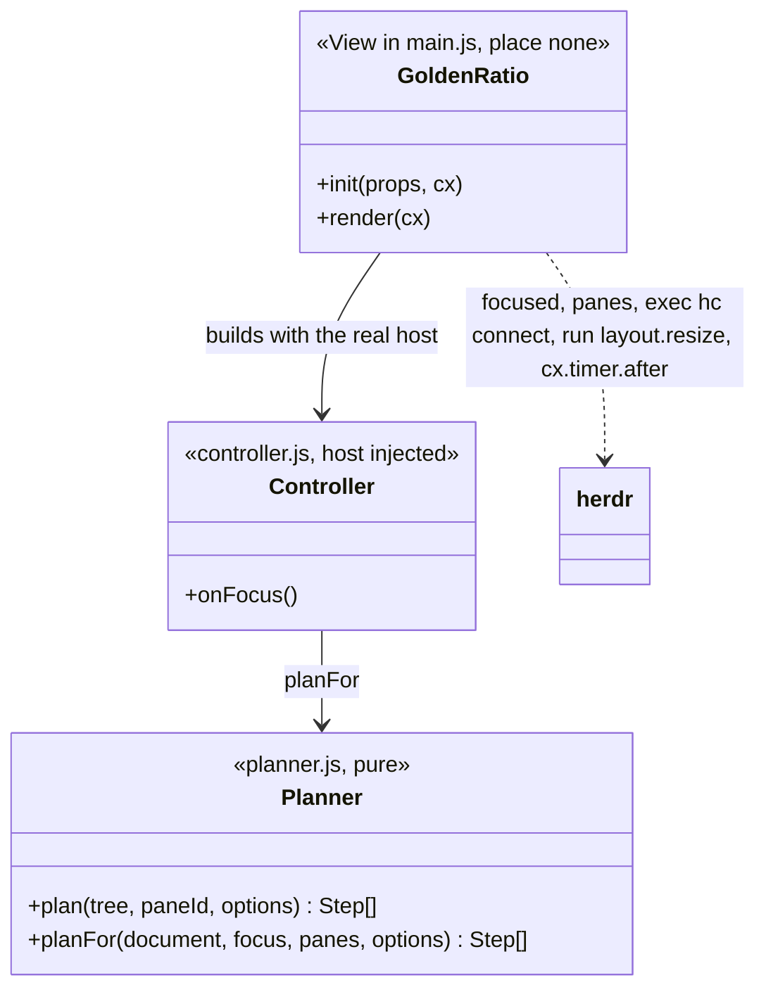
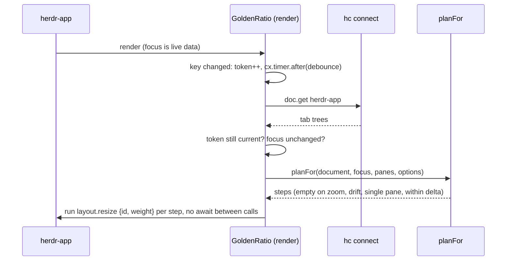

# Plan: Golden ratio in herdr-app

From `intent.md` (2026-11-11). Status: accepted.

## Design

### Domain terms

- **Tab tree**: the row, column and block nodes of one tab, as herdr-core stores them in the `herdr-app` document. A block is a pane. Every node has an id; `size` is `{weight}` or `{px}`, and a missing size means weight 1.
- **Focus path**: the containers from the tab root down to the focused pane. Only `row` and `column` containers are axes; a `stack` shows one child and has no weights, so it gets no step and its children are not resized. The siblings of a stack in the enclosing row or column follow the weight rule.
- **Step**: one `{id, weight}` pair, run as `layout.resize`.
- **Golden ratio**: 0.618. On each axis, the focused pane gets that share of the tab. When the focus path crosses `n` containers of one axis, each of them gives the focused branch the share `ratio^(1/n)`, so the shares multiply to `ratio`.
- **Settled**: the focus did not change for `debounce_ms`. The focus state is the (space, tab, pane) key plus whether the focused tab is zoomed, so unzooming with the same pane focused is a change.
- **Drift**: the focused tab is missing from the document (a fresh tab not yet persisted), or its leaf ids differ from the pane ids `panes()` reports for that tab. A space with a `machine` is not drift: it stays quiet and is never retried. It is the only staleness the mod can detect.
- **Settle run**: one pass of the controller after the debounce: read the document, check the focus again, plan, submit the steps.
- **herdr TUI plugin**: `vv.golden-ratio`, which hooks the TUI server and never fires under herdr-app (`herdr plugin log list --plugin vv.golden-ratio` is empty). The glossary has no term to avoid here.

### Diagrams





### Signatures

`mods/golden-ratio/mod.json`: `{"place": "none"}`. The cores layout mounts one zero-size block for it and gives it the settings as props: `ratio`, `debounce_ms`, `min_delta`. Settings are valid when `ratio` is a number from 0.05 to 0.95 (the Rex rule), `debounce_ms` a number from 0 to 2000 and `min_delta` a number from 0 to 0.5. An invalid or missing value falls back to the default (0.618, 120, 0.02).

`mods/golden-ratio/planner.js`: no `herdr` import, so node loads it in tests.

```js
/** Steps that give the focused pane's branch `ratio` at every container on its focus path. [] when the pane is absent or alone. */
export function plan(tree, paneId, { ratio, minDelta })

/** True when the focused tab or space is missing from the document, or the leaf ids differ from the live panes of that tab. A space with a `machine` is not drift. */
export function drifted(document, focus, panes)

/** `plan` for the focused pane's tab, or [] when the tab is zoomed (live `PaneInfo.zoomed`, since the document carries no zoom), has drifted, or holds one pane. */
export function planFor(document, focus, panes, { ratio, minDelta })
```

`mods/golden-ratio/controller.js`: the debounce, token, retry and submit logic, with the host injected (`focused`, `panes`, `readDocument`, `run`, `after`, settings). No `herdr` import, so node loads it with a fake host and a fake clock.

```js
export class Controller { constructor(host, settings); onFocus() }
```

`mods/golden-ratio/main.js`: the View, with no visible output. It builds a `Controller` with the real host and calls `onFocus` from `render`. Its only public members are the View lifecycle (`init`, `render`).

```js
export default class GoldenRatio extends View
```

Checked by: `herdr-app check` on the mod folder. Not checked by Steep: the change has no Ruby production code, and RBS comments do not apply to JavaScript.

Weight math at a container on the focus path, with at least two weighted children:

- With `n` containers of the same axis on the path, the target share `t` is `ratio^(1/n)` for each of them. A path with one container per axis gives `t = ratio`.
- The focused branch gets weight `t`.
- Each weighted sibling gets `(1 - t) * w / S`, where `w` is its old weight and `S` the sum of the siblings' old weights. A sibling set with `S <= 0` skips the container.
- A `px` child is never touched.
- The container is skipped when the focused branch's share `w_f / (w_f + S)` is within `min_delta` of `t`.

### Complexity

- Per render: one `focused()` read and one string compare. No process starts when the focus is unchanged.
- Per settled focus change: one `hc connect` process (one `doc.get`), one `panes()` read, an O(nodes) walk, and at most depth times fan-out `layout.resize` calls. A tab already within `min_delta` runs none.
- A burst of focus changes ends in one batch: each change replaces the timer, and the settle run checks the token after the document read.
- A drifted or failed read retries once after the debounce, so one more `hc` process at most.

### Invariants

- `plan` returns only ids that exist in the tree. Enforced in `planner.js`.
- A zoomed tab, a one-pane tab and a drifted tab produce no step. Enforced in `planFor`.
- Unzooming the focused tab re-evaluates the pane, even though the pane is the same. A pass within `min_delta` still marks the state applied. Enforced in `controller.js`.
- Planning the result of a plan gives `[]`. Enforced by the `min_delta` rule.
- A px child is never in a step. Enforced in `plan`.
- A `stack` on the focus path produces no step. Enforced in `plan`.
- A superseded settle run submits no `layout.resize`. Enforced by the token and focus check in `controller.js` after the document read. The steps then go out in one loop with no `await`, so nothing cancels a step once the loop starts. The commands are queued by `run()` and cannot be recalled.
- A failed `doc.get` leaves the layout unchanged and raises nothing to the UI: `readDocument` returns null and the controller retries once. A failed `layout.resize` shows the app's own toast and can leave a partial layout. Weights are absolute, so the next focus change repairs it.
- The drift check catches a changed leaf set only. A rearrangement that keeps every leaf id is not detectable from `panes()`. The cost is a mis-sized layout until the next focus change, never a wrong pane resized by id, because every step targets ids from the same document.
- A setting outside its valid range is replaced by its default before any weight is computed. Enforced in `controller.js`.

### Alternatives

- **Resize from `panes()` alone.** Rejected: `panes()` carries no tree, so nested axes cannot be planned.
- **Equal split of the sibling share (architect B).** Rejected for proportional split: it keeps the relative weights of three or more siblings.
- **Skip the drift check (architect A).** Rejected: the persisted document can trail a fresh split, and the mod would resize a node that is gone or miss a new one. The check costs one `panes()` read.
- **Keep the shell logic in `main.js`.** Rejected: it imports app modules, so node cannot test debounce and supersession. A controller with an injected host can.
- **A sidecar process watching the app, or polling `hc`.** Rejected: it runs outside the mod system and works when nothing changes.
- **A new app command `pane.resize`.** Rejected: it needs a change to the herdr-app source, outside this change.

## Design decisions

- The mod reads the tab tree through `exec("sh", ["-c", "printf … | hc connect"])` with `doc.get herdr-app`, because `exec` and `hc` take no stdin and `layout()` publishes only the chrome layout. Verified against the app source: `layout.resize {id, weight}` finds any node id, tab trees included (`find_node_mut` in `src/window.rs`).
- Settings are props on the mod's block in `layouts/cores.json`. Mods have no settings file; `settings()` carries look settings only. Defaults in code: ratio 0.618, debounce 120 ms, min delta 0.02.
- The planner is a separate pure file, so a Ruby minitest can run it through `node`, as `test/rex_golden_ratio_test.rb` runs Lua. Node is installed (v25.9.0).
- The debounce uses `cx.timer.after` (verified in `gpui-kit.d.ts`).
- The first version reads the local machine's document only. `intent.md` names no remote case, so this does not change the agreed behaviour. A pane in a space with a `machine` is skipped. The delivery account says so.
- No conflict with `intent.md`'s `## Decisions`.

## Integration points

- herdr-core document `herdr-app`, through `hc connect`. The format is opaque to the app's contract and could change; the drift check turns a change into a silent no-op.
- The `layout.resize` command of herdr-app.
- `herdr-app/.config/herdr-app/layouts/cores.json`: one new block node mounts the mod.
- The new files need links in `~/.config/herdr-app/` before the app sees them: the package links file by file (`packages.conf`, `STOW_SHARED`). The agent never runs `stow`. Etienne runs the restow.

## Files that change

- `herdr-app/.config/herdr-app/mods/golden-ratio/mod.json` — new, `place: none`.
- `herdr-app/.config/herdr-app/mods/golden-ratio/planner.js` — new, pure planner.
- `herdr-app/.config/herdr-app/mods/golden-ratio/controller.js` — new, debounce, token, retry and submit with an injected host.
- `herdr-app/.config/herdr-app/mods/golden-ratio/main.js` — new, the View: real host, `onFocus` from `render`.
- `herdr-app/.config/herdr-app/layouts/cores.json` — add a zero-size block for the mod, with props.
- `test/herdr_app_golden_ratio_test.rb` — new, planner and controller tests through `node`.
- `herdr/.config/herdr/README.md` — one paragraph in the golden-ratio section: herdr-app has its own `golden-ratio` mod, what it does, its props and how to activate it.
- `test/herdr_app_package_test.rb` — add the four new mod files to the expected tracked-file list.

## Order of work

1. Write the acceptance test for the side-by-side case in `test/herdr_app_golden_ratio_test.rb`. Run it and watch it fail.
2. Write `planner.js` until that test passes, then add the remaining planner tests one at a time (stacked, nested, repeated-axis nesting, single pane, within delta, zoom, drift, px sibling, three siblings, zero-weight siblings, invalid settings, idempotency).
3. Write the controller tests with a fake host and a fake clock, then `controller.js`: debounce, supersession during the document read, one retry on drift or a failed read, the last-applied skip.
4. Write `mod.json` and `main.js`. Run `herdr-app check herdr-app/.config/herdr-app/mods/golden-ratio` until it passes.
5. Add the block to `layouts/cores.json`. Update `test/herdr_app_package_test.rb`. Add the README paragraph.
6. Run the new test, the package test, then `bin/test`. Run `rubocop` and `markdownlint` on the touched files.
7. Verify live as a human would, in a sandbox: a dedicated `HC_SESSION`, its own `XDG_STATE_HOME`, `HERDR_APP_HOME` with the files linked and the cores layout selected, every `hc` call under the same `HC_SESSION`. Stop sandboxes by pid. Split a tab, move focus, and read the weights back with `hc connect`. Record the evidence in the delivery account.

## Risks

- **Mounting is unverified.** A `place: none` mod runs only where a layout mounts it (AGENTS.md). A zero-size block in the cores layout should do it. Step 6 proves it. If the block cannot be zero-size, the plan stops with a `Decision needed:` line.
- **Document freshness is unverified.** The app persists the document asynchronously, so a fresh split can fail the drift check. The controller retries once after the debounce. A second failure leaves the layout alone until the next focus change.
- **Remote machines.** `doc.get` takes `on: <machine>`, and remote node ids carry a `machine/` prefix. The first version reads the local machine's document only and skips a pane whose space has a machine. This is a known gap, named in the delivery account, and a candidate for a separate change.
- **Focus loops.** A resize does not change focus. The last applied (tab, pane) pair is skipped as a second guard.
- **Opaque document format.** A format change makes the mod a silent no-op, never a wrong resize.

## Proof

- Focusing a pane in a tab with two side-by-side panes gives the focused pane 61.8% of the tab width → `test/herdr_app_golden_ratio_test.rb` `test_side_by_side_pair_gives_the_focused_pane_the_golden_ratio`
- Focusing a pane in a stack of two panes gives it 61.8% of the height → `test/herdr_app_golden_ratio_test.rb` `test_stacked_pair_gives_the_focused_pane_the_golden_ratio`
- In a nested layout the focused pane gets 61.8% on each axis it shares with a sibling → `test/herdr_app_golden_ratio_test.rb` `test_nested_layout_balances_every_shared_axis` and `test_repeated_axis_nesting_multiplies_to_the_golden_ratio`
- A tab with one pane is left unchanged → `test/herdr_app_golden_ratio_test.rb` `test_single_pane_gets_no_step`
- Rapid focus changes end with one settled layout → `test/herdr_app_golden_ratio_test.rb` `test_rapid_focus_changes_submit_one_batch_for_the_last_pane`, with a fake clock: zero `run` calls before the debounce, one batch after it. The sandbox run repeats it live.
- A pane already within the minimum delta is not resized again → `test/herdr_app_golden_ratio_test.rb` `test_pane_within_min_delta_gets_no_step`
- A zoomed pane is left unchanged → `test/herdr_app_golden_ratio_test.rb` `test_zoomed_tab_gets_no_step`, with an unzoomed document and a live pane that reports `zoomed`
- Settings for ratio, debounce and minimum delta → `test/herdr_app_golden_ratio_test.rb` `test_settings_change_ratio_debounce_and_min_delta` and `test_invalid_settings_fall_back_to_defaults`; check: `herdr-app check herdr-app/.config/herdr-app/mods/golden-ratio` passes.
- Invariant: only existing ids appear in a plan, enforced by `plan` → `test/herdr_app_golden_ratio_test.rb` `test_plan_returns_only_ids_in_the_tree`
- Invariant: planning a plan's result gives nothing, enforced by `min_delta` → `test/herdr_app_golden_ratio_test.rb` `test_plan_is_idempotent`
- Invariant: a drifted tab gets no step, enforced by `planFor` → `test/herdr_app_golden_ratio_test.rb` `test_drifted_tab_gets_no_step`
- Invariant: a tab or space missing from the document is drift, a machine space is not → `test/herdr_app_golden_ratio_test.rb` `test_plan_for_reports_a_tab_missing_from_the_document_as_drift`, `test_document_missing_the_fresh_tab_is_retried_then_applied` and `test_machine_space_is_never_retried`
- Invariant: a stack container is not an axis → `test/herdr_app_golden_ratio_test.rb` `test_plan_ignores_a_stack_container`
- Invariant: a px child is never resized, enforced by `plan` → `test/herdr_app_golden_ratio_test.rb` `test_px_sibling_is_never_in_a_step`
- Invariant: unzooming with the same pane focused rebalances → `test/herdr_app_golden_ratio_test.rb` `test_unzooming_the_same_pane_rebalances`; a no-op pass still marks the pair applied → `test_a_no_op_pass_still_marks_the_pair_applied`
- Invariant: a superseded settle run submits nothing → `test/herdr_app_golden_ratio_test.rb` `test_focus_change_during_the_document_read_submits_nothing`
- Invariant: a failed document read retries once, then does nothing → `test/herdr_app_golden_ratio_test.rb` `test_failed_read_retries_once_then_stays_quiet` and `test_document_that_lags_a_split_is_retried`
- Document decoding and emitted commands, end to end through the controller → `test/herdr_app_golden_ratio_test.rb` `test_focus_change_emits_layout_resize_commands_from_the_document`

Per changed file, the unit tests expected, named as behaviour:
- `planner.js`: `plan` keeps the relative weights of three siblings, `plan` ignores a pane that is not in the tree, `plan` skips a container whose siblings have no weight, `planFor` skips a pane of another tab, `planFor` skips a pane of a space with a machine.
- `controller.js`: `onFocus` ignores an unchanged focus, `onFocus` skips the last applied pair, `onFocus` swallows a throwing host.
- `test/herdr_app_package_test.rb`: `test_the_package_holds_only_etiennes_files` lists the four new mod files.

Test setup: Ruby minitest builds tab-tree JSON fixtures in the test, calls `node` with a short ESM import of `planner.js` or `controller.js`, and parses the JSON result. The controller tests pass a fake host that records `run` calls and a fake clock that fires timers on demand. The test skips when `node` is absent. `main.js` is only glue, covered by `herdr-app check` and the live check, because it imports the app's own modules.

---
Domain skills applied: software-design, object-oriented-design (pure planner, injected host, thin shell), rails-testing (minitest conventions).

## Critique

### Round 1 (codex gpt-6.1-sol)

- Nested-axis math gives 0.618 squared for two same-axis containers → fixed (each of `n` same-axis containers on the path gets `ratio^1/n`; new repeated-axis test)
- Skipping remote panes narrows the accepted scope → dismissed: `intent.md` names no remote case, so the agreed behaviour is unchanged; the first version stays local, the gap is listed under Risks and goes in the delivery account
- The failure invariant is false because `run()` queues commands and returns null → fixed (invariant rewritten: a failed read is quiet, a failed resize shows the app's toast and may leave a partial layout that the next focus change repairs)
- Token checks cannot cancel queued resize commands → fixed (the token and focus are rechecked after the read, the steps go out in one loop with no await, and the cancellation boundary is stated)
- Leaf-ID comparison does not establish structural freshness → fixed (the claim is reduced to what the check proves; the residual race is stated)
  - A stale-topology test with unchanged leaf ids is dismissed: `panes()` carries no tree, so the mod cannot detect it and no test can assert a detection
- Document lag can permanently suppress the required resize → fixed (one retry after the debounce on drift or a failed read, with a delayed-document test)
- The zoom guard needs an explicit live source → fixed (`planFor` reads live `PaneInfo.zoomed`; test with an unzoomed document and a zoomed live pane)
- The required integration test is missing → fixed (new `controller.js` with an injected host; end-to-end controller test from document to `run` commands)
- The debounce proof cannot establish one settled batch → fixed (fake-clock test: zero calls before the debounce, one batch after; settings tests added)
- The sandbox procedure omits core isolation → fixed (dedicated `HC_SESSION` and `XDG_STATE_HOME`, cores layout selected, every `hc` call under the same session)
- Settings validation is unspecified → fixed (valid ranges, defaults, zero-weight sibling skip, tests)
- The README deliverable is absent → fixed (README paragraph added to Files and Order of work)
