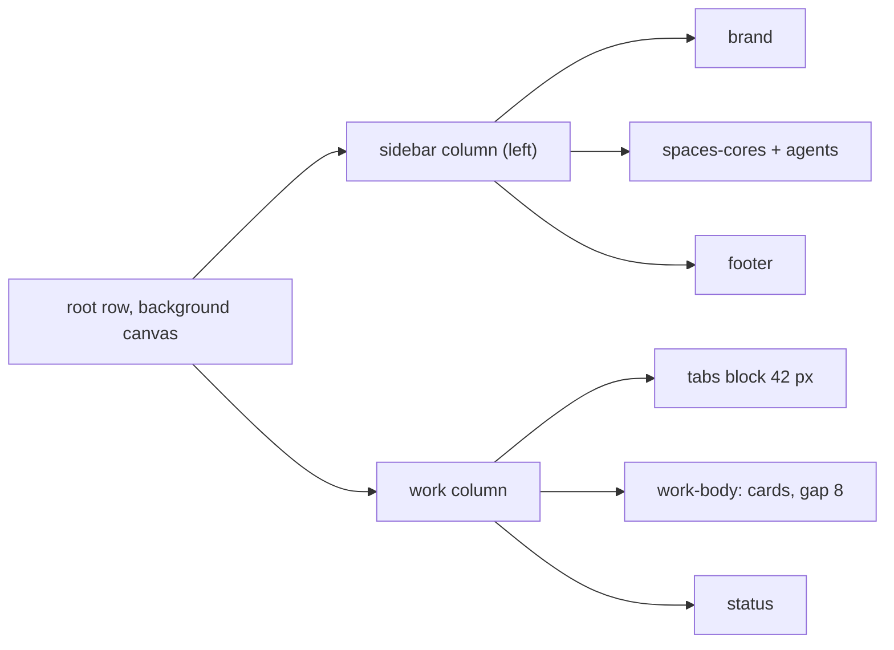
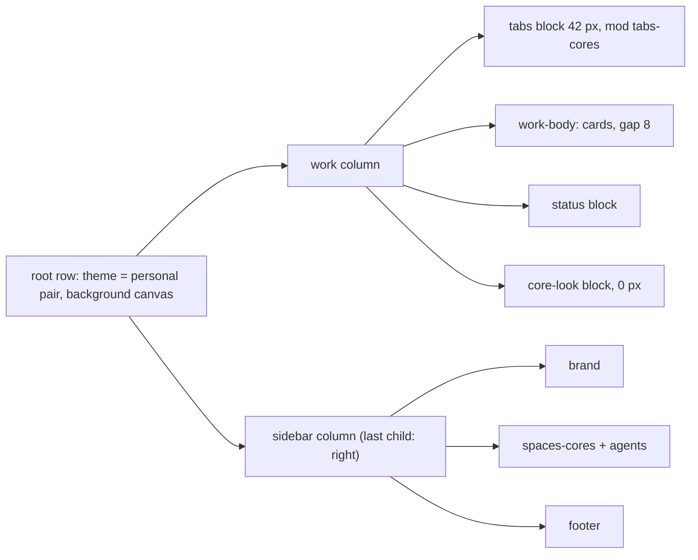
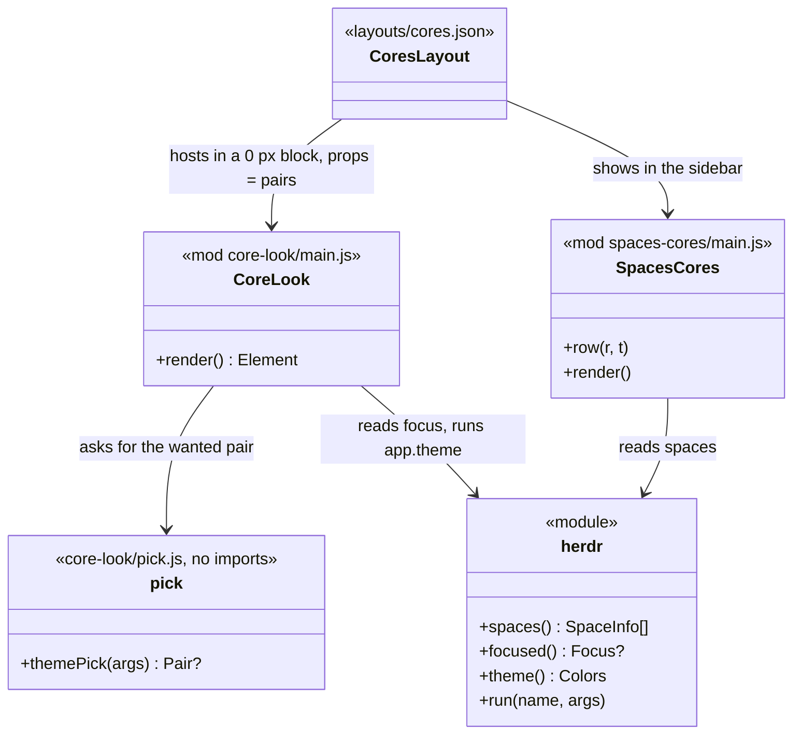
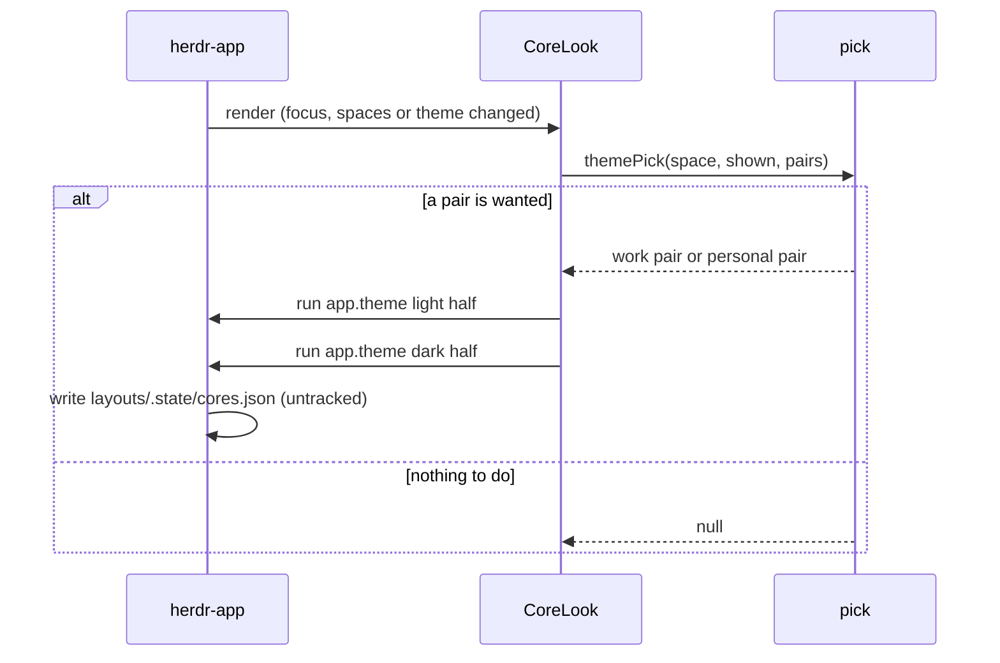
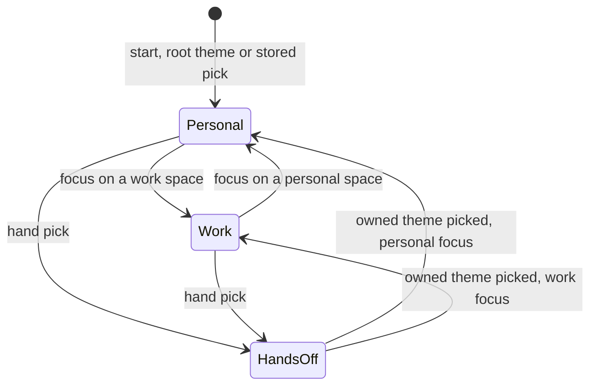

# Plan: herdr-app phase 4, look

From `intent.md` (2026-11-11). Status: accepted.

Scope: phase 4 ("look") of the five-phase herdr-app intent only. Phases 3 (keys, branch `herdr-app-keys`) and 5 (pipeline) run in parallel and are out of scope. This branch does not touch `keys.json` or any pipeline script.

## Design

### Domain terms

Glossary terms used: **Core**, **Machine**, **Space**, **herdr-app**, **herdr TUI**, **Drift**. No avoided word is used ("server", "template", "Herdr UI").

New terms (written to `GLOSSARY.md` at acceptance):

- **Personal space** — a space whose `machine` is null: this computer, the `default` core.
- **Work space** — a space whose `machine` is not null: today only the `work` core.
- **Theme pair** — `{light, dark}`: two herdr-app theme names, one per appearance.
- **Personal pair** — `solunized-light-blue` and `solunized-dark-blue`. **Work pair** — `solunized-light-orange` and `solunized-dark-orange`. **Owned theme** — one of these four names.
- **Hand pick** — a theme that is not an owned theme, picked in herdr-app's theme menu or with `app.theme`.
- **Dist themes** — `solunized-{light,dark}-{blue,orange}.json` in `<solunized checkout>/dist/herdr-app/`, generated by the solunized pull request `herdr-app-theme`.
- **Work mark** — the one fixed avatar color of every work space in the spaces list.
- **Shown halves** — `layout().theme`, the `{light, dark}` theme names the window shows now, the stored pick included (checked in the sandbox on 2026-11-11).

### Diagrams

Before (cores layout today):



After:









### Signatures

JavaScript files carry RBS-style signatures in `//:` comments above each function.

`herdr-app/.config/herdr-app/mods/core-look/pick.js` (new) — decides the wanted theme pair from plain data. It imports nothing, so `node` can load it in tests.

```js
// Pair = { light: String, dark: String }
//: ({ space: { machine: String? }?, shown: Pair, pairs: { personal: Pair, work: Pair } }) -> Pair?
export function themePick({ space, shown, pairs })
```

`shown` is the shown halves. It returns null when there is no focused space, when either shown half is not an owned theme (a hand pick in either appearance), or when both shown halves already equal the wanted pair. Otherwise it returns the work pair for a work space and the personal pair for a personal space. It keeps no state.

`herdr-app/.config/herdr-app/mods/core-look/main.js` (new) — makes the window show the focused space's core. It draws nothing.

```js
export default class CoreLook extends View {
  //: () -> Element
  render()
}
```

`render()` finds the focused space (`focused().space`, else the space with `active`), reads the shown halves from `layout().theme`, asks `themePick`, and on a result runs `app.theme` for each half that differs from the wanted pair. It keeps no memo: once both halves fit, `themePick` returns null. A repeated request before herdr-app applies the first is harmless, because `app.theme` is idempotent. It returns `div()`.

`herdr-app/.config/herdr-app/mods/core-look/mod.json` (new): `{"place": "none", "title": "Core look"}`. `"none"` stops herdr-app from docking a copy into a layout on its own.

`herdr-app/.config/herdr-app/mods/spaces-cores/main.js` (edit, one line, one value and one constant):

```js
// Every work space shows this one avatar color, in light and dark. Orange belongs to work only.
const WORK_MARK = "#ea8347";
// MARK.ansi3 changes from "#e3814f" (orange) to "#d9b02a" (Solunized yellow), so no personal avatar looks like the work mark.
// row(): const color = w.machine ? WORK_MARK : (colors[w.id] ?? "ansi6");
```

`render()`'s palette loop stays as it is: the shipped `picker` mod runs the same loop on `shared("space.colors")`, so a skip in one mod would not hold.

`herdr-app/.config/herdr-app/mods/tabs-cores/` (new): a clone of the shipped `tabs` mod (`herdr-app do mod.clone '{"name":"tabs","as":"tabs-cores"}'` in a sandbox home), with one change: its traffic-light padding drops the sidebar-width term, because the sidebar is no longer left of the tabs bar. The shipped formula is `max(10, (traffic_lights[0] + 64) / zoom - (sidebar hidden ? 0 : sidebar px))`; the clone uses `max(10, (traffic_lights[0] + 64) / zoom)`. This holds with the sidebar shown or hidden, at any zoom.

`herdr-app/.config/herdr-app/layouts/cores.json` (edit):

- Root `children` order becomes `[work, sidebar]`. The `sidebar` id and every field inside it stay, so phase 3's toggle-sidebar key keeps working.
- Root `"theme": {"light": "solunized-light-blue", "dark": "solunized-dark-blue"}`. The root `background` stays `"canvas"`: the Solunized themes make `canvas` and `chrome` both `bg_1`, so the frame is already the herdr TUI frame color. `titlebar: none` and `traffic_lights: [12, 16]` stay.
- The `tabs` block shows `tabs-cores` instead of `tabs`.
- A new last child of `work`: `{"id": "core-look", "type": "block", "size": {"px": 0}, "content": {"mod": "core-look", "props": {"personal": <personal pair>, "work": <work pair>}}}`. It sits in `work`, not in `sidebar`, so hiding the sidebar does not stop it.
- The pane frame stays as it is: `background: "background"`, border 1 `border`, focus 1 `accent`, radius 10, gap 8, `lone: true`, and `work-body` padding 8 and gap 8. With the Solunized panel palette, the cards are `bg_0` on a `bg_1` frame with a `bg_2` border and an accent focus border: the herdr TUI's look.

`herdr-app/.config/herdr-app/settings.json` (edit): the `colors` key goes. A settings `colors.accent` overrides every theme's accent in both appearances, so it would keep work spaces blue.

`herdr-app/.config/herdr-app/themes/solunized-{light,dark}-{blue,orange}.json` (4 new files): byte-for-byte copies of the Dist themes, as the Ghostty themes in `ghostty/.config/ghostty/themes/` are copies. `STOW_SHARED` links them file by file into the real `~/.config/herdr-app/themes/`.

`agents/.agents/skills/dotfiles-maintenance/references/herdr-app-look.md` (new): the runbook for this phase — the copy command for the Dist themes, the hand-pick rule, the work mark, and how to check the look in a sandbox. A new file, so it does not conflict with phase 3's edit of `herdr-app-cores.md`.

Not checked: the dotfiles repository declined Steep; the JavaScript has no type checker. Signatures are comments.

### Complexity

- `CoreLook.render`: O(S) over spaces (about 25), no `exec`, no `hc`, no timer. It runs when herdr-app's live data changes.
- `app.theme`: at most 2 runs and 2 untracked `.state` writes per change of core under focus; 0 otherwise.
- `spaces-cores`: one extra condition per row and per palette step.
- No database, no queries.

### Invariants

1. While the shown theme is an owned theme, it is the work pair exactly when the focused space is a work space. Enforced by `CoreLook.render` through `themePick`. → `test/herdr_app_look_test.rb` pick tests.
2. A hand pick is never replaced. Enforced by `themePick`. → `test_a_hand_picked_theme_is_left_alone`.
3. A space switch never changes a tracked file: the switch uses `app.theme`, which writes the untracked `layouts/.state/cores.json`, never `layout.set`. → sandbox check (step 9) and `test_core_look_never_edits_the_layout` (a source scan for `layout.set`).
4. The root theme of `cores.json` equals the `personal` prop of the `core-look` block. → `test_the_core_look_block_names_the_root_pair_as_personal`.
5. Each committed theme equals its Dist theme. → `test_the_themes_match_the_solunized_dist` (skips without a Solunized checkout that has `dist/herdr-app`).
6. Each orange theme equals its blue twin except `colors.accent`. → `test_blue_and_orange_differ_only_in_the_accent`.
7. Each theme's terminal colors equal Ghostty's committed `solunized-light` and `solunized-dark`. → `test_the_herdr_app_themes_match_ghosttys_solunized_colors` (always runs).
8. `settings.json` holds no `colors`. → `test_settings_leave_the_accent_to_the_theme`.
9. The sidebar is the last child of the root and keeps the spaces and agents lists. → `test_the_sidebar_is_the_last_child_of_the_root`, `test_the_sidebar_keeps_the_spaces_and_agents_lists`.
10. Every work space draws the work mark; personal spaces keep their palette color. Enforced by `spaces-cores` `row()`. → `test_work_spaces_share_one_fixed_mark` (source scan) and sandbox step 8.

Handling of each case:

- No focused space: `themePick` returns null; the accent stays as it is. No flash while cores load.
- A focused space on an unreachable work core: the choice reads only `machine`, so the accent stays orange while the space is listed and focused.
- The system flips light and dark: both halves are already set, so the right accent shows at once; the next render finds a fit and does nothing.
- A hand pick in either appearance: the mod leaves both halves alone until both halves are owned themes again. A light and dark flip after a hand pick in one half therefore changes nothing.
- Etienne picks an owned theme that does not fit (for example `solunized-dark-orange` on a personal space): the next render sets the personal pair, since both halves are owned.
- A herdr-app restart: the window starts with the stored pick in `.state/cores.json`, which is the last core shown; the first render corrects it if focus is elsewhere. On a fresh machine the root personal pair applies.
- The window hidden behind another window: herdr-app does not render it, so the mod does not run until the window draws again. The sandbox check on 2026-11-11 showed this; in daily use the window is visible.

### Alternatives

- **A — switch inside `spaces-cores` (rejected).** No new mod, a 250 ms timer in `spaces-cores` calls `app.theme`. The clone gets a second responsibility and drifts further from the shipped `spaces` mod; the switch stops when the sidebar mod is not mounted; no unit test can reach it, because `main.js` imports `gpui-kit`.
- **B — a separate `core-look` mod that also writes the work mark into `shared("space.colors")` (rejected).** Zero edits to `spaces-cores`, but two mods coordinate through one shared key, and a color picked by hand on a work space is reverted at once.
- **C — a separate `core-look` mod with a node-testable `pick.js`, and a two-line work-mark edit in `spaces-cores` (chosen).** One job per mod, the switch logic has real unit tests, and the work mark is an explicit, visible edit.
- The intent's fallback (work always dark) is not needed: the sandbox showed that `app.theme` with an orange theme changes the accent.

## Design decisions

- "Every work space has the same fixed sidebar color" is read as the work mark: one fixed avatar color for every work space in the spaces list. The sidebar background stays the theme's `chrome` for both cores, because the blue and orange themes differ only in the accent. The work mark is the Solunized dark orange `#ea8347`, fixed in light and dark.
- Work is any space with a machine. A future ssh machine would also show orange. Accepted: today the only machine is the work core.
- The theme files are committed copies, not links into the Solunized checkout: the same pattern as the Ghostty themes, and a fresh machine needs no Solunized checkout.
- Clone `tabs` (one-line change), but not `workspace-chrome`. The tabs bar needs the traffic-light room in every state, and an empty spacer column could not track a hidden sidebar or the zoom. Costs of not cloning `workspace-chrome`: the brand row keeps its 76 px left pad on the right side, and the collapsed sidebar shows no toggle button on macOS (the agents list's button and the sidebar key still expand it).
- The orange avatar belongs to work only: `spaces-cores` draws `MARK.ansi3` as Solunized yellow. The shipped `picker` mod keeps its own colors, so it shows a work space's stored palette color, not the work mark.
- This plan follows the intent's Decisions, including "Phases 4 and 5 start now, in parallel with phase 3" (no `keys.json` edit) and "Plan critiques use Claude". No conflict found.

## Integration points

- The solunized pull request `herdr-app-theme` (branch `herdr-app-theme` in `eirvandelden/solunized`) supplies the Dist themes. Take the four files from `~/Developer/solunized/.worktrees/herdr-app-theme/dist/herdr-app/` after `ruby generate_themes.rb` there. Until that pull request merges and the main Solunized checkout regenerates, the drift test skips.
- herdr-app 0.1.15: `app.theme`, the layout cascade, `focused()`, `spaces()`, `herdr-app check`.
- Phase 3 adds files to the package; `test_the_package_holds_only_etiennes_files` will conflict on rebase. Merge both lists.

## Files that change

- `herdr-app/.config/herdr-app/layouts/cores.json` — sidebar right, root theme and background, tabs-bar row, core-look block.
- `herdr-app/.config/herdr-app/mods/core-look/main.js`, `pick.js`, `mod.json` — new mod.
- `herdr-app/.config/herdr-app/mods/spaces-cores/main.js` — work mark, `MARK.ansi3`.
- `herdr-app/.config/herdr-app/mods/tabs-cores/` — new clone of `tabs`, one-line change.
- `herdr-app/.config/herdr-app/settings.json` — remove `colors`.
- `herdr-app/.config/herdr-app/themes/solunized-{light,dark}-{blue,orange}.json` — four copies.
- `test/herdr_app_look_test.rb` — new.
- `test/herdr_app_package_test.rb` — the expected file list; `test_the_generated_mod_files_are_ignored` also covers `core-look` and `tabs-cores`.
- `agents/.agents/skills/dotfiles-maintenance/references/herdr-app-look.md` — new runbook; linked from the dotfiles-maintenance skill's reference list where `herdr-app-cores.md` is linked.
- `GLOSSARY.md` — the new terms (at acceptance).
- Not affected: `keys.json`, `packages.conf`, the pipeline scripts, `herdr-app-cores.md`.

## Order of work

0. Wait until the solunized implementation (branch `herdr-app-theme`) has generated `dist/herdr-app/` in `~/Developer/solunized/.worktrees/herdr-app-theme`; the theme copies and the drift test need it.
1. Write the acceptance test `test_the_sidebar_is_the_last_child_of_the_root`, run it, watch it fail.
2. Write the remaining layout, settings, theme and pick tests; watch them fail for the right reasons (missing files, wrong order, `colors` present).
3. Copy the four Dist themes from the solunized worktree into `themes/`.
4. Edit `cores.json`; remove `colors` from `settings.json`.
5. Write `pick.js`, then `main.js` and `mod.json`; run `herdr-app check herdr-app/.config/herdr-app/mods/core-look` (with `HERDR_APP_HOME` set to a scratch home).
6. Edit `spaces-cores/main.js` for the work mark; clone `tabs` as `tabs-cores` in a sandbox home, copy it into the package, change its padding line; `herdr-app check` both.
7. Write the runbook.
8. `SOLUNIZED_DIR=~/Developer/solunized/.worktrees/herdr-app-theme bin/test test/herdr_app_look_test.rb` (record that the drift test ran, not skipped), then `bin/test test/herdr_app_package_test.rb`, then `bin/test`. Lint: `rubocop` on the test files; `markdownlint` through lefthook on the runbook.
9. Sandbox check (below).

Sandbox check, in a sandbox herdr-app only; never send a command or keystroke to Etienne's own herdr-app window:

- The home path must be short or the socket path is too long: `ln -sfn <scratch>/hac4-home /tmp/hac4h`; copy the package's `layouts/cores.json`, `mods/core-look/`, `mods/spaces-cores/`, `themes/` and `settings.json` into it.
- Start: `HERDR_APP_HOME=/tmp/hac4h HC_SESSION=hac4 /Applications/Herdr.app/Contents/MacOS/Herdr &`; note the pid. `HC_SESSION=hac4` keeps it off Etienne's cores. Never start, stop or restart the `default` or `work` cores.
- A work space needs a second machine: register a scratch core as a machine of `hac4` only (`HC_SESSION=hac4 hc machine add ...` against a scratch core such as `hac4w`), never the real `work` core.
- `export HERDR_APP_HOME=/tmp/hac4h; herdr-app do layout.switch --name cores`; `herdr-app status` shows no errors.
- herdr-app renders only a visible window. Before each `herdr-app shot` or `.state` read, run `herdr-app do window.maximize` twice to make the sandbox draw.
- Shots: the sidebar on the right; the first tab clear of the traffic lights, with the sidebar shown and hidden (`herdr-app do layout.toggle --id sidebar`); cards on the frame. Focus a personal space (`herdr-app do space.select --id <id>`): blue focus border, `.state/cores.json` holds the personal pair. Focus a work space: orange border, the work pair, the work mark on every work space avatar. `"appearance": "light"` in the sandbox settings: light theme with the same accent. `app.theme --name graphite` then a work space: graphite stays. Restart the sandbox by pid: the accent matches the focused space.
- Compare a pixel inside a terminal and one in the sidebar with Ghostty's solunized `bg_0` and `bg_1` (a scratch Ruby `Zlib` PNG reader).
- Stop the sandbox window by its pid. Stop a scratch core only with `HC_SESSION=<name> hc server stop`, and kill only a holder whose arguments name that scratch session.

## Risks

- The solunized pull request must merge first; until then the drift test skips and the theme copies come from its branch.
- `app.theme` from a mod is not documented; the 2026-11-11 spike showed it works from a 0 px block.
- The work mark `#ea8347` is not checked for contrast against the avatar letter.
- herdr-app 0.1.x may change `app.theme`'s half-setting or the tabs mod's padding formula.
- Removing `colors` from `settings.json` on the live machine: the main checkout has uncommitted herdr-app edits to the same file (`zoom`, `minimum_contrast`, `font_size`). Etienne resolves them when he pulls; the delivery step does not touch the main checkout.
- The look on Etienne's own window is not checked by agents. Pending with Etienne after the merge: commit or set aside his local `settings.json` edits, pull, then `stow -R -t "$HOME" herdr-app` from the main checkout (new files: `themes/*.json`, `mods/core-look/*`, `mods/tabs-cores/*`), and look at personal and work spaces.
- `tabs-cores` is a clone: herdr-app updates to `tabs` do not reach it. The clone test names the one changed line, so a re-clone is mechanical.

## Proof

- The sidebar with the spaces list and the agents list sits on the right → `test/herdr_app_look_test.rb` `test_the_sidebar_is_the_last_child_of_the_root`, `test_the_sidebar_keeps_the_spaces_and_agents_lists`; check: sandbox shot.
- herdr-app's colors match Ghostty's solunized colors in light and dark → `test_the_herdr_app_themes_match_ghosttys_solunized_colors`, `test_the_themes_match_the_solunized_dist`, `test_the_root_theme_is_the_personal_pair`; check: sandbox pixel samples, light and dark.
- Focus on a personal space shows blue; focus on a work space shows orange → `test_a_work_space_asks_for_the_work_pair`, `test_a_personal_space_asks_for_the_personal_pair`, `test_the_core_look_block_names_the_root_pair_as_personal`, `test_settings_leave_the_accent_to_the_theme`; check: sandbox shots and `.state/cores.json`.
- Panes look like cards on a frame → `test_panes_are_cards_on_the_frame`; check: sandbox shot.
- Invariant: a hand pick stays → `test_a_hand_picked_theme_is_left_alone`, `test_a_hand_pick_in_the_other_half_is_left_alone`.
- Invariant: an owned theme that does not fit is corrected → `test_an_owned_theme_that_does_not_fit_is_corrected`.
- Invariant: no focused space changes nothing → `test_no_focused_space_changes_nothing`.
- Invariant: a fitting shown theme changes nothing → `test_a_shown_theme_that_fits_changes_nothing`.
- Invariant: the switch never edits the layout → `test_core_look_never_edits_the_layout`.
- Invariant: blue and orange differ only in the accent → `test_blue_and_orange_differ_only_in_the_accent`.
- Invariant: work spaces share one mark, and no personal mark is orange → `test_work_spaces_share_one_fixed_mark`, `test_no_personal_mark_is_the_work_orange`; check: sandbox shot.
- The tabs bar leaves room for the traffic lights with the sidebar on the right → `test_the_tabs_bar_shows_the_cloned_tabs_mod`, `test_the_cloned_tabs_mod_pads_without_the_sidebar_width`, `test_the_cloned_tabs_mod_differs_from_tabs_only_in_the_padding` (skips without the shipped `tabs` mod); check: sandbox shots, sidebar shown and hidden.
- herdr-app loads both mods → `test_herdr_app_accepts_the_core_look_mod`, `test_herdr_app_accepts_the_cloned_spaces_mod` (skip without `herdr-app`).

Per changed file, the unit tests expected:

- `mods/core-look/pick.js`: the seven pick tests above, run through `node --input-type=module` (skip without `node`).
- `layouts/cores.json`: the layout tests above.
- `settings.json`: `test_settings_leave_the_accent_to_the_theme`; the existing settings tests stay green.
- `themes/*.json`: `test_each_owned_theme_has_a_theme_file`, the Ghostty, dist and blue-orange tests.
- `mods/spaces-cores/main.js`: `test_work_spaces_share_one_fixed_mark`; `test_the_cloned_spaces_mod_names_the_local_group_personal` stays green.
- `test/herdr_app_package_test.rb`: `test_the_package_holds_only_etiennes_files` lists the new files.

Test setup: tests read the package files directly; the pick tests run `node` on `pick.js` with inline data; the drift test reads `$SOLUNIZED_DIR/dist/herdr-app` (default `~/Developer/solunized`) and skips when it is missing, as `test/herdr_config_test.rb` does; the `herdr-app check` tests use a scratch `HERDR_APP_HOME` and skip without `herdr-app`.

---
Domain skills applied: software-design, object-oriented-design, glossary, diagrams.

## Critique

### Round 1 (Claude, opus)

- The Solunized dist themes do not exist yet, so the copy step cannot run → fixed (step 0 waits for the solunized implementation; step 8 runs the drift test with `SOLUNIZED_DIR` on the solunized worktree and records that it ran)
- A hand pick in one half is overwritten after a light and dark flip, and the plan did not say where the shown theme is read → fixed (`themePick` takes both shown halves from the layout theme the mod reads, checked in the sandbox, and returns null when either half is not owned; new test for the other half)
- The memo of the last pair can lock in a wrong accent → fixed (no memo; `themePick` is stateless and returns null once both halves fit; new test for an owned theme that does not fit)
- The work mark `#ea8347` is close to the personal avatar color `MARK.ansi3` `#e3814f` → fixed (`MARK.ansi3` becomes Solunized yellow `#d9b02a` in `spaces-cores`, so orange belongs to work only; new test)
- The `render()` palette skip in `spaces-cores` would not hold, because the shipped picker runs the same loop → fixed (the palette-loop change is dropped; the picker difference is a recorded design decision)
- The 66 px spacer ignores a hidden sidebar and the zoom → fixed (a `tabs-cores` clone with one changed padding line, and tests that pin that line; sandbox shots with the sidebar shown and hidden)
- `"background": "chrome"` changes nothing with Solunized → fixed (root background stays `canvas`)
- The plan does not cover the stow after the merge → fixed (the pending step for Etienne lists the pull, the local `settings.json` edits and the restow; the ignored-files test covers the new mods)
- The collapsed right sidebar has no toggle button and the brand row keeps its left pad → fixed (listed in Design decisions as costs of not cloning `workspace-chrome`)
- The personal pair is written twice in `cores.json` → dismissed: `layout().theme` returns the shown halves with the stored pick applied, not the root theme of the file (sandbox probe on 2026-11-11), so the mod cannot read the personal pair from it; a test keeps the two copies equal
- The Complexity section counts one `.state` write per switch → fixed (at most two runs and two writes)
