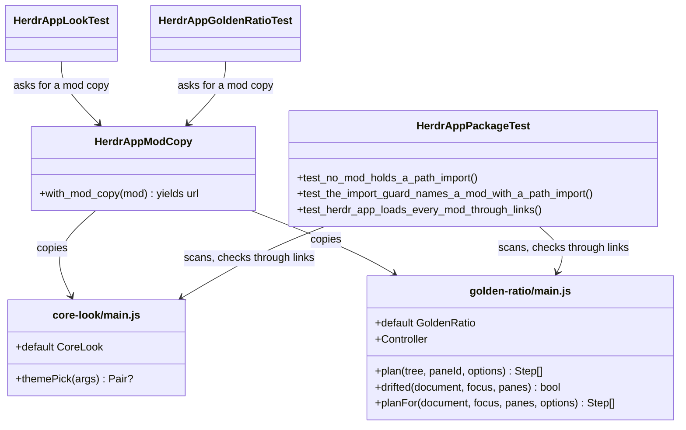

# Plan: herdr-app mods with relative imports fail to load when stowed

From `intent.md` (2026-11-11). Status: accepted.

## Design

Fold each helper file into its mod's `main.js` and delete the helper files. Each `main.js` also exports its pure logic by name. The node tests import a scratch copy of `main.js` that resolves the host modules `herdr` and `gpui-kit` through small stub packages. The package test gets two guards over every mod: a source scan for path imports (runs everywhere, CI included) and a real `herdr-app check` of each mod through a folder of links (runs where herdr-app is installed).

Facts verified while planning (herdr-app on this machine, node 25.9):

- `herdr-app check <folder>` on a folder whose files are links into the repository reproduces the live fault: "module `./pick.js` resolves outside the application directory", exit 1. The same mod as real files passes.
- Through links, `agents-done`, `agents-blocked`, `spaces-cores` and `tabs-cores` pass; only `core-look` and `golden-ratio` fail. One check takes about 0.6 s.
- A `main.js` that holds `export function themePick` next to `export default class CoreLook extends View` passes `herdr-app check`.
- CI (`.github/workflows/dotfiles-tests.yml`) runs `bin/test` on ubuntu-latest with the runner's own node and no herdr-app.
- `eslint.config.mjs` ignores `herdr-app/**/mods/**`; no JavaScript linter reads the mods.

### Domain terms

Glossary terms used: **herdr-app**, **Space**, **Personal space**, **Theme pair**, **Personal pair**, **Shown halves**, **Hand pick**, **Owned theme**, **PATH stub**, **Run root**, **Test file**.

New terms, written into `GLOSSARY.md` by the implement stage:

- **Stowed mod** — a mod folder under `~/.config/herdr-app/mods/` whose files are links into the repository, as `stow --no-folding` makes them.
- **Path import** — an import whose specifier is a file path (`./`, `../` or `/`), not a module name. herdr-app refuses one from a stowed mod, because its real path leaves the mod folder.
- **Host module** — a module that herdr-app gives a mod at run time (`herdr`, `gpui-kit`); node cannot resolve it.
- **Module stub** — a package a test writes into a scratch `node_modules` folder in place of a host module; a PATH stub for imports.
- **Mod copy** — a scratch folder that holds one mod's `main.js` as `main.mjs`, plus one module stub per host module, so node can import it.
- **Linked mod folder** — a scratch folder that holds one link per tracked file of a mod, the way stow links it; the guard runs `herdr-app check` on it.

### Diagrams

Before: `core-look/main.js → ./pick.js`; `golden-ratio/main.js → ./controller.js → ./planner.js`. After:



```mermaid
sequenceDiagram
  participant T as test (Ruby)
  participant C as HerdrAppModCopy
  participant N as node
  T ->> C : with_mod_copy("golden-ratio")
  C ->> C : mktmpdir; write node_modules/herdr, node_modules/gpui-kit; copy main.js to main.mjs
  C -->> T : yield file:// URL of main.mjs
  T ->> N : node --input-type=module -e "import { planFor, Controller } from URL ..."
  N ->> N : resolve "herdr", "gpui-kit" through the scratch node_modules
  N -->> T : JSON on stdout
  C ->> C : remove the scratch folder
```

### Signatures

`herdr-app/.config/herdr-app/mods/core-look/main.js` — the theme pair for the focused space, with no path import.

- Fold `owned`, `same` and `themePick` in from `pick.js`, word for word, with their `//:` comments. Delete `pick.js`.
- `//: ({ space: { machine: String? }?, shown: Pair, pairs: { personal: Pair, work: Pair } }) -> Pair?` above `export function themePick({ space, shown, pairs })`. Behaviour unchanged.
- `export default class CoreLook extends View`, `render()` with `//: () -> Element`. Unchanged.
- Header comment: say the decision is `themePick` in this file and that tests run it through a mod copy.

`herdr-app/.config/herdr-app/mods/golden-ratio/main.js` — the golden ratio for the focused pane, with no path import.

- Fold all of `planner.js` and `controller.js` in, word for word. Delete both files.
- `//: (Node, String, { ratio: Float, minDelta: Float }) -> Array[Step]` above `export function plan(tree, paneId, { ratio, minDelta })`.
- `//: (Document?, Focus, Array[PaneInfo]) -> bool` above `export function drifted(document, focus, panes)`.
- `//: (Document?, Focus, Array[PaneInfo], { ratio: Float, minDelta: Float }) -> Array[Step]` above `export function planFor(document, focus, panes, options)`.
- `export class Controller`: `constructor(host, settings)`, `onFocus`, `schedule`, `settle`, `submit`, `stateOf` unchanged. It reaches the app only through its injected `host`.
- `export default class GoldenRatio extends View`: `init` and `render` unchanged. `readDocument` and `firstReply` stay unexported.
- Header comment: drop "the logic lives in planner.js and controller.js"; say `main.js` exports the planner and the controller for the node tests.
- Helper parameters named `focused` and `panes` shadow the `herdr` imports. That is legal; keep the names so the fold stays word for word.

`test/herdr_app_mod_copy.rb` (new; not a `_test.rb` file, so `bin/test` does not run it on its own) — makes a mod's `main.js` importable by node.

```ruby
module HerdrAppModCopy
  MODS = File.expand_path("../herdr-app/.config/herdr-app/mods", __dir__)
  # The names each module stub exports. A mod that imports a name not listed here fails in node with
  # "does not provide an export named <name>".
  HOST_EXPORTS = { "herdr" => %w[exec focused layout panes props run spaces], "gpui-kit" => %w[View div] }.freeze

  # Yields the file URL of a mod copy of <mod>/main.js; removes the copy afterwards.
  #: (String) { (String) -> untyped } -> untyped
  def with_mod_copy(mod)
end
```

- Each stub is `node_modules/<name>/package.json` (`{"name": "<name>", "exports": "./index.mjs"}`) and `node_modules/<name>/index.mjs`. `View` is `export class View {}`, so `extends View` works. Every other listed name is `export function <name>() { throw new Error("host module <module>.<name> called in a node test"); }`, so a call at load time fails the import.
- The copy is `main.mjs`, so node treats it as ESM on every version without a `"type"` key.

`test/herdr_app_look_test.rb` — `require_relative "herdr_app_mod_copy"`, `include HerdrAppModCopy`.

- Drop `PICK`. `theme_pick(space:, shown:)` (`#: (space: Hash[Symbol, untyped]?, shown: Hash[Symbol, String]) -> untyped`) wraps its node call in `with_mod_copy("core-look") { |url| ... }` and imports `themePick` from `url`.
- `test_core_look_never_edits_the_layout` reads only `main.js`.
- Update the class comment. The seven `themePick` tests keep their assertions.

`test/herdr_app_golden_ratio_test.rb` — `NodeRunner` includes `HerdrAppModCopy`.

- `run_node(body, input = {})` (`#: (String, ?Hash[Symbol, untyped]) -> untyped`) imports `{ drifted, plan, planFor, Controller }` from the golden-ratio mod copy.
- `run_planner(body, input = {})` (`#: (String, ?Hash[Symbol, untyped]) -> untyped`) imports `{ drifted, plan, planFor }` from the same mod copy.
- Drop `NodeRunner::MODS`. Update the header comment. All 32 tests keep their bodies and assertions.

`test/herdr_app_package_test.rb`

- `test_the_package_holds_only_etiennes_files`: drop `mods/core-look/pick.js`, `mods/golden-ratio/controller.js`, `mods/golden-ratio/planner.js`.
- Replace `test_the_agent_list_imports_only_builtin_modules` with:
  - `test_no_mod_holds_a_path_import`: `assert_empty(path_imports(File.join(PACKAGE, "mods")), ...)`; the message lists each `mod <mod>: <file> imports <specifier>`.
  - `test_the_import_guard_names_a_mod_with_a_path_import`: a scratch `mods/helper-user/main.js` with `import { x } from "./helper.js";` gives `{ "helper-user" => ["main.js imports ./helper.js"] }`.
  - `test_the_agent_list_names_no_other_agent_list`: keeps `refute_includes(source, "mods/agents-")` for `agents-done/main.js`.
  - `test_herdr_app_loads_every_mod_through_links`: skips when `herdr-app` is not on `PATH`. For each mod folder, it builds a linked mod folder (one `File.symlink` per tracked file of the mod, to its absolute repository path) and runs `herdr-app check` on it with `HERDR_APP_HOME` in a short `Dir.mktmpdir("hal", "/tmp")`, as `assert_herdr_app_accepts` in the look test does. It collects the failing mods and asserts the list is empty; the message names each mod and the first line of its output.
- Private `path_imports(mods_root)` (`#: (String) -> Hash[String, Array[String]]`): reads every `<mods_root>/<mod>/**/*.js` and scans `/(?:\bfrom|\bimport)\s*\(?\s*["'](\.{0,2}\/[^"']*)["']/`, which finds `import … from`, `export … from`, `import "x"` and `import("x")`. Returns `{ mod => ["<file> imports <specifier>"] }` for mods with a hit.

Not checked: the dotfiles repository has no Steep setup; the `//:` and `#:` comments are documentation.

### Complexity

- Live app: each of the two mods loads one module instead of two or three. No other cost, no queries.
- Node tests: each node call adds one `mktmpdir`, four small writes and one copy, O(1). Seven calls in the look test, 32 in the golden-ratio test; a node start costs about 40 ms, so the overhead is small.
- `path_imports`: one read and one regex scan per mod `.js` file, O(lines); seven files today.
- `test_herdr_app_loads_every_mod_through_links`: one `herdr-app check` per mod, about 0.6 s each, about 4 s for six mods, local only.

### Invariants

1. No `.js` file under `mods/` holds a path import. Enforced by `test_no_mod_holds_a_path_import` (CI and local).
2. Every mod in the package loads in herdr-app through links. Enforced by `test_herdr_app_loads_every_mod_through_links` (local, where herdr-app is installed).
3. `core-look/main.js` and `golden-ratio/main.js` call no host function when the module loads; only `extends View` runs then. Enforced by every node test: each module stub throws when called, so a host call at load time fails the import and the test.
4. Every name the two mods import from `herdr` and `gpui-kit` is in `HOST_EXPORTS`. Enforced by every node test: node refuses to link otherwise.
5. `themePick`, `plan`, `drifted`, `planFor` and `Controller` keep their behaviour. Enforced by the unchanged assertions of the look and golden-ratio tests.

### Alternatives

- **Chosen: inline the helpers into `main.js`, test through a mod copy with module stubs.** Smallest change; edit-and-see in the live app keeps working; all node tests survive.
- **Rejected: keep `src/` helper files and generate a bundled `main.js` with a Ruby generator plus a stale-bundle test.** It works, but a regex JavaScript rewriter, duplicate code in every diff, a regeneration step and two new conventions are too much for two mods with one or two helpers each.
- **Rejected: inline and drop the node tests, test through herdr-app only.** The intent allows it, but it loses 39 fast unit tests that run on CI, where herdr-app is absent.
- **Rejected for the node stubs: a resolve hook through `node --import`.** `module.register` and `module.registerHooks` depend on the node version (20.6+, 22.15+/23.5+); CI uses whatever ubuntu-latest ships. Plain `node_modules` resolution works on every supported node. `NODE_PATH` does not apply to ESM.
- **Rejected for loading: absolute-path or `data:` URL imports, an install task that copies helpers as real files, hard links.** An absolute path still resolves outside the mod folder and leaks a home path into a public repository; a `data:` URL is inlining that is harder to read; copies go stale between installs; stow makes symlinks and git breaks hard links.

## Design decisions

- The guard is two tests, not one: the source scan runs on CI, where herdr-app is missing; the real loader check catches any refusal the scan does not model. Intent asks for one guard over every mod; both cover every mod.
- The node tests survive in reshaped form. Intent's decision allows dropping them; keeping them costs one small helper file and keeps CI coverage.
- `main.js` gets named exports used only by the tests. Verified that herdr-app accepts them.
- No conflict with intent's `## Decisions`.

## Integration points

- herdr-app's mod loader (`herdr-app check`, the live app). Not changed.
- GNU Stow, `install/utils.sh` `stow_configure` (`--restow`, `--no-folding` for `STOW_SHARED`). Not changed.
- The live install `~/.config/herdr-app/mods/` (links into the main checkout today).
- CI workflow `.github/workflows/dotfiles-tests.yml` (runs `bin/test`; not changed).

## Files that change

- `herdr-app/.config/herdr-app/mods/core-look/main.js` — fold in `pick.js`, export `themePick`, new header comment.
- `herdr-app/.config/herdr-app/mods/core-look/pick.js` — delete.
- `herdr-app/.config/herdr-app/mods/golden-ratio/main.js` — fold in `planner.js` and `controller.js`, export `plan`, `drifted`, `planFor`, `Controller`, new header comment.
- `herdr-app/.config/herdr-app/mods/golden-ratio/planner.js` — delete.
- `herdr-app/.config/herdr-app/mods/golden-ratio/controller.js` — delete.
- `test/herdr_app_mod_copy.rb` — new: `HerdrAppModCopy#with_mod_copy`.
- `test/herdr_app_package_test.rb` — tracked-file list, path-import guard and its self-test, linked-mod loader check, agents-done cross-reference test.
- `test/herdr_app_look_test.rb` — `theme_pick` through a mod copy; `test_core_look_never_edits_the_layout` reads `main.js` only; comments.
- `test/herdr_app_golden_ratio_test.rb` — `NodeRunner` through a mod copy; comments.
- `agents/.agents/skills/dotfiles-maintenance/references/herdr-app-look.md` — line 27: the decision is `themePick` in `mods/core-look/main.js`, tested through a mod copy with module stubs. Line 49 (sandbox recipe copying `mods/core-look/`) stays valid.
- `GLOSSARY.md` — add Stowed mod, Path import, Host module, Module stub, Mod copy, Linked mod folder, in alphabetical order.

Out of scope: herdr-app's loader; how stow links `herdr-app`; any behaviour change in core-look or golden-ratio; `herdr/.config/herdr/README.md` (it names no mod file); `eslint.config.mjs`; the CI workflow.

## Order of work

1. Write `test_herdr_app_loads_every_mod_through_links`, `test_no_mod_holds_a_path_import` and `test_the_import_guard_names_a_mod_with_a_path_import` with `path_imports`; move the agents-done cross-reference into `test_the_agent_list_names_no_other_agent_list`. Run `bin/test test/herdr_app_package_test.rb`. Watch the two guards fail and name `core-look` and `golden-ratio`; the self-test passes.
2. Add `test/herdr_app_mod_copy.rb`. Point `theme_pick` in the look test at the core-look mod copy. Run `bin/test test/herdr_app_look_test.rb`; the `themePick` tests fail (no export named `themePick`).
3. Fold `pick.js` into `core-look/main.js`, export `themePick`, delete `pick.js`, update `test_core_look_never_edits_the_layout`, the tracked-file list and the comments. Run the look test green.
4. Point `NodeRunner` at the golden-ratio mod copy. Run `bin/test test/herdr_app_golden_ratio_test.rb`; it fails (no export named `planFor`).
5. Fold `planner.js` and `controller.js` into `golden-ratio/main.js`, export the four names, delete both files, update the tracked-file list and comments. Run the golden-ratio test and the package test green.
6. Update `herdr-app-look.md` line 27 and `GLOSSARY.md`.
7. Run `bin/test`, then the linters on every touched file: `rubocop -c rubocop/.rubocop.yml test/herdr_app_*.rb`, markdownlint no-hardwrap on the two markdown files (as `lefthook.yml` runs it).
8. Live check (rule 12 approval in intent). The live links point into the main checkout. Remove them for this package only, then stow from the worktree: `stow --dir "$HOME/Developer/dotfiles" --target "$HOME" -D herdr-app`, then `stow --dir "$HOME/Developer/dotfiles/.worktrees/herdr-app-mod-imports" --target "$HOME" --restow --no-folding herdr-app`. Confirm `ls -l ~/.config/herdr-app/mods/core-look/` shows no `pick.js` and links into the worktree. Run `herdr-app status` and record it.
9. In the live window: focus a pane on a work space and on a personal space, and record the theme `herdr-app status` reports (or a `herdr-app shot`). Confirm a hand-picked theme stays. Focus a pane in a tab with siblings on one axis, wait past `debounce_ms`, and record the resulting weights from the herdr-app document (the `doc.get` read that `golden-ratio/main.js` uses).
10. Re-read the diff and commit in small steps (guards, test helper, core-look, golden-ratio, docs).

## Risks

- After the merge, the live links point into this worktree. Removing the worktree before Etienne restows from main leaves dangling links and every mod fails. The delivery account must say: restow `herdr-app` from main (`-D` from the worktree, then stow from main) before the worktree goes.
- `HOST_EXPORTS` must list every name the mods import from `herdr` and `gpui-kit`. A new import fails the node tests with a clear message; the fix is one word in the list.
- The path-import scan is a regex, not a parser. A multi-line `import {\n a\n} from "./x.js"` still matches, because the regex anchors on `from "./`. A comment between `from` and the specifier, or a path built at run time (`import(prefix + "x.js")`), escapes it; the linked-mod loader check catches both locally. A commented-out import or a string that holds `from "./x.js"` gives a false hit; that fails safe, and the fix is to reword the comment.
- `golden-ratio/main.js` grows to about 190 lines and mixes host glue with pure logic. Accepted: one file, one purpose, and the intent allows it.
- `herdr-app check` needs a short `HERDR_APP_HOME` (socket path length); the test uses `/tmp`, as the look test already does.
- The live check changes Etienne's running setup; only the `herdr-app` package is touched, as intent approves.

## Proof

- After a restow from the branch, `herdr-app status` lists no "resolves outside the application directory" error for any mod → `test/herdr_app_package_test.rb` `test_herdr_app_loads_every_mod_through_links`, then check: Order of work step 8, `herdr-app status` after the restow.
- On a work space the window shows the work pair, on a personal space the personal pair; a hand-picked theme stays → `test/herdr_app_look_test.rb` `test_a_work_space_asks_for_the_work_pair`, `test_a_personal_space_asks_for_the_personal_pair`, `test_a_hand_picked_theme_is_left_alone`, then check: Order of work step 9 in the live window.
- After the focus settles on a pane that shares an axis with siblings, that pane gets the golden ratio → `test/herdr_app_golden_ratio_test.rb` (the 32 planner and controller tests through the mod copy), then check: Order of work step 9 in the live window.
- A mod in the package that imports `./helper.js` makes `bin/test` fail and names the mod → `test/herdr_app_package_test.rb` `test_the_import_guard_names_a_mod_with_a_path_import` and `test_no_mod_holds_a_path_import`.
- `bin/test` and the linters are green → check: `bin/test`; `rubocop -c rubocop/.rubocop.yml` on the touched Ruby files; markdownlint no-hardwrap on the touched markdown.
- Invariant: no `.js` file under `mods/` holds a path import, enforced by `test_no_mod_holds_a_path_import` → `test/herdr_app_package_test.rb` `test_no_mod_holds_a_path_import`.
- Invariant: every mod loads in herdr-app through links, enforced by the linked-mod check → `test/herdr_app_package_test.rb` `test_herdr_app_loads_every_mod_through_links`.
- Invariant: the two mods load in node with only module stubs, enforced by every node test → `test/herdr_app_look_test.rb` `test_no_focused_space_changes_nothing`, `test/herdr_app_golden_ratio_test.rb` (any planner test).
- Query count: not affected; no database.

Per changed file, the unit tests expected:

- `herdr-app/.config/herdr-app/mods/core-look/main.js`: the seven existing `themePick` tests in `test/herdr_app_look_test.rb`, unchanged; `test_herdr_app_accepts_the_core_look_mod`; `test_core_look_never_edits_the_layout`.
- `herdr-app/.config/herdr-app/mods/golden-ratio/main.js`: the 32 existing tests in `test/herdr_app_golden_ratio_test.rb`, unchanged.
- `test/herdr_app_mod_copy.rb`: covered by every node test that uses it; no tests of its own (test support code).
- `test/herdr_app_package_test.rb`: `test_no_mod_holds_a_path_import`, `test_the_import_guard_names_a_mod_with_a_path_import`, `test_herdr_app_loads_every_mod_through_links`, `test_the_agent_list_names_no_other_agent_list`, `test_the_package_holds_only_etiennes_files`.

Test setup: scratch folders under the run root's `TMPDIR` (mod copies, the guard's fixture mod) and under `/tmp` (short `HERDR_APP_HOME`, linked mod folders). No fixtures, no network. node and herdr-app are real where present; tests skip when node or herdr-app is missing, as today.

---
Domain skills applied: software-design, glossary, diagrams, ruby-style.

## Critique

### Round 1 (codex gpt-6.1-sol, medium)

- The CI path-import regex misses `import { x } from /* comment */ "./helper.js"` and flags commented imports or strings that hold `from "./helper.js"`; use a dependency-free lexical scanner → dismissed: a comment inside an import statement is not a form anyone writes in these mods, a false hit fails safe, and the real loader check in `test_herdr_app_loads_every_mod_through_links` catches any refusal the scan misses wherever herdr-app runs; a hand-written JavaScript lexer is more code to trust than the gap it closes. Risks now name both gaps.
- No-op module stubs let a top-level host call such as `run(...)` pass silently, so invariant 3 is not enforced → fixed (each stub function now throws when called; `View` stays an empty class; invariant 3 names the throwing stubs as its enforcement)
