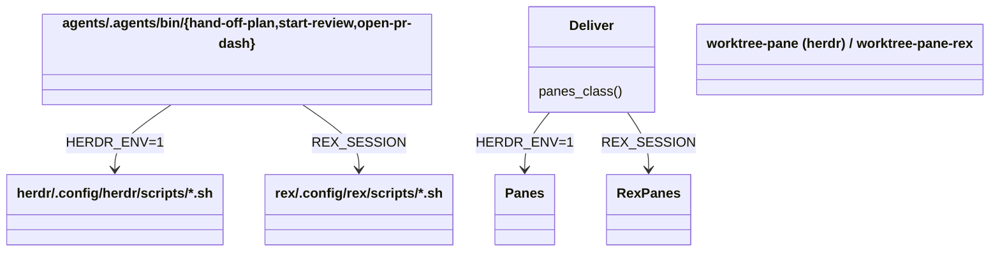
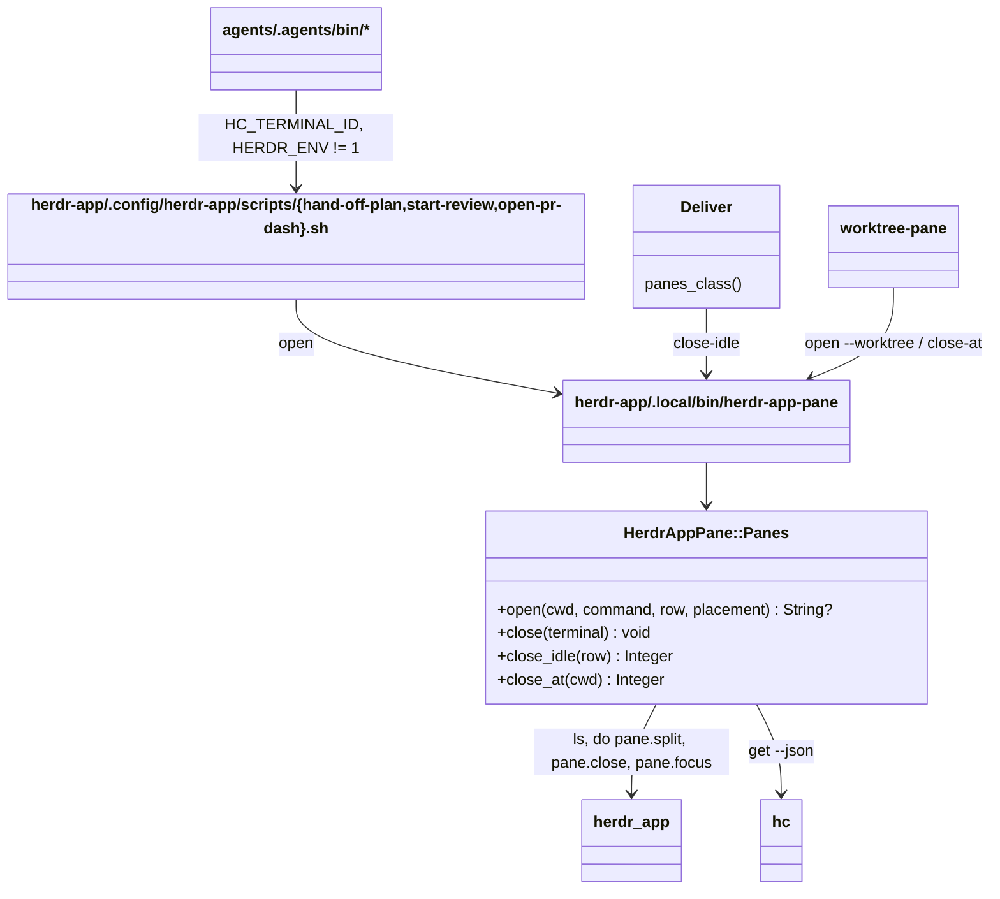

# Plan: herdr-app as a third pane backend (phase 5, pipeline)

From `intent.md` (2026-11-10, phase 5 of 5; scope changed 2026-11-11: no worktree viewer). Status: accepted.

Context for the executor: the agent pipeline opens stage panes, review panes, worktree panes and a gh-dash pane, sends each stage's final line back to its coordinator, and closes idle stage panes after delivery. Today it does this in the herdr TUI (`HERDR_ENV=1`) and in Rex (`REX_SESSION`). This plan adds herdr-app as a third pane backend. herdr-app shows terminals that run in herdr-core (`hc`). A herdr-app terminal carries `HC_TERMINAL_ID` (for example `t61`), `HC_TERMINAL_SOCKET` and `HC_SCOPE`; `HERDR_ENV`, `HERDR_PANE_ID` and `REX_SESSION` are unset. The herdr TUI and Rex paths stay as they are. The worktree viewer is out of scope: phase 3's `; f` Files panel is the herdr-app viewer.

## Design

### Domain terms

Existing glossary terms: **herdr-app**, **herdr TUI**, **Core**, **Machine**, **Space**, **Change folder**.

New terms, written into `GLOSSARY.md` after acceptance:

- **Pane backend** — the tool where the pipeline opens its panes: herdr TUI, herdr-app or Rex, picked from the environment.
- **Stage pane** — a pane the pipeline opens for one change: a stage worker, a reviewer or gh-dash.
- **Row** — the stage panes of one change, side by side; the slug names it.
- **Row record** — `<git-common-dir>/<tool>/stage-panes-<slug>`: the stage panes of one row, one per line, in the order they opened. herdr-app lines are hc terminal addresses.
- **Coordinator** — the terminal a stage worker reports to. In herdr-app it is `HERDR_APP_COORDINATOR`, set by a dispatcher from `COORDINATOR`, else the caller's own `HC_TERMINAL_ID`.

### Diagrams

Before: the dispatchers pick herdr TUI or Rex; each tool has its own script set and deliver class.



After: a third branch. All herdr-app knowledge sits in one Ruby class in the `herdr-app` package, behind one CLI. The `git` and `agents` packages only run that CLI, so no new file lands in a package whose restow is not approved.



```mermaid
sequenceDiagram
  participant C as Coordinator terminal (t10)
  participant S as herdr-app hand-off-plan.sh
  participant P as herdr-app-pane
  participant A as herdr-app window
  participant W as Worker terminal (t61)
  C->>S: COORDINATOR=t10 hand-off-plan implement slug
  S->>S: worktree-create --no-pane; unique empty report file
  S->>P: open <worktree> --row slug -- claude --model sonnet <prompt>
  P->>P: hc get t10 (space label); herdr-app ls (pane of t10 in that space)
  P->>A: do pane.split {pane, direction: right, argv: [sh -c cd.., claude, ...]}
  A-->>P: {pane: p7, terminal: t61}
  P->>A: pane.focus back, if the split took focus
  P->>P: append t61 to the row record; wait until hc get t61 shows claude-code
  W->>W: works, writes the report
  W->>C: hc send t10 "Handoff done: <report>"
  W->>P: herdr-app-pane close (own pane)
```

### Signatures

`herdr-app/.local/share/herdr-app-pane/panes.rb` — the only pipeline file that sends `herdr-app ls` or `herdr-app do`. It sits beside `herdr-app/.local/share/herdr-app-migrate/`, like that tool.

```ruby
module HerdrAppPane
  # Raised when herdr-app or hc refuses; the CLI turns it into one stderr line and exit 1.
  class Refusal < StandardError; end

  # Places and closes herdr-app panes beside the coordinator, in the coordinator's space.
  class Panes
    PLACEMENTS = %i[column new_row unlisted worktree].freeze

    #: (?own: String, ?coordinator: String?, ?common_dir: String?, ?command_line: CommandLine) -> void
    def initialize(own: ENV.fetch("HC_TERMINAL_ID"), coordinator: ENV["HERDR_APP_COORDINATOR"], common_dir: nil, command_line: CommandLine.new)

    # Opens a pane rooted in cwd that runs command, or a login shell when command is empty, and answers its terminal address.
    # column: right of the row's last live pane, else right of the coordinator; new_row: below the coordinator;
    # unlisted: placed like column, never recorded; worktree: below the coordinator, nil when a pane of the space already shows cwd.
    # Gives focus back when the split took it. With a command, waits until hc shows an agent in the new terminal;
    # a finished terminal or a timeout closes the pane, drops its record line and raises Refusal.
    #: (String cwd, ?command: Array[String], ?row: String?, ?placement: Symbol) -> String?
    def open(cwd, command: [], row: nil, placement: :column)

    # Closes the pane that shows terminal (default: the own terminal), whatever runs in it.
    #: (?String terminal) -> void
    def close(terminal = @own)

    # Closes the row's recorded panes whose agent is idle or done, read from the space-narrowed `herdr-app ls`;
    # keeps the own, coordinator and intent terminals; then deletes the record. Best effort: warns, never raises.
    # Answers the number closed.
    #: (String row) -> Integer
    def close_idle(row)

    # Closes each pane of the coordinator's space whose real cwd (hc get: foreground.cwd, else cwd) is the real cwd
    # given, and that runs no agent. Answers the number closed.
    #: (String cwd) -> Integer
    def close_at(cwd)
  end
end
```

`herdr-app/.local/share/herdr-app-pane/command_line.rb` — `HerdrAppPane::CommandLine#json(*command)`: runs one `herdr-app` or `hc` command as an argument list (binaries from `HERDR_APP_BIN` and `HC_BIN`, else PATH), answers parsed JSON, raises `Refusal` on a failure, an `{"error"}` answer or unparsable output. Same shape as `HerdrAppMigration::CommandLine`.

`git/.config/git/worktree-tools/lib/common.rb` (`Helpers`):

```ruby
# True in a herdr-app terminal that is not inside a herdr TUI pane. Herdr wins when both are set.
#: -> bool
def herdr_app_env?

# HERDR_APP_PANE names the herdr-app-pane CLI, so a test can stub it; else herdr-app-pane from PATH.
#: -> String
def herdr_app_pane_bin
```

`rex_only_env?` stays unchanged: `worktree-pane` checks `herdr_app_env?` before its Rex exec, and no other caller changes path.

Shell entry points:

- `herdr-app/.local/bin/herdr-app-pane` (Ruby): `open <cwd> [--row <slug>] [--new-row | --unlisted | --worktree] [-- <command>...]` prints the terminal address, or nothing for a worktree pane that already exists; `close [<terminal>]`; `close-idle <slug>` (needs a git repository: the record lives under its common dir); `close-at <cwd>`. Bad arguments exit 1 before any call; a `Refusal` exits 1 with its reason.
- `herdr-app/.config/herdr-app/scripts/hand-off-plan.sh <stage> <slug> [--auto]` — same stages, models, `--auto` rules and prompt text as the Rex script. It creates the worktree (`worktree-create <slug> --no-pane`), makes the report with `report=$(mktemp "<git-common-dir>/herdr-app/<stage>-XXXXXX") && mv "$report" "$report.md"` (BSD `mktemp` fills only trailing X's), then runs `"$pane_cli" open <worktree> --row <slug> [--new-row for intent] -- claude --model <model> <prompt>`. `$pane_cli` is `${HERDR_APP_PANE:-<realpath of this script>/../../../.local/bin/herdr-app-pane}`, written into the prompt as an absolute path. No wait-and-send: the prompt is claude's first argument. In the prompt, `rex send` + `send-key enter` become `hc send <coordinator> '<ready word> <path>'` (up to twelve tries), the self-close becomes `<pane_cli> close`, and the chain line names `COORDINATOR=<coordinator>`.
- `herdr-app/.config/herdr-app/scripts/start-review.sh` — same shape and prompt as the Rex script; `--row` only when a change folder exists.
- `herdr-app/.config/herdr-app/scripts/open-pr-dash.sh <slug> <pr-url>` — writes the gh-dash config like the Rex script, then `"$pane_cli" open <toplevel> --row <slug> --unlisted -- gh dash --config <file>`. Outside herdr-app it prints the URL and opens nothing.
- Dispatchers `agents/.agents/bin/{hand-off-plan,start-review,open-pr-dash}`: a second branch after `HERDR_ENV=1`: `HC_TERMINAL_ID` non-empty → `COORDINATOR` becomes `HERDR_APP_COORDINATOR` → exec `${HERDR_APP_SCRIPTS_DIR:-$HOME/.config/herdr-app/scripts}/<x>.sh`. The refusal names all three tools.
- `deliver` `panes_class`: `HERDR_ENV=1` → `Panes`; else `HC_TERMINAL_ID` → `HerdrAppPanes`, a small class in `deliver` whose `close_stale` runs `${HERDR_APP_PANE:-herdr-app-pane} close-idle <slug>` and warns on failure; else `REX_SESSION` → `RexPanes`; else `Panes`.
- `worktree-pane`: `herdr_app_env?` → `open` runs `herdr-app-pane open <target> --worktree`, `close` runs `herdr-app-pane close-at <target>`, `label` does nothing (herdr-app has no pane rename). Checked before the Rex exec.
- `rex/.config/rex/scripts/play-tone.sh`: one more guard, `[ -z "${HC_TERMINAL_ID:-}" ] || exit 0`, for a Rex environment that leaked into a core.
- `bin/test`: the spawn environment of every test file clears `HC_TERMINAL_ID`, `HC_TERMINAL_SOCKET`, `HC_SCOPE`, `HERDR_APP_COORDINATOR` and `HERDR_APP_HOME`.

Not checked: the dotfiles repository declined Steep and rbs_rails; it has no `Steepfile`.

### Complexity

Counts are spawned processes; there are no queries.

- `open` (column, new_row, unlisted): `hc get` + `herdr-app ls` + `pane.split` (+1 split when the row end refuses) + at most 1 `pane.focus` + up to `HERDR_APP_READY_TIMEOUT / HERDR_APP_READY_POLL` `hc get` (30 / 1 by default; a started claude answers within a few). Constant in the row length.
- `open` (worktree): 2 + T `hc get` + at most 1 split + at most 1 focus, T = terminals in the coordinator's space. No readiness wait: it runs a shell.
- Worker start: 0 sends (Rex polls, then sends twice).
- `close`: 2 + 1 `pane.close`.
- `close_idle`: 2 (`hc get <coordinator>`, `herdr-app ls`) + up to R `pane.close`, R = row record lines.
- `close_at`: 2 + T `hc get` + up to T `pane.close`; runs on the worktree sweep only.

### Invariants

1. Every pane `open` makes is in the coordinator's space, so on the coordinator's core. Enforced: the anchor comes from the space id in `hc get <coordinator>` labels (`herdr.space`), and `herdr-app ls` is narrowed to that space before any terminal address is matched (addresses repeat across cores).
2. Every pane `open` makes starts in its cwd, or its program never starts. Enforced: the argv `sh -c 'cd "$1" || exit 1; shift; exec "$@"' sh <cwd> <command...>`, with `"${SHELL:-/bin/sh}" -l` as the command when none is given.
3. The row record lists only column and new_row panes that started. Enforced: the append guard in `open`, and the line drop on a failed start.
4. `close_idle` never closes the own, coordinator or intent terminal. Enforced: the keep list.
5. `close_idle` closes only an agent (`claude-code` or `codex`) in `idle` or `done`; `close_at` closes only a terminal with no agent. Working, blocked and unreadable stay open.
6. A worker's report file is new, unique and empty before the worker starts. Enforced: `mktemp` then `mv` before `open`.
7. Focus stays where it was. Enforced: `open` reads the focused pane from `herdr-app status` before the split and runs `pane.focus` on it when the split moved focus.
8. Among pipeline files, only `panes.rb` sends `herdr-app ls` or `herdr-app do`.
9. Backend order: `HERDR_ENV=1`, then `HC_TERMINAL_ID`, then `REX_SESSION`, in the dispatchers, `deliver`, `worktree-pane` and `play-tone.sh` alike.

### Alternatives

- A. Mirror the Rex set file for file (third `open-column.sh`, `worker-ready.sh` with wait-idle-then-send, a third deliver class with its own `herdr-app` calls, `worktree-pane-herdr-app`). Rejected: about 400 more lines of shell, `herdr-app ls` parsing in jq in three places, and new files in the `git` package, whose restow is not approved.
- B. One Ruby class in the `herdr-app` package behind a four-verb CLI; stage scripts keep only their prompts (chosen). It puts the JSON shape of `herdr-app ls` and `hc get` in one place, so a herdr-app 0.1.x change breaks one file.
- Precedence alternative: `HC_TERMINAL_ID` first, since a core started from an agent shell leaks `HERDR_*`. Rejected: a herdr TUI started inside a herdr-app terminal inherits `HC_TERMINAL_ID`, and the innermost tool must win; the cores runbook (phase 3) already forbids starting a core from an agent shell; the existing "herdr wins" rule and test stay.

## Design decisions

- All new runtime files live in the `herdr-app` package: the scripts in `herdr-app/.config/herdr-app/scripts/`, the CLI in `herdr-app/.local/bin/`, its library in `herdr-app/.local/share/herdr-app-pane/`. `herdr-app` is in `STOW` and `STOW_SHARED`; the intent approves its restow in every delivery step. The `git` and `agents` packages get edits to existing files only, so they need no restow.
- The prompt is claude's first argument, not a send after an idle wait. A short readiness wait (`hc get` until an agent shows, 30 s) replaces Rex's `abandon_worker`: a failed start closes its pane and exits 1.
- The coordinator variable is `HERDR_APP_COORDINATOR`. hc owns `HC_TERMINAL_ID` and the `HC_` prefix.
- Reports arrive wrapped: hc delivers `hc send` text to an agent as `<hc from="t61 …">Plan ready: …</hc>`. The intent, plan, implement and review skills say so where they name the ready lines.
- Tones: herdr-app plays its own tones (phase 1 `settings.json`); `play-tone.sh` plays nothing in a herdr-app terminal, even with a leaked `REX_SESSION`.
- The intent skill records the intent terminal in herdr-app: `$HC_TERMINAL_ID` into `<git-common-dir>/herdr-app/intent-pane-<slug>`, and starts the plan stage with `COORDINATOR=$HC_TERMINAL_ID`.
- Worktree viewer: out of scope, per the 2026-11-11 decision in `intent.md`.
- No conflict with `intent.md`'s `## Decisions`. The critique uses Claude, per the 2026-11-11 decision.

## Integration points

- herdr-app CLI (`ls`, `status`, `do pane.split|pane.close|pane.focus`); on macOS `herdr-app` is `~/.local/bin/herdr-app` → `/Applications/Herdr.app/Contents/MacOS/Herdr`. `HERDR_APP_HOME` selects the window.
- hc (`hc get --json`, `hc send`).
- `worktree-create` and `worktree-sweep` (through `worktree-pane`), `deliver`, the `intent`, `plan`, `implement` and `review` skills, `bin/test`.
- Claude Code hooks in `claude/.claude/settings.json` (play-tone).

## Files that change

- New `herdr-app/.local/share/herdr-app-pane/{panes,command_line}.rb` and `herdr-app/.local/bin/herdr-app-pane`.
- New `herdr-app/.config/herdr-app/scripts/{hand-off-plan,start-review,open-pr-dash}.sh`.
- `agents/.agents/bin/{hand-off-plan,start-review,open-pr-dash}` — third branch.
- `agents/.agents/skills/deliver/scripts/deliver` — `HerdrAppPanes` and `panes_class`.
- `git/.config/git/worktree-tools/lib/common.rb` — `herdr_app_env?`, `herdr_app_pane_bin`.
- `git/.config/git/worktree-tools/worktree-pane` — herdr-app branch; `README.md` — the herdr-app backend.
- `rex/.config/rex/scripts/play-tone.sh` — guard.
- `agents/.agents/skills/{plan,implement,review,intent}/SKILL.md` — backend lines name `HC_TERMINAL_ID`; coordinator id in herdr-app; wrapped ready lines; intent records its terminal.
- `bin/test` — clears the herdr-app variables.
- Tests: new `test/herdr_app_harness.rb`, `test/herdr_app_panes_test.rb`, `test/herdr_app_pane_cli_test.rb`, `test/herdr_app_worker_scripts_test.rb`, `test/herdr_app_open_pr_dash_test.rb`, `test/worktree_pane_herdr_app_test.rb`; changed `test/dispatchers_test.rb`, `test/deliver_test.rb`, `test/rex_tone_test.rb`, `test/test_runner_test.rb`, and the env of each file that runs `worktree-create`, `worktree-pane` or a dispatcher directly or through `WORKTREE_TOOLS_DIR`: `test/worktree_create_test.rb`, `test/worktree_sweep_test.rb`, `test/worktree_pane_test.rb`, `test/worktree_pane_rex_test.rb`, `test/rex_worker_scripts_test.rb`, `test/herdr_worker_scripts_test.rb`, `test/delivery_harness.rb` (they also run under plain `ruby -Itest`).
- `GLOSSARY.md` — the new terms, after acceptance.

## Order of work

1. Probe in a sandbox herdr-app (see the live check for how to start it): does `pane.split` move focus; what `hc get` shows for a fresh `claude` given a first prompt; the exact `herdr-app ls` keys (`status`, `app`, `pane`, `terminal`) and `herdr-app status` focus key. Write the answers into `docs/changes/herdr-app-pipeline/probe.md`; fixtures copy them.
2. Write the acceptance test for criterion 1 (`herdr_app_worker_scripts_test.rb`, `implement` handoff through the dispatcher with stub `herdr-app` and `hc`), run it, watch it fail.
3. `bin/test` and the listed test envs clear the herdr-app variables; run the full suite inside herdr-app; it stays green.
4. `CommandLine`, `Panes` and `herdr-app-pane`, unit tests first per method.
5. Dispatchers and the three herdr-app scripts; criterion 1 and 2 tests go green.
6. `common.rb` and the `worktree-pane` branch; criterion 3 test goes green.
7. `deliver` panes; `play-tone.sh` guard; their tests.
8. Skill texts and README; the grep invariant test.
9. Full suite, linters (rubocop, shellcheck, markdownlint), self-review of the diff.
10. Live check in the sandbox; record the evidence in the report.

## Risks

- herdr-app 0.1.x may change the shape of `ls`, `status` or `do` answers; one class to fix. Step 1 and the live check catch it.
- `hc send` while the coordinator is mid-turn: Claude Code queues pasted input, and hc waits for a person's unfinished draft. The twelve-try loop stays for a failed send.
- A long prompt in argv shows in `ps` and `hc get`; it holds no secret.
- Terminal address reuse after a core restart: the agent-state guard keeps a reused shell open.
- A trust dialog or slow start beyond 30 s fails the handoff; `HERDR_APP_READY_TIMEOUT` raises the limit.
- The new files reach `$HOME` only after the `herdr-app` restow in the delivery step; until then the live check runs with `HERDR_APP_SCRIPTS_DIR` and `HERDR_APP_PANE` pointing into the worktree.
- Rejected: a scripted worktree viewer (out of scope), `HC_TERMINAL_ID` before `HERDR_ENV` (see Alternatives), new files in the `git` package (restow not approved).

## Proof

- `implement handoff` in a herdr-app terminal opens the stage pane in herdr-app, and its final line comes back → `test/herdr_app_worker_scripts_test.rb` `test_implement_handoff_opens_a_stage_pane_beside_the_coordinator_and_reports_back`; check: sandbox run, below.
- `review` opens its review pane in herdr-app → `test/herdr_app_worker_scripts_test.rb` `test_start_review_opens_a_review_pane_in_the_row`.
- `worktree-create` opens a pane rooted in the new worktree in herdr-app → `test/worktree_pane_herdr_app_test.rb` `test_worktree_create_opens_a_pane_rooted_in_the_new_worktree`.
- The existing herdr TUI and Rex tests stay green → check: `bin/test` run inside a herdr-app terminal, all green; `test/test_runner_test.rb` `test_clears_herdr_app_variables_for_each_test_file`.
- Intent behaviour "closing idle stage panes" → `test/deliver_test.rb` `test_deliver_runs_close_idle_in_herdr_app`; `test/herdr_app_panes_test.rb` `test_close_idle_closes_idle_and_done_agents`.
- Intent behaviour "open-pr-dash" → `test/herdr_app_open_pr_dash_test.rb` `test_opens_gh_dash_unlisted_in_the_row`.
- Intent behaviour "the tones" → `test/rex_tone_test.rb` `test_plays_nothing_in_a_herdr_app_terminal_with_a_leaked_rex_session`.
- Intent behaviour "picked from the environment" → `test/dispatchers_test.rb` `test_each_dispatcher_runs_its_herdr_app_script_when_hc_terminal_id_is_set`, `test_herdr_wins_over_herdr_app`, `test_herdr_app_wins_over_rex`, `test_coordinator_becomes_herdr_app_coordinator`.
- Invariant 1 → `test/herdr_app_panes_test.rb` `test_open_never_anchors_on_a_terminal_of_another_space`.
- Invariant 2 → `test/herdr_app_panes_test.rb` `test_open_roots_the_command_in_cwd`, `test_worktree_open_runs_a_login_shell`.
- Invariant 3 → `test/herdr_app_panes_test.rb` `test_unlisted_and_worktree_opens_leave_the_row_record_unchanged`, `test_failed_start_closes_the_pane_and_drops_its_record_line`.
- Invariant 4 → `test/herdr_app_panes_test.rb` `test_close_idle_keeps_own_coordinator_and_intent_terminals`.
- Invariant 5 → `test/herdr_app_panes_test.rb` `test_close_idle_leaves_working_blocked_and_unreadable_panes_open`, `test_close_at_leaves_agent_panes_open`, `test_close_at_compares_real_paths`.
- Invariant 6 → `test/herdr_app_worker_scripts_test.rb` `test_two_handoffs_get_two_empty_report_files`.
- Invariant 7 → `test/herdr_app_panes_test.rb` `test_open_gives_focus_back_when_the_split_took_it`.
- Invariant 8 → `test/herdr_app_panes_test.rb` `test_only_panes_rb_sends_herdr_app_commands`.
- Invariant 9 → the dispatcher tests above, plus `test/worktree_pane_herdr_app_test.rb` `test_herdr_env_keeps_the_herdr_path`.
- Live behaviour → check, in a sandbox: start the hc core and the window from a minimal environment, never with this agent's `CLAUDE_*` (`env -i HOME="$HOME" PATH="$HOME/.local/bin:/usr/bin:/bin:/opt/homebrew/bin" HC_SESSION=hac5 HERDR_APP_HOME=<scratch> herdr-app`, started detached; record its pid). Use a scratch git repository with a local bare origin, and point `HERDR_APP_SCRIPTS_DIR`, `HERDR_APP_PANE` and `WORKTREE_TOOLS_DIR` into this worktree. (a) Plumbing: a stub `claude` early on the sandbox PATH writes the report, runs `hc send <coordinator>` and `herdr-app-pane close`; run `hand-off-plan implement <scratch-slug>` from a sandbox terminal; the coordinator's screen (`hc read`) shows the ready line and the stage pane is gone. (b) Real agent: `herdr-app-pane open <scratch> --row <scratch-slug> -- claude --model haiku 'Reply OK.'` opens a pane that reaches idle; `herdr-app-pane close-idle <scratch-slug>` closes it. (c) `worktree-create` from a sandbox terminal opens a pane rooted in the worktree. Evidence: `herdr-app ls` before and after each step, `herdr-app shot`, the coordinator screen text. Teardown: stop the window by its pid, `HC_SESSION=hac5 hc server stop`, then the `hac5` holder only after reading its arguments.

Per changed file, the unit tests expected:

- `panes.rb`: `Panes#open places a column right of the row's last live pane`, `falls back to the coordinator when the row end is gone or refuses`, `new_row splits down from the coordinator`, `worktree answers nil when a pane already shows cwd`, `appends started column and new_row panes to the row record`, `raises Refusal with herdr-app's reason`, `uses HERDR_APP_COORDINATOR over the own terminal`, `waits until hc shows an agent`; `#close closes the pane of the own terminal`, `of a given terminal`; `#close_idle deletes the record`, `warns and answers 0 when herdr-app fails`; `#close_at closes shells at cwd only`.
- `command_line.rb`: `CommandLine#json answers parsed JSON`, `raises Refusal on a failure, an error answer and unparsable output`, `honours HERDR_APP_BIN and HC_BIN`.
- `herdr-app-pane`: `open prints the terminal address`, `exits 1 with the reason`, `refuses bad arguments before any call`, `close defaults to the own terminal`, `close-idle and close-at reach the class`.
- `lib/common.rb`: `herdr_app_env? needs HC_TERMINAL_ID and no HERDR_ENV=1`, `herdr_app_pane_bin honours HERDR_APP_PANE`.
- `scripts/hand-off-plan.sh`: `intent splits down`, `plan and implement split right with their models`, `--auto changes the prompt as in Rex`, `refuses --auto for intent`, `refuses a slug that looks like an option`, `the prompt names hc send to the coordinator and the absolute herdr-app-pane close`, `exits 1 when the pane does not start`.
- `scripts/start-review.sh`: `opens claude --model opus in the row`, `opens unrecorded without a change folder`, `refuses without a base branch`.
- `scripts/open-pr-dash.sh`: `prints the URL and opens nothing outside herdr-app`.
- `worktree-pane`: `open runs herdr-app-pane open --worktree`, `close runs close-at`, `label does nothing`.
- `deliver`, `play-tone.sh`, `bin/test`: covered by the Proof lines above.

Test setup: PATH stubs for `herdr-app`, `hc` and `herdr-app-pane` in `test/herdr_app_harness.rb`, in the style of `delivery_harness.rb` and `rex_harness_compat.rb`: each logs its argv and answers canned JSON by key (`herdr-app ls`, `herdr-app status`, `herdr-app do pane.split <pane>`, `herdr-app do pane.close`, `herdr-app do pane.focus`, `hc get <t>`, `hc send <t>`), with shapes copied from `probe.md`. `HERDR_APP_BIN`, `HC_BIN` and `HERDR_APP_PANE` point at the stubs; `HERDR_APP_READY_POLL=0` keeps tests fast. Git fixtures from `isolated_git.rb`.

---
Domain skills applied: software-design, glossary, diagrams, object-oriented-design, ruby-style, rails-testing (Minitest conventions only).

## Critique

### Round 1 (Claude Opus, `claude -p --model opus --permission-mode plan`)

- BSD `mktemp` leaves `XXXXXX.md` unfilled, so report names repeat → fixed (`mktemp` without a suffix, then `mv` to `.md`; test of two handoffs with two paths)
- Existing tests inherit `HC_TERMINAL_ID` and would drive real panes in Etienne's window → fixed (`bin/test` clears the herdr-app variables; each listed test file clears them too, for plain `ruby -Itest` runs)
- The plan dropped the worktree viewer without a decision → fixed (Etienne chose on 2026-11-11 to drop it from phase 5; `intent.md` records it in scope, out of scope and `## Decisions`)
- New files in the `git` package need a restow that is not approved → fixed (all new runtime files go in the `herdr-app` package; `git` and `agents` get edits to existing files only; the prompt carries the absolute CLI path)
- The live check started a core from an agent shell and could push to GitHub → fixed (sandbox core and window start under `env -i`; scratch repository with a local bare origin; stub `claude` for the plumbing, one real `claude --model haiku` for the idle close)
- `deliver` could not load the class or its `Refusal` → fixed (`deliver` runs `herdr-app-pane close-idle`; `HerdrAppPane::Refusal` is defined)
- `close_idle` made R needless `hc get` calls → fixed (state and app come from the space-narrowed `herdr-app ls`; Complexity updated)
- `pane.split` may take focus → fixed (step 1 probes it; `open` gives focus back with `pane.focus`; invariant 7 and its test)
- A worker that never starts leaves the coordinator waiting → fixed (readiness wait on `hc get` for 30 s; a finished terminal or timeout closes the pane, drops its record line and exits 1)
- The empty command ran a bare `exec` and closed the worktree pane → fixed (`"${SHELL:-/bin/sh}" -l` as the default command; test)
- `close_at` did not say which cwd it compares → fixed (`foreground.cwd`, else `cwd`, both through `File.realpath`; test with `/tmp` and `/private/tmp`)
- Ready lines arrive inside `<hc from=…>` tags → fixed (the skill texts say so; the live check records the exact text)
- `HC_COORDINATOR` takes hc's prefix → fixed (renamed `HERDR_APP_COORDINATOR`)
- The tone test would pass before the change → fixed (it sets `HC_TERMINAL_ID` and `REX_SESSION` together)
- Changing `rex_only_env?` reaches `worktree-create` and `worktree-viewer` → fixed (`rex_only_env?` stays unchanged; `worktree-pane` checks herdr-app before its Rex exec)
