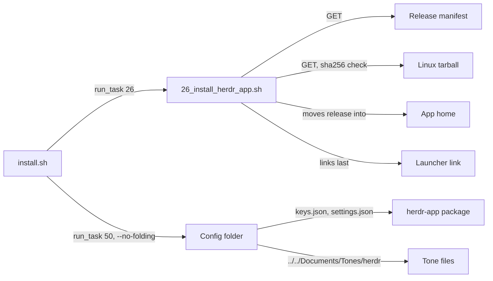
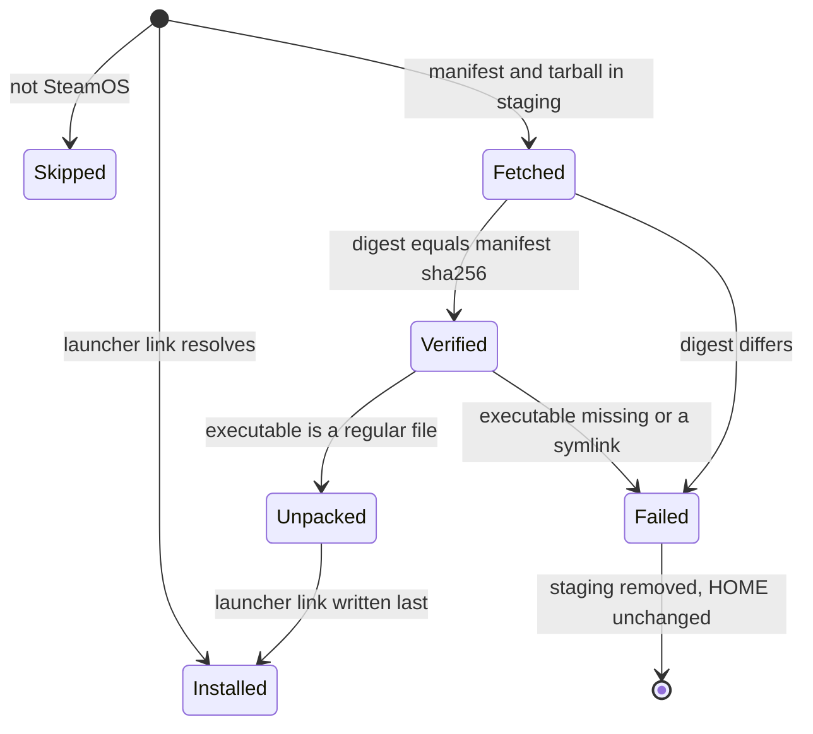

# Plan: herdr-app phase 1 — stow package

From `intent.md` (2026-11-10). Status: accepted.

Scope: phase 1 of five ("Stow package") only. Phases 2–5 (cores, keys, look, pipeline) each get their own plan after the previous phase merges. This plan ships as one pull request.

## Design

### Domain terms

From the glossary: **herdr-app**, **herdr TUI**, **Core**, **PATH stub**, **Personal repository**. No avoided word is used: not "Herdr UI", not "herdr GUI", not "server".

Proposed new terms. They go into `GLOSSARY.md` only after Etienne agrees them:

- **Release manifest** — `https://releases.herdr.dev/app/latest.json`, the JSON that lists the tarball URL and sha256 of every herdr-app release target.
- **Release target** — a key under the release manifest's `targets`, such as `linux-x86_64` or `linux-aarch64`, picked from `uname -m`.
- **App home** — `${XDG_DATA_HOME:-$HOME/.local/share}/herdr-app`, the folder that holds the extracted Linux release.
- **Launcher link** — `$HOME/.local/bin/herdr-app`, the symlink to the executable in the app home. The task writes it last, so it is the only mark that herdr-app is installed.
- **Config folder** — `~/.config/herdr-app`, a real folder that holds the links to the tracked `keys.json` and `settings.json` next to the files herdr-app writes itself.

### Diagrams

What links to what after phase 1:



The Linux install task, as states:



### Signatures

Shell, so each entry has a one-line contract instead of an RBS signature.

**`install/tasks/26_install_herdr_app.sh`** (new, mode 755): installs herdr-app on SteamOS from the verified Linux tarball, writing only under `$HOME` and `$XDG_DATA_HOME`. "SteamOS" is `determine_os`'s existing group (`ID` `steamos`, `holo` or `arch`, or a `pacman` system), the same group the AUR task serves. Entry point: the script, no arguments. Exit 0 means skipped, already installed or installed. Any other exit leaves no launcher link. It sources `00_common.sh` like `53_configure_rex_defaults.sh`, and keeps its helpers local to the script:

```bash
# herdr_app_cleanup   :: () -> status          rm -rf the staging folder named in the global HERDR_APP_STAGING
#                        (the EXIT trap names this function, so no quoted trap string needs a shellcheck disable)
# herdr_app_home      :: () -> stdout          "${XDG_DATA_HOME:-$HOME/.local/share}/herdr-app"
# herdr_app_launcher  :: () -> stdout          "$HOME/.local/bin/herdr-app"
# herdr_app_installed :: () -> status          true when the launcher link resolves to an executable
# herdr_app_target    :: () -> stdout          "linux-x86_64" | "linux-aarch64" from uname -m; die on anything else
# herdr_app_fetch     :: (url, out) -> status  curl --proto =https --proto-redir =https -fsSL -o out url
# herdr_app_release   :: (manifest, target) -> stdout "url sha256"
#                        jq -er; die unless url starts with https://releases.herdr.dev/ and sha256 is 64 hex digits
# herdr_app_verify    :: (tarball, sha256) -> status   die unless sha256sum's first field equals sha256
# herdr_app_unpack    :: (tarball, staging) -> status  tar -xzf into staging; die unless staging/herdr-app/herdr-app
#                        is a regular, executable file and not a symlink
# herdr_app_exec_argument :: (path) -> stdout  path as one quoted Desktop Entry Exec argument: \ " ` $ escaped
#                        inside the quotes, that backslash doubled for the string value, % as %%
# herdr_app_desktop_entry :: (app_home) -> stdout  the herdr-app.desktop text; Exec through herdr_app_exec_argument
# herdr_app_place     :: (staging) -> status   rm -rf "<app home>.new"; mv staging/herdr-app "<app home>.new";
#                        rm -rf "<app home>"; mv "<app home>.new" "<app home>" (never into an existing folder);
#                        cp -f herdr-app.svg to the hicolor icon folder; write herdr-app.desktop (overwrite);
#                        ln -sfn the launcher link last. Every step overwrites, so a rerun after any failure starts clean.
# main                :: () -> status          task_bootstrap; determine_os; skip unless SteamOS; skip when installed;
#                        require_cmd curl jq tar sha256sum; trap herdr_app_cleanup EXIT; fetch, verify, unpack, place
```

**`install/utils.sh` `determine_os`**: one change, a test seam. It reads `${OS_RELEASE_FILE:-/etc/os-release}` instead of the fixed path. The default behaviour is unchanged.

```bash
# determine_os :: () -> exports OS OS_KERNEL OS_DISTRO_ID OS_PRETTY   (OS_RELEASE_FILE overrides /etc/os-release)
```

**Stow package `herdr-app/.config/herdr-app/`** (new):

- `keys.json`: byte-for-byte copy of this Mac's `~/.config/herdr-app/keys.json`. It equals herdr-app 0.1.14's shipped `defaults/keys.macos.json`.
- `settings.json`: copy of this Mac's file, with `sounds.done` = `"../../Documents/Tones/herdr/jobs-done.mp3"` and `sounds.blocked` = `"../../Documents/Tones/herdr/milord.mp3"`. herdr-app resolves a relative sound path against the config folder (`src/sound.rs` `resolve`, `crate::mods::app_dir().join(p)`). Everything else stays: `font` `MonoLisa`, `colors.accent`, `telemetry: false`.

Not checked: this change has no Ruby production code; Steep does not apply to shell.

### Complexity

- Skipped (not SteamOS) or already installed: 0 network requests, 0 writes. The guard runs before `require_cmd`, so `curl` need not exist.
- Partial earlier install (app home, `.new` folder, icon or desktop entry present, launcher link missing): the same as a fresh install; every step overwrites.
- Fresh install: exactly 2 HTTPS requests (manifest, one tarball), one sha256 pass and one extraction, both linear in the tarball size (about 100 MB today). Writes: the app home, one icon, one desktop entry, the launcher link.
- Stow: 2 file links in a real config folder, whatever herdr-app writes next to them.
- Live reload: herdr-app's file watcher watches the config folder, not link targets. An edit to the repository's `settings.json` reaches the app through its mtime poll (every 25 × 400 ms = 10 s, `src/window.rs` `poll`), so within at most about 10 s.

### Invariants

- No downloaded content runs: the script has no `| sh`, `eval` or `source` on a fetched path, and never runs the app. Enforced by the script's shape. Proved by `test_the_task_runs_no_fetched_content`: the fixture executable writes a marker file when run, and the test asserts the marker never appears. A static scan of the script backs it up.
- Every request is HTTPS only, redirects too. Enforced in `herdr_app_fetch`. Proved by `test_every_request_is_https_only`.
- The tarball URL is on `https://releases.herdr.dev/`. Enforced in `herdr_app_release`. Proved by `test_a_foreign_tarball_url_fails_before_download`.
- Nothing lands in `$HOME` before the digest matches. Enforced by the order in `main`. Proved by `test_a_wrong_sha256_installs_nothing`.
- The launcher link exists only after a complete install, and its presence means no request. Enforced by `herdr_app_place` linking last and the guard in `main`. Proved by `test_a_second_run_downloads_nothing` and `test_a_missing_launcher_link_reinstalls`.
- The task never installs herdr-core, never uses `sudo`, and writes only under `$HOME` and `$XDG_DATA_HOME`. Enforced by the script's paths. Proved by `test_a_fresh_install_writes_only_the_app_files` and `test_xdg_data_home_moves_the_app_home`.
- A rerun after a failed or partial install ends in one clean app home, never a nested folder. Enforced by `herdr_app_place`'s remove-then-move. Proved by `test_a_rerun_after_a_partial_install_replaces_it` and `test_a_failed_desktop_entry_leaves_no_launcher_link`.
- The staging folder is gone after every exit. Enforced by `trap herdr_app_cleanup EXIT`. Proved by `test_staging_is_removed_after_success_and_failure`.
- The config folder is a real folder, never a link into the repository. Enforced by `herdr-app` in `STOW_SHARED` (`stow --no-folding`). Proved by `test_stow_shared_lists_herdr_app` and `test_the_stow_task_links_herdr_app_file_by_file`, which runs `50_stow_all.sh` with a `stow` PATH stub. This also makes `../../Documents` resolve to `$HOME/Documents`.
- `settings.json` holds no absolute path, and every sound path resolves under the home folder. Proved by `test_sound_paths_resolve_under_home`.
- A save from herdr-app keeps a link a link. Enforced by herdr-app: `persist::write_atomic` resolves the link and renames its temp file next to the target; `keys.rs` writes with `fs::write`, which follows the link. Proved by the manual check in `## Proof`.

### Alternatives

1. **Own task, verified tarball, SteamOS only (chosen).** Built for the smallest trust surface and full test coverage with PATH stubs. Costs one test seam in `determine_os`.
2. **Least new code: one task that skips only on macOS, fixed `linux-x86_64`, no desktop entry, one test file.** Rejected: it also installs on Debian, which goes past the intent's "macOS and SteamOS"; it gives no desktop-mode launcher on the Steam Deck; and one test file would hold two jobs.
3. **Run upstream's `https://releases.herdr.dev/app/install.sh` behind an "already installed" guard.** Rejected: it pipes a remote script into `sh`, and it also installs herdr-core, which the intent's approved permissions do not cover.

The intent's folder-link fallback is not needed: herdr-app's source shows that a settings save keeps the link (alternative "link the whole `~/.config/herdr-app`" stays the fallback only if the live check fails).

## Design decisions

- Phase 1 only, per the coordinator; later phases get their own plan.
- Install task number 26, right after `25_install_gh_extensions.sh`: it is a package install (the 2x group), after task 20 has installed `jq` and `curl`. It needs no stowed file.
- Install the whole extracted release folder (executable, icon, `LICENSE`, `THIRD-PARTY-NOTICES`) into the app home, same paths as upstream's installer, so a manual upstream install and this task agree on "installed".
- Write a desktop entry and icon like upstream, so herdr-app shows in the Steam Deck's desktop menu.
- No herdr-core install: not in the approved permissions. herdr-app offers herdr-core on first open. Phase 2 needs a core; its plan revisits this.
- No updates from the task: herdr-app updates itself. The task only installs when the launcher link is missing.
- `OS_RELEASE_FILE` seam in `determine_os`, so CI (Ubuntu) can reach the SteamOS branch without widening the task to Debian.
- The task follows `determine_os`'s existing "SteamOS" group, which also holds Arch and other `pacman` systems, like the AUR task. A stricter check would make this task the only one with its own idea of SteamOS.
- `keys.json` is one file for macOS and SteamOS, as tracked today. On Linux, herdr-app reads its `cmd-` bindings as the Super key. Phase 3 rewrites the keys.
- Ignore `herdr-app/.config/herdr-app/*.tmp.*` in the root `.gitignore`: `write_atomic` writes `settings.json.tmp.<pid>.<n>` next to the link target, inside the repository, and a crash between write and rename would leave it.
- Stow on this Mac only from the main checkout after the merge, never from this worktree: links into `.worktrees/herdr-app` would dangle once the worktree is removed.
- No conflict with `intent.md`'s `## Decisions` found. The acceptance criterion "within a few seconds" may not hold: herdr-app's watcher does not see edits through a link, and its fallback poll runs every 10 s. The plan keeps the criterion as written and measures it; if the measured delay is over a few seconds, that is a decision for Etienne, not for the implementer.

## Integration points

- herdr-app 0.1.14: reads `~/.config/herdr-app/{keys,settings}.json`, writes `*.error` files into the config folder (not the repository), rewrites an unedited `keys.json` through the link when an update ships new defaults.
- Homebrew cask `herdr-app` (requires macOS on arm64; `auto_updates`).
- `releases.herdr.dev`: the release manifest and the Linux tarball.
- `install/utils.sh` `stow_configure` (`--no-folding` for `STOW_SHARED`), `brew_install_one` (cask fallback), `determine_os`.
- `test/repo_agents_file_test.rb`: checks the `agents.md` package list against `packages.conf`.
- `test/stow_package_roots_test.rb`: checks every package root holds only dot entries.

## Files that change

- `herdr-app/.config/herdr-app/keys.json` — new; copied from this Mac.
- `herdr-app/.config/herdr-app/settings.json` — new; copied, sound paths made relative.
- `packages.conf` — `herdr-app` in `BREW_MACOS`, in `STOW` after `herdr`, in `STOW_SHARED`; one comment clause at `STOW_SHARED` on why.
- `install/tasks/26_install_herdr_app.sh` — new task, mode 755.
- `install.sh` — `run_task "26_install_herdr_app.sh" "$root"` after task 25.
- `install/utils.sh` — `determine_os` reads `${OS_RELEASE_FILE:-/etc/os-release}`.
- `.gitignore` — `herdr-app/.config/herdr-app/*.tmp.*` with a one-line comment.
- `agents.md` (`CLAUDE.md` links to it) — `herdr-app` after `herdr` in the package list.
- `test/herdr_app_install_test.rb` — new; runs the real task with PATH stubs.
- `test/herdr_app_package_test.rb` — new; package contents and `packages.conf` lists.

## Order of work

1. Write `test/herdr_app_package_test.rb` (package files, `packages.conf` lists, sound paths). Run it, watch it fail.
2. Copy `keys.json` and `settings.json` from `~/.config/herdr-app/` into the package; make the sound paths relative. Add `herdr-app` to `BREW_MACOS`, `STOW`, `STOW_SHARED`. Add the `.gitignore` line. Run the package test green; run `test/stow_package_roots_test.rb`.
3. Update the `agents.md` package list. Run `test/repo_agents_file_test.rb`.
4. Add the `OS_RELEASE_FILE` seam to `determine_os`.
5. Write `test/herdr_app_install_test.rb`. Run it, watch it fail (task missing).
6. Write `install/tasks/26_install_herdr_app.sh` and the `install.sh` line. Run the install test green.
7. Live check on this Mac, before the pull request, in a sandbox that mirrors the deployed depth: `SANDBOX=~/.config/herdr-app-plan-check`, holding links to the worktree's `keys.json` and `settings.json`, so `../../Documents/Tones/herdr` still resolves to `~/Documents/Tones/herdr`. Start a second window with `HERDR_APP_HOME="$SANDBOX" /Applications/Herdr.app/Contents/MacOS/Herdr`. Pass `HERDR_APP_HOME="$SANDBOX"` to every `herdr-app` client command (`shot`, `status`), or it addresses Etienne's window. Run the sandbox checks in `## Proof` with `$SANDBOX` and the worktree path. Never quit or restart Etienne's own herdr-app window or any core. Quit the sandbox window afterwards and `trash "$SANDBOX"`. If a second window cannot start, record that and leave the live checks for the delivery step.

   Results, 2026-11-10, run by the coordinator with `HC_SESSION=test-hac` (a longer session name overflowed the 103-byte socket path limit):

   - Repository edit reaches the window: `font_size` 14 → 16 in the worktree's `settings.json` showed in `herdr-app status` after 9.3 s, inside the intent's 10 s. Reverted.
   - Save from the app keeps the link: `herdr-app do app.zoom_in` wrote `"zoom": 1.1` through the link; `settings.json` stayed a link, and `git diff` listed `herdr-app/.config/herdr-app/settings.json`. `app.zoom_reset` left the tree clean. The whole-folder fallback is not needed.
   - Herdr's files: `git status --porcelain` listed nothing under `herdr-app/` after the session.
   - Sound paths: `$SANDBOX/../../Documents/Tones/herdr/jobs-done.mp3` resolves; `herdr-app status` reported no errors. Playback stays the delivery check.
   - MonoLisa: not confirmed. The sandbox window drew no frame after the space opened, so `shot` showed the empty start screen. The font key is unchanged from the current file; the delivery check in step 9 confirms it.
   - Caution for step 9 and later phases: `herdr-app do app.quit` against the sandbox also closed Etienne's own window. Stop a sandbox window by its own process.
8. Run `bin/test`, then the linters (`rubocop`, `shellcheck`, `yamllint`, markdownlint through lefthook). Re-read the diff.
9. Delivery, after the merge, from the main checkout `~/Developer/dotfiles`: `trash ~/.config/herdr-app/keys.json ~/.config/herdr-app/settings.json`, then `stow -d ~/Developer/dotfiles -t "$HOME" --no-folding --restow herdr-app`. Then repeat the live checks against the real config folder.

## Risks

- Edits to the repository's `settings.json` reach the running app through the 10 s mtime poll, not the watcher. "Within a few seconds" becomes "within about 10 s". Nothing in the dotfiles can shorten it.
- While the tracked `keys.json` equals a shipped default, a herdr-app update rewrites it through the link. That shows as a diff in the repository. Phase 3 edits the file, after which updates stop touching it.
- On SteamOS, `keys.json` holds the macOS `cmd-` bindings (Super key) until phase 3.
- The second sandbox window shares herdr-core with Etienne's window; it must never close spaces or stop a core. It may double sounds and toasts while it runs.
- The sha256 comes from the same origin as the tarball: it proves an intact download, not an uncompromised origin. Pinning a version in `packages.conf` was rejected because the intent names `latest.json`.
- A later release could move the executable inside the tarball; the task then fails loudly in `herdr_app_unpack` instead of installing something broken.
- The cask conflicts with this Mac's manual install in `/Applications/Herdr.app`. The intent keeps the installer from running here, so nothing changes on this Mac.
- Rejected: the whole-folder link (not needed, see Alternatives); running upstream's installer (remote script, installs herdr-core); widening the task to Debian.

## Proof

The live checks below run twice: first in the sandbox of step 7, with `CONFIG=$SANDBOX`, `REPO=<this worktree>` and `HERDR_APP_HOME="$SANDBOX"` on every `herdr-app` command; then after delivery, with `CONFIG=~/.config/herdr-app`, `REPO=~/Developer/dotfiles` and no `HERDR_APP_HOME`.

- After delivery on this Mac, both files resolve into the dotfiles repository, herdr-app still uses MonoLisa and plays the herdr tones → check: `readlink "$CONFIG/keys.json" "$CONFIG/settings.json"` prints paths under `$REPO/herdr-app/`; no `$CONFIG/settings.error`; `herdr-app shot` shows MonoLisa; the Play buttons in Settings > Alerts play `jobs-done` and `milord`, not the bundled sounds.
- Changing the font in the repository's `settings.json` changes the running window's font within a few seconds → check: change `font` in `$REPO/herdr-app/.config/herdr-app/settings.json`, time until `herdr-app shot` shows it, revert. Record the measured time; over a few seconds goes to Etienne as a decision.
- Changing a setting in herdr-app's settings dialog shows up as a diff in the repository → check: toggle a setting in the dialog; `test -L "$CONFIG/settings.json"`; `git -C "$REPO" diff --stat` lists `herdr-app/.config/herdr-app/settings.json`; revert. If the link became a plain file, stop: the intent's whole-folder fallback applies.
- With herdr-app running for a while, `git status` shows no file Herdr wrote → check: `git -C "$REPO" status --porcelain` after a session lists nothing under `herdr-app/` beyond the two tracked files.
- On a fresh Mac, the installer installs Herdr and links both files → `test/herdr_app_package_test.rb` `test_brew_macos_lists_the_herdr_app_cask`, `test_stow_lists_herdr_app`, `test_stow_shared_lists_herdr_app`; `test/herdr_app_package_test.rb` `test_the_stow_task_links_herdr_app_file_by_file`; plus check: the cask install on a fresh Mac stays a manual check for Etienne, since the intent keeps the installer from running on this Mac.
- On a fresh Steam Deck, the installer installs herdr-app from the Linux tarball and links both files; a second run downloads nothing → `test/herdr_app_install_test.rb` `test_a_fresh_install_places_the_app_and_the_launcher_link`, `test_a_second_run_downloads_nothing`; plus the package tests above; plus check: Etienne runs `./install.sh` on the Steam Deck after the merge.
- On a Steam Deck with the tone files present, herdr-app plays the same tones from the same `settings.json` → `test/herdr_app_package_test.rb` `test_sound_paths_resolve_under_home`; plus check: Etienne presses the Play buttons in Settings > Alerts on the Steam Deck.
- Invariant: no downloaded content runs, enforced by the task's shape → `test/herdr_app_install_test.rb` `test_the_task_runs_no_fetched_content`.
- Invariant: HTTPS only, enforced by `herdr_app_fetch` → `test/herdr_app_install_test.rb` `test_every_request_is_https_only`.
- Invariant: only `releases.herdr.dev` tarballs, enforced by `herdr_app_release` → `test/herdr_app_install_test.rb` `test_a_foreign_tarball_url_fails_before_download`.
- Invariant: nothing lands before the digest matches, enforced by `main`'s order → `test/herdr_app_install_test.rb` `test_a_wrong_sha256_installs_nothing`.
- Invariant: the launcher link is written last, enforced by `herdr_app_place` → `test/herdr_app_install_test.rb` `test_a_missing_launcher_link_reinstalls`, `test_a_tarball_without_the_executable_installs_nothing`, `test_a_tarball_with_a_symlinked_executable_installs_nothing`.
- Invariant: no herdr-core, no `sudo`, writes only under `$HOME` and `$XDG_DATA_HOME`, enforced by the task's paths → `test/herdr_app_install_test.rb` `test_a_fresh_install_writes_only_the_app_files`, `test_xdg_data_home_moves_the_app_home`.
- Invariant: a rerun after a partial install ends in one clean app home, enforced by `herdr_app_place` → `test/herdr_app_install_test.rb` `test_a_rerun_after_a_partial_install_replaces_it`, `test_a_failed_desktop_entry_leaves_no_launcher_link`.
- Invariant: staging removed on every exit, enforced by `trap herdr_app_cleanup EXIT` → `test/herdr_app_install_test.rb` `test_staging_is_removed_after_success_and_failure`.
- Invariant: the desktop entry's Exec path stays one argument with any reserved character, enforced by `herdr_app_exec_argument` → `test/herdr_app_install_test.rb` `test_the_desktop_entry_quotes_an_exec_path_with_reserved_characters`, `test_a_fresh_install_places_the_app_and_the_launcher_link`.
- Invariant: the config folder is a real folder, enforced by `STOW_SHARED` → `test/herdr_app_package_test.rb` `test_stow_shared_lists_herdr_app`, `test_the_stow_task_links_herdr_app_file_by_file`.

Per changed file, the unit tests expected, named as behaviour:

- `install/tasks/26_install_herdr_app.sh`: `test_the_task_skips_on_macos`, `test_the_task_skips_on_debian`, `test_the_task_installs_on_arch` (the existing SteamOS group), `test_aarch64_fetches_the_aarch64_tarball`, `test_an_unknown_arch_fails_before_any_request`, `test_a_failed_download_installs_nothing`, `test_a_missing_target_fails`, `test_a_malformed_sha256_fails`, `test_the_task_is_executable`, `test_install_runs_the_task_after_the_brew_packages`, plus the invariant tests above.
- `install/utils.sh`: `test_the_task_skips_on_debian` and the SteamOS install tests exercise `OS_RELEASE_FILE`; no test of its own.
- `herdr-app/.config/herdr-app/*.json`: `test_both_files_parse_as_json`, `test_the_package_holds_only_keys_and_settings`, `test_settings_keep_monolisa`, `test_settings_hold_no_absolute_paths`, `test_sound_paths_resolve_under_home`.
- `packages.conf`: `test_brew_macos_lists_the_herdr_app_cask`, `test_stow_lists_herdr_app`, `test_stow_shared_lists_herdr_app`, `test_the_stow_task_links_herdr_app_file_by_file` (runs `install/tasks/50_stow_all.sh` with a `stow` PATH stub that logs its arguments and a scratch `HOME` without `dotfiles-work`; asserts `--no-folding` and `herdr-app` in one call).
- `.gitignore`: `test_atomic_write_leftovers_are_ignored` (`git check-ignore` on `herdr-app/.config/herdr-app/settings.json.tmp.1.0`).
- `agents.md`: covered by the existing `test/repo_agents_file_test.rb`.

Test setup: the install test runs the real task with `HOME`, `XDG_DATA_HOME` and `TMPDIR` in a temp folder and a `PATH` of only its own bin folder. PATH stubs: `uname` (`-s` Linux/Darwin, `-m` the arch asked), `curl` (logs its arguments, copies a fixture file to the `-o` path, exits with a chosen status), `sha256sum` (the host tool, or `shasum -a 256` on macOS). Real tools are linked in: `bash`, `env`, `dirname`, `jq`, `tar`, `gzip`, `mktemp`, `mkdir`, `mv`, `cp`, `rm`, `cat`, `chmod`, `ln`. Ruby builds the fixture tarball (`herdr-app/herdr-app` as a script that writes a marker file and exits 1, `herdr-app/herdr-app.svg`) and the manifest with `Digest::SHA256`. A one-line os-release file (`ID=steamos`, `ID=arch` or `ID=ubuntu`) goes in through `OS_RELEASE_FILE`. The partial-install test pre-creates the app home and `<app home>.new`; the failed-desktop-entry test makes the applications folder read-only. No test reaches the network.

Out of scope for this phase: cores, the migration script, keys, look, the pipeline backend; installing herdr-core; MonoLisa and tone files on SteamOS; tracking `view.json` and `window.json`; replacing this Mac's manual install with the cask; running the installer on this Mac.

---
Domain skills applied: dotfiles-maintenance (stow and installer conventions), dependencies (cask and tarball approved in intent), software-design, glossary, diagrams.

## Critique

### Round 1 (Codex, `codex exec -s read-only`, default profile)

- The plan weakens the accepted criterion "within a few seconds" to about ten seconds → fixed (Proof keeps the criterion as written and measures it; Design decisions hands a slower result to Etienne as a decision)
- Publication failures and retries need a full design, since a plain `mv` can nest folders on a rerun → fixed (herdr_app_place removes then moves, every step overwrites, new invariant and two rerun and failure tests)
- The sandbox checks address the real config and window, and `../../Documents` breaks in a scratch folder → fixed (sandbox at `~/.config/herdr-app-plan-check` keeps the depth; every check takes `CONFIG`, `REPO` and `HERDR_APP_HOME`)
- The tests do not isolate `XDG_DATA_HOME`, which the task honours → fixed (tests set it; new test for its override; invariant names both roots)
- The fetched-content test cannot see an ignored failed run of the app → fixed (the fixture executable writes a marker file that the test asserts never appears)
- Several test names overstate what they prove → fixed (renamed to what they assert; added a `50_stow_all.sh` run with a `stow` PATH stub; the fresh-Mac cask install is named as a manual check)
- "SteamOS only" does not match `determine_os`, which groups Arch and `pacman` systems as SteamOS → fixed (the plan states that the task follows the existing group, like the AUR task, and adds an Arch fixture)
