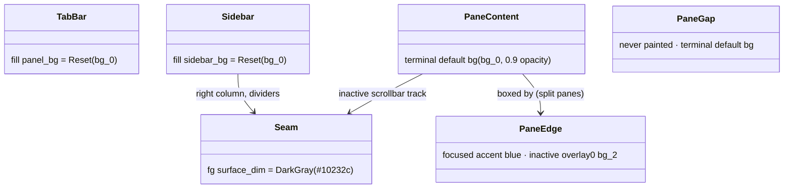
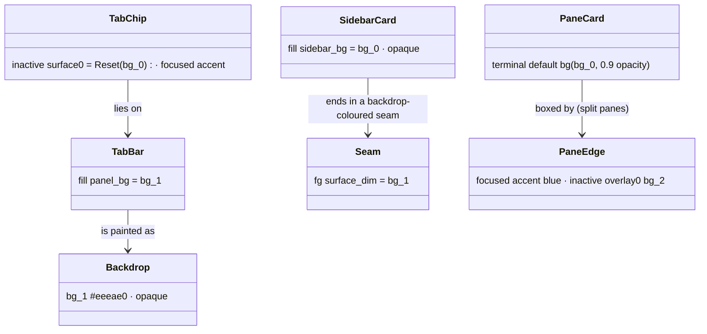

# Plan: herdr panels as cards on a darker backdrop

From `intent.md` (2026-11-04). Status: accepted.

## Design

### Domain terms

`GLOSSARY.md` has no entry for these words, and no word of the intent is in an `Avoid:` list. The terms below are working terms for this plan only. Auto mode adds no glossary entry, because Etienne has not agreed them.

- **Card**: a screen region with the `bg_0` `#fffbf1` fill. Panes, the sidebar and the inactive tab chips are cards.
- **Backdrop**: the darker `bg_1` `#eeeae0` fill that the cards lie on. In herdr 0.9.5 only `panel_bg` paints it: the tab bar row, popups, overlays and the mode bar.
- **Seam**: a one-cell line glyph that herdr draws in `surface_dim`: the sidebar separator `│`, the sidebar and agent panel dividers `─`, and the inactive scrollbar tracks `▕`. Today every seam is ANSI DarkGray, which the Solunized light Ghostty palette maps to near-black `#10232c`. These are the dark lines of the problem statement.
- **Card edge**: the border box that herdr draws around a split pane: `accent` (blue) for the focused pane, `overlay0` (`bg_2`) for the others.

### Diagrams

Before (light mode, theme `terminal`, current `[theme.custom]`):



After:



Screen layout after the change, light mode:

```text
 sidebar card bg_0          │ tab bar = backdrop bg_1   [chip bg_0] [focused chip blue]
 active row bg_2            │ ┌ pane card bg_0 ──────┐┌ pane card bg_0 ───────┐
 ─ divider bg_1 ─           │ │                      ││                       │
 agent rows blue            │ └ blue = focused ──────┘└ bg_2 = inactive ──────┘
                            ^ seam in bg_1, the backdrop colour
```

### Signatures

Not affected: no Ruby changes. The only file that changes is `herdr/.config/herdr/config.toml`. Its new `[theme.custom]` block and the new `[ui]` key:

```toml
[theme.custom]
accent        = "#0068c9"   # unchanged
active_row_bg = "#d5d2c8"   # unchanged
overlay0      = "#d5d2c8"   # unchanged
panel_bg      = "#eeeae0"   # new: bg_1, the backdrop (tab bar, popups, overlays, mode bar)
sidebar_bg    = "#fffbf1"   # new: bg_0, the sidebar card
surface_dim   = "#eeeae0"   # new: bg_1, every seam takes the backdrop colour

[ui]
pane_gaps = true            # new, explicit: already the default; each split pane keeps its own box
```

Not checked: the dotfiles repository declined Steep and rbs_rails; this change has no Ruby.

### Complexity

Not affected: configuration only. herdr draws the same cells per frame, and no query runs.

### Invariants

- Every hex value in `config.toml` is one of `#fffbf1`, `#eeeae0`, `#d5d2c8` or `#0068c9`. Enforced by the palette check in `## Proof`.
- The focused pane edge (`accent`, blue) differs from an inactive pane edge (`overlay0`, `bg_2`). Enforced by herdr's `render_pane_borders` (`src/ui/panes.rs:599-603` in v0.9.5) and by keeping both tokens unchanged.
- `overlay0` stays `bg_2`. It also colours text (inactive tab labels, hints, sidebar numbers), so `bg_1` would make that text unreadable. Enforced by the config comment.
- `pane_borders` stays `auto` (the default). With `off`, split panes lose every focus cue. Enforced by review: the change adds no `pane_borders` key.

### Alternatives

1. **Chosen: backdrop through `panel_bg`, sidebar card, `bg_1` seams, default borders.** It keeps the intent's order: lighter cards on a darker backdrop, and the tab bar on that backdrop. It changes three tokens. Inactive scrollbar thumbs (`overlay0`, `bg_2`) stay visible on their `bg_1` tracks.
2. **Rejected: the same, plus `pane_borders = "always"` and `surface_dim = bg_2`** (architect "closest card look"). `always` frames a lone pane too, costs it 2 columns and 2 rows, and gives it a permanent blue box. The intent asks only for split panes. `surface_dim = bg_2` equals the `overlay0` thumb colour, so the scroll thumb disappears on inactive panes and in sidebar lists.
3. **Rejected: `sidebar_bg = bg_1` and `surface_dim = bg_0`, `panel_bg` unset** (architect "smallest blast radius"). It leaves popups and the mode bar alone, but it inverts the brightness order: the sidebar becomes the darker surface and the backdrop is the lightest colour. That contradicts "a slightly darker backdrop" in the intent. It also lowers the contrast of every sidebar text colour.
4. **Rejected: `pane_borders = "off"` with `pane_gaps = true`.** herdr then leaves a one-cell gap, but never paints it. The gap shows the terminal default background, the same as the pane content, so no backdrop appears. The focused pane is no longer told apart, which breaks an acceptance criterion.

## Design decisions

- **The gap between split panes cannot show the backdrop.** In herdr 0.9.5 no token paints the pane gap, and the pane content shows the terminal default background (`blit_pane_surface` copies a server buffer whose blank cells are `Reset`). The plan removes the dark lines but cannot put a `bg_1` strip between two panes. This conflicts with acceptance criterion 1; see `## Risks` and the report.
- **The tab bar token also colours other surfaces.** The tab bar fill is `panel_bg` (`src/client/shell/tabs.rs:18`). `panel_bg` also fills popups, the settings overlay, worktree overlays and the mode bar. None of these is a card in the intent's sense, so the intent's fallback ("keep the tab bar on its current colour") does not apply. The side effect is named in the config comment.
- **`sidebar_bg` is explicit `bg_0`, not left unset.** It names the card colour in the file. Ghostty draws a cell with an explicit background opaque and a default-background cell at `background-opacity = 0.9`, so the sidebar card is solid while the panes stay a little translucent. Where the sidebar meets the tab bar, `bg_0` against `bg_1` sets it apart.
- **`surface_dim` is `bg_1`, the backdrop colour.** The seam between the sidebar and the panes then reads as a thin strip of backdrop that continues down from the tab bar, instead of a dark line. `bg_2` was rejected because it hides the inactive scroll thumbs.
- **`pane_gaps = true` is written although it is the default.** The intent names gaps as in scope; the explicit key and its comment record why each split pane keeps its own box.
- **No rounded corners.** herdr 0.9.5 draws pane boxes with `┌┐└┘` only (`line_cell_symbol` in `src/ui/panes.rs`) and has no border-type setting. Per the intent's decision, the flat card look ships and the report says so.
- **The decisions in `intent.md` hold:** panes, tab bar and sidebar are restyled; the tab bar takes the backdrop colour; only Solunized values appear; corners stay flat and this is reported.

## Integration points

- herdr 0.9.5 reads `~/.config/herdr/config.toml`, a stow link to `herdr/.config/herdr/config.toml` in the main checkout. The worktree copy goes live only after the merge; until then, verify it with `HERDR_CONFIG_PATH`.
- Ghostty's Solunized light theme (`ghostty/.config/ghostty/themes/solunized-light`) gives the default background `bg_0` and maps ANSI DarkGray to `#10232c`. Unchanged.
- `test/herdr_config_test.rb` runs `herdr config check` against the file.

## Files that change

- `herdr/.config/herdr/config.toml` — add `panel_bg`, `sidebar_bg` and `surface_dim` to `[theme.custom]`; rewrite the comment above `[theme.custom]` so it says what each token now paints, that `panel_bg` also fills popups, overlays and the mode bar, that the pane gap cannot be painted, and that corners stay flat; add `pane_gaps = true` with a one-line comment to `[ui]`. Comments follow the file's existing style: full sentences, wrapped at about 100 characters, as the neighbouring TOML comments are.

## Order of work

No acceptance criterion needs a test (configuration has no tests), so the work starts with the change.

1. Edit `herdr/.config/herdr/config.toml` as `## Files that change` says.
2. Run `HERDR_CONFIG_PATH="$PWD/herdr/.config/herdr/config.toml" herdr config check`. Expect `config: ok`.
3. Run the palette check from `## Proof`.
4. Run `ruby test/herdr_config_test.rb`. Expect only the known toast failure that already fails on `main` (see `## Risks`); every other test passes.
5. Do the visual check from `## Proof` and record what it shows.
6. Run `yamllint`/`markdownlint` only if the diff touches YAML or markdown outside the change folder. It does not; no TOML linter is configured in this repository.
7. Re-read the diff: only `config.toml` changes.

## Risks

- **Acceptance criterion 1 is met only in part.** No dark line remains between split panes (their edges are `bg_2` or blue, and the inactive scrollbar track becomes `bg_1`), but no darker backdrop shows between them. herdr 0.9.5 cannot paint that cell. This needs Etienne's decision.
- **`test/herdr_config_test.rb` already fails before this change.** `test_notifications_go_through_the_terminal_so_no_notifier_program_can_block_the_client` expects `[ui.toast] delivery = "terminal"`; the committed config holds `"system"` since commit `8363835d`. The fix sits uncommitted on `main` and is out of scope per the intent. Acceptance criterion 6 cannot pass until it lands. This needs Etienne's decision.
- **Dark mode gets light values.** `[theme.custom]` does not follow the system switch (intent constraint). In dark mode, `panel_bg = bg_1` makes the tab bar a light strip, and popups and the settings overlay show light default text on `bg_1`, which is hard to read. `sidebar_bg = bg_0` makes the dark-mode sidebar light. The intent accepts light values in dark mode, but this is a larger regression than today's three tokens. herdr offers `theme.custom.light.*` with `auto_switch`; that is a dark-mode change and out of scope.
- **The mode bar loses a little contrast.** Its hint text is `overlay0` (`bg_2`) on `bg_1` instead of `bg_2` on `bg_0`. Its keys stay blue.
- **The focused tab label changes colour.** `panel_contrast_fg` returns `panel_bg` once it is set, so the label becomes `bg_1` on blue instead of near-black on blue. Contrast goes up.
- **Ghostty opacity.** The claim that explicit-background cells are opaque under `background-opacity = 0.9` is checked in the visual check, not assumed. If they are translucent too, the sidebar still matches the panes and nothing breaks.
- **herdr upgrades.** Token use is read from the v0.9.5 source. A later herdr may move the tab bar or seams to other tokens.

## Proof

- With two split panes open, a darker backdrop shows between them and no dark line is drawn → check: visual check below, steps 1–3. Expected: no near-black line; the two pane boxes touch with `bg_2`/blue edges; no `bg_1` strip between them (known herdr limit, reported).
- The sidebar stands out as a panel against that backdrop → check: visual check, step 4. Expected: the sidebar is a `bg_0` card beside the `bg_1` tab bar, and its right seam is `bg_1`, not near-black.
- The tab bar has the same background colour as the backdrop, with no visible edge → check: visual check, step 2. Expected: the whole tab bar row is `bg_1`, inactive chips `bg_0`, focused chip blue.
- The focused pane is still told apart from an inactive one → check: visual check, step 3. Expected: the focused pane box is blue, the other `bg_2`.
- Every hex value in the new theme settings is a Solunized palette value → check: `grep -oE '#[0-9a-fA-F]{6}' herdr/.config/herdr/config.toml | sort -u` prints exactly `#0068c9`, `#d5d2c8`, `#eeeae0` and `#fffbf1`.
- `herdr config check` reports no diagnostics, and `test/herdr_config_test.rb` passes → check: `HERDR_CONFIG_PATH="$PWD/herdr/.config/herdr/config.toml" herdr config check` prints `config: ok`; `ruby test/herdr_config_test.rb` passes except the pre-existing toast failure, which needs Etienne's decision.
- Invariant: the focused edge differs from the inactive edge, enforced by unchanged `accent` and `overlay0` → check: the palette check plus visual check step 3.
- Invariant: no rounded corners exist in herdr 0.9.5 → check: visual check step 3 shows `┌┐└┘` corners; reported, not fixed.

Visual check, from the worktree root, in a new Ghostty window in light mode:

1. Run `HERDR_CONFIG_PATH="$PWD/herdr/.config/herdr/config.toml" herdr --session card-panels`, so the running default session stays untouched.
2. Look at the tab bar row with two tabs open (`prefix+c`).
3. Split the pane (herdr's split binding), focus each pane in turn, and look at the edges and the gap.
4. Look at the sidebar's right column and its dividers.
5. Take a screenshot with `screencapture -w`, record what each step showed, then run `herdr session stop card-panels` and `herdr session delete card-panels`.

Per changed file, the unit tests expected:

- `herdr/.config/herdr/config.toml`: none. Configuration has no tests; `test/herdr_config_test.rb` already covers that herdr accepts the file.

Test setup: none.

Out of scope: a dark-mode palette or `theme.custom.light`/`dark` blocks; `pane_borders`, `pane_outer_borders` and every other `[ui]` key except `pane_gaps`; the sidebar agent rows, the toast and the sound settings; the Ghostty theme; the herdr binary or an upstream feature request; the uncommitted edits on `main`.

---
Domain skills applied: software-design, glossary, diagrams, dotfiles-maintenance (stow link noted).

## Critique

### Round 1 (codex exec -p terra)

- Acceptance criterion 1 cannot be met: with borders on, the pane boxes touch and no backdrop cell exists; `surface_dim` paints only glyph foregrounds → dismissed: the plan already states this limit in `## Design decisions` and `## Risks`; herdr 0.9.5 has no token for the pane gap, a herdr change is out of scope per the intent, and the report carries it as a decision for Etienne.
- Setting `panel_bg` breaks the intent's tab bar fallback, because `panel_bg` also colours popups, overlays and modals, which are card surfaces → dismissed: the intent names only panes and the sidebar as cards ("Panes and the sidebar read as separate panels"), and `panel_bg` colours neither; a popup pane keeps its `Reset` content and only its frame ring takes `bg_1`. The report asks Etienne to confirm this reading, and leaving `panel_bg` unset is the fallback if he does not.
- Acceptance criterion 6 stays unmet, because `test/herdr_config_test.rb` already fails on the toast setting → dismissed: the failure predates this change (commit `8363835d`), the toast setting and the uncommitted test edit on `main` are out of scope per the intent, and the report carries it as a decision for Etienne.
