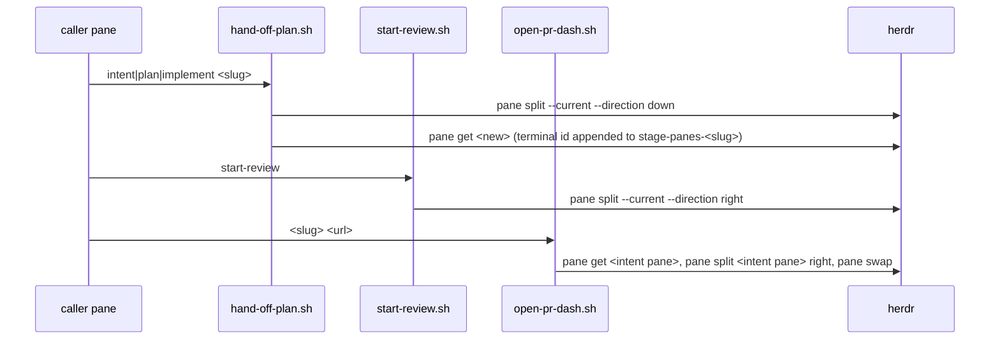
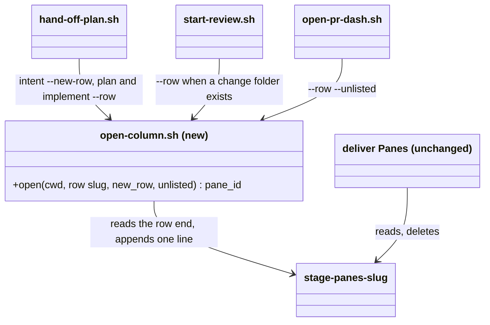
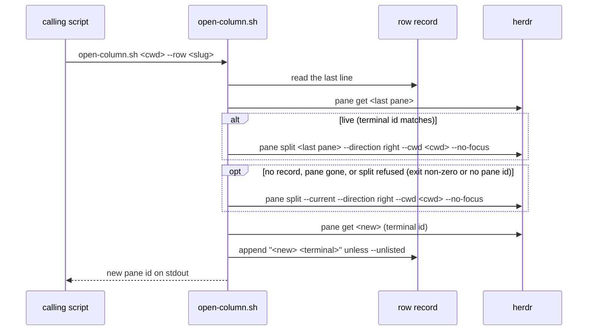

# Plan: Herdr panes form one row per change

From `intent.md` (2026-10-25). Status: accepted.

## Design

### Domain terms

The repository has no `GLOSSARY.md`. These terms come from `intent.md`; none is on an avoid list.

- **Change**: one `docs/changes/<slug>` folder, one branch, one worktree.
- **Row**: the panes of one change, side by side, left to right in process order.
- **Column**: one pane of a row, for one process step: intent, plan, implement, review, gh-dash.
- **Row record**: `<git-common-dir>/herdr/stage-panes-<slug>`. One line `<pane_id> <terminal_id>` per listed column, in the order the columns opened. The format does not change: `deliver` reads it.
- **Live pane**: `herdr pane get <id>` succeeds and its `terminal_id` equals the recorded one. Pane ids are reused; the terminal id tells a recorded pane from a later pane with the same id.
- **Row end** (new): the pane on the last line of the row record, when it is live.
- **Caller pane**: the pane that `herdr pane split --current` resolves to. This keeps today's meaning.
- **Unlisted column** (new): a column that joins the row on screen but not in the row record. The gh-dash pane is the only one, so `deliver` never closes it.
- **Intent pane record**: `<git-common-dir>/herdr/intent-pane-<slug>`, written by the `intent` skill. After this change only `deliver` reads it, to keep the intent pane open.

### Diagrams

Before:



After, class view (each script is one "class"):



After, one listed column:



### Signatures

No Ruby class or method changes. The one new public interface is a bash script; its usage line is its signature.

`herdr/.config/herdr/scripts/open-column.sh` (new): opens the next column of a change's row and prints its pane id.

```bash
# open-column.sh <cwd> [--row <slug>] [--new-row | --unlisted]
#: (String cwd, ?row: String, ?new_row: bool, ?unlisted: bool) -> stdout pane_id, exit 0 | exit 1
```

- No `--row`: one pane right of the caller pane, not recorded. start-review uses it on `main`, `master` or a detached HEAD, where `change-folder` exits 1, as today.
- `--row <slug>`: right of the row end. Right of the caller pane when there is no row record, the last recorded pane is gone, or herdr refuses the anchored split (non-zero exit or no `.result.pane.pane_id`). Appends the new pane to the row record when its terminal id is readable.
- `--row <slug> --new-row`: below the caller pane (`pane split --current --direction down`), whatever the record holds. Appends the new pane. Used by the intent stage only.
- `--row <slug> --unlisted`: placed like `--row`, never appended.
- `--new-row` or `--unlisted` without `--row`, both together, or an unknown option: usage error on stderr, exit 1, no herdr call.
- Exit 1 when the split on `--current` fails or returns no pane id. Diagnostics go to stderr; stdout holds only the pane id.
- It finds the row record itself: `$(git rev-parse --path-format=absolute --git-common-dir)/herdr`, created with `mkdir -p`.

Callers find the helper beside their own real path:

```bash
scripts_dir=$(dirname "$(realpath "${BASH_SOURCE[0]}")")
```

`~/.config/herdr/scripts/` holds one stow link per file, so a new file there needs a restow. `realpath` follows the caller's link into the dotfiles checkout, where `open-column.sh` exists as soon as the branch is merged and pulled. No restow is needed. `quieter-tones.sh` already relies on `realpath`.

Caller changes:

- `hand-off-plan.sh`: lines 160–168 (split, `pane get`, record append) become `pane=$("$scripts_dir/open-column.sh" "$worker_cwd" --row "$slug" $placement)`, with `placement=--new-row` for `intent` and empty for `plan` and `implement`. The header comment and the final echo name the position per stage ("in a pane below" for intent, "in the next column of its row" otherwise).
- `start-review.sh`: run `change-folder` before the split. `pane=$("$scripts_dir/open-column.sh" "$PWD" ${folder:+--row "${folder##*/}"})`. Lines 46–57 (record append) go away; the helper does it. `change-folder` prints a slug for every feature branch without checking that the folder exists, so a feature branch without a row record gets `--row` and falls back to the caller pane; its reviewer pane is recorded, exactly as today.
- `open-pr-dash.sh`: `pane=$("$scripts_dir/open-column.sh" "$toplevel" --row "$slug" --unlisted)`. `anchor_for`, the read of `intent-pane-<slug>` and `pane swap` go away. The header and the final echo say "right of the last pane of the change's row".

Not checked: no Ruby signature changes; the change touches bash scripts, Ruby tests and Markdown only.

### Complexity

- k = lines in the row record, one per stage pane and review round, usually six or fewer.
- Listed column: one read of the last line, one `pane get` (row end), one `pane split`, one `pane get` (new terminal id). Three herdr calls whatever k is.
- Worst case (row end refuses the split): one more `pane split` on `--current`. Four herdr calls. Constant in k.
- New row (intent): one split, one get, as today.
- Unlisted column (gh-dash): no final `pane get`, no swap. Fewer herdr calls than today.
- Each caller starts one extra bash process. No database path.

### Invariants

1. Intent always splits down from the caller pane; plan, implement, review and gh-dash never split down. Enforced by `--new-row` being the only down path in `open-column.sh`, and only `hand-off-plan.sh intent` passing it.
2. A right split anchors only on a live pane. A pane with the recorded id but another terminal id is never an anchor. Enforced by the terminal-id check in `open-column.sh`.
3. The anchor is the last recorded pane or the caller pane, never an earlier recorded pane. Enforced by reading only the last line (acceptance criterion 7).
4. A right split always opens a pane, even when the record is stale or the anchor closes between check and split. Enforced by `open-column.sh`: a refused anchored split falls back to the caller pane instead of aborting under `set -e`.
5. Every row record line holds exactly two fields. Enforced by appending only when the terminal id is readable (existing rule, moved into the helper).
6. The gh-dash pane is never in the row record. Enforced by `--unlisted`.
7. A caller reached through a link still finds `open-column.sh`. Enforced by the `realpath` line.

### Alternatives

- **A. Shared helper `open-column.sh` (chosen).** One owner of placement and of the row record writes. Smallest caller knowledge: cwd, slug, one flag. One test surface for the anchor rules.
- **A'. The same helper, walking back to the last live recorded pane before the caller.** Rejected: acceptance criterion 7 names the caller pane as the fallback once the recorded rightmost pane is gone. In autonomous delivery the first recorded pane is the intent pane, which is also the caller, so A gives the same row.
- **B. Inline `row_end` function copied into all three scripts, no new file.** Rejected: about 50 duplicated lines, connascence of algorithm across three bash copies plus `deliver`'s Ruby reader, and a sameness test to keep the copies equal. Its only gain, no restow, the `realpath` lookup in A also gives.
- **C. Anchor from `herdr pane list` live state (`change-row` script with `open`/`extend`).** Rejected: herdr 0.9.5 exposes no pane position or layout through its CLI, so the record order still decides left to right. It adds a `pane list` call per split and buys only a single-call liveness check, which per-pane `pane get` already gives for a list of six lines.

## Design decisions

- The row end is the last recorded pane only; when it is gone, the caller pane. `intent.md` In scope says "anchors on the rightmost live pane of the change"; acceptance criterion 7 refines it: "when the recorded rightmost pane is gone, the split falls back to the caller pane". This plan follows the criterion. No earlier recorded pane is tried.
- Acceptance criterion 4 is read as column order, not as panes that stay open: `intent.md` keeps stage panes closing after they hand on (Out of scope). In autonomous delivery the plan pane usually closes before implement opens; implement then opens right of the coordinator, the intent pane, and the row still reads in process order.
- The fallback uses `--current`, not `$HERDR_PANE_ID`, so "caller pane" keeps today's meaning in `hand-off-plan.sh` and `start-review.sh`. For `open-pr-dash.sh` this changes the fallback from `$HERDR_PANE_ID` to `--current`; `deliver` runs it from its own pane, where both name the same pane.
- A refused anchored split falls back to the caller pane. Stage panes close themselves right after reporting, which is when the coordinator starts the next stage.
- gh-dash is an unlisted column: in the record, `deliver` would close it.
- The `intent` skill keeps writing `intent-pane-<slug>`: `deliver` still needs it to keep the intent pane open. Only its stated purpose changes.
- Skill text: besides `intent` and `review` (named in the intent), the `plan` and `implement` skills also say "a pane below the caller". They change too, under In scope's "skill text updated to match". No behaviour beyond the intent.
- No glossary write: auto mode has no agreement from Etienne on terms, and the `glossary` skill adds a term only after he agrees it. The terms above stay in this plan.

## Integration points

- herdr 0.9.5 CLI: `pane split [PANE_ID] [--current] --direction right|down --cwd --no-focus`, `pane get <id>` (exit 1 for a gone pane, checked by hand: `herdr pane get w99:p999` exits 1).
- `agents/.agents/skills/deliver/scripts/deliver` `Panes`: reads the row record and the intent pane record; calls `open-pr-dash.sh` before it closes idle stage panes. Unchanged.
- `git/.config/git/worktree-tools/worktree-create` and `worktree-pane label`: called by `hand-off-plan.sh` as today.
- `agents/.agents/skills/plan/scripts/change-folder`: called by `start-review.sh` as today, now before the split.

## Files that change

- `herdr/.config/herdr/scripts/open-column.sh` (new, executable): the helper above.
- `herdr/.config/herdr/scripts/hand-off-plan.sh`: use the helper; intent `--new-row`, plan and implement `--row`; header comment and final echo.
- `herdr/.config/herdr/scripts/start-review.sh`: `change-folder` before the split; use the helper; drop the inline record append; header comment.
- `herdr/.config/herdr/scripts/open-pr-dash.sh`: use the helper with `--unlisted`; drop `anchor_for` and `pane swap`; header comment and final echo.
- `test/herdr_open_column_test.rb` (new): unit tests of `open-column.sh` on `delivery_harness` stubs.
- `test/herdr_worker_scripts_test.rb`: stub extensions; new acceptance tests; rewrite the plan and implement "below" tests and `test_every_stage_splits_its_pane_below`; worker names for plan and implement change from `-w1-pv` to `-w1-pw` where the stub answers a right split with `w1:pW`.
- `test/open_pr_dash_test.rb`: header comment; replace the left-of-intent and swap tests with right-of-row-end tests; fallback tests now expect `--current`.
- `herdr/.config/herdr/README.md` line 84: intent below, later stages to the right of the row, `open-column.sh` named, and the row record.
- `agents/.agents/skills/intent/SKILL.md` line 179: the intent pane record keeps the intent pane open at delivery; drop "gh-dash pane directly left of this pane". Lines 6, 27, 37 stay (intent still opens below).
- `agents/.agents/skills/review/SKILL.md` line 25: the reviewer opens as the next column of the change's row.
- `agents/.agents/skills/plan/SKILL.md` lines 6 and 26, `agents/.agents/skills/implement/SKILL.md` line 27: "a pane below the caller" becomes "the next column of the change's row".

## Order of work

1. Write `test_handing_off_a_plan_stage_splits_right_of_the_intent_pane` in `test/herdr_worker_scripts_test.rb`. Run `bin/test test/herdr_worker_scripts_test.rb`; watch it fail on the missing `pane split w1:pI --direction right` call.
2. Write `test/herdr_open_column_test.rb` with the unit tests below. Run it; watch it fail (no script).
3. Create `open-column.sh` until its unit tests pass. `shellcheck -x -S warning` on it.
4. Switch `hand-off-plan.sh` to the helper. Extend the worker-scripts stub, add the remaining hand-off acceptance tests (criteria 2, 3, 4, 7, link lookup), rewrite the "below" tests. Run the file green.
5. Switch `start-review.sh` to the helper. Add the review acceptance test (criterion 5). Run the file green.
6. Switch `open-pr-dash.sh` to the helper. Rewrite `test/open_pr_dash_test.rb` (criterion 6, unlisted invariant, fallbacks). Run it green; run `bin/test test/deliver_test.rb` to confirm `deliver` is unaffected.
7. Update the README and the four skill texts. Run `bin/test test/artifact_chain_skills_test.rb test/delivery_contract_test.rb test/autonomy_contract_test.rb`.
8. Run `bin/test` (full suite), `shellcheck -x -S warning` on the four scripts, `rubocop --force-exclusion` on the changed test files, and on the changed Markdown `markdownlint --config "$HOME/.config/markdownlint/no-hardwrap.json" --rules "$HOME/.config/markdownlint/no-hardwrap.cjs" herdr/.config/herdr/README.md agents/.agents/skills/intent/SKILL.md agents/.agents/skills/review/SKILL.md agents/.agents/skills/plan/SKILL.md agents/.agents/skills/implement/SKILL.md`.
9. Verify by hand inside herdr with the worktree's own scripts, called by their full path in this worktree: the stowed `~/.config/herdr/scripts/` links resolve to the main checkout and still hold the old code until merge. In a scratch herdr tab, run `open-column.sh "$PWD" --row probe-row --new-row`, then `open-column.sh "$PWD" --row probe-row` twice, then close the last pane and run it once more. After each call, look at the screen and record where the new pane opened (below, or right of which pane); `herdr pane list` only records the pane ids, since herdr exposes no position. Also run `herdr pane split w99:p999 --direction right --no-focus; echo $?` to confirm a gone anchor exits non-zero. Close the probe panes and remove `<git-common-dir>/herdr/stage-panes-probe-row`. Record the full stowed chain (intent, plan, implement, review, gh-dash) as a post-merge check in the report; it needs no restow, because callers resolve `open-column.sh` through `realpath`.

## Risks

- `pane split <gone-id>` exit status is assumed non-zero; only `pane get` was checked. Mitigation: the helper also treats an empty `.result.pane.pane_id` as a refusal. Verify in step 9.
- `--current` resolution: if herdr resolves it from the `HERDR_PANE_ID` environment variable, the fallback in a non-autonomous chain is the coordinator pane (the question pane), so a fallback column lands in that row. Acceptance criterion 7 accepts the caller pane. In that chain each stage pane starts the next stage before it closes, so its record line is live and the fallback is rare.
- A stale row record from an earlier run of the same slug can still hold a live pane with a matching terminal id. `deliver` deletes the record after each delivery, so this needs a crashed earlier run. Not handled; the intent does not ask.
- Two columns opened at the same moment (a review and an implement) can pick the same anchor; their order then depends on timing. One coordinator starts stages one at a time, so not handled.
- Panes moved by hand are invisible to the helper: herdr's CLI exposes no layout.
- In autonomous delivery the plan pane closes before implement opens, so the row reads intent, implement on screen. Still process order; the intent asks for order, not for closed panes to stay.
- Out of scope, untouched: stage pane closing, `worktree-pane` and `worktree-viewer` placement, herdr configuration and keybindings, `deliver`.

## Proof

- Handing off `intent` from a question pane opens one pane below it → `test/herdr_worker_scripts_test.rb` `test_handing_off_an_intent_stage_splits_a_pane_below_here` and `test_handing_off_an_intent_stage_opens_exactly_one_pane_with_the_agent_in_it` (existing, kept)
- Handing off `plan` from the intent pane opens one pane right of the intent pane → `test/herdr_worker_scripts_test.rb` `test_handing_off_a_plan_stage_splits_right_of_the_intent_pane`
- Handing off `implement` while the plan pane exists opens a pane right of the plan pane → `test/herdr_worker_scripts_test.rb` `test_handing_off_an_implement_stage_splits_right_of_the_plan_pane`
- In autonomous delivery the row reads intent, plan, implement left to right → `test/herdr_worker_scripts_test.rb` `test_an_autonomous_delivery_builds_the_row_intent_plan_implement` (intent from caller `w1:p1`, then plan and implement `--auto` with the intent pane as caller; each split names the previous new pane) and `test_an_autonomous_implement_after_the_plan_pane_closed_opens_right_of_the_intent_pane`
- Starting a review opens a pane right of the last stage pane of the change → `test/herdr_worker_scripts_test.rb` `test_reviewing_splits_right_of_the_last_stage_pane_of_the_change`
- Opening the PR dashboard opens a pane right of the last pane of the change → `test/open_pr_dash_test.rb` `test_opens_gh_dash_right_of_the_last_pane_of_the_change`
- When the recorded rightmost pane is gone, the split falls back to the caller pane → `test/herdr_worker_scripts_test.rb` `test_handing_off_a_plan_stage_falls_back_to_the_caller_when_the_row_end_is_gone`
- Invariant: intent splits down, every later column right, enforced by `--new-row` in `open-column.sh` → `test/herdr_worker_scripts_test.rb` `test_only_the_intent_stage_splits_down`
- Invariant: a recycled pane id is never an anchor, enforced by the terminal-id check → `test/herdr_open_column_test.rb` `test_skips_a_recorded_pane_whose_terminal_changed`
- Invariant: the anchor is the last recorded pane or the caller, never an earlier recorded pane, enforced by reading only the last line → `test/herdr_open_column_test.rb` `test_falls_back_to_the_caller_when_the_last_recorded_pane_is_gone_even_if_an_earlier_one_lives`
- Invariant: a column opens even when the anchor closes during the split, enforced by the caller fallback on a refused split → `test/herdr_open_column_test.rb` `test_falls_back_to_the_caller_when_the_row_end_refuses_the_split`
- Invariant: gh-dash is never recorded, enforced by `--unlisted` → `test/open_pr_dash_test.rb` `test_leaves_the_row_record_unchanged`
- Invariant: a caller reached through a link finds the helper, enforced by `realpath` → `test/herdr_worker_scripts_test.rb` `test_a_linked_hand_off_script_finds_open_column_beside_its_real_path`
- Query count: not applicable, no database.

Per changed file, the unit tests expected:

- `herdr/.config/herdr/scripts/open-column.sh`: `test_prints_only_the_new_pane_id`, `test_splits_right_of_the_last_recorded_pane_when_it_is_live`, `test_falls_back_to_the_caller_when_the_last_recorded_pane_is_gone_even_if_an_earlier_one_lives`, `test_skips_a_recorded_pane_whose_terminal_changed`, `test_falls_back_to_the_caller_when_the_row_end_refuses_the_split`, `test_treats_an_anchored_split_without_a_pane_id_as_a_refusal`, `test_falls_back_to_the_caller_without_a_row_record`, `test_without_a_row_splits_right_of_the_caller_and_records_nothing`, `test_a_new_row_splits_down_from_the_caller_whatever_the_record_holds`, `test_appends_the_new_pane_and_its_terminal_to_the_row_record`, `test_records_nothing_when_the_new_terminal_cannot_be_read`, `test_an_unlisted_column_is_placed_but_not_recorded`, `test_refuses_bad_arguments_before_any_herdr_call` (table-driven: no cwd, an unknown option, `--new-row` without `--row`, `--unlisted` without `--row`, `--new-row` with `--unlisted`, `--row` without a slug), `test_exits_1_when_the_caller_split_fails`, `test_exits_1_when_the_caller_split_returns_no_pane_id`.
- `herdr/.config/herdr/scripts/hand-off-plan.sh`: the acceptance tests above; `test_handing_off_records_each_stage_pane_for_the_change` and `test_handing_off_records_no_pane_when_its_terminal_cannot_be_read` kept green.
- `herdr/.config/herdr/scripts/start-review.sh`: `test_reviewing_records_the_reviewer_pane_for_the_change` kept; `test_reviewing_splits_the_caller_pane_to_the_right_without_taking_the_screen` kept for a branch without a change folder; `test_reviewing_splits_right_of_the_last_stage_pane_of_the_change`; `test_reviewing_a_feature_branch_without_a_row_record_splits_right_of_the_caller`.
- `herdr/.config/herdr/scripts/open-pr-dash.sh`: `test_opens_gh_dash_right_of_the_last_pane_of_the_change`, `test_never_swaps_panes`, `test_leaves_the_row_record_unchanged`, `test_falls_back_to_the_caller_when_no_pane_of_the_change_is_live`, `test_falls_back_without_a_row_record`; `test_writes_a_config_that_filters_on_the_branch`, `test_runs_gh_dash_with_that_config_in_the_new_pane`, `test_outside_herdr_prints_the_pr_url_and_opens_no_pane` kept.

Test setup: `herdr_open_column_test.rb` and `open_pr_dash_test.rb` use `delivery_harness` `stub_response` per command key (`herdr pane get w1:pA`, `herdr pane split w1:pB` with `"exit" => 1`, queued split answers) and write the row record under the harness repository's common git dir. `herdr_worker_scripts_test.rb` keeps its own stub and gains two switches: `STUB_GONE_PANES` (space-separated ids for which `pane get` and `pane split <id>` exit 1; the caller fallback `pane split --current` keeps answering) and `STUB_SPLIT_IDS` (a file of pane ids handed out one per split, for the autonomous row test; without it, today's direction-based `w1:pV`/`w1:pW` answers). Row records are written directly into `report_directory` as `stage-panes-<slug>`. The link test symlinks `hand-off-plan.sh` into a temp directory and runs the link.

---
Domain skills applied: software-design, diagrams, glossary (no `GLOSSARY.md`; no terms written in auto mode), object-oriented-design (deep module, one responsibility per script), dotfiles-maintenance (stow layout: new file reached through `realpath`, no restow).

## Critique

### Round 1 (codex exec -p terra)

- The walk back to an earlier live pane contradicts acceptance criterion 7, which names the caller pane as the fallback → fixed (the row end is now the last recorded pane only, else the caller; walk-back moved to rejected alternative A'; tests renamed to match)
- The autonomous row reads intent, implement once the plan pane has closed, against acceptance criterion 4 → dismissed: intent.md keeps stage panes closing after they hand on (Out of scope), so criterion 4 is about column order; the plan now says so under Design decisions and adds a test for implement after the plan pane closed
- change-folder prints a slug for every feature branch, so start-review cannot tell a branch without a change folder → fixed (Signatures now say the no-row path is main, master or a detached HEAD; a feature branch without a row record falls back to the caller and is recorded as today; regression test added)
- The helper's error contract for bad arguments and empty pane ids has no named tests → fixed (table-driven bad-argument test and empty-pane-id tests for the anchored and the caller split added to the Proof list)
- Manual verification through the stowed scripts runs the old code from the main checkout → fixed (step 9 now probes the worktree's own open-column.sh by full path and records the full stowed chain as a post-merge check)
- The markdownlint step is not an executable command → fixed (step 8 now holds the exact no-hardwrap command from lefthook.yml)

### Round 2 (codex exec -p terra)

- Step 8's markdownlint command still ends in a placeholder → fixed (step 8 now lists the five Markdown paths)
- Step 9 cannot prove placement with herdr pane list, since herdr exposes no position → fixed (step 9 now records placement by looking at the screen after each split; pane list only records the ids)
