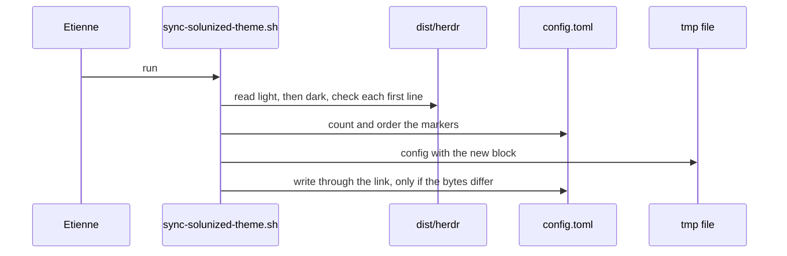

# Plan: sync herdr theme tables from Solunized

From `intent.md` (2026-11-06). Status: accepted.

## Design

### Domain terms

New terms. The implement stage adds them to `GLOSSARY.md`, with no avoided word:

- **Solunized block**: the lines of `herdr/.config/herdr/config.toml` between `# BEGIN solunized` and `# END solunized`, markers excluded.
- **Dist tables**: `solunized-light.toml` and `solunized-dark.toml` in `<solunized checkout>/dist/herdr/`.
- **Drift**: the Solunized block is not byte-equal to the light dist table, one empty line, then the dark dist table.

### Diagrams

Class diagram: not affected, the change adds no Ruby class.

### Signatures

`herdr/.config/herdr/scripts/sync-solunized-theme.sh` copies the light and dark dist tables into the Solunized block of `config.toml`.

- CLI: `sync-solunized-theme.sh`, no arguments. Any argument prints the usage line on stderr and exits 1.
- Env `SOLUNIZED_DIR`: the Solunized checkout. Default `$HOME/Developer/solunized`.
- Env `HERDR_CONFIG_PATH`: the config to write. herdr reads the same variable. Default `<script dir>/../config.toml`, so a run from a worktree edits that worktree's config, and a run through `~/.config/herdr/scripts/` edits the stowed config.
- Exit 0 when the block is written or already equal. Exit 1 with `sync-solunized-theme.sh: <reason>` on stderr for: a missing dist table; a dist table whose first line is not `[theme.custom.light]` or `[theme.custom.dark]`; a missing marker; a second marker of either kind; END before BEGIN.
- The header says what the script does, and that it is obsolete once herdr supports `include` or theme files.
- The script reads only the light and dark files, so black and white are skipped by design.
- Body, in the style of `quieter-tones.sh`: `fail`, `cleanup`, `check_table`, `check_markers` (a readable-file check, then two `grep -cx` counts written as `count=$(grep -cx -- "$marker" "$config" || true)` so `set -e` cannot exit before the diagnostic, then the line order), `splice` (one POSIX `awk` pass that prints lines outside the block verbatim and the light table, an empty line and the dark table inside it, to a `mktemp` file beside the config), then `cmp -s "$tmp" "$config" || cat "$tmp" > "$config"`.

Not checked: the script is bash, and the repository has no Steepfile. The test helper gets an inline `#:` signature.

### Complexity

One `awk` pass over the config and the two dist tables, two `grep` counts: O(lines). At most one write per run; a second run writes nothing. The drift tests read three files and start no process.

### Invariants

- Exactly one BEGIN and one END marker exist, BEGIN first. `check_markers` enforces it.
- Every byte outside the block stays the same. `awk` prints those lines verbatim. The colour comments, `[ui.sidebar.agents]` and `pane_gaps = true` are outside the block.
- The block equals light table + empty line + dark table. The drift test enforces it on the real config when `dist/herdr` exists, by its own comparison, without the script.
- A failed run leaves the config unchanged. Every check runs before the write.
- A symlinked config stays a link. `cat >` writes through the link and never replaces it.
- A second run leaves the bytes identical. The `cmp -s` guard enforces it.

### Alternatives

- Bash script, plus a drift test that reads the block between the markers and compares it with the dist tables itself (chosen): the script fits `herdr/.config/herdr/scripts/*.sh` and the `quieter-tones.sh` test pattern. The drift test is an independent check: a script that exits 0 without a write cannot make it pass. The cost is the block layout in two places, three lines each.
- Ruby script with `SolunizedBlock` and `HerdrConfig` objects and a `--check` mode, drift test runs `--check`: rejected. It adds a second mode and two classes for a 40-line text splice, breaks the bash convention of the scripts folder, and its drift test trusts the script.
- Drift test that runs the bash script on a copy and compares the copy with the original: rejected after the critique. A script that exits 0 without a write makes that test pass.

## Design decisions

- The default config path is relative to the script, not `$HOME/.config/herdr/config.toml`. A run from a worktree then never edits the main checkout through the stow link.
- The script refuses a dist table without its mode header. An older Solunized checkout writes `[theme.custom]`, and a sync from it would give herdr two plain tables.
- The markers go in by hand, once. The script never adds markers, so it cannot guess a position.
- The write is `cat >` through the path, not an atomic rename, because a rename would replace the stow link. A crash mid-write can truncate the config; git restores it.
- The README gets a paragraph for the new script, like every other script in the folder. `intent.md` does not list the README; the change only documents the script.
- No conflict with `intent.md`'s `## Decisions`: the drift test skips without `dist/herdr`, and delivery stays autonomous with Claude review only.

## Integration points

- Solunized `dist/herdr/solunized-{light,dark}.toml`, generated by Solunized PR #22.
- herdr 0.9.5 `herdr config check`, through `HERDR_CONFIG_PATH`.
- The stow link `~/.config/herdr/config.toml`. Never run `stow`.

## Files that change

- `herdr/.config/herdr/config.toml` — add `# BEGIN solunized` after the comment block that ends with "run through generate_themes.rb.", directly above `[theme.custom.light]`, and `# END solunized` directly after the dark table's `surface_dim` line. No other line changes.
- `herdr/.config/herdr/scripts/sync-solunized-theme.sh` — new, executable.
- `test/herdr_sync_solunized_theme_test.rb` — new script tests.
- `test/herdr_config_test.rb` — new drift tests `test_the_solunized_block_matches_dist_herdr` and `test_the_drift_check_catches_an_edited_colour`, with constant `SOLUNIZED_DIR = ENV.fetch("SOLUNIZED_DIR", File.expand_path("~/Developer/solunized"))`.
- `herdr/.config/herdr/README.md` — one paragraph: what the script does, how to run it, which tests cover it.
- `GLOSSARY.md` — the three terms above, in alphabetical order.

## Order of work

1. Write `test_the_solunized_block_matches_dist_herdr` and `test_the_drift_check_catches_an_edited_colour`, run them, watch them fail because `config.toml` has no markers yet.
2. Add the two markers to `config.toml`. Run the two drift tests. They must pass with no other edit, which proves the hand-copied tables equal the dist tables. If either fails, a value differs: stop, run no script, and report the differing lines to Etienne as a `Decision needed:` line.
3. Write `test/herdr_sync_solunized_theme_test.rb`, run it, watch every test fail.
4. Write the script. Make the script tests pass, one at a time.
5. Run the script with no env. Check that `git diff main -- herdr/.config/herdr/config.toml` shows only the two marker lines.
6. Record `shasum -a 256 herdr/.config/herdr/config.toml`, run the script again, and check that the sum is the same.
7. Record one red run: change `#a44910` to `#a44911` in the config, run the drift test, see it fail, revert. Then run the drift tests with `SOLUNIZED_DIR` set to an empty scratch directory, and record the skip message.
8. Run `HERDR_CONFIG_PATH=herdr/.config/herdr/config.toml herdr config check`. Run the palette check: every `#rrggbb` value in `config.toml` must occur in `~/Developer/solunized/themes.yml` (`grep -o '#[0-9a-fA-F]\{6\}' herdr/.config/herdr/config.toml | sort -u`, then `grep -ci` each value without its `#` in `themes.yml`; every count must be at least 1). On 2026-11-06 all nine values pass.
9. Add the README paragraph and the glossary terms.
10. Run `bin/test test/herdr_config_test.rb test/herdr_sync_solunized_theme_test.rb`, then `bin/test`. Run `shellcheck -x -S warning` on the script, `rubocop` on both test files, and the no-hardwrap markdown check on the README and glossary.

## Risks

- macOS `/bin/bash` is 3.2 and CI awk is not BSD awk. The script uses no bash 4 feature and only POSIX awk. The script tests run with `PATH=/usr/bin:/bin`, so they exercise the system bash.
- The block layout lives in the script and in the drift test. A layout change needs both edits; the drift test fails until both agree.
- CI has no Solunized checkout, so the drift test always skips there. The script tests use fixture dist tables and run in CI.
- Out of scope: black and white variants, every other config section, a CI step that checks out Solunized, a look at dark mode on screen.

## Proof

- Running the sync on today's config changes no colour value → check: step 2 (drift tests green before any script run) and step 5 (`git diff main` shows only the two marker lines).
- Running the sync twice leaves the config byte-identical → `test/herdr_sync_solunized_theme_test.rb` `test_a_second_run_leaves_the_config_byte_identical`; check: step 6.
- The test passes when the block equals the dist tables → `test/herdr_config_test.rb` `test_the_solunized_block_matches_dist_herdr`.
- The test fails when one colour value is edited → `test/herdr_config_test.rb` `test_the_drift_check_catches_an_edited_colour`; check: step 7's recorded red run.
- The test skips with a message without `dist/herdr` → check: step 7, the skip message names the missing path.
- `herdr config check` accepts the config → `test/herdr_config_test.rb` `test_herdr_accepts_the_config`; check: step 8.
- The comments, `[ui.sidebar.agents]` rows and `pane_gaps = true` are unchanged → `test/herdr_sync_solunized_theme_test.rb` `test_lines_outside_the_markers_are_kept`; check: step 4's diff.
- Invariant: exactly one BEGIN before one END, enforced by `check_markers` → `test_a_missing_marker_is_refused`, `test_a_doubled_marker_is_refused`, `test_reversed_markers_are_refused`; each asserts the `sync-solunized-theme.sh: <reason>` text on stderr.
- Invariant: a failed run leaves the config unchanged, enforced by checks before the write → `test_a_missing_dist_table_leaves_the_config_unchanged`.
- Invariant: a symlinked config stays a link, enforced by `cat >` → `test_a_symlinked_config_stays_a_link`.

Per changed file, the unit tests expected, named as behaviour:

- `herdr/.config/herdr/scripts/sync-solunized-theme.sh`: `test_the_sync_writes_the_dist_tables_between_the_markers`, `test_a_second_run_leaves_the_config_byte_identical`, `test_an_edited_colour_is_put_back`, `test_lines_outside_the_markers_are_kept`, `test_a_symlinked_config_stays_a_link`, `test_a_missing_dist_table_leaves_the_config_unchanged`, `test_a_table_without_its_mode_header_is_refused`, `test_a_missing_marker_is_refused`, `test_a_doubled_marker_is_refused`, `test_reversed_markers_are_refused`, `test_the_default_checkout_is_under_home`, `test_an_argument_prints_the_usage`.
- `test/herdr_config_test.rb`: a private helper `assert_block_matches_dist(text)` reads the lines between `# BEGIN solunized` and `# END solunized` in `text` and asserts they equal `solunized-light.toml` + `"\n"` + `solunized-dark.toml`; it flunks when a marker is missing. `test_the_solunized_block_matches_dist_herdr` calls it on `File.read(CONFIG_PATH)`; its failure message says to run the script. `test_the_drift_check_catches_an_edited_colour` replaces the first `#rrggbb` inside the block with `#000000`, asserts the text changed, and asserts `assert_raises(Minitest::Assertion) { assert_block_matches_dist(edited) }`. Both skip with `no Solunized checkout at <dir>/dist/herdr` when that directory is missing.

Test setup: scratch `HOME` with fixture dist tables at `Developer/solunized/dist/herdr/`, written by the test with known colours; a small fixture config with a comment line, the markers, a stale block and a trailing `[ui]` section; `PATH=/usr/bin:/bin`, no stubs. `test_lines_outside_the_markers_are_kept` uses a copy of the real `config.toml`.

---
Domain skills applied: software-design, glossary, diagrams.

## Critique

### Round 1 (codex exec -p terra)

- The drift test ran the script on a copy and compared the copy with the original, so a script that exits 0 without a write passes it → fixed (the drift test now reads the block between the markers and compares it with the dist tables itself; `test_the_drift_check_catches_an_edited_colour` proves it fails on one edited colour; Alternatives updated)
- The plan saw a differing hand-copied value only after the sync had overwritten it, against the intent's "stop and tell Etienne" constraint → fixed (step 2 adds the markers and runs the drift tests before any script exists; a red result stops the work with a `Decision needed:` line)
- Under `set -e` a `grep -cx` count of zero exits the script before `check_markers` prints its diagnostic → fixed (counts use `|| true` after a readable-file check; the three marker tests assert the stderr text)
- `git status` cannot prove a second run changed nothing, because the branch already has other changes → fixed (step 6 compares `shasum -a 256` before and after the second run)
