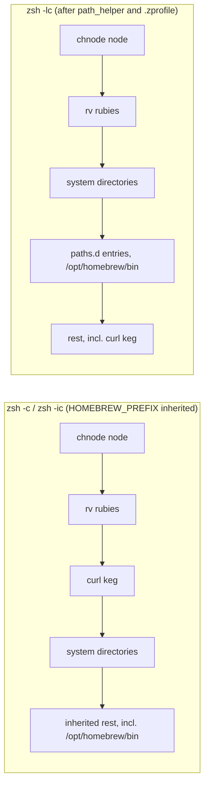
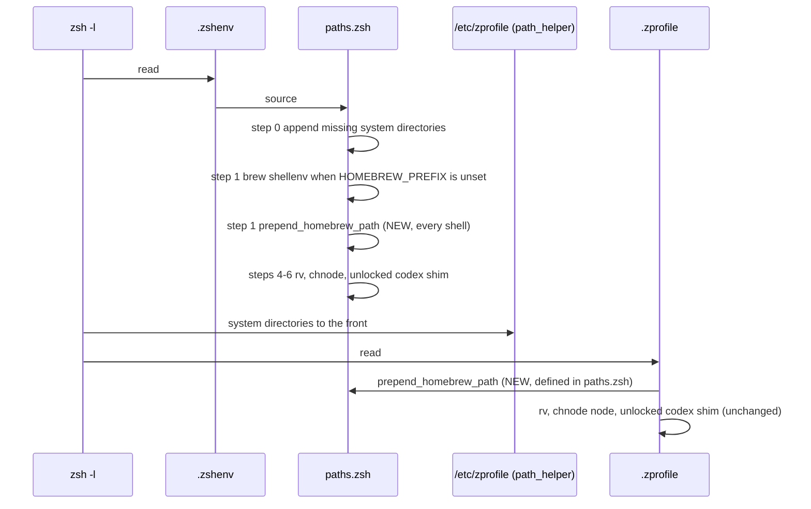

# Plan: Homebrew tools first on PATH

From `intent.md` (2026-11-03). Status: accepted.

## Design

### Domain terms

- **System directories**: `/usr/local/bin /usr/bin /bin /usr/sbin /sbin`, the `/etc/paths` entries that macOS `path_helper` puts first.
- **Homebrew directories**: `$HOMEBREW_PREFIX/opt/curl/bin`, `$HOMEBREW_PREFIX/bin` and `$HOMEBREW_PREFIX/sbin`, in that order.
- **Curl keg**: `$HOMEBREW_PREFIX/opt/curl/bin`, where brew's keg-only curl lives. On this Mac it is `/opt/homebrew/opt/curl/bin`.
- **path_helper**: `/usr/libexec/path_helper -s`, run by macOS `/etc/zprofile` in every zsh login shell. It builds PATH from `/etc/paths`, then `/etc/paths.d/*` (this Mac has `/etc/paths.d/homebrew` with `/opt/homebrew/bin`), then the old PATH.
- **Unlocked codex shim**: `$UNLOCKED_BIN/codex`, the term the intent and the code use. The glossary lists "shim" as a word to avoid for **Binstub**; this is a different concept. See the `Decision needed` line in the report; the plan keeps the existing term and adds no glossary entry.
- **PATH stub** (glossary): the fake `git`, `python3`, `openssl` and `curl` executables the tests write into the fake Homebrew prefix.

### Diagrams

Before, front of PATH first. The order is the one `zsh -c`, `zsh -lc` and `zsh -ic` print on this Mac today:



Startup after the change, login shell:



After, front of PATH first, in all three shell types: unlocked codex shim > chnode node > rv rubies > curl keg > Homebrew bin > Homebrew sbin > other entries > system directories already present > system directories that were missing.

### Signatures

These are zsh files; there is no Ruby production code and no RBS.

`zsh/.config/zsh/paths.zsh` — builds PATH for every shell type.

- Step 0 changes from a prepend to an append of the missing system directories:

  ```zsh
  # 0. Ensure standard system paths are always present, behind everything else.
  # Non-login shells (Conductor, editors, CI) may start with a stripped PATH.
  # A directory that is already on PATH keeps its place.
  for system_dir in /usr/local/bin /usr/bin /bin /usr/sbin /sbin; do
    [[ ":$PATH:" == *":$system_dir:"* ]] || path+=("$system_dir")
  done
  unset system_dir
  ```

  The explicit membership check makes "append only when missing" hold even where a caller did not set `typeset -U path` (`test/secrets_loader_test.rb`, `test/rv_ci_fallback_test.rb`). The `":$PATH:"` form passes `shellcheck -S warning -s bash`, which lefthook runs on `*.zsh`; a zsh `(Ie)` subscript would not. Prototyped: with `PATH=/x:/usr/bin` and `HOMEBREW_PREFIX=/opt/homebrew`, the result is curl keg, bin, sbin, `/x`, `/usr/bin`, then the four missing system directories.

- Step 1 keeps its `brew shellenv` guard, runs `brew` with a system-only PATH, and adds one new function that every shell calls:

  ```zsh
  # 1. Homebrew — must come first so later tools can rely on HOMEBREW_PREFIX.
  # brew shellenv prints nothing when PATH already starts with its bin and sbin,
  # so give the brew command a PATH without them. The printed PATH line expands
  # this shell's own PATH.
  if [[ -z "${HOMEBREW_PREFIX:-}" ]]; then
    if [[ -x /opt/homebrew/bin/brew ]]; then
      eval "$(PATH=/usr/bin:/bin /opt/homebrew/bin/brew shellenv)"
    elif [[ -x /usr/local/bin/brew ]]; then
      eval "$(PATH=/usr/bin:/bin /usr/local/bin/brew shellenv)"
    fi
  fi

  # Puts brew's keg-only curl, then Homebrew's bin and sbin, ahead of the
  # system directories. Also runs when a parent shell set HOMEBREW_PREFIX, and
  # again from .zprofile after macOS path_helper. rv, chnode and the unlocked
  # codex shim come after it, so they stay ahead of Homebrew.
  function prepend_homebrew_path() {
    [[ -n "${HOMEBREW_PREFIX:-}" ]] || return 0
    path=("$HOMEBREW_PREFIX/opt/curl/bin" "$HOMEBREW_PREFIX/bin" "$HOMEBREW_PREFIX/sbin" "${path[@]}") # .zshenv sets typeset -U path
  }

  prepend_homebrew_path
  ```

- Step 2 loses its curl line (the function now holds it) and keeps the Rancher Desktop and `~/.local/bin` append unchanged.
- Steps 3 to 6 and the file header do not change.

`zsh/.config/zsh/.zprofile` — restores the tool order after `path_helper`. One new block goes at the top, before the rv block:

```zsh
# macOS path_helper moved the system directories ahead of Homebrew. Put
# Homebrew back first; rv, the chnode node and the codex shim below then go
# ahead of it. paths.zsh defines the function, so a .zprofile sourced on its
# own leaves PATH alone.
if (( $+functions[prepend_homebrew_path] )); then
  prepend_homebrew_path
fi
```

`.zprofile` does not match lefthook's `*.zsh` shellcheck glob, so the zsh-only `$+functions` test is fine there. Do not move this guard into `paths.zsh`: shellcheck reports SC2154 on it.

Not checked: zsh files have no type signatures; the repository has no Steep setup.

### Complexity

- No new subprocess. `brew shellenv` runs exactly as often as today: only when `HOMEBREW_PREFIX` is unset.
- `prepend_homebrew_path` rebuilds the `path` array once per call: O(p) for p PATH entries (about 20). A login shell calls it twice, other shells once.
- Step 0 does five array lookups: O(5·p).
- No database, no queries.

### Invariants

- `$HOMEBREW_PREFIX/bin` and `$HOMEBREW_PREFIX/sbin` come before `/usr/bin` in non-login, login and interactive shells, also when `HOMEBREW_PREFIX` is inherited. Enforced by `prepend_homebrew_path`, called in `paths.zsh` step 1 and at the top of `.zprofile`.
- The curl keg comes before `/usr/bin`. Enforced by the same function.
- A system directory is appended only when it is missing; one already on PATH keeps its place. Enforced by the membership check in step 0.
- rv rubies, the chnode node and the unlocked codex shim stay ahead of the Homebrew directories; the shim stays last in the build order. Enforced by call position: the function runs before steps 4–6 in `paths.zsh` and before the rv block in `.zprofile`.
- `.zprofile` sourced without `paths.zsh` does not touch the Homebrew order. Enforced by the `$+functions` guard.

### Alternatives

1. **Inline duplication** (architect goal: least change). The same `HOMEBREW_PREFIX` prepend is written once in `paths.zsh` and once in `.zprofile`, like the rv and chnode repairs today. Rejected: the two copies of the Homebrew order would drift, and the curl keg would stay spelled two ways (hardcoded in `paths.zsh`, `$HOMEBREW_PREFIX` in `.zprofile`). The chosen design keeps this design's shape and tests but holds the order in one function.
2. **New file `homebrew-path.zsh` with an insert-before-first-system-directory function** (architect goal: one source of truth). Rejected: `~/.config/zsh` is a folded stow directory with per-file links, so a new file needs a restow before it is live; `.zprofile` must find the file through `${(%):-%x}:A`, which is fragile for a startup file; and the insertion logic is more code than a prepend for no behaviour the intent asks for.
3. **Skip `/etc/zprofile` in macOS login shells** (`unsetopt global_rcs` in `paths.zsh`, `setopt global_rcs` in `.zprofile`; architect goal: remove the reorder at its root). Rejected: login shells lose the `/etc/paths.d` entries that only `path_helper` adds (`/System/Cryptexes/App/usr/bin`, cryptex bootstrap dirs, `rvictl`), silently skip any future Apple `/etc/zprofile` content, add an option-state coupling across two files, and CI on Ubuntu cannot prove the skip.

## Design decisions

- The curl keg is spelled `$HOMEBREW_PREFIX/opt/curl/bin` instead of the hardcoded `/opt/homebrew/opt/curl/bin`. On this Mac both name the same directory, so the intent's constraint holds; the variable lets the tests use a fake prefix.
- `brew shellenv` runs with `PATH=/usr/bin:/bin` on the `brew` command only. Without it, a shell whose PATH already starts with `/opt/homebrew/bin:/opt/homebrew/sbin` and has no `HOMEBREW_PREFIX` gets an empty shellenv (`/opt/homebrew/Library/Homebrew/cmd/shellenv.sh:10`), and `SSL_CERT_FILE` points nowhere. The old step 0 hid this by putting the system directories first.
- Homebrew goes to the front of PATH, not just ahead of the first system directory. This matches how rv and chnode already prepend, and every later step re-prepends its own tool.
- The login-shell stand-in in `test/node_path_order_test.rb` becomes faithful to `path_helper` (system directories first, then `/etc/paths.d/homebrew`'s entry, then the old PATH). The old stand-in put Homebrew's bin first, which is not what `path_helper` does and hid this bug. This makes existing tests stricter; it does not weaken them.
- Intent `## Decisions` (autonomous delivery, no Codex review): no conflict.

## Integration points

- macOS `/etc/zprofile` and `path_helper`: unchanged, still run in login shells.
- Homebrew's `brew shellenv` output: consumed as before.
- rv (`rv shell init`, `rv shell env`), chnode (`chnode.sh`) and the unlocked codex shim (`functions/secrets.zsh`): unchanged, run after the new code.
- Claude Code's Bash tool, editors, Conductor and agents: inherit the PATH these files build.
- `~/.config/zsh/paths.zsh` and `~/.config/zsh/.zprofile` are stow links into the main checkout. No new file, so no restow; the change is live once the main checkout has it.

## Files that change

- `test/node_path_order_test.rb` — PATH stubs for `git`, `python3`, `openssl` in the fake `bin`, `curl` in the fake `opt/curl/bin`, an `sbin` dir; a faithful `path_helper` stand-in; new Homebrew order tests.
- `zsh/.config/zsh/paths.zsh` — step 0 appends missing system directories; step 1 runs `brew shellenv` with a system-only PATH and adds and calls `prepend_homebrew_path`; step 2 drops the hardcoded curl line.
- `zsh/.config/zsh/.zprofile` — calls `prepend_homebrew_path` first, guarded.
- `test/secrets_loader_test.rb` — comment at line 154 only; it says `paths.zsh` puts `/usr/local/bin` and `/usr/bin` first, which becomes false.

## Order of work

1. In `test/node_path_order_test.rb`, add the PATH stubs and the `sbin` dir to `write_homebrew`. Write `test_a_non_login_shell_with_an_inherited_homebrew_prefix_resolves_homebrews_git_first`. Run it with `bin/test test/node_path_order_test.rb` and watch it fail (it resolves `/usr/bin/git`).
2. Make `path_helper_and_zprofile` faithful: `path=(/usr/local/bin /usr/bin /bin /usr/sbin /sbin "$HOMEBREW_PREFIX/bin" "${path[@]}")`, then source `.zprofile`. Update the comment above `run_zsh`. Add the remaining Proof tests. Run the file and confirm each new test fails for the stated reason, and note which existing login tests now fail (expected: `test_zprofile_leaves_path_alone_without_chnode_root` where `/usr/local/bin/node` exists).
3. Commit the failing tests: `test: Homebrew order on PATH in every shell type`.
4. Change `paths.zsh` step 0 and step 1 and drop the step 2 curl line. Run the test file: non-login tests pass.
5. Add the guarded call to `.zprofile`. Run the test file: all pass.
6. Fix the comment in `test/secrets_loader_test.rb:154`.
7. Commit: `fix: put Homebrew ahead of system directories on PATH` (production files plus the comment).
8. Run the full suite with `bin/test`. Run `shellcheck -S warning -s bash zsh/.config/zsh/paths.zsh` and `rubocop` on the touched test files.
9. Run manual checks 1–5 from `## Proof` on this Mac and record their output. Check 6 runs after merge.

## Risks

- **Inherited entries move behind Homebrew.** A directory a parent shell put ahead of `/opt/homebrew/bin` (for example a project `bin`) now comes after it in a child shell. rv and chnode already reorder PATH the same way. Accepted.
- **`/usr/local/bin` moves behind `/usr/bin` in a stripped shell.** Before, step 0 put it first. On Apple Silicon it holds few tools. Accepted.
- **`brew shellenv` with a system-only PATH.** `brew` is a bash script with an absolute shebang; it calls `/bin/ps` by absolute path. If a future brew needs a tool outside `/usr/bin:/bin` to print shellenv, the eval gets an error. Manual check 4 covers today's brew.
- **Interactive shells read `.zshrc`.** `environment.zsh` and the work overlay add dirs (Android SDK, nix, trusted `.git/safe` bins) ahead of PATH; they do not touch Homebrew's position. The tests run `zsh -f`, so the manual `zsh -ic` check is the proof.
- **Claude Code's Bash tool** inherits the PATH of the shell that started Claude; it only changes after a new Claude session starts from a shell that has the fix.
- Rejected designs: see `### Alternatives`.

## Proof

- A non-login shell resolves `git` to Homebrew → `test/node_path_order_test.rb` `test_a_non_login_shell_with_an_inherited_homebrew_prefix_resolves_homebrews_git_first`; on this Mac, checks 1 and 6.
- A login shell resolves `git`, `python3`, `curl` and `openssl` to Homebrew after `path_helper` → `test/node_path_order_test.rb` `test_a_login_shell_resolves_homebrews_tools_after_path_helper`; on this Mac, checks 2, 4 and 6.
- An interactive shell resolves the same four tools to Homebrew → `test/node_path_order_test.rb` `test_interactive_login_and_non_login_shells_resolve_homebrews_tools`; on this Mac, checks 3, 4 and 6.
- `python3 --version` shows 3.15.x in all three shells → check: checks 1–4 and 6 print `python3 --version`.
- `ruby` still resolves to rv's Ruby in all three shells → existing `test_rvs_ruby_stays_ahead_of_homebrews_ruby_in_a_login_shell`, new `test_rv_chnode_and_the_codex_shim_stay_ahead_of_homebrew_in_a_login_shell`; checks 1–4 and 6 print `command -v ruby`.
- A stripped PATH still has `/usr/bin` and `/bin`, after Homebrew → `test/node_path_order_test.rb` `test_a_stripped_path_gets_the_system_directories_after_homebrew`.
- An inherited `HOMEBREW_PREFIX` still puts `/opt/homebrew/bin` before `/usr/bin` → `test/node_path_order_test.rb` `test_an_inherited_homebrew_prefix_puts_homebrew_bin_and_sbin_before_usr_bin`.
- Claude Code's Bash tool shows the same order → check: manual check 6.
- Invariant: the curl keg comes before `/usr/bin` and before Homebrew's bin, enforced by `prepend_homebrew_path` → `test/node_path_order_test.rb` `test_the_curl_keg_comes_before_homebrew_bin_and_usr_bin`.
- Invariant: a system directory already on PATH keeps its place, enforced by step 0's membership check → `test/node_path_order_test.rb` `test_a_system_directory_already_on_path_keeps_its_place`.
- Invariant: rv, chnode and the unlocked codex shim stay ahead of Homebrew in a login shell, enforced by call position → `test/node_path_order_test.rb` `test_rv_chnode_and_the_codex_shim_stay_ahead_of_homebrew_in_a_login_shell`, plus the existing chnode, rv and shim login tests under the faithful stand-in.
- Invariant: `.zprofile` alone leaves PATH alone, enforced by the `$+functions` guard → existing `test/secrets_loader_test.rb` `test_zprofile_leaves_path_alone_without_unlock` and `test_zprofile_puts_the_shim_back_ahead_of_a_reordered_path`, unchanged.

Manual checks on this Mac. Before merge, `~/.zshenv` and `~/.config/zsh` link to the main checkout, and `.zshenv` line 1 resets `ZDOTDIR`, so a real startup cannot point at the worktree. A temporary `HOME` is not safe either: `zsh/.zshenv` then runs `launchctl setenv ZDOTDIR` for the whole GUI session. So the pre-merge checks replay the real startup order by hand. They use the real `/etc/zprofile`, the real `/etc/zshrc` and the unchanged `.zshrc`, and take `paths.zsh` and `.zprofile` from the worktree. `WT` is this worktree's absolute path, spelled out in full when run. `CMDS` is `command -v git python3 curl openssl ruby; git --version; python3 --version`.

1. Non-login, as `zsh -c`: `env -i HOME=$HOME TERM=dumb HOMEBREW_PREFIX=/opt/homebrew PATH=/usr/bin:/bin zsh -f -c 'typeset -gU path; source WT/zsh/.config/zsh/paths.zsh; CMDS'`
2. Login, as `zsh -lc`: as 1, with `source /etc/zprofile; source WT/zsh/.config/zsh/.zprofile` before `CMDS`. `/etc/zprofile` runs the real `path_helper`.
3. Interactive, as `zsh -ic`: as 1, with `zsh -f -i -c` and `ZDOTDIR=$HOME/.config/zsh; source /etc/zshrc; source $ZDOTDIR/.zshrc` before `CMDS`.
4. Interactive login, as a new Ghostty tab: steps 2 and 3 combined, in startup order: `paths.zsh`, `/etc/zprofile`, `.zprofile`, `/etc/zshrc`, `.zshrc`.
5. Shellenv guard: `env -i HOME=$HOME TERM=dumb PATH=/opt/homebrew/bin:/opt/homebrew/sbin:/usr/bin:/bin zsh -f -c 'typeset -gU path; source WT/zsh/.config/zsh/paths.zsh; print -r -- $HOMEBREW_PREFIX'` prints `/opt/homebrew`.
6. After merge, once `main` is pulled into `~/Developer/dotfiles`: real `zsh -c CMDS`, `zsh -lc CMDS` and `zsh -ic CMDS` with no `-f`, then `CMDS` in the Bash tool of a new Claude session. This is the end-to-end proof of the acceptance criteria; the coordinator cannot run it before Etienne merges, so the report says so.

Expected: `git`, `python3`, `openssl` under `/opt/homebrew/bin`, `curl` under `/opt/homebrew/opt/curl/bin`, no "Apple Git", Python 3.15.x, `ruby` under `~/.local/share/rv/rubies`.

Per changed file, the unit tests expected:

- `zsh/.config/zsh/paths.zsh`: `prepend_homebrew_path puts the curl keg, bin and sbin first`, `prepend_homebrew_path does nothing without HOMEBREW_PREFIX` (`test_without_a_homebrew_prefix_no_homebrew_directory_is_added`), step 0 `appends only missing system directories` (the stripped-PATH and keeps-its-place tests).
- `zsh/.config/zsh/.zprofile`: `puts Homebrew back ahead of path_helper's order` (the login test), `leaves PATH alone without paths.zsh` (the existing secrets_loader tests).

Test setup: the existing `node_path_order_test.rb` fixtures — a fake Homebrew prefix in a tmpdir with PATH stubs, the rv and chnode stubs, `zsh -f` with `unsetenv_others`. Add PATH stubs `git`, `python3`, `openssl` in `@brew/bin`, `curl` in `@brew/opt/curl/bin`, and an empty `@brew/sbin`. Inherited cases set `PATH` to `/usr/bin:/bin:#{@brew}/bin`. CI (Ubuntu) has real `/usr/bin/git` and `/usr/bin/curl`, so the tests fail there before the fix.

Out of scope: the Apple certificate issue, `SSL_CERT_FILE` (`paths.zsh:26`), installing or removing any tool, running `stow`, the PATH entries `environment.zsh` and the work overlay add, bash login shells.

---
Domain skills applied: software-design, glossary, diagrams, dotfiles-maintenance (stow layout), ruby-style (test helpers).

## Critique

### Round 1 (codex exec -p terra)

- The manual checks run `zsh -f` and source files by hand, so they never run the real `zsh -c`, `zsh -lc` or `zsh -ic` startup, and the interactive criterion is not proven through `.zshrc` → fixed (manual checks now replay the real startup order with the real `/etc/zprofile`, `/etc/zshrc` and `.zshrc`, add an interactive login check, and add check 6: real startup with no `-f` and the Claude Bash tool after merge)
  - The proposed `ZDOTDIR="$WT/zsh/.config/zsh"` real startup does not reach the worktree: `zsh/.config/zsh/.zshenv` line 1 resets `ZDOTDIR` to `$HOME/.config/zsh`. A temporary `HOME` would make `zsh/.zshenv` run `launchctl setenv ZDOTDIR` for the GUI session. The plan records both reasons.
