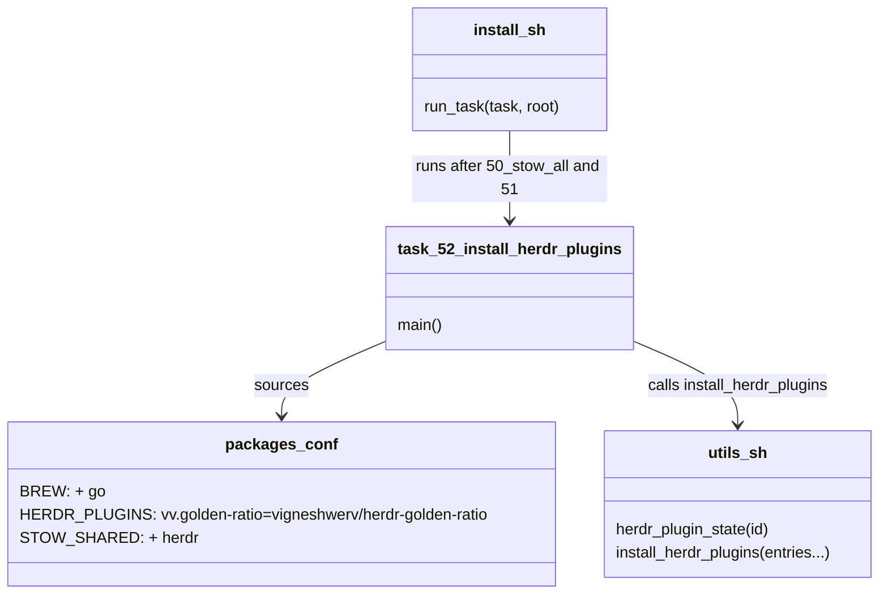
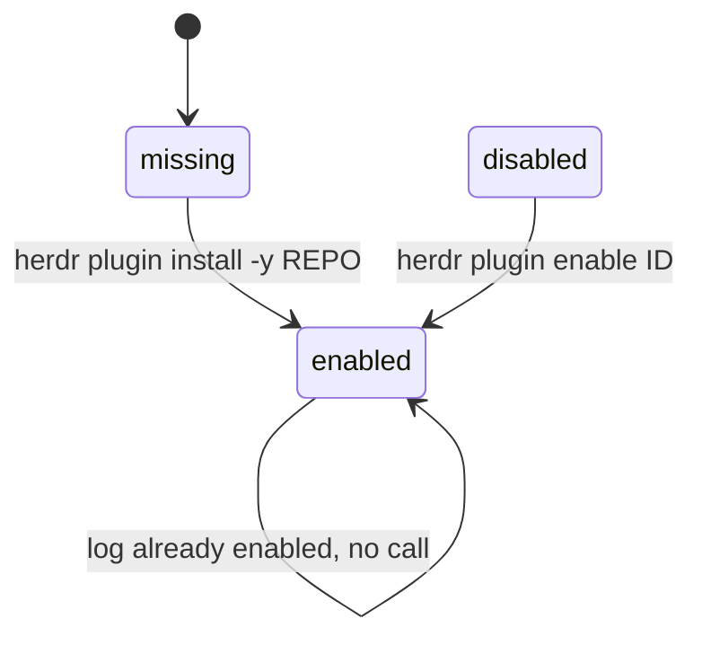
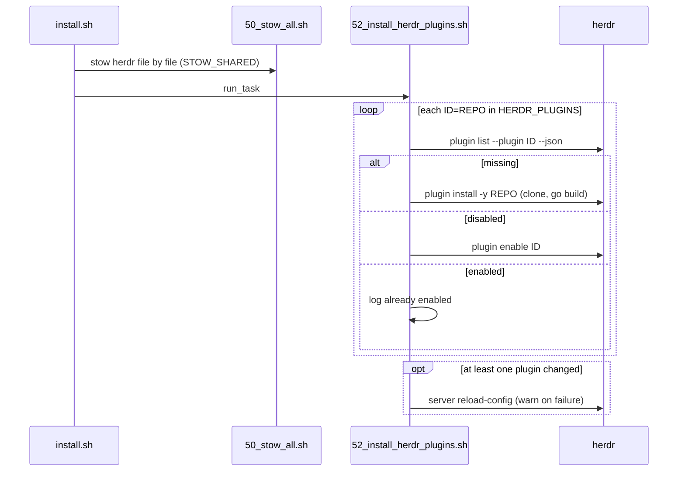

# Plan: Install the herdr golden-ratio plugin and Go

From `intent.md` (2026-11-05). Status: accepted.

## Design

### Domain terms

No `GLOSSARY.md` term applies, and no avoided word appears in the intent. Words used in this plan:

- **Plugin**: a herdr extension that `herdr plugin install OWNER/REPO` clones and builds. This plugin's id is `vv.golden-ratio`. Its source is `vigneshwerv/herdr-golden-ratio`.
- **Plugin config**: `herdr/.config/herdr/plugins/config/vv.golden-ratio/config.toml`, with `auto = true`. It exists since PR #254 and does not change.
- **Herdr plugin list**: the new `HERDR_PLUGINS` array in `packages.conf`. Each item is `<plugin id>=<owner/repo>`, for example `vv.golden-ratio=vigneshwerv/herdr-golden-ratio`. The id is what `herdr plugin enable` and `herdr plugin list --plugin` take; the repository is what `herdr plugin install` takes.
- **Plugin state**: `enabled`, `disabled` or `missing`, read from `herdr plugin list --plugin <id> --json`. An unknown id returns `"plugins":[]`, which is `missing`.
- **Install task**: a numbered script in `install/tasks/`. `install.sh` runs it through `run_task`, and it also runs on its own.
- **Shared stow package**: a package in `STOW_SHARED`, linked file by file (`--no-folding`), so its target directories stay real directories.

No new glossary term: these words describe the installer only.

### Diagrams

Before: `packages.conf` has no `go` and no plugin list. No install task touches herdr. The herdr README says "The plugin is not installed by this repository."

After:

### Signatures

Bash functions, not Ruby. The shapes follow `gh_extension_is_installed` and `install_gh_extensions` in `install/utils.sh`.

`install/utils.sh`, new section `# herdr plugins` after `# GitHub CLI extensions`:

- `herdr_plugin_state <plugin id>` — prints `enabled`, `disabled` or `missing`. It reads `herdr plugin list --plugin "$id" --json` with `jq -r '.result.plugins[0].enabled // "missing"'` and maps `true` and `false` to `enabled` and `disabled`.
- `install_herdr_plugins <id=owner/repo>...` — `require_cmd herdr go jq`; skips empty items; dies on an item without `=`; per item: `missing` → log and `herdr plugin install -y "$repo"`; `disabled` → log and `herdr plugin enable "$id"`; `enabled` → log "already enabled". When it changed at least one plugin, it runs `herdr server reload-config`, and on failure only warns that the plugins load at the next server start.

`install/tasks/52_install_herdr_plugins.sh` — installs and enables the herdr plugins that `packages.conf` lists. `main` runs `task_bootstrap`, then `install_herdr_plugins "${HERDR_PLUGINS[@]}"`. Header comment and shape copy `install/tasks/25_install_gh_extensions.sh`.

Not checked: the change adds no Ruby code outside tests, so `steep check` has nothing to check. `shellcheck -x -S warning` checks the shell code.

### Complexity

- One `herdr plugin list --plugin` call per listed plugin; N = 1 today.
- One `herdr plugin install` per missing plugin: a network clone and one `go build`. One `herdr plugin enable` per disabled plugin. An enabled plugin costs nothing more.
- At most one `herdr server reload-config` per run.

### Invariants

- **Every plugin in `HERDR_PLUGINS` is installed and enabled after task 52 succeeds.** `set -euo pipefail` makes a failed `install` or `enable` fail the task. Proof: the "missing", "disabled" and "failed install" tests.
- **Task 52 never reinstalls an enabled plugin.** Enforced by `herdr_plugin_state`. Proof: the "already enabled" test.
- **A herdr server that is not running never fails setup.** `herdr plugin list` reads from disk: with `HERDR_SOCKET_PATH=/nonexistent/herdr.sock` it still listed all four plugins on this machine, while `herdr status server` said "not running". `reload-config` only warns. `herdr plugin install` and `enable` without a server are proved on this machine in step 9. Proof: the "reload fails" test and step 9.
- **Go, herdr and jq exist before task 52 runs.** All three are in `BREW`; task 20 runs before task 52; `require_cmd herdr go jq` stops the task with a clear error. Proof: the "missing go" test and the `install.sh` order test.
- **Plugin clones never land inside the dotfiles repository.** herdr clones into `~/.config/herdr/plugins/github/` (the `managed_path` in `herdr plugin list --json`). If stow folded `~/.config/herdr` into one symlink, the clone would go into the git tree. `herdr` in `STOW_SHARED` gives `--no-folding`, so the directories stay real. Proof: the `STOW_SHARED` test.

### Alternatives

- **A. README only: `go` in `BREW`, and the README documents `herdr plugin install` as a manual setup step.** Rejected. The intent says the README must state that the dotfiles setup steps install the plugin, "not by hand". With no installer code that sentence is false. Critique round 1 raised the same point.
- **B. Install task before stow (`26_…`), with `herdr` in `STOW_SHARED`.** Rejected. On a fresh machine herdr would create `~/.config/herdr/plugins/config/` before stow links the plugin config into it. Whether herdr writes a default `config.toml` there is unknown, and a written file would make stow abort with a conflict. Running after stow means the stowed `auto = true` config is in place before the plugin first runs.
- **C. Install task after stow (`52_…`), with `herdr` in `STOW_SHARED` (chosen).** Stow links the config first; `--no-folding` keeps the plugin clones out of the repository; the task is idempotent, enables a disabled plugin, and runs on its own.

## Design decisions

- The task runs after `51_configure_glow_style.sh`, as `52_install_herdr_plugins.sh`, for the stow reason in Alternative B.
- `HERDR_PLUGINS` items carry both the id and the repository, because `install` takes the repository while `enable` and `list --plugin` take the id.
- The state comes from `--json` through `jq`, not from matching the text output. `jq` is already in `BREW` for the herdr scripts.
- `herdr` joins `STOW_SHARED`. The existing comment there already covers it: "A package is shared too when something other than stow writes into its directory". Cost: a new file in the `herdr` package needs a re-stow before it shows in `$HOME`.
- `go` goes in `BREW` (all systems), in the `# Editors / dev` group after `gh`, with a comment that names its purpose. Not `BREW_MACOS`: herdr runs on Linux too.
- `herdr-file-viewer` stays a manual install with its README text unchanged. Moving it into `HERDR_PLUGINS` is outside the intent.
- `reload-config` failure only warns, as the Invariants say. A failed install or enable still fails the task (playbook §3: raise errors freely).
- No conflict with the intent's `## Decisions`: plain brew `go`, no version manager, and the plugin is installed now on this machine.
- The intent's In scope list names `packages.conf`, two commands and the README text. The installer task, its `utils.sh` functions, the `install.sh` line, `herdr` in `STOW_SHARED` and the test file are needed to make the README text true, so this plan adds them. Recorded as a decision for Etienne to confirm.

## Integration points

- Homebrew on this machine: `brew install go` (approved in the intent).
- herdr 0.9.5 on this machine: `herdr plugin install -y`, `herdr plugin enable`, `herdr plugin list --plugin --json`, `herdr server reload-config`, `herdr pane split`, `herdr pane focus`, `herdr pane layout`.
- GitHub: herdr clones `vigneshwerv/herdr-golden-ratio` during the install.
- `install.sh` `run_task` sequence and `install/tasks/00_common.sh` `task_bootstrap`.
- `stow_configure` in `install/utils.sh`, which reads `STOW_SHARED`.

## Files that change

- `packages.conf` — add `go` to `BREW` after `gh` with `# Builds herdr plugins such as vv.golden-ratio (needs Go 1.24+); Go manages its own toolchains`. Add a `HERDR_PLUGINS=( vv.golden-ratio=vigneshwerv/herdr-golden-ratio )` section after `GH_EXTENSIONS`, with a comment on the `<id>=<owner/repo>` format, and a `HERDR_PLUGINS` line in the header's Sections list. Add `herdr` to `STOW_SHARED`.
- `install/utils.sh` — add `herdr_plugin_state` and `install_herdr_plugins` in a new `# herdr plugins` section after `# GitHub CLI extensions`.
- `install/tasks/52_install_herdr_plugins.sh` — new, executable. Header comment like task 25: purpose, usage, requires herdr, go and jq, idempotency.
- `install.sh` — add `run_task "52_install_herdr_plugins.sh" "$root"` after the line for task 51.
- `test/herdr_plugins_install_test.rb` — new Minitest file. See Proof.
- `herdr/.config/herdr/README.md`, section `## Resizing the focused pane` — replace "The plugin is not installed by this repository. It builds with Go 1.24+, so install Go first, then run:" and its code block with text that says: the dotfiles setup installs and enables the plugin from `HERDR_PLUGINS` in `packages.conf`, through `install/tasks/52_install_herdr_plugins.sh`; it builds with Go 1.24+, which `packages.conf` also installs; to install it by hand, run `herdr plugin install vigneshwerv/herdr-golden-ratio`, then `herdr server reload-config`; `herdr plugin update` updates it. One line per paragraph. Leave the `herdr-file-viewer` section unchanged.

Nothing else changes.

## Order of work

1. Write `test/herdr_plugins_install_test.rb` with the "missing plugin" acceptance test. Run it: it fails because the task script does not exist.
2. Add `HERDR_PLUGINS` and `go` to `packages.conf`, the two functions to `install/utils.sh`, and the task script. Make the test pass.
3. Add the other task tests one at a time (already enabled, disabled, reload fails, failed install, missing go), each red then green.
4. Add the `packages.conf` and `install.sh` tests; add `herdr` to `STOW_SHARED` and the `install.sh` line; make them pass.
5. Edit the herdr README section. Run the README check and `markdownlint herdr/.config/herdr/README.md`.
6. Run `shellcheck -x -S warning install/utils.sh install/tasks/52_install_herdr_plugins.sh install.sh` and `bash -n packages.conf`. Run `rubocop test/herdr_plugins_install_test.rb`.
7. Run `bin/test test/herdr_plugins_install_test.rb`, then `bin/test` once.
8. On this machine: `brew install go`. Run the `go version` check.
9. On this machine, with no reachable server, to prove the fresh-machine path: `HERDR_SOCKET_PATH=/nonexistent/herdr.sock install/tasks/52_install_herdr_plugins.sh`. It runs the approved `herdr plugin install -y vigneshwerv/herdr-golden-ratio` and only warns on the reload. Then `herdr server reload-config` against the real server. Run the `herdr plugin list` check. Run the task once more: it must log "already enabled" and change nothing. If the install fails because no server is reachable, stop and report it; do not start a server from the task.
10. Run the two-pane check in a scratch tab and record the numbers as evidence. Close the scratch tab after.

Commit per logical step: the task, `packages.conf` and their tests; `STOW_SHARED` and `install.sh`; the README.

Do not run `stow` (playbook rule 12). The `STOW_SHARED` change takes effect at Etienne's next restow.

## Risks

- `herdr plugin install` may need a running server. `herdr plugin list` does not. Step 9 proves the install without one. If it fails, the automatic install cannot run on a fresh machine before herdr first starts; report this as a decision for Etienne.
- The plugin build fails, for example from the network or a Go version below 1.24. The `go version` check runs first. On failure, stop and report the error.
- `herdr plugin list --json` output shape may change. The task reads `.result.plugins[0].enabled`, the shape herdr 0.9.5 prints. A change reads as `missing` and makes the task reinstall, which is safe.
- `herdr` in `STOW_SHARED` changes how the next restow links the herdr package: file by file. On this machine `~/.config/herdr` and `~/.config/herdr/plugins` are already real directories, so nothing moves.
- Tasks 25 and 52 expect their commands on `PATH` from the calling shell. A fresh shell gets brew's `PATH` only after stow. This gap exists already and is out of scope.
- The README's file-viewer section says "There is no `herdr plugin update`". herdr 0.9.5 has `herdr plugin update`. This plan fixes only the golden-ratio section; the file-viewer line is a separate fix on another branch.

Out of scope, from the intent: a Go version manager, a keybinding for a manual re-balance, the plugin `config.toml`, the Neovim plugin, and the modified `neovim/.config/nvim/lazy-lock.json` in the main checkout. Also out of scope: moving `herdr-file-viewer` into `HERDR_PLUGINS`.

## Proof

- `go version` prints Go 1.24 or newer → check: `go version`, and the printed version is 1.24 or newer.
- `herdr plugin list` shows `vv.golden-ratio` enabled → check: `herdr plugin list --plugin vv.golden-ratio --json | jq -e '.result.plugins[0].enabled == true'` exits 0.
- With two panes in a tab, focusing one makes it about 61.8% of the tab → check: in a scratch tab, `herdr pane split --current --direction right --ratio 0.5`, then `herdr pane focus --current --direction left` and `--direction right` in turn, each followed by `herdr pane layout --current`. The focused pane's `rect.width / area.width` is between 0.598 and 0.638 (the plugin's `min_delta` is 0.02). Record both readings.
- `packages.conf` lists `go` → `test/herdr_plugins_install_test.rb` `test_packages_conf_installs_go_and_lists_the_golden_ratio_plugin`.
- The README no longer says the plugin is not installed → check: `! sed -n '/^## Resizing the focused pane/,/^## Worker scripts/p' herdr/.config/herdr/README.md | grep -qi 'not installed'`, then the same range holds `herdr plugin install vigneshwerv/herdr-golden-ratio`, `1.24` and `HERDR_PLUGINS` (three `grep -q` checks).
- The setup installs the plugin, not by hand (the intent's README sentence made true) → `test/herdr_plugins_install_test.rb` `test_the_task_installs_a_missing_plugin_and_reloads_the_config`.
- Invariant: a disabled plugin gets enabled, enforced by `install_herdr_plugins` → `test_the_task_enables_a_disabled_plugin`.
- Invariant: an enabled plugin is left alone, enforced by `herdr_plugin_state` → `test_the_task_skips_an_enabled_plugin`.
- Invariant: a failed reload never fails setup, enforced by `install_herdr_plugins` → `test_a_failed_reload_only_warns`.
- Invariant: a failed install fails the task, enforced by `set -euo pipefail` → `test_a_failed_install_fails_the_task`.
- Invariant: Go is required, enforced by `require_cmd herdr go jq` → `test_the_task_stops_without_go`.
- Invariant: the task runs after stow, enforced by `install.sh` → `test_install_sh_runs_the_plugin_task_after_stow`.
- Invariant: plugin clones never land in the repository, enforced by `STOW_SHARED` → `test_the_herdr_package_is_linked_file_by_file`.
- Invariant: no running server never fails setup → check: step 9's run with `HERDR_SOCKET_PATH=/nonexistent/herdr.sock` exits 0 and the plugin is enabled after it.

Per changed file, the unit tests expected (all in `test/herdr_plugins_install_test.rb`):

- `install/tasks/52_install_herdr_plugins.sh` and `install/utils.sh` (`herdr_plugin_state`, `install_herdr_plugins`): the six task tests above, run against the real script.
- `packages.conf`: `test_packages_conf_installs_go_and_lists_the_golden_ratio_plugin`, `test_the_herdr_package_is_linked_file_by_file` (sourced in bash, as `test/glow_package_test.rb` does).
- `install.sh`: `test_install_sh_runs_the_plugin_task_after_stow`.
- `herdr/.config/herdr/README.md`: none; documentation.

Test setup: copy the pattern of `test/glow_style_install_test.rb`. `PATH` is a scratch `bin/` with stub `herdr` and `go` and a symlink to the real `jq`, then `/usr/bin:/bin`. The `herdr` stub appends its arguments to a log file, prints the `plugin list --plugin … --json` output from a fixture string (`[]`, `enabled: true` or `enabled: false`), and takes the exit status of `plugin install` and `server reload-config` from environment variables. The "missing go" test leaves out the `go` stub. Never call the real `herdr`.

---
Domain skills applied: dependencies (Go is a new system dependency, approved in the intent), dotfiles-maintenance (packages.conf, installer tasks, stow), software-design, glossary, diagrams.

## Critique

### Round 1 (codex exec -p terra)

- The plan makes the plugin install manual, against the intent's "installed by the dotfiles setup steps, not by hand" → fixed (switched to Alternative C: `HERDR_PLUGINS`, task `52_install_herdr_plugins.sh` after stow, `herdr` in `STOW_SHARED`, with tests)
- The README check used `grep -ci 'not installed'`, which prints `0` but exits 1 when the text is gone → fixed (the check is now `! … | grep -qi 'not installed'`, plus three `grep -q` checks for the required text)
- The two-pane check did not fix the split direction, and only a side-by-side split gives a width ratio → fixed (the check now uses `herdr pane split --current --direction right --ratio 0.5` and `herdr pane focus --direction left|right`)

### Round 2 (codex exec -p terra)

- The task checks presence, not enabled state, so an installed but disabled plugin is skipped and fails the enabled criterion → fixed (items are now `<id>=<owner/repo>`; `herdr_plugin_state` reads `list --plugin ID --json`; a disabled plugin gets `herdr plugin enable ID`; new test `test_the_task_enables_a_disabled_plugin`)
- The "no server never fails setup" invariant is unproven, and `herdr plugin list` may need the server socket → fixed (verified that `herdr plugin list` works with `HERDR_SOCKET_PATH=/nonexistent/herdr.sock` while `herdr status server` says not running; step 9 now runs the real install with no reachable server and stops on failure)
- The README text said re-running the install updates the plugin, but herdr has `herdr plugin update` → fixed (the README now names `herdr plugin update` for updates)
- "brew offers Go 1.27.3" is a time-sensitive claim the repository does not fix → fixed (the plan no longer names a brew version and relies on the `go version` check)
