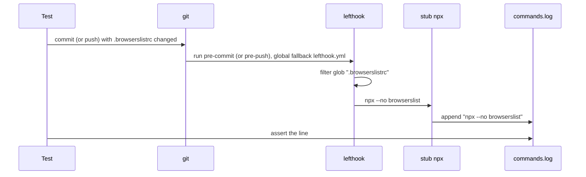

# Plan: Run browserslist through npx --no in the shared lefthook hooks

From `intent.md` (2026-10-21). Status: accepted.

## Design

### Domain terms

- **Node linter job**: a `commands` entry in `lefthook.yml` whose `run` calls `npx`. There are six: stylelint, browserslist and eslint, each in pre-commit and in pre-push.
- **`npx --no`**: runs the copy of a package that the repo installed. When no copy is installed, it fails and does not download one. PR #216 introduced this for stylelint and eslint.
- **Push files**: the files lefthook gives to pre-push jobs, and the files it filters each `glob` against.

No term is new to the domain. The repository has no `GLOSSARY.md`, and this change adds none.

### Diagrams



### Signatures

`lefthook.yml`: two `run` lines change from `npx browserslist` to `npx --no browserslist` (pre-commit job at line 15, pre-push job at line 210). Nothing else changes.

`LefthookLocalHooksTest` (`test/lefthook_local_hooks_test.rb`) checks the global hooks against a throwaway repository. Two new public tests:

```ruby
#: () -> void
def test_pre_commit_browserslist_runs_through_npx_no

#: () -> void
def test_pre_push_browserslist_runs_through_npx_no
```

The `#:` lines record the signature here only. The test file carries no RBS comments, so the new tests stay bare `def`s like the stylelint and eslint tests. They reuse the existing private helpers `setup_repo`, `stub_real_lefthook`, `stub_npx`, `stage_file`, `commit_file`, `git` and `push`. No helper is new.

Not checked: the dotfiles repository has no Steep setup; the change adds only test methods.

### Complexity

Not affected at runtime: the change is one flag on two hook commands. Each new test makes one commit or one push through the real lefthook binary, the same cost as the existing stylelint and eslint tests.

### Invariants

- The browserslist job runs the repo's installed browserslist in pre-commit and in pre-push, and never downloads one. `lefthook.yml` enforces it through `npx --no`; the two new tests prove the command.
- A repo without browserslist fails the job. npx itself enforces it when `--no` is present; the same behaviour already holds for stylelint and eslint.

### Alternatives

1. **Minimal: add `--no` to the two jobs, add one behavioural test per hook.** Chosen. It matches PR #216 exactly and meets every acceptance criterion.
2. **Static guard: a new `test/lefthook_npx_test.rb` that parses `lefthook.yml` and asserts every `npx` call has `--no`.** Rejected. It guards future jobs, which the intent puts out of scope ("any other hook job"). It is a separate improvement for a separate branch.
3. **YAML anchors to share one `npx --no` command.** Rejected. Pre-commit and pre-push use different file placeholders and different tags, so anchors restructure the file for no gain.

## Design decisions

- The pre-push test asserts only the log line, not the push status. Other pre-push jobs (for example `review-report-fresh`, which has no glob) can fail under the temporary `HOME`. The pre-push jobs run in parallel (`parallel: true`), so the browserslist job still runs and logs.
- No origin seeding before the pre-push test. A scratch run with lefthook 2.2.2 showed that a first push to an empty bare origin still runs a job with `glob: ".browserslistrc"` when the pushed commit adds that file.
- The pre-commit test asserts the commit succeeds, like the stylelint and eslint tests. The browserslist job is the only job that the staged `.browserslistrc` triggers that can fail, and the stub npx exits 0.
- No conflict with `intent.md`'s `## Decisions`: chore, a missing browserslist fails the job, autonomous delivery without Codex review.

## Integration points

- Every repository that loads the shared `lefthook.yml` through the global git hook shims in `git/.config/git/hooks/` (personal and work repos).
- npm's `npx` (`--no` is the documented short form of `--no-install`/`--yes=false`; the stylelint and eslint jobs already rely on it).

## Files that change

- `lefthook.yml` — the pre-commit and pre-push browserslist jobs run `npx --no browserslist`.
- `test/lefthook_local_hooks_test.rb` — two new tests, placed after `test_pre_commit_eslint_runs_through_npx_no`.

## Order of work

1. Add `test_pre_commit_browserslist_runs_through_npx_no`: `setup_repo("trunk")`, `stub_real_lefthook`, `stub_npx`, `stage_file(".browserslistrc", "defaults\n")`, `git("commit", "-m", "browserslist")`. Assert success and `assert_match(/^npx --no browserslist$/, File.read(@log_file))`. Run it alone (`ruby -Itest test/lefthook_local_hooks_test.rb -n test_pre_commit_browserslist_runs_through_npx_no`). Watch it fail: the log holds `npx browserslist`.
2. Add `test_pre_push_browserslist_runs_through_npx_no`: `setup_repo("trunk")`, `stub_real_lefthook`, `stub_npx`, `commit_file(".browserslistrc", "defaults\n")`, `push`. Assert only `assert_match(/^npx --no browserslist$/, File.read(@log_file))`. Run it alone. Watch it fail for the same reason. If it fails because the log has no browserslist line at all, the job did not run: then push the init commit first with `LEFTHOOK=0` so the push files resolve, and say so in the commit message.
3. Change both `run: npx browserslist` lines in `lefthook.yml` to `run: npx --no browserslist`.
4. Run both new tests; they pass. Run `ruby -Itest test/lefthook_local_hooks_test.rb`, then the full suite as CI runs it: `(set -e; for file in test/*_test.rb; do ruby -Itest "$file"; done)`, which stops non-zero at the first failing file.
5. Run the linters on the touched files: `rubocop test/lefthook_local_hooks_test.rb` and `yamllint -c yamllint/.config/yamllint/config lefthook.yml`.
6. Manual check of criterion 3, in a scratch directory with no `node_modules` and no global browserslist: run `npx --no browserslist` and confirm it exits non-zero with npx's "not found"/"npx canceled due to missing packages" error and downloads nothing.
7. Re-read the diff. Commit in one commit (tests and config together, one logical change).

## Risks

- A future lefthook version could stop running glob-filtered pre-push jobs on a first push. Step 2 names the fallback.
- A developer whose shell exports `LEFTHOOK_BIN` sees two existing tests error (known, tracked on a separate branch). The new tests clear `LEFTHOOK_BIN` through `repo_env`, like the others.
- Repos that relied on npx downloading browserslist now fail the job. The intent accepts this, the same as for stylelint and eslint.

Out of scope: the `client-dependencies` yarn fallback, the `yarn lefthook`/`pnpm lefthook` fallbacks in the global hook shims, the worktree-first skill text about `yarn`, any other hook job, a static "every npx has --no" guard, and any package or Node version change.

## Proof

- Staging a changed `.browserslistrc` and committing runs `npx --no browserslist` → `test/lefthook_local_hooks_test.rb` `test_pre_commit_browserslist_runs_through_npx_no`
- Pushing a changed `.browserslistrc` runs `npx --no browserslist` → `test/lefthook_local_hooks_test.rb` `test_pre_push_browserslist_runs_through_npx_no`
- A repo without browserslist installed fails the job instead of downloading it → check: in an empty scratch directory, `npx --no browserslist; echo $?` prints a missing-package error and a non-zero status
- The lefthook tests and the repo linters pass → check: `ruby -Itest test/lefthook_local_hooks_test.rb`, the full suite (`test/*_test.rb`), `rubocop test/lefthook_local_hooks_test.rb`, `yamllint -c yamllint/.config/yamllint/config lefthook.yml`
- Invariant: browserslist never downloads in the shared hooks, enforced by `npx --no` in `lefthook.yml` → the two tests above

Per changed file, the unit tests expected, named as behaviour:
- `test/lefthook_local_hooks_test.rb`: `pre-commit browserslist runs through npx --no`, `pre-push browserslist runs through npx --no`.
- `lefthook.yml`: configuration, covered by the two tests above.

Test setup: the existing `LefthookLocalHooksTest` harness — a temporary `HOME` with a copy of `lefthook.yml`, the real lefthook binary behind a stub, and a stub `npx` that logs its arguments to `commands.log`.

---
Domain skills applied: software-design (alternatives), dotfiles-maintenance (public repo, no work references).

## Critique

### Round 1 (codex exec -p terra)

- The full-suite loop with `|| break` exits zero after a failing file and masks the failure → fixed (Order of work step 4 now runs the loop in a `set -e` subshell that stops non-zero)
- `verify-ruby-version` is not a job in `lefthook.yml`; it lives in `lefthook-local.yml` → fixed (Design decisions now names only `review-report-fresh` and cites `parallel: true`)
- The RBS `#:` comments do not match the test file, whose tests carry no annotations → fixed (Signatures now says the tests stay bare `def`s; the `#:` lines document the plan only)
- The `software-design` skill is not available, so the footer should not cite it → dismissed: the skill exists at `~/.claude/skills/software-design/SKILL.md`; the Codex sandbox cannot see the Claude skill directory
