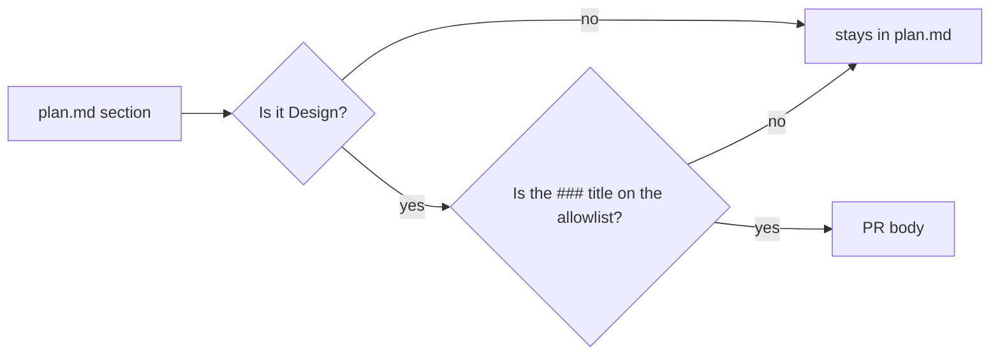
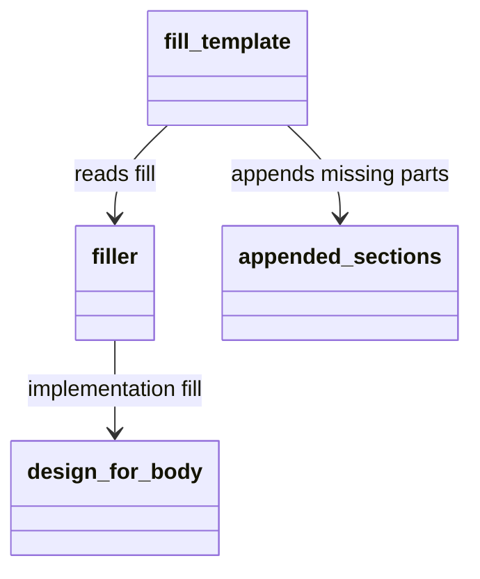

# Plan: Keep design internals out of the PR body

From `intent.md` (2026-11-11). Status: accepted.

## Design

### Domain terms

- **PR body**: the text `fill-pr-template` produces and `deliver` opens the pull request with.
- **Body allowlist**: the named list of plan `### Design` subsections that may reach the PR body. It is new. A section not on the list stays out. A plan section added later stays out without any other change.
- **Fill**: the text the script puts under a matched template heading. An empty fill leaves the template text in place.

### Diagrams





### Signatures

`fill-pr-template` is a flat script of top-level functions. No class is added.

```ruby
# The only Design subsections that reach the PR body.
DESIGN_SUBSECTIONS_IN_BODY = [ "Domain terms", "Diagrams" ].freeze

#: (String intent, String plan) -> Hash[Symbol, String]
def filler(intent, plan) # summary, why, implementation

# The allowlisted Design subsections with their deeper headings and fences, or "".
#: (String plan) -> String
def design_for_body(plan)

#: (String template, Hash[Symbol, String] fill) -> String
def fill_template(template, fill)
```

`design_for_body` selects the direct `###` children of `## Design`, stops at the next peer `##` heading, and keeps the allowed subsection's deeper headings and fences. `design_for_body` replaces `section_with_subsections`. `filler` replaces `appended_filler` as well, because both now return the same text. Deleted: `appended_filler`, `acceptance_criteria`, `section_with_subsections`, the `[ :test, "Proof" ]` entry of `APPEND_ORDER`. `[ :test, ... ]` stays in `CATEGORIES`: without it a "How has this been tested?" heading would match `how` and receive the Implementation fill.

Checked by: steep check

### Complexity

One pass over the plan's sections, O(plan size). The script runs no queries. It parses the plan fewer times than before.

### Invariants

- The body holds no text from a plan section the script does not name. Enforced by `filler`, which reads only `## Design` through `design_for_body`.
- A Design subsection reaches the body only when its title is in `DESIGN_SUBSECTIONS_IN_BODY`. Enforced by `design_for_body`.
- A matched template heading with an empty fill keeps its own template text. Enforced by the empty-fill guard in `fill_template`.
- No `## Proof` heading is appended. Enforced by the removed `APPEND_ORDER` entry.
- A `#` line inside a Mermaid fence never splits a section. Enforced by `parse_sections`, unchanged.
- A subsection with an allowed title outside `## Design` never reaches the body. Enforced by `design_for_body`, which looks only under `## Design`.

### Alternatives

- Denylist of Signatures, Complexity, Invariants, Alternatives and Proof: rejected. It fails open, so a new plan section leaks until someone lists it.
- A marker comment in `plan.md` that opts a section in: rejected. Agents must remember it, and it changes `plan.md`.
- A `PrSection` object that splits `fill_template`: rejected. It is far more change than a bug fix needs.

## Design decisions

- One allowlist constant in the script. The skill text states the rule once, in `deliver`; the other places link to it. Intent left the wording open.
- The guard that keeps template text for an empty fill also applies to Summary and Why. An intent with no Problem now keeps the template text instead of a blank heading.
- No conflict with `intent.md`'s `## Decisions`.

## Integration points

- `deliver` calls `fill-pr-template` and saves its output under `<git-common-dir>/deliver/`.
- `finish` distils the PR body into an ADR for a change another application consumes. The body no longer holds alternatives or invariants, so that ADR has less decision context. Risk below.
- `deliver/scripts/deliver:163` is the only production caller of `fill-pr-template`. Its arguments stay the same.

## Files that change

- `agents/.agents/skills/finish/scripts/fill-pr-template` — the allowlist, `design_for_body`, the guard; the removals above; the header comment.
- `test/fill_pr_template_test.rb` — Proof tests go, design tests change, exclusion tests arrive.
- `agents/.agents/skills/deliver/SKILL.md` — one "PR body" paragraph that states the rule.
- `agents/.agents/skills/plan/SKILL.md`, `agents/.agents/skills/finish/SKILL.md` — one line each that points to `deliver`.
- `agents/.agents/PLAYBOOK.md` — one line in rule 5 that points to `deliver`. `claude/.claude/PLAYBOOK.md` and `codex/.codex/PLAYBOOK.md` are symlinks to it, so there is one source edit.
- `test/deliver_test.rb` — `test_fills_the_body_with_no_template` expects `## Implementation` and `## Proof`; its fixture has no Design. It now expects `## Summary` only and refutes `## Proof`. A second test uses a fixture with a diagram and asserts delivery keeps it.

## Order of work

1. Write the acceptance tests for the intent's criteria in `test/fill_pr_template_test.rb`. Run them. Watch them fail.
2. Add `DESIGN_SUBSECTIONS_IN_BODY` and `design_for_body`. Point `filler` at it. Add the empty-fill guard. Merge `appended_filler` into `filler`.
3. Delete `acceptance_criteria`, `section_with_subsections` and the Proof entry. Update the header comment.
4. Delete only the tests devoted to Proof extraction. Rewrite the other tests that assert Proof, design or file-list text so they keep their checkbox, nested-heading, unmatched-text and duplicate-fill coverage. Keep a populated Proof fixture for the exclusion tests. Update `test/deliver_test.rb`.
5. Write the `deliver` paragraph and the three pointer lines. Run the skill-text check.
6. Run `bin/test test/fill_pr_template_test.rb`, then `bin/test`, then the linters.

## Risks

- A subsection that should reach the body later, such as Screenshots, needs a one-line edit to the constant. That friction is deliberate.
- A `Not affected: <why>.` line under Domain terms or Diagrams reaches the body as written.
- A template sub-heading nested under a matched heading is still absorbed. A "How to test" sub-heading under Description loses its template text and nothing replaces it. This behaviour is old and out of scope.
- A PR body already open keeps its old text.
- An ADR that `finish` writes for a cross-application change has no alternatives or invariants to draw on. The change folder stays in git history, but the ADR step reads the PR body only. Teaching it to read the history is a follow-up, outside this change.

## Proof

- A plan with Signatures, Complexity, Invariants and Alternatives gives a body with none of those headings or their text → `test/fill_pr_template_test.rb` `test_the_plans_design_internals_never_reach_the_body`
- A plan with a Mermaid diagram in its Design gives a body that still holds the diagram → `test/fill_pr_template_test.rb` `test_the_plans_design_section_lands_in_the_implementation_part_with_its_mermaid_fence`
- A plan with a Proof list gives a body with no Proof lines → `test/fill_pr_template_test.rb` `test_the_plans_proof_and_file_list_never_reach_the_body`
- A plan with a `Files that change` section gives a body with no file list → `test/fill_pr_template_test.rb` `test_the_plans_proof_and_file_list_never_reach_the_body`
- A template with a "Tests" heading keeps its own text instead of receiving Proof lines → `test/fill_pr_template_test.rb` `test_an_empty_fill_keeps_the_template_heading_text`
- The `deliver` skill text names what the body holds and what it leaves out → check: read the `deliver` paragraph whole, then `grep -n "PR body" agents/.agents/skills/plan/SKILL.md agents/.agents/skills/finish/SKILL.md agents/.agents/PLAYBOOK.md` prints each pointer line, rule 5 included.
- Invariant: a plan section the script does not name never reaches the body, enforced by `design_for_body` → `test/fill_pr_template_test.rb` `test_a_design_subsection_off_the_allowlist_stays_out`

Per changed file, the unit tests expected, named as behaviour:
- `agents/.agents/skills/finish/scripts/fill-pr-template`: `keeps Domain terms and Diagrams`, `drops every other Design subsection`, `drops Proof and Files that change`, `keeps template text for an empty fill`, `appends Summary alone without a template when the plan has no allowed subsection`, `appends Summary and Implementation without a template when an allowed subsection has content`, `ignores an allowed title outside Design`, `keeps an allowed subsection's deeper headings and stops at the next peer heading`.

Test setup: the existing `PLAN_WITH_DESIGN` fixture gains Complexity, Invariants, Alternatives and an invented `### Rollout risk` subsection. The Proof-only fixtures and the tests that assert Proof output are deleted: they test the behaviour the intent removes. The script runs as a subprocess, as today.

---
Domain skills applied: software-design, glossary, diagrams, ruby-style.

## Critique

### Round 1 (Codex gpt-6.1-sol)

- `test/deliver_test.rb:219` expects Implementation and Proof headings and would break → fixed (`test/deliver_test.rb` joins Files that change, with an updated and a new test)
- Deleting every test that asserts Proof removes unrelated coverage → fixed (Order of work step 4 deletes only Proof-extraction tests and rewrites the rest)
- The no-template expectation "Summary and Implementation" contradicts empty-section handling → fixed (the Proof list names Summary alone and Summary plus Implementation as two cases)
- The allowlist needs explicit structural boundaries and tests → fixed (Signatures state the `###` direct-child rule; an invariant and two unit tests cover it)
- The playbook files are symlinks, so the second edit is conditional → fixed (one source edit, `agents/.agents/PLAYBOOK.md`; the check reads each pointer)
- The ADR compatibility claim lacks support → fixed (the claim is replaced by a named limitation in Risks and Integration points; reading git history is a follow-up)
