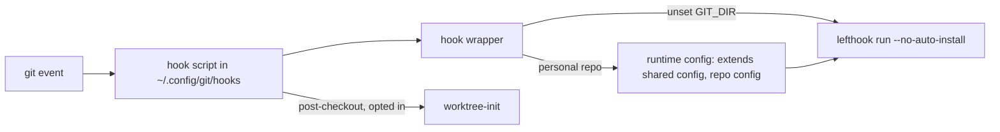
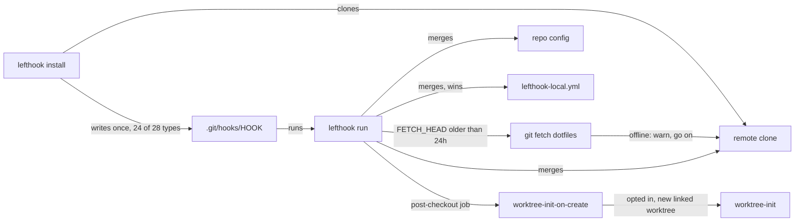

# Plan: Plain per-repo lefthook config, no global hooks

From `intent.md` (2026-11-07). Status: accepted.

## Design

### Domain terms

- **Shared config** — redefined: the dotfiles `lefthook.yml`, which a repo config names under `remotes:`.
- **Repo config** — unchanged: the first of `lefthook.yml`, `.lefthook.yml` or `.config/lefthook.yml` at the git toplevel.
- **Starter config** (new) — the documented `lefthook.yml` with the `remotes:` block that a personal repository copies. The intent calls it a "template"; the glossary avoids that word for Git fixture and Original.
- **Remote clone** (new) — lefthook's copy of the shared config in `.git/info/lefthook-remotes/<name>`.
- Retired: **Hook scripts**, **Hook wrapper**, **Hooks copy**, **Runtime config**.

### Diagrams

Before:

After:

### Signatures

Not affected: no Ruby class or public method changes. The one moved executable is a POSIX shell script, `worktree-init-on-create OLD_HEAD`, which always exits 0.

Not checked: dotfiles declined Steep and rbs_rails.

### Complexity

- Per git event: one lefthook process, down from hook script + wrapper + `mktemp` + `git remote` + `git rev-parse`.
- Refetch: one foreground `git fetch` per repo per 24 hours, on the first hook run after expiry.
- Install: one clone per repo, once.
- 24 of 28 hook types are installed. `reference-transaction`, `post-index-change`, `prepare-commit-msg` and `post-commit` are not, so none of them starts lefthook on a ref update, index write or commit.

### Invariants

- No tracked file sets `core.hooksPath`. Enforced by removing it from `git/.config/git/config`.
- Every shared job that starts Bundler or runs git in another repository clears `GIT_DIR` first. Enforced in the shared `lefthook.yml`.
- An unreachable remote never fails a hook run. Enforced by lefthook ("Couldn't sync … Will continue").
- `worktree-init-on-create` always exits 0. Enforced in the script.

### Alternatives

- Chosen: plain lefthook. The shared `lefthook.yml` holds config only; each repo names it in `remotes:` and runs `lefthook install`. No new test helper: configuration has no tests.
- Rejected: one deep `LefthookRepository` test helper that rewrites every hook-run test onto `remotes:`. Configuration has no tests, so the helper had nothing left to serve.
- Rejected: per-file fixture swaps in each test file. Same reason, and it repeats the remotes block in about eight files.
- Rejected: a lefthook `rc:` file to unset `GIT_DIR` for every job. It needs an absolute path in every repo or a new stow package, and it is unclear whether a remote's top-level `rc:` merges.

## Design decisions

- **Old hook-run tests are deleted, not rewritten.** Conflict with intent's in-scope item "Rewrite the tests that relied on the global hooks". Etienne chose deletion on 2026-11-08: they test configuration, and configuration has no tests. The code they also reached keeps unit tests: `test/review_report_check_test.rb` (review-report-fresh) and `test/worktree_sweep_test.rb` (worktree-sweep).
- **initOnCreate moves into the shared config.** Intent is silent; removing the global `post-checkout` would drop it. Etienne chose to keep it: the logic moves to `worktree-tools/worktree-init-on-create`, called from a shared `post-checkout` job. The new worktree's `lefthook-local.yml` now counts from the next hook run, not the first one.
- **24 of the 28 hook types lefthook 2.2.2 knows are listed.** `reference-transaction`, `post-index-change`, `prepare-commit-msg` and `post-commit` are left out (decided 2026-11-10, after review round 1 and 2): they fire on every ref update, index write or commit, print a banner each time, and `reference-transaction` can block every ref update when the shared config breaks. Etienne does not use them. `push-to-checkout` stays, after Etienne weighed its cost on 2026-11-08.
- **"Load Ruby" means "start Bundler or run git in another repository".** `unset GIT_DIR` goes into: pre-commit `erb_lint`, pre-push `erb_lint`, `minitest`, `rspec`, and the `migrations` caller in `post-merge` and `post-rewrite` (one line there covers the nested `bi`, `rails db:migrate` and npm/yarn). Already clear it: `rubocop` ×2, `bundle-audit`, `worktree-sweep` (`HOOK_ENVIRONMENT`, `worktree-sweep:12`). Left alone: `brakeman` (static parser), `ruby-syntax` (`ruby -c`), `review-report-fresh` and the guards (git in the hooked repo only).
- **Starter config uses the HTTPS URL** of the public repo, so a clone needs no SSH key and no credential.
- **An ADR records the switch**, since it reverses PR #269 (glossary skill: contradicts an earlier decision).

## Integration points

- lefthook 2.2.2: `remotes:`, `refetch_frequency`, `lefthook install`, auto-install (no longer blocked by `no_auto_install`).
- GNU Stow `git` package: `~/.config/git/config` and `~/.config/git/hooks` links (rollout by Etienne, never by the agent).
- `worktree-tools/worktree-init`, called by the moved script.
- Work repos: lose the global hooks after rollout; their `lefthook install` is a follow-up outside this repository.

## Files that change

- `git/.config/git/config` — remove `hooksPath = ~/.config/git/hooks`.
- `git/.config/git/hooks/post-checkout` → `git mv` to `git/.config/git/worktree-tools/worktree-init-on-create`; drop the `LEFTHOOK=0` guard and the three wrapper hand-off lines; keep `init_new_worktree "$1"`; header comment says lefthook's post-checkout job calls it.
- `git/.config/git/hooks/lefthook-wrapper`, `commit-msg`, `post-merge`, `post-rewrite`, `pre-commit`, `pre-push`, `prepare-commit-msg` — delete.
- `lefthook.yml`:
  - remove `no_auto_install: true` and its comment;
  - `unset GIT_DIR` (with a pointer to the rubocop comment) in pre-commit `erb_lint`, pre-push `erb_lint`, `minitest`, `rspec`, post-merge `migrations`, post-rewrite `migrations`;
  - new `post-checkout:` section with job `worktree-init-on-create`: `run: test -x ~/.config/git/worktree-tools/worktree-init-on-create || exit 0; ~/.config/git/worktree-tools/worktree-init-on-create {1}`;
  - an empty section (`<type>: {}`, or the form step 1 proves) for each of the 18 unused types: applypatch-msg, pre-applypatch, post-applypatch, pre-merge-commit, pre-rebase, pre-receive, update, proc-receive, post-receive, post-update, push-to-checkout, pre-auto-gc, sendemail-validate, fsmonitor-watchman, p4-changelist, p4-prepare-changelist, p4-post-changelist, p4-pre-submit — under one comment that says why they are there;
  - the three "test/branch_guard_test.rb keeps the two equal" comments become "keep the two equal by hand".
- `lefthook-branch-guard.yml` — header: drop the fallback and test references; say a repo config or `lefthook-local.yml` loads it with `extends:`, and that the shared config holds the same three commands.
- `git/.config/git/worktree-tools/test/post_checkout_hook_test.rb` → `git mv` to `git/.config/git/worktree-tools/test/worktree_init_on_create_test.rb`; `HOOK_PATH` names the moved script; drop the lefthook stub, its log assertions, `test_post_checkout_does_not_run_worktree_setup_for_new_worktree` and `test_post_checkout_skips_everything_when_lefthook_is_disabled`; rename the rest from "post_checkout" to the script's behaviour.
- `test/lefthook_wrapper_test.rb`, `test/lefthook_global_hooks_sync_test.rb`, `test/lefthook_local_hooks_test.rb`, `test/lefthook_pull_hooks_test.rb`, `test/lefthook_posix_sh_test.rb`, `test/lefthook_rubocop_git_gem_test.rb`, `test/branch_guard_test.rb`, `test/review_push_hook_test.rb`, `test/worktree_sweep_on_pull_test.rb`, `test/hook_scripts.rb`, `test/hook_scripts_test.rb` — delete. `test/lefthook_binary.rb` and `test/personal_origin.rb` stay (still used by `lefthook_no_fixme_test`, `skill_parity_hook_test`, `autonomy_contract_test`).
- `agents/.agents/skills/new-repo-setup/SKILL.md` — step 3: the Starter config as a fenced block (`remotes:` with `git_url: https://github.com/eirvandelden/dotfiles.git`, `ref: main`, `refetch_frequency: 24h`, `configs: [lefthook.yml]`), then "run `lefthook install` once", overrides in `lefthook-local.yml`, never disable hooks. Installed paths only (`test_no_skill_or_agent_body_names_a_repo_relative_path_as_a_command`).
- `agents/.agents/skills/dotfiles-maintenance/SKILL.md` — line 27: replace the global `core.hooksPath` sentences with "each repo runs lefthook from its own repo config, with the shared config as a remote; see `new-repo-setup`".
- `git/.config/git/worktree-tools/README.md` — the initOnCreate section names the shared post-checkout job and the next-run caveat; new "Rollout after the merge" section: restow `git`, check `ls -l ~/.config/git/hooks`, trash the dangling links, run `lefthook install` in `~/Developer/dotfiles`; follow-ups: each personal repo gets the Starter config, each work repo runs `lefthook install`.
- `GLOSSARY.md` — retire four terms, redefine Shared config, add Starter config and Remote clone (glossary commit after acceptance, per the plan skill).
- `docs/adr/0001-per-repo-lefthook-remotes.md` — new: Context, Decision, Consequences.

## Order of work

No criterion needs a test (configuration), so the work starts with the change and each check runs after it.

1. In a scratch directory under the session scratchpad, with `GIT_CONFIG_GLOBAL=/dev/null`, prove lefthook's behaviour before editing: a `file://` remote holding a lefthook.yml with an empty `pre-rebase: {}` makes `lefthook install` write `.git/hooks/pre-rebase`; note whether the remote clone has a `FETCH_HEAD` after the clone, and the remote clone's directory name. If `{}` writes no hook, find the smallest form that does and use it in step 4.
2. `git mv` the post-checkout script and its test; strip the lefthook parts from both; run `ruby git/.config/git/worktree-tools/test/worktree_init_on_create_test.rb`. Commit.
3. Delete the hook wrapper, the six other hook scripts, the nine hook-run test files and `hook_scripts(_test).rb`; remove `core.hooksPath` from `git/.config/git/config`. Run `bin/test`. Commit.
4. Edit `lefthook.yml`: drop `no_auto_install`, add the `unset GIT_DIR` lines, the `post-checkout` job, the 18 empty sections, the comment fixes. Edit `lefthook-branch-guard.yml`'s header. Run `yamllint lefthook.yml lefthook-branch-guard.yml` and `lefthook dump` in the worktree. Commit.
5. Run the Proof checks in the scratch repo against this branch.
6. Docs: `new-repo-setup`, `dotfiles-maintenance`, worktree-tools README, ADR. Commit each logical change on its own.
7. Full `bin/test`, `ruby git/.config/git/worktree-tools/test/worktree_init_on_create_test.rb`, rubocop, shellcheck on the moved script, markdownlint no-hardwrap on touched markdown. Re-read the diff.

## Risks

- A job for `reference-transaction`, `post-index-change`, `prepare-commit-msg` and `post-commit` needs a new section in the shared config and a new `lefthook install` in each repo, because those four hooks are not installed. Chosen on 2026-11-10 over a banner on every ref update and commit.
- An empty `push-to-checkout` hook replaces git's `updateInstead` logic: a push to a non-bare repo with `receive.denyCurrentBranch=updateInstead` is accepted without updating the working tree. None of Etienne's repos is known to use it.
- lefthook may drop an empty `{}` section and write no hook for it; step 1 proves the form before step 4 relies on it.
- With `no_auto_install` gone, `lefthook run` reinstalls hooks when the config checksum changes. Until rollout, the stowed hook wrapper still passes `--no-auto-install`, so commits in this worktree cannot overwrite `~/.config/git/hooks`.
- After rollout and before each repo runs `lefthook install`, personal and work repos run no hooks at all (no branch guard, no linters). The README rollout section lists the follow-ups; Etienne runs `lefthook install` once per repo by hand (agreed 2026-11-09), so the plan adds no detection step.
- The two copies of the main/master guard (`lefthook.yml`, `lefthook-branch-guard.yml`) lose the test that kept them equal; comments now ask for it by hand.
- A first `lefthook install` with no network fails to clone the remote; later runs offline are fine.
- Rejected: rewriting the old tests (configuration has no tests); dropping initOnCreate (behaviour lost); listing only 15 client types (intent's decision).

## Proof

- A repo whose `lefthook.yml` lists the dotfiles remote runs the shared jobs and its own jobs on commit, after one `lefthook install` → check: scratch repo with the Starter config (`git_url` = this worktree via `file://`, `ref: per-repo-lefthook-remotes`) plus an own pre-commit job that echoes to a log; `lefthook install`; committing a file with conflict markers fails (shared `no-merge-conflicts`) and the log holds the own job's line.
- A job in `lefthook-local.yml` overrides the shared job of the same name → check: add `pre-commit: commands: no-merge-conflicts: run: "true"` to `lefthook-local.yml`; the same commit succeeds.
- After the shared config changes upstream, the repo picks up the change on its first hook run after 24 hours, with no manual step → check: commit a new shared pre-commit job to the remote branch copy, `touch -t` the remote clone's `FETCH_HEAD` to 25 hours ago, commit in the scratch repo; the new job runs.
- A hook run without network access still commits → check: point the remote clone's origin at a missing path (or rename the source), age `FETCH_HEAD`, commit; output shows "Couldn't sync … Will continue" and the commit exists.
- A `bundle exec` job in a linked worktree on `pre-push` does not see `GIT_DIR` → check: in a linked worktree of the scratch repo, a PATH stub `rubocop` logs `GIT_DIR=${GIT_DIR-unset}`; push a `.rb` file; the log says `GIT_DIR=unset`.
- A repo with no `lefthook.yml` and no `lefthook install` runs no hooks at all → check: fresh repo, `GIT_CONFIG_GLOBAL` = a copy of `git/.config/git/config` from this branch; `.git/hooks` is empty and a commit with conflict markers succeeds.
- When the shared config gives jobs to a hook type that had none, a repo runs them after its next refetch, with no new `lefthook install` → check: right after install, `.git/hooks/post-commit` exists; then commit a `post-commit` job to the remote, age `FETCH_HEAD`, commit twice; the job runs on the second commit without `lefthook install`.
- Invariant: no tracked file sets `core.hooksPath`, enforced by `git/.config/git/config` → check: `git grep -n hooksPath -- ':!test' ':!docs'` prints nothing.
- Invariant: `worktree-init-on-create` always exits 0 → `git/.config/git/worktree-tools/test/worktree_init_on_create_test.rb` `test_..._still_exits_0_when_worktree_init_fails` (renamed from `test_post_checkout_still_runs_lefthook_when_worktree_init_fails`).

Per changed file, the unit tests expected:
- `git/.config/git/worktree-tools/worktree-init-on-create`: `runs worktree-init for a new linked worktree of an opted-in repo`, `skips without the opt-in`, `skips a branch switch`, `skips a fresh clone`, `exits 0 when worktree-init fails`, `runs under dash` — the surviving tests of `post_checkout_hook_test.rb`, renamed.

Test setup: the existing temp-dir and PATH-stub setup of `post_checkout_hook_test.rb`, minus the lefthook stub.

Out of scope: `lefthook.yml` in other repositories; `lefthook install` in any repository; running `stow`; touching `~/.config/git/hooks`; changing what the shared jobs check; work repositories; anything upstream at lefthook.

---
Domain skills applied: dotfiles-maintenance, software-design, glossary, diagrams.
