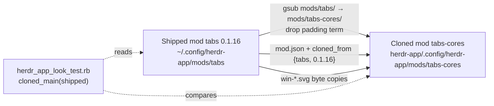

# Plan: Re-clone the tabs-cores mod from the installed tabs mod

From `intent.md` (2026-11-19). Status: accepted.

## Design

### Domain terms

- **herdr-app**, **Mod copy**, **Linked mod folder** — as in `GLOSSARY.md`; unchanged.
- **Shipped mod** (new) — a mod that the installed herdr-app writes to `~/.config/herdr-app/mods/<name>`, here `tabs` at 0.1.16. The test calls it `SHIPPED_TABS`. Never edited.
- **Cloned mod** (new) — a mod in `herdr-app/.config/herdr-app/mods/` that `herdr-app do mod.clone` made from a shipped mod and that records `cloned_from: {name, version}` in its `mod.json`. Here `tabs-cores`.
- **Padding term** (new) — ` - (sidebar?.hidden ? 0 : sidebar?.size?.px ?? 0)`, the sidebar-width part of the shipped tabs mod's traffic-light padding. The clone drops it, because the cores layout puts the sidebar on the right.

The two new terms are not yet in `GLOSSARY.md`; this change does not add them (see Design decisions).

### Diagrams

Before: `tabs-cores/main.js` is the 0.1.15 shipped mod with the transform applied; it lacks `clean`, `label`, the `wheel` swipe handler and the guarded `localStorage` read that 0.1.16 added. After: it is the 0.1.16 shipped mod with the same transform.

### Signatures

Not affected: no Ruby, no JavaScript interface changes; two data files are regenerated. `main.js` is Herdr's own code, which `eslint.config.mjs` ignores on purpose.

Not checked: no Ruby signature is touched.

### Complexity

Not affected: the mod's runtime cost is the shipped mod's own. The regeneration is a one-off string transform of a 157-line file.

### Invariants

- `tabs-cores/main.js` equals `cloned_main(shipped main.js)`: every `mods/tabs/` replaced with `mods/tabs-cores/`, and the padding term removed once. Enforced by `test/herdr_app_look_test.rb` `test_the_cloned_tabs_mod_differs_from_tabs_only_in_the_padding`.
- The padding stays `Math.max(10, (root.traffic_lights[0] + 64) / settings().zoom)` with no `sidebar?.size?.px`. Enforced by `test_the_cloned_tabs_mod_pads_without_the_sidebar_width`.
- `tabs-cores/mod.json` without `cloned_from` equals the shipped `mod.json`, and `cloned_from.name` is `tabs`. Enforced by `assert_clone_names_tabs_as_its_source`.
- Each shipped `win-*.svg` equals its copy byte for byte. Enforced by the same test's `shipped_assets` loop.
- herdr-app accepts the clone. Enforced by `test_herdr_app_accepts_the_cloned_tabs_mod` (`herdr-app check`).

### Alternatives

1. **String transform of the shipped file (chosen).** Apply exactly the test's `cloned_main` transform to `~/.config/herdr-app/mods/tabs/main.js` with a one-off Ruby one-liner, write the result over `tabs-cores/main.js`, and set `cloned_from.version` to `0.1.16` by hand. Deterministic, needs no running app, and produces by construction the bytes the test expects.
2. **`herdr-app do mod.clone` in a sandbox, then the padding edit.** Mirrors how the clone was first made and writes `cloned_from` itself. Rejected: it needs a throwaway `HERDR_APP_HOME` and a running core, which has known traps (a stray core, `app.quit` closing every window, inherited `CLAUDE_*` variables); its output for `main.js` is the same transform the test already encodes, so it buys no extra fidelity for this change.
3. **Loosen the test so it does not depend on the installed app.** Rejected: out of scope by `intent.md` (Decisions: "Re-clone the mod instead of loosening the test").

## Design decisions

- Regenerate with the transform in alternative 1, not with `mod.clone`. Intent left the tool open; the test helper defines the target bytes, so the transform is the shortest correct path.
- Keep `mod.json` formatting as it is today (two-space pretty JSON, no trailing newline, `cloned_from` last); only the version string changes. The test compares parsed JSON, so formatting is free; keeping it makes the diff one line.
- The new glossary terms (Shipped mod, Cloned mod, Padding term) are written into `GLOSSARY.md` by the `glossary` step only if the implementer or Etienne wants them; this plan stage touches `plan.md` only. No conflict with `intent.md`'s `## Decisions`: re-clone (yes), autonomous without Codex review (yes), version 0.1.16 (yes).

## Integration points

- The installed herdr-app 0.1.16 at `~/.config/herdr-app/mods/tabs/` — read only.
- `herdr-app check` — the test runs it on the clone.
- `herdr-app/.config/herdr-app/layouts/cores.json` — names `tabs-cores` in its `tabs` node; unchanged.
- Etienne's live tab bar: the installed `~/.config/herdr-app/mods/tabs-cores` links point at the main checkout, not this worktree. The new code reaches the live tab bar only after the branch merges into the main checkout and the mod reloads. No `stow` run.

## Files that change

- `herdr-app/.config/herdr-app/mods/tabs-cores/main.js` — regenerated from the shipped 0.1.16 `main.js` with the transform; gains `clean`, `label`, the `wheel` method and the guarded `panels` read.
- `herdr-app/.config/herdr-app/mods/tabs-cores/mod.json` — `cloned_from.version` from `0.1.15` to `0.1.16`.

Unchanged and checked: the four `win-*.svg` files (byte-equal to the shipped ones on 2026-11-19).

Out of scope: `test/herdr_app_look_test.rb`, any other mod, `layouts/cores.json`, the sidebar, `GLOSSARY.md`, running `stow`.

## Order of work

1. Run `ruby -Itest test/herdr_app_look_test.rb -n test_the_cloned_tabs_mod_differs_from_tabs_only_in_the_padding` and watch it fail on the `main.js` comparison (the regression already exists on `main`; it was confirmed failing on 2026-11-19, 27 runs, 1 failure). Use rv's Ruby 4: a shell whose `PATH` finds `/usr/bin/ruby` 2.6 first cannot load minitest, so check `ruby -v` first. Also run `herdr-app --version`: it must print `herdr-app 0.1.16`. On any other version, stop and report, because `intent.md` decided to record 0.1.16 and no test checks `cloned_from.version`.
2. Regenerate `main.js`: `ruby -e 's = File.read(ARGV[0]); File.write(ARGV[1], s.gsub("mods/tabs/", "mods/tabs-cores/").sub(" - (sidebar?.hidden ? 0 : sidebar?.size?.px ?? 0)", ""))' ~/.config/herdr-app/mods/tabs/main.js herdr-app/.config/herdr-app/mods/tabs-cores/main.js`. Confirm the shipped file contains the padding term exactly once before writing (`grep -c`), so `sub` cannot silently miss.
3. Edit `mod.json`: `"version": "0.1.15"` → `"version": "0.1.16"`. Nothing else.
4. Check the four `win-*.svg` files with `cmp` against the shipped ones; they need no change.
5. Run the single test again: green. Then the whole file: 0 failures. Then `bin/test`.
6. Run `herdr-app check herdr-app/.config/herdr-app/mods/tabs-cores` (the test does this too, in a scratch `HERDR_APP_HOME`).
7. Read the diff: only the two files; `main.js` hunks match the shipped 0.1.15→0.1.16 change. Commit as one change ("Re-clone tabs-cores from the 0.1.16 tabs mod").

## Risks

- The installed herdr-app updates again before or during implement: the test then compares against a newer shipped mod. Mitigation: step 1 records `herdr-app --version`; if it is no longer 0.1.16, stop and report instead of recording a wrong version.
- `mod.clone` also renames self-opening overlay names, per `~/.config/herdr-app/AGENTS.md`. The shipped tabs `main.js` has none, and its `mods/tabs/` paths sit on three lines (153–155); `mods/pane/close.svg` is not a tabs path and stays. So the transform matches what `mod.clone` would write. A future shipped mod with an overlay name would break that match; the test would then need its helper widened, which is out of scope here.
- `sub` removes only the first padding term; the shipped file has it once (checked in step 2). A second occurrence would leave one behind and the padding test would catch it.
- The wrong Ruby on `PATH` makes the test runner fail before any test runs; that is an environment fault, not a test failure. Do not change toolchains (playbook rule 8); call rv's Ruby by path if needed.
- The live tab bar now follows an agent's live title; this is the shipped behaviour Etienne already sees in the plain tabs mod, so no surprise is expected.

## Proof

- `ruby test/herdr_app_look_test.rb` passes with 0 failures → `test/herdr_app_look_test.rb` `test_the_cloned_tabs_mod_differs_from_tabs_only_in_the_padding` (and the whole file)
- `tabs-cores/main.js` carries the installed mod's label code and keeps the padding without `sidebar?.size?.px` → `test/herdr_app_look_test.rb` `test_the_cloned_tabs_mod_pads_without_the_sidebar_width`, plus `test_the_cloned_tabs_mod_differs_from_tabs_only_in_the_padding`, which proves the `clean` and `label` code by full equality with the shipped file
- `tabs-cores/mod.json` names `tabs` as its source and records 0.1.16 → `test/herdr_app_look_test.rb` `test_the_cloned_tabs_mod_differs_from_tabs_only_in_the_padding` (name and the rest of `mod.json`), and check: `ruby -rjson -e 'p JSON.parse(File.read("herdr-app/.config/herdr-app/mods/tabs-cores/mod.json")).dig("cloned_from", "version")'` prints `"0.1.16"`
- `bin/test` and every linter pass, apart from failures `main` already has → check: `bin/test` exits 0; `lefthook run pre-commit --all-files` (or each touched file's linter) passes; `main.js` is excluded from ESLint by `eslint.config.mjs`, and `mod.json` has no linter
- Invariant: herdr-app accepts the clone, enforced by `herdr-app check` → `test/herdr_app_look_test.rb` `test_herdr_app_accepts_the_cloned_tabs_mod`

Per changed file, the unit tests expected:

- `herdr-app/.config/herdr-app/mods/tabs-cores/main.js`: no new tests; it is Herdr's code, covered by the existing look tests above.
- `herdr-app/.config/herdr-app/mods/tabs-cores/mod.json`: no new tests; data, covered by `assert_clone_names_tabs_as_its_source`.

Test setup: none new. The look test reads the shipped mod from `~/.config/herdr-app/mods/tabs` and skips when it is absent.

---
Domain skills applied: software-design, glossary, diagrams, dotfiles-maintenance (edit sources, never links; no stow).

## Critique

### Round 1 (codex gpt-6.1-sol, medium)

- Integration points promised live pickup after a mod reload, but the installed tabs-cores links point at the main checkout, not this worktree → fixed (Integration points now say pickup needs the merge into the main checkout, then a reload)
- Risks claimed step 1 records the herdr-app version, but step 1 did not, and no test checks cloned_from.version → fixed (step 1 now requires herdr-app --version to print 0.1.16 and stops otherwise)
