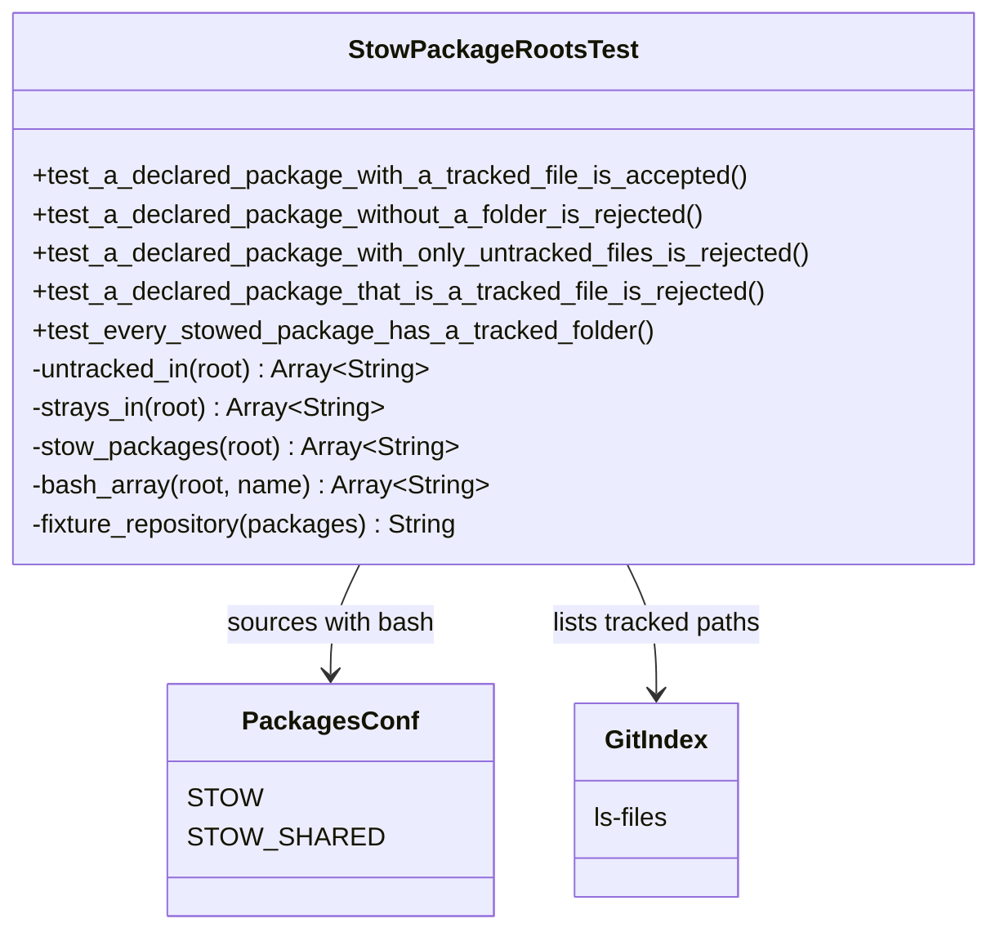
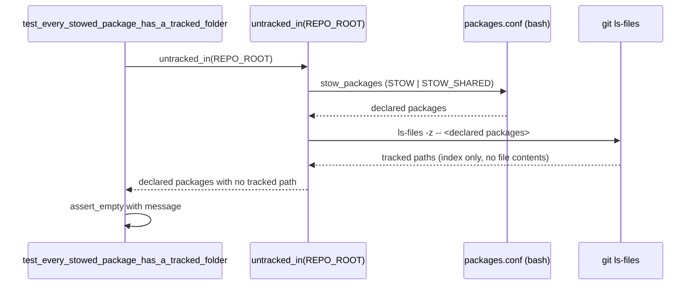

# Plan: Remove bundler from the stow list

From `intent.md` (2026-11-10). Status: accepted.

## Design

### Domain terms

- **Repo agents file** (glossary): the root `agents.md`. It lists exactly the `STOW` packages; `test/repo_agents_file_test.rb` checks that list.
- **Declared package** (existing phrase in `test/stow_package_roots_test.rb`): an entry of `STOW ∪ STOW_SHARED` in `packages.conf`, as `stow_packages(root)` returns it.
- **Tracked package folder** (new): a declared package with at least one path in git's index under `<package>/`, as `git ls-files` lists it. A folder that exists only on the local disk is not a tracked package folder.
- **Stow step** (new): `install/tasks/50_stow_all.sh`, which calls `stow_configure` with the `STOW` list.
- Not used: **Git fixture**. The fixture repositories here are built per test and never copied, so that glossary term does not fit.

### Diagrams

Before: `packages.conf` `STOW` names `bundler` → the stow step calls `stow_configure(root, STOW...)` → `stow_configure` dies with `Stow package not found: <root>/bundler` on a fresh clone → no later package gets linked.





### Signatures

`StowPackageRootsTest` (`test/stow_package_roots_test.rb`): guards the packages that `packages.conf` declares. Every package root holds only dotfiles, and every declared package has a tracked package folder.

New public tests:

```ruby
# A file in git's index under a declared package's folder makes it a tracked package folder.
#: () -> void
def test_a_declared_package_with_a_tracked_file_is_accepted

# The fresh-clone failure: packages.conf declares a package that has no folder.
#: () -> void
def test_a_declared_package_without_a_folder_is_rejected

# The main-checkout case: the folder exists locally, but git tracks nothing in it.
# A File.directory? check passes here, where a fresh clone fails.
#: () -> void
def test_a_declared_package_with_only_untracked_files_is_rejected

# A tracked file at the root with the package's name is not a folder; stow_configure refuses it.
#: () -> void
def test_a_declared_package_that_is_a_tracked_file_is_rejected

# The regression test: red on main (bundler), green after the fix.
#: () -> void
def test_every_stowed_package_has_a_tracked_folder
```

New private helper, next to `strays_in`:

```ruby
# Every declared package with no path in git's index under its folder. It reads the index only,
# never a file's contents, so a local untracked folder counts as missing.
#: (String root) -> Array[String]
def untracked_in(root)
  packages = stow_packages(root)
  stdout, stderr, status = Open3.capture3("git", "-C", root, "ls-files", "-z", "--", *packages)
  raise stderr unless status.success?

  packages - stdout.split("\0").filter_map { |path| path.split("/", 2).first if path.include?("/") }
end
```

Only a path with a `/` counts: a tracked root file named like a package is not a folder, and `stow_configure` refuses it.

Changed private helper `fixture_repository(packages)`: after it writes `packages.conf`, it runs `git init --quiet` and `git add --all` in the fixture root. No commit: `git ls-files` reads the index, so the add is enough and no git identity is needed. `require_relative "isolated_git"` is already at the top of the file, so the machine's global git setup stays out. A package given an empty entry list becomes an empty folder, which git cannot track. Its RBS line becomes `#: (Hash[String, Array[String]] packages) -> String`.

Comment edits only: the class header gets one sentence ("It also guards that every declared package has a tracked folder, because `stow_configure` dies on a missing one."). The comment in `strays_in` that says a missing directory is "Nothing for this guard to say about it" now says `untracked_in` reports it.

Unchanged: `stow_packages`, `bash_array`, `strays_in` code, `stray_report`, `teardown`, `install/utils.sh`, `install/tasks/50_stow_all.sh`.

Not checked: the repository runs no `steep check`; `test/ruby_signatures_test.rb` only checks the skills' signature rules.

### Complexity

- `untracked_in(root)` starts three processes whatever the package count: two `bash` (existing `stow_packages`) and one `git ls-files`. The work after that is linear in tracked paths under declared packages.
- `fixture_repository` gains two git processes per call (`init`, `add`). The file has 11 fixture-using tests after the change, so about 20 extra short git processes per run, all inside the run root.
- Not affected: no queries; this is not a Rails application.

### Invariants

- Every declared package has at least one path in git's index under `<package>/`. Enforced by `test_every_stowed_package_has_a_tracked_folder`, run by `bin/test` and CI. The runtime backstop stays `stow_configure`'s existing `die "Stow package not found"`.
- A folder that exists only on the local disk does not count. Enforced by `untracked_in`, which reads `git ls-files`, not `File.directory?`. Proven by `test_a_declared_package_with_only_untracked_files_is_rejected`.
- The guard never reads a file's contents under a package folder. It holds by construction: its only inputs are `packages.conf` and `git ls-files` output. So the local untracked `bundler/.bundle` is never read.

### Alternatives

1. **Chosen — tracked-folder check in `StowPackageRootsTest`.** One helper, five tests, reuses `stow_packages`, `bash_array` and the fixture builder. Proves the invariant that the stow step needs, on both a fresh clone and Etienne's checkout.
2. **Rejected — a fresh-clone stow test in a new file.** Copies every tracked path into a temp folder and runs the real `50_stow_all.sh` there with a PATH stub `stow` and a temp `HOME`. Higher fidelity (it runs the installer), but about 80 lines, one file copy per tracked path, submodule handling, and a stub that still does not prove real links. The tracked-folder check proves the same failure cause in about 15 lines. The manual check below covers the real stow run once.
3. **Rejected — `File.directory?` check.** Passes in Etienne's main checkout, where the untracked `bundler/.bundle` exists, so it would not be red there. It also cannot catch the case this bug is.

## Design decisions

- Put the regression test in `test/stow_package_roots_test.rb`, not a new file: it already reads `STOW ∪ STOW_SHARED` and builds fixture repositories. The class name says "package roots"; a missing package root fits that name.
- "Tracked" means in git's index (`git ls-files`), not in `HEAD`. So the test turns green when the fix is staged, before the commit. CI's checkout proves what a fresh clone holds.
- Check `STOW ∪ STOW_SHARED`, not only `STOW`, as the existing guard does. Both are stowed.
- The acceptance criterion names `herdr-app`. `herdr-app` is not in `STOW` on this branch: its branch rebases onto this fix afterwards (out of scope). The manual check here proves the stow step runs past the former `bundler` position and links every `STOW` package. The `herdr-app` link is proven on that branch after its rebase.
- The glossary terms "Tracked package folder" and "Stow step" are proposals. This plan stage writes only `plan.md`; the glossary edit is left to Etienne or a later stage.
- No conflict with `intent.md`'s `## Decisions`: `bundler` leaves the stow list, stow does not skip missing folders, and no `bundler` package is tracked.

## Integration points

- `install/tasks/50_stow_all.sh` and `install/utils.sh` `stow_configure`: read `STOW`; unchanged.
- `test/repo_agents_file_test.rb`: checks that `agents.md` names exactly the `STOW` packages. It stays green only if `packages.conf` and `agents.md` change in the same commit.
- `.github/workflows/dotfiles-tests.yml`: runs `bin/test` on a fresh checkout; has `git`, no `stow`. The new test needs only `git` and `bash`.

## Files that change

- `test/stow_package_roots_test.rb` — five new tests, `untracked_in` helper, `git init` and `git add` in `fixture_repository`, two comment edits.
- `packages.conf` — remove the `bundler` line from `STOW`. `RUBY_GEMS` keeps `bundler`.
- `agents.md` — remove `` `bundler` `` from the "Packages in `packages.conf`" list. (`CLAUDE.md` is a symlink to it; `AGENTS.md` follows the same file.)
- `agents/.agents/skills/dotfiles-maintenance/references/repository-layout.md` — remove `` `bundler` `` from the "Key packages" list.

## Order of work

1. Add `untracked_in`, the `git init`/`git add` lines in `fixture_repository`, and `test_every_stowed_package_has_a_tracked_folder`. Run `bin/test test/stow_package_roots_test.rb`. Watch it fail, naming `bundler`.
2. Add the four fixture tests (tracked file accepted, no folder rejected, only untracked files rejected, tracked root file rejected). Run the file; only the regression test is red.
3. Commit the tests (red regression test, its reason in the message).
4. Remove `bundler` from `STOW` in `packages.conf` and from the list in `agents.md`. Run `bin/test test/stow_package_roots_test.rb test/repo_agents_file_test.rb`; both green. Commit.
5. Remove `bundler` from `repository-layout.md`. Commit.
6. Edit the two comments in `stow_package_roots_test.rb`. Commit.
7. Run `bin/test`, then the lefthook linters on touched files (`rubocop` with `rubocop/.rubocop.yml`, `no-hardwrap` markdownlint).
8. Run the manual stow check (see Proof). Record its output in the review evidence.

## Risks

- A tracked file staged but not committed makes a package pass locally while a fresh clone still fails. Accepted: CI runs on the pushed commit.
- The existing stray-check fixtures now pay for `git init` and `git add`. Small cost; a second builder would be more code.
- The local untracked `bundler/.bundle` in Etienne's main checkout stays. After the fix nothing declares `bundler`, so `strays_in` never lists that folder and nothing reads it. Never `cat`, `ls` or glob into it while working.
- Out of scope, noticed while reading: `repository-layout.md` also names `lefthook`, which is not a package; `vscode/` exists at the root but is not in `STOW`. Neither is touched here.

## Proof

- On a fresh clone, `50_stow_all.sh` runs past the point where `bundler` was and links every `STOW` package → check: `git clone --quiet "$PWD" "$SCRATCH/clone" && mkdir "$SCRATCH/home" && HOME="$SCRATCH/home" bash "$SCRATCH/clone/install/tasks/50_stow_all.sh"`, with `$SCRATCH` a fresh temp folder and the fix committed. It exits 0 and logs "stow: all configured packages applied.". Then prove the links resolve into the clone, for a package after the former `bundler` position and for a shared package: `[ "$(realpath "$SCRATCH/home/.config/caddy/Caddyfile")" = "$(realpath "$SCRATCH/clone/caddy/.config/caddy/Caddyfile")" ]` and, for `claude` (linked file by file), `test -L "$SCRATCH/home/.claude/settings.json" && [ "$(realpath "$SCRATCH/home/.claude/settings.json")" = "$(realpath "$SCRATCH/clone/claude/.claude/settings.json")" ]`. Both succeed. `HOME` is a temp folder, so the real home and `dotfiles-work` are not touched. The `herdr-app` link is proven on the `herdr-app` branch after its rebase.
- The regression test fails on `main` today and passes after the fix → `test/stow_package_roots_test.rb` `test_every_stowed_package_has_a_tracked_folder`
- Invariant: a declared package needs a tracked folder, enforced by `untracked_in` → `test/stow_package_roots_test.rb` `test_a_declared_package_without_a_folder_is_rejected`
- Invariant: a local untracked folder does not count, enforced by `untracked_in` reading `git ls-files` → `test/stow_package_roots_test.rb` `test_a_declared_package_with_only_untracked_files_is_rejected`
- Invariant: a tracked root file with a package's name does not count, enforced by `untracked_in` counting only paths with a `/` → `test/stow_package_roots_test.rb` `test_a_declared_package_that_is_a_tracked_file_is_rejected`
- `agents.md` matches `STOW` after the edit → `test/repo_agents_file_test.rb` (existing, unchanged)

Per changed file, the unit tests expected:

- `test/stow_package_roots_test.rb`: `a declared package with a tracked file is accepted`, `a declared package without a folder is rejected`, `a declared package with only untracked files is rejected`, `a declared package that is a tracked file is rejected`, `every stowed package has a tracked folder`. The seven existing tests stay green.
- `packages.conf`, `agents.md`, `repository-layout.md`: configuration and docs; no tests of their own beyond the lines above.

Test setup: fixture repositories from `fixture_repository`, each a temp folder with `git init` and `git add --all`, inside the run root. The real-repo test reads `REPO_ROOT`'s index. No PATH stubs, no stow.

---
Domain skills applied: software-design, glossary, diagrams, dotfiles-maintenance.

## Critique

### Round 1 (Codex gpt-6.1-sol, medium)

- The guard counts a tracked root file named like a package as a package folder, but `stow_configure` requires a directory → fixed (`untracked_in` counts only paths with a `/`; new test `test_a_declared_package_that_is_a_tracked_file_is_rejected`; Proof line added)
- The manual check with `ls -A` does not prove that links resolve, nor covers a shared package → fixed (the check now compares `realpath` of `caddy`'s `Caddyfile`, after the former `bundler` position, and of `claude`'s `settings.json`, a shared package linked file by file, against the clone)
