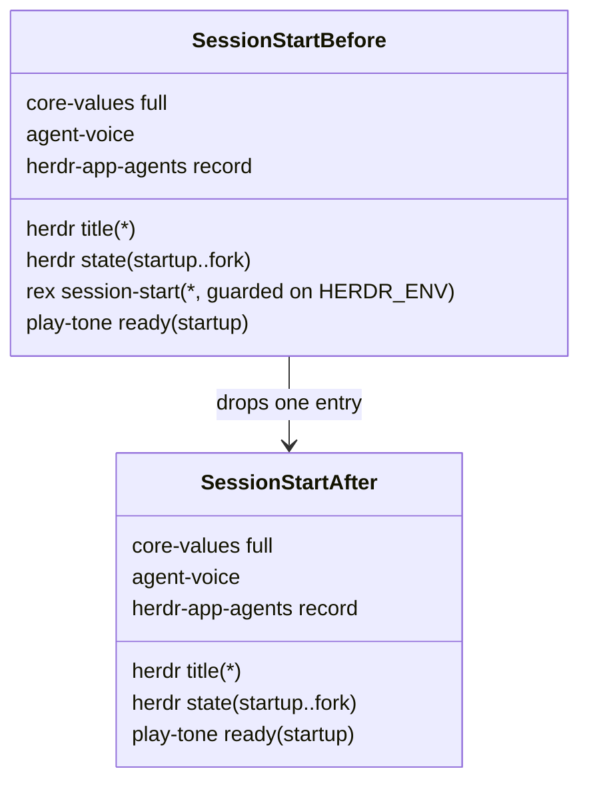
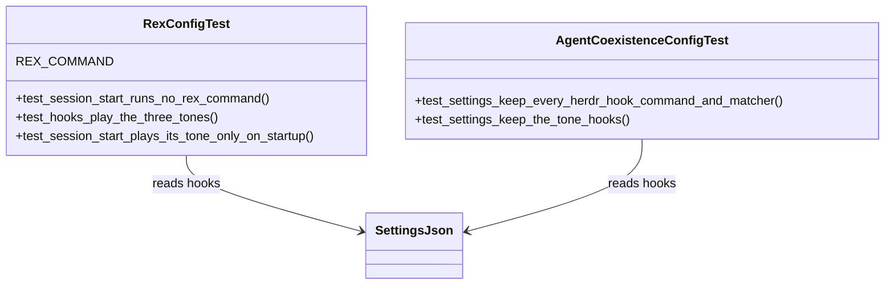

# Plan: Remove the Rex SessionStart hook

From `intent.md` (2026-11-23). Status: accepted.

## Design

### Domain terms

- **herdr-app**: as `GLOSSARY.md` defines it. It does not set `HERDR_ENV`, so the current guard on the hook never stops it there.
- **Rex session-start hook**: the SessionStart entry in `claude/.claude/settings.json` that runs `rex __internal session-start --agent claude`. This change deletes it. Plan-only term; it does not go into the glossary.
- **Tone hook**: a hook that runs `$HOME/.config/rex/scripts/play-tone.sh <tone>`. Out of scope; it stays. Its path holds `/rex/`, but it runs no `rex` program, and the script itself calls only `afplay`. Plan-only term.
- **Rex command**: a hook command in which `rex` is the program that runs. A path segment such as `/rex/` is not a Rex command. Plan-only term.

### Diagrams

The SessionStart list in `claude/.claude/settings.json`, before and after:



The touched tests:



### Signatures

No production class or method changes. The production change is one deleted JSON object in `claude/.claude/settings.json`.

`RexConfigTest` (`test/rex_config_test.rb`) — proves the Rex Lua config and the Rex parts of the Claude settings. New constant under `TONE_HOOKS`:

```ruby
REX_COMMAND = /(?:\A|[\s;&|'"(`])rex\s/
```

It matches `rex` as a program word: at the start of the command, or after whitespace, `;`, `&`, `|`, a quote, `(` or a backtick, with whitespace after it. It does not match `$HOME/.config/rex/scripts/play-tone.sh`, where `/` stands on both sides of `rex`.

Replaces `test_settings_json_has_the_rex_session_start_hook`:

```ruby
#: () -> void
def test_session_start_runs_no_rex_command
  commands = hook_commands.fetch("SessionStart")

  assert_empty(commands.grep(REX_COMMAND), commands.inspect)
  refute_includes(File.read(SETTINGS), "rex __internal session-start")
end
```

`AgentCoexistenceConfigTest` (`test/agent_coexistence_config_test.rb`) — keeps the herdr hooks, the tone hooks and the Codex rules in their files. `test_settings_add_guarded_rex_hooks` becomes:

```ruby
#: () -> void
def test_settings_keep_the_tone_hooks
  TONES.each do |event, tone|
    commands = hook_entries(event).map { |entry| entry[:command] }
    assert(commands.any? { |command| command.match?(%r{play-tone\.sh #{tone}\b}) }, "#{event} has no #{tone} tone: #{commands.inspect}")
  end
end
```

The `REX_GUARD` constant is deleted.

Not checked: this repository's tests are plain Minitest scripts with inline `#:` comments; it runs no `steep check`.

### Complexity

Not affected: no runtime path is added. Each Claude session start loses one hook shell (`/bin/sh -c …`). When `HERDR_ENV` is not `1`, as in herdr-app, it also loses one `rex` process. The new test reads `settings.json` once more. No database, no queries.

### Invariants

- No SessionStart hook command in `claude/.claude/settings.json` runs `rex` as a program. Enforced by `RexConfigTest#test_session_start_runs_no_rex_command`.
- `claude/.claude/settings.json` holds no `rex __internal session-start`. Enforced by the same test.
- The three tone hooks stay: SessionStart `ready` on `startup`, Notification `request`, Stop `done`. Enforced by `RexConfigTest#test_hooks_play_the_three_tones`, `#test_session_start_plays_its_tone_only_on_startup` and `AgentCoexistenceConfigTest#test_settings_keep_the_tone_hooks`. Because these stay green next to the new guard, they also prove `REX_COMMAND` does not catch the tone path.
- The herdr title and state hooks keep their commands and matchers. Enforced by `AgentCoexistenceConfigTest#test_settings_keep_every_herdr_hook_command_and_matcher`.

### Alternatives

1. **Minimal, SessionStart-scoped guard (chosen).** Delete the entry; invert the one test that expected it; trim the coexistence test. Smallest diff; the guard matches the bug's scope (session start), which is what the acceptance criteria name.
2. **Whole-settings guard.** Walk every `command` value in `settings.json` (every hook event and `statusLine`) with a wider pattern that also catches `/path/to/rex`, plus a test that exercises the pattern on fixed strings. Rejected: it guards events the intent does not name, adds friction for any future deliberate Rex hook, and adds a test of a test constant. Its extra strength is not needed while the only Rex hook is the one this change deletes.
3. **Guard the hook on `HC_TERMINAL_ID` instead of deleting it.** Rejected by `intent.md` `## Decisions`: Rex is unused, so the hook goes entirely.

## Design decisions

- The regression guard lives in `test/rex_config_test.rb`, which owned the assertion that expected the hook. One copy, so no drift.
- The guard covers SessionStart only, the event the acceptance criteria name. No other configured hook command invokes the Rex CLI directly today; the other events hold consent, worktree, test, title, core-values and tone hooks.
- `REX_COMMAND` is a text heuristic, not a shell parser. It catches `rex …`, `|| rex …` and `sh -c '… rex …'`. It misses an absolute path such as `/opt/homebrew/bin/rex …` and a quoted `"rex" …`, and it would also match `rex` as an argument, such as `echo rex info`. The `refute_includes` assertion checks only the current spelling `rex __internal session-start`. Accepted: both assertions guard against this hook coming back as it was written, not against every possible spelling. Broader detection is alternative 2, rejected above.
- The class comment of `agent_coexistence_config_test.rb` ("herdr and Rex run side by side, so the Claude hooks and the Codex rules for both tools must stay") stays. The Codex rules and tone hooks keep it true; editing it is outside the intent's scope.
- `test_settings_keep_the_tone_hooks` duplicates `RexConfigTest#test_hooks_play_the_three_tones`. It stays: the intent asks only to remove the assertions that expect the hook.
- No conflict with `intent.md` `## Decisions`.

## Integration points

- Claude Code reads `~/.claude/settings.json`, a stow link to `claude/.claude/settings.json`. The change takes effect for new Claude sessions with no restow, because the link already points at the edited source.
- The `rex` CLI (`rex __internal session-start`) is no longer called. The `rex/` package and `play-tone.sh` do not change.

## Files that change

- `test/rex_config_test.rb` — add `REX_COMMAND`; replace `test_settings_json_has_the_rex_session_start_hook` (lines 99–103) with `test_session_start_runs_no_rex_command`.
- `test/agent_coexistence_config_test.rb` — delete `REX_GUARD` (line 22); rename `test_settings_add_guarded_rex_hooks` to `test_settings_keep_the_tone_hooks` and delete its Rex lookup and three Rex assertions (lines 44–48); keep the `TONES` loop.
- `claude/.claude/settings.json` — delete the SessionStart object with `"matcher": "*"` and the command `/bin/sh -c '[ "${HERDR_ENV:-}" = 1 ] || rex __internal session-start --agent claude 2>/dev/null || true'` (lines 48–57). The `},` before it and the play-tone `{` after it stay adjacent; the JSON stays valid. No other line changes.

## Order of work

Run tests with the rv Ruby: `rv run bin/test …` (system `/usr/bin/ruby` 2.6 has no minitest).

1. Regression test first. In `test/rex_config_test.rb`, add `REX_COMMAND` and replace the old test with `test_session_start_runs_no_rex_command`. In `test/agent_coexistence_config_test.rb`, delete `REX_GUARD` and the Rex half of the renamed `test_settings_keep_the_tone_hooks`. Run `rv run bin/test test/rex_config_test.rb test/agent_coexistence_config_test.rb`. Expect exactly one failure: `test_session_start_runs_no_rex_command`, on the `assert_empty` (it lists the Rex command). Commit the tests.
2. Delete the Rex session-start hook object from `claude/.claude/settings.json`. Check JSON validity: `ruby -rjson -e 'JSON.parse(File.read("claude/.claude/settings.json"))'` (rv Ruby). Run both test files; expect green. Commit.
3. Run the full suite: `rv run bin/test`. Run `rubocop` on both test files (config `rubocop/.rubocop.yml`, via lefthook on commit).
4. Manual check, for criterion 1, in a herdr-app terminal (`HC_TERMINAL_ID` set, `HERDR_ENV` unset). Make a scratch directory with a stub `rex` executable that appends its arguments to a log file and exits 0. Run `PATH=<stub dir>:$PATH claude -p --setting-sources "" --settings claude/.claude/settings.json "reply ok"` from the worktree. `--setting-sources ""` stops the user settings (the stow link to the main checkout, which still holds the hook) from loading, so only the worktree file applies. Positive control: run it once before step 2, at the step-1 commit, and see `__internal session-start --agent claude` in the log. After step 2, run it again with an empty log and see the log stay empty. Record the after run with `delivery-evidence`.

## Risks

- Deleting the wrong JSON object, or leaving a trailing comma. Mitigated by the JSON parse check and by `test_settings_keep_every_herdr_hook_command_and_matcher` and the tone tests, which fail if a neighbour goes.
- `REX_COMMAND` false negative for an absolute `rex` path. Accepted; see `## Design decisions`.
- Another settings source (the private `dotfiles-work` overlay or a project `.claude/settings.json`) could add a Rex hook. Out of scope; nothing in this repository does.
- Rejected: guarding on `HC_TERMINAL_ID` (intent decision), whole-settings guard (alternative 2).

Out of scope: the `rex/` package and its scripts, the `play-tone.sh` hooks, Rex mentions in the stage skills, the Codex configuration, the global `rex` skills already trashed.

## Proof

- A new Claude session in herdr-app runs no `rex` command at session start → `test/rex_config_test.rb` `test_session_start_runs_no_rex_command`, plus check: the stub-`rex` run in `## Order of work` step 4 logs `__internal session-start` before the fix and nothing after it.
- `claude/.claude/settings.json` holds no `rex __internal session-start` command → `test/rex_config_test.rb` `test_session_start_runs_no_rex_command` (`refute_includes` on the raw file).
- The hook and coexistence tests pass without any assertion that expects the Rex hook → check: `rv run bin/test test/rex_config_test.rb test/agent_coexistence_config_test.rb` green, and `grep -n 'rex __internal\|REX_GUARD' test/rex_config_test.rb test/agent_coexistence_config_test.rb` lists only the new `refute_includes` line.
- Invariant: the tone hooks stay, enforced by `claude/.claude/settings.json` → `test/rex_config_test.rb` `test_hooks_play_the_three_tones`, `test_session_start_plays_its_tone_only_on_startup`; `test/agent_coexistence_config_test.rb` `test_settings_keep_the_tone_hooks`.
- Invariant: the herdr hooks keep command and matcher, enforced by `claude/.claude/settings.json` → `test/agent_coexistence_config_test.rb` `test_settings_keep_every_herdr_hook_command_and_matcher`.

Per changed file, the unit tests expected, named as behaviour:

- `claude/.claude/settings.json`: configuration; covered by `RexConfigTest#test_session_start_runs_no_rex_command` (SessionStart runs no Rex command).
- `test/rex_config_test.rb`: `RexConfigTest#test_session_start_runs_no_rex_command`.
- `test/agent_coexistence_config_test.rb`: `AgentCoexistenceConfigTest#test_settings_keep_the_tone_hooks`.

Test setup: none. Both tests read `claude/.claude/settings.json` as text and JSON; no fixtures, no stubs.

---
Domain skills applied: software-design, glossary, diagrams, ruby-style.

## Critique

### Round 1 (Codex gpt-6.1-sol, medium)

- The manual check with `claude --settings` loads extra settings on top of the user settings, which still hold the hook, and a missing Rex registration does not prove no `rex` ran → fixed (Order of work step 4 now isolates settings with `--setting-sources ""` and logs calls through a stub `rex` on `PATH`, with a before-fix positive control; the Proof line points at it)
- The claim that `refute_includes` catches the deleted command in any form is too strong; both assertions miss an absolute or quoted `rex`, and the regex matches `rex` as an argument → fixed (Design decisions now state the exact coverage and its limits, and name alternative 2 as the broader option that was rejected)
- `grep -n … test/` without `-r` fails on a directory → fixed (the Proof check names the two test files)
- The claim that other hook events hold only tone hooks is false → fixed (Design decisions now says no other configured hook command invokes the Rex CLI directly, and lists what the other events hold)
- The claim of one process fewer per session is conditional → fixed (Complexity now states the removed hook shell and, when `HERDR_ENV` is not 1, the removed `rex` process separately)
