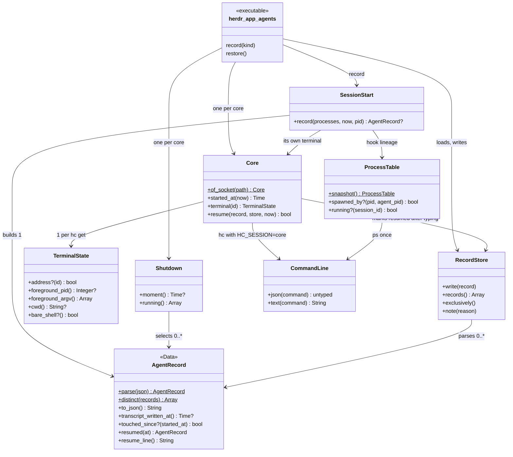
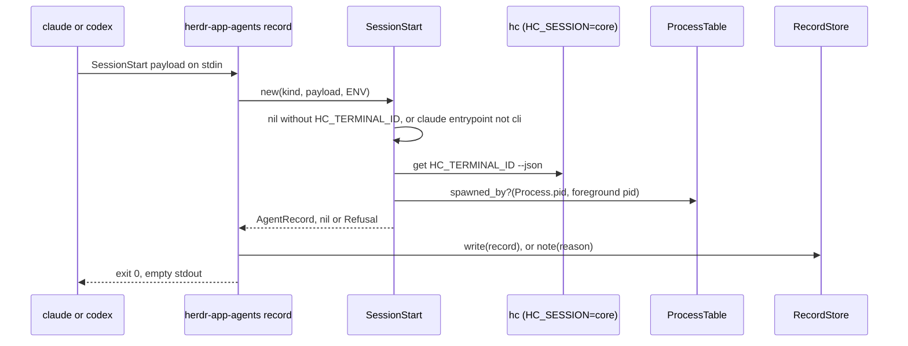
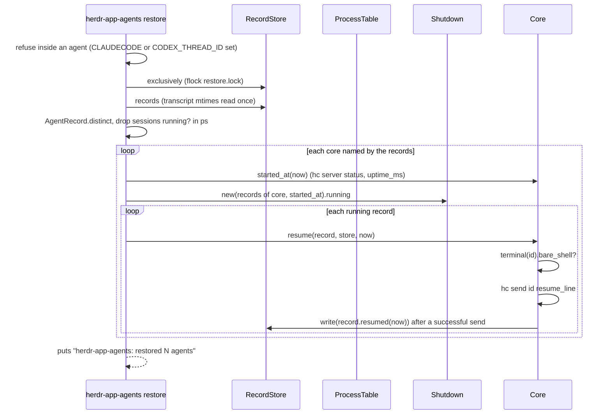
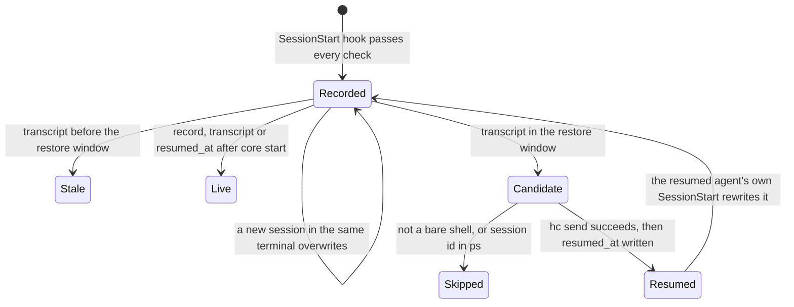

# Plan: Restore agents in herdr-app panes after a reboot or core restart

From `intent.md` (2026-11-13). Status: accepted.

## Design

### Domain terms

Existing glossary terms used: **Core** (never "server"; `hc server status` is only a command name), **herdr-app**, **Machine**, **PATH stub**. **Running agent** is not used: it means a herdr TUI pane. **Row record** is not used: it means the stage-pane list.

New terms, written into `GLOSSARY.md` after acceptance:

- **Agent record** — `<state>/herdr-app/agents/<core>/<terminal>.json`: the agent session that last started in one terminal of one core, with its kind, session id, folder, transcript path, permission flags, `recorded_at` and `resumed_at`. Avoid: pane record, session file.
- **Transcript** — the session log at the hook payload's `transcript_path`. Its mtime is the session's last write.
- **Shutdown moment** — the newest transcript write among one core's agent records that comes before that core started.
- **Restore window** — the 10 minutes up to and including the shutdown moment.
- **Bare shell** — a live terminal with no agent status, whose foreground process is its own login shell (`foreground.pid == pid`, `argv[0]` a shell). Its folder does not matter: the resume line changes folder.
- **Hook lineage** — the parent chain from the hook process up to the pane's foreground agent. Only hook runners (`sh`, `bash`, `zsh`, `dash`, `env`, `ruby`, `rv`) may stand between them.
- **Resume line** — the shell-quoted command that restore types into a bare shell: `cd <cwd> && claude --resume <id> [flags]` or `cd <cwd> && codex resume <id> [flags]`.

`<state>` is `$XDG_STATE_HOME`, else `~/.local/state`.

### Diagrams

Before: `herdr-app-migrate` holds `HerdrAppMigration::AgentSession` (`kind`, `id`, `cwd`, `resume_argv` for a new pane). `herdr-app-pane` holds `HerdrAppPane::CommandLine` (hc and herdr-app as argv, `HC_BIN` stub) and `HerdrAppPane::Terminal` (`agent?`, `at?`). Nothing records which session ran in which terminal.

After, a new library `herdr-app/.local/share/herdr-app-agents/` (module `HerdrAppAgents`) behind one new executable `herdr-app/.local/bin/herdr-app-agents`:



Record path:



Restore path:



Agent record states across one restore:



Storage replaces an ER diagram: one JSON object per file, keyed by its path. Keys: `core`, `terminal`, `kind`, `session_id`, `cwd`, `transcript_path`, `flags`, `recorded_at`, `resumed_at`.

### Signatures

`herdr-app/.local/bin/herdr-app-agents record claude|codex | restore`:

- `record` reads the payload on stdin. It rescues every `StandardError`, prints nothing on stdout (Claude adds SessionStart stdout to the model context), notes each refusal in `<state>/herdr-app/agents/recorder.log` and always exits 0.
- `restore` prints `herdr-app-agents: restored N agents` on stdout, one stderr line per candidate it skips, and exits 0. Bad arguments exit 1 with the usage line before any hc call.

```ruby
module HerdrAppAgents
  # Raised when a check fails or hc/ps refuses; the executable turns it into one line.
  class Refusal < StandardError; end

  # Runs one hc or ps command as an argument list, never a shell string. HC_BIN and PS_BIN name test stubs.
  class CommandLine
    #: (?core: String?) -> void
    def initialize(core: nil); end

    # Parsed JSON; Refusal on a non-zero exit, an "error" key or no JSON.
    #: (*String command) -> untyped
    def json(*command); end

    # Stdout; Refusal on a non-zero exit.
    #: (*String command) -> String
    def text(*command); end
  end

  # One herdr-core session, reached through hc with HC_SESSION set to its name.
  class Core
    NAME = /\A[a-z0-9][a-z0-9_-]{0,31}\z/

    # The name from <dir>/<core>/<core>.sock; Refusal for any other shape.
    #: (String? socket_path) -> Core
    def self.of_socket(socket_path); end

    #: (String name, ?command_line: CommandLine) -> void
    def initialize(name, command_line: CommandLine.new(core: name)); end

    #: -> String
    attr_reader :name

    # now - uptime_ms of `hc server status --json`; Refusal without uptime_ms.
    #: (Time now) -> Time
    def started_at(now); end

    # An unreadable answer gives a TerminalState that is never a bare shell.
    #: (String terminal) -> TerminalState
    def terminal(terminal); end

    # Types record's resume line into its terminal when that terminal is a bare shell, then writes resumed_at.
    # A refused send writes nothing, so a later run may retry. Answers whether it typed.
    #: (AgentRecord record, store: RecordStore, now: Time) -> bool
    def resume(record, store:, now:); end
  end

  # One `hc get --json` answer, read strictly: a missing field answers the safe side.
  class TerminalState
    SHELLS = %w[zsh bash sh fish dash].freeze

    #: (untyped answer) -> void
    def initialize(answer); end

    #: (String terminal) -> bool
    def address?(terminal); end

    #: -> Integer?
    def foreground_pid; end

    #: -> Array[String]
    def foreground_argv; end

    # The real path of foreground.cwd, else cwd; nil when absent or unresolvable.
    #: -> String?
    def cwd; end

    # Live, no agent status, foreground.pid == pid, argv[0] (basename, leading - stripped) in SHELLS.
    #: -> bool
    def bare_shell?; end

    # True when the foreground argv runs kind interactively: argv[0] basename is kind, and for codex the
    # first non-flag argument is not exec or e.
    #: (String kind) -> bool
    def interactive?(kind); end
  end

  # One `ps -A -ww -o pid=,ppid=,args=` snapshot.
  class ProcessTable
    HOOK_RUNNERS = %w[sh bash zsh dash env ruby rv].freeze

    #: (?command_line: CommandLine) -> ProcessTable
    def self.snapshot(command_line: CommandLine.new); end

    #: (Array[[Integer, Integer, Array[String]]] rows) -> void
    def initialize(rows); end

    # True when agent_pid is an ancestor of pid and every process between them is a hook runner.
    #: (Integer pid, Integer agent_pid) -> bool
    def spawned_by?(pid, agent_pid); end

    # True when a live process carries session_id as one of its arguments. A secondary guard: a session
    # opened without its id in argv is caught by touched_since? through its own new record.
    #: (String session_id) -> bool
    def running?(session_id); end
  end

  # Which agent session last started in which terminal of which core.
  class AgentRecord < Data.define(:core, :terminal, :kind, :session_id, :cwd, :transcript_path,
                                  :flags, :recorded_at, :resumed_at, :transcript_written_at)
    SESSION_ID = /\A\h{8}-\h{4}-\h{4}-\h{4}-\h{12}\z/
    TERMINAL = /\A[A-Za-z0-9][A-Za-z0-9_-]{0,63}\z/
    CLAUDE_MODES = %w[acceptEdits auto bypassPermissions dontAsk plan].freeze
    CODEX_SANDBOXES = %w[read-only workspace-write danger-full-access].freeze
    CODEX_APPROVALS = %w[untrusted on-failure on-request never].freeze

    # The whitelisted permission flags in a foreground argv; everything else is dropped.
    #: (String kind, Array[String] argv) -> Array[String]
    def self.flags_of(kind, argv); end

    # Refusal on any field outside its rule: kind claude|codex, SESSION_ID, Core::NAME, TERMINAL,
    # absolute cwd and transcript_path, flags that flags_of(kind, flags) keeps unchanged, ISO 8601 times.
    # transcript_written_at is not stored: the caller passes the mtime it observed once at load (nil when gone).
    #: (String json, ?transcript_written_at: Time?) -> AgentRecord
    def self.parse(json, transcript_written_at: nil); end

    # One record per session id: the newest recorded_at; a tie keeps none.
    #: (Array[AgentRecord] records) -> Array[AgentRecord]
    def self.distinct(records); end

    # Every field except transcript_written_at.
    #: -> String
    def to_json; end

    # True when recorded_at, resumed_at or transcript_written_at is at or after started_at.
    #: (Time started_at) -> bool
    def touched_since?(started_at); end

    #: (Time at) -> AgentRecord
    def resumed(at); end

    # Shellwords-quoted: cd <cwd> && claude --resume <id> <flags> | cd <cwd> && codex resume <id> <flags>.
    #: -> String
    def resume_line; end
  end

  # The agent records under <state>/herdr-app/agents/<core>/<terminal>.json.
  class RecordStore
    #: (?root: String) -> void
    def initialize(root: File.join(ENV.fetch("XDG_STATE_HOME", File.expand_path("~/.local/state")), "herdr-app/agents")); end

    # Atomic: a temporary file in the same folder, mode 0600, then rename.
    #: (AgentRecord record) -> void
    def write(record); end

    # Each file AgentRecord.parse accepts, with its transcript mtime read once; any other file warns and is skipped.
    #: -> Array[AgentRecord]
    def records; end

    # Runs the block under a non-blocking flock on restore.lock; Refusal when another restore holds it.
    #: [T] () { () -> T } -> T
    def exclusively(&); end

    # Appends one timestamped line to recorder.log.
    #: (String reason) -> void
    def note(reason); end
  end

  # One SessionStart hook call, turned into an agent record.
  class SessionStart
    #: (String kind, String payload, Hash[String, String] env, ?cores: singleton(Core)) -> void
    def initialize(kind, payload, env, cores: Core); end

    # nil outside herdr-app (no HC_TERMINAL_ID), for claude without CLAUDE_CODE_ENTRYPOINT=cli, and when the
    # terminal's foreground is not TerminalState#interactive?(kind) (a foreground `codex exec`).
    # Refusal when: the payload has no session_id or transcript_path; the hc answer names another address;
    # the hook lineage does not reach the terminal's foreground pid; HC_SESSION is set and differs from the
    # socket's core. cwd is the terminal's real foreground cwd; flags come from its foreground argv.
    #: (processes: ProcessTable, now: Time, ?pid: Integer) -> AgentRecord?
    def record(processes:, now:, pid: Process.pid); end
  end

  # The last shutdown of one core, as its agent records show it.
  class Shutdown
    WINDOW = 600 # seconds

    #: (Array[AgentRecord] records, started_at: Time) -> void
    def initialize(records, started_at:); end

    # The newest transcript write before started_at; nil when there is none.
    #: -> Time?
    def moment; end

    # Records with a transcript written in [moment - WINDOW, started_at) and not touched_since?(started_at).
    #: -> Array[AgentRecord]
    def running; end
  end
end
```

Not checked: the dotfiles repository has no Steepfile; the inline `#:` comments are documentation.

### Complexity

- Hook outside herdr-app, or for `claude -p`: 0 hc calls, 0 ps calls, 0 writes.
- Hook in a herdr-app terminal: 1 `hc get`, 1 `ps` (O(P) in the process count P, one pass), 1 temporary-file write and rename (a refusal: 1 log append). Independent of the number of panes. Ruby start-up dominates (about 0.1 s).
- Restore with R records over C cores, K candidates after the window and the `ps` filter, J sends:
  - 1 `ps` (O(P)), C `hc server status`, K `hc get`, at most J `hc send`. Total hc calls C + K + J ≤ C + 2R.
  - R file reads and R transcript stats; J record writes.
  - No `hc ls` call: a missing terminal makes `hc get` refuse, which is "not a bare shell".
- `Shutdown` and `AgentRecord.distinct` are pure over the observed records (transcript mtimes captured once at load) and O(R log R).

### Invariants

1. An agent record names the terminal whose foreground agent sent the hook. `SessionStart#record` enforces it: the core comes from `HC_TERMINAL_SOCKET`, the `hc get` address equals `HC_TERMINAL_ID`, and `ProcessTable#spawned_by?` holds. A Codex hook run by the shared app-server daemon, a nested `claude -p` and a nested `codex exec` all fail the lineage check.
2. Non-interactive runs write no record. `SessionStart#record` answers nil for claude without `CLAUDE_CODE_ENTRYPOINT=cli` and for a foreground that is not `TerminalState#interactive?(kind)`, such as `codex exec` run directly in a pane; nested runs also fail invariant 1.
3. One core and terminal pair holds at most one record, the latest. The store path enforces it.
4. Restore types only validated, quoted values. `AgentRecord.parse` validates every field at load; `resume_line` joins fixed words, a UUID, whitelisted flags and a `Shellwords`-escaped cwd.
5. Restore types only into a bare shell. `Core#resume` reads `hc get` directly before `hc send`; `TerminalState#bare_shell?` answers false for any missing field. A gap of milliseconds between the two calls stays open: hc has no atomic predicate for a shell, and `hc send` waits for an unfinished draft.
6. Each session resumes at most once. `RecordStore#exclusively` lets one restore run at a time; `AgentRecord.distinct` keeps one record per session id across cores; `Shutdown#running` drops records touched since the core start, which covers a session reopened elsewhere through its own new record; the restore drops ids `ProcessTable#running?` sees; `Core#resume` writes `resumed_at` after a successful send, so a re-run never retypes and a refused send may retry.
7. A record of one core never restores into another. Every hc call of `Core` runs with `HC_SESSION=<core>`; `Shutdown` uses that core's own start.
8. Only sessions in the restore window resume. `Shutdown#running` enforces it.
9. Store paths stay inside the state folder. `Core::NAME` and `AgentRecord::TERMINAL` reject `/` and `.` prefixes before a path is built.
10. The recorder never breaks or pollutes a session: the executable rescues in record mode, keeps stdout empty and exits 0.
11. Restore never starts a core with an agent's environment. The executable refuses `restore` when `CLAUDECODE` or `CODEX_THREAD_ID` is set, because `hc server status` starts a stopped core with the caller's environment.

### Alternatives

- **A — smallest module (rejected).** One executable and one file with two classes (`AgentRecord`, `Core`), reusing `HerdrAppPane::CommandLine` (given an `env:` and a `run`), `HerdrAppPane::Terminal` (given `bare_shell?`) and `AgentSession#resume_command` (made public). Fewest files, one kind-to-command mapping. Rejected: it couples three libraries and two `Refusal` classes, folds hook vetting into the storage value, uses a depth-3 ancestry heuristic instead of a hook-runner chain, and has no `resumed_at`, so a failed send is retyped on the next run.
- **B — safest restore (chosen, trimmed).** Its own small library with strict validation, a hook-lineage check, per-core `HC_SESSION`, a `flock` on `restore.lock`, and `resumed_at` written after a successful send. Trimmed from the architect's draft: the `Permission` class folds into `AgentRecord.flags_of`, and the bare-shell check no longer demands the record's folder.
- **C — scan, no records (rejected).** Match transcripts to terminals by folder at restore time. It cannot tell four sessions in one folder apart, which is the problem the intent states.

`AgentSession` is not reused: `resume_argv` builds a new pane's argv, restore types one line into an existing shell, and `AgentSession` models a herdr TUI running agent. The cost is a second kind-to-command mapping; a unit test in each library pins its own.

## Design decisions

- Name: `herdr-app-agents`, with subcommands `record` and `restore`. The intent asks for "a new restore command"; one executable holds both halves so they share one library.
- The shutdown moment is the newest transcript write before the core started (from `uptime_ms`), per core. A transcript-anchored moment stays correct after a long power-off; the core start alone would not.
- Permission flags come from the terminal's foreground argv (`hc get`), for both kinds: Claude `--permission-mode <mode>` and `--dangerously-skip-permissions`; Codex `--dangerously-bypass-approvals-and-sandbox`, `-s/--sandbox <mode>` and `-a/--ask-for-approval <policy>`. `codex resume` takes these flags (checked with `codex resume --help`, Codex 0.168.0); it has no `--full-auto`. The payload's `permission_mode` is not used: argv is the same source for both kinds.
- Restore types `cd <cwd> && <agent> …` with `hc send`, because the kept shell may stand in another folder than the session's.
- `hc send` already waits for a person's unfinished draft (its help says so), which covers half-typed text at a prompt.
- No dry-run flag: the intent does not ask for one.
- Records are never pruned (a `SessionEnd` hook is out of scope). A record of a closed terminal is harmless: `hc get` refuses and nothing is typed.
- Conflict with intent's `## Decisions`: none. Risk against the acceptance criteria: see the Codex daemon risk below.

## Integration points

- `hc get`, `hc send`, `hc server status` with `HC_SESSION=<core>` (verified: `HC_SESSION=default` and `HC_SESSION=work hc ls --json` each list their own core).
- Claude `SessionStart` hook payload (`session_id`, `transcript_path`, `cwd`, `source`) and env (`HC_TERMINAL_ID`, `HC_TERMINAL_SOCKET`, `CLAUDE_CODE_ENTRYPOINT`).
- Codex `SessionStart` hook payload (`session_id`, `transcript_path`; herdr's own Codex hook reads both) and env.
- `ps -A -ww -o pid=,ppid=,args=`.
- Claude `settings.json` and Codex `config.toml` hook tables. Codex asks once to trust the new hook (`hooks.state` hash).
- Stow: the executable reaches `~/.local/bin` only after Etienne restows `herdr-app` (rule 12). Until then the hook command fails quietly (`|| true`).

## Files that change

- `herdr-app/.local/bin/herdr-app-agents` — new executable: argument parsing, `record` and `restore`.
- `herdr-app/.local/share/herdr-app-agents/command_line.rb` — `Refusal`, `CommandLine`.
- `herdr-app/.local/share/herdr-app-agents/core.rb` — `Core`, `TerminalState`.
- `herdr-app/.local/share/herdr-app-agents/process_table.rb` — `ProcessTable`.
- `herdr-app/.local/share/herdr-app-agents/agent_record.rb` — `AgentRecord`, `RecordStore`.
- `herdr-app/.local/share/herdr-app-agents/session_start.rb` — `SessionStart`.
- `herdr-app/.local/share/herdr-app-agents/shutdown.rb` — `Shutdown`.
- `claude/.claude/settings.json` — a `SessionStart` entry, matcher `^(startup|resume|clear|compact|fork)$`, command `"$HOME/.local/bin/herdr-app-agents" record claude || true`, timeout 10. Appended after the existing entries.
- `codex/.codex/config.toml` — a `[[hooks.SessionStart]]` table after the agent-voice table, same matcher, command `'"$HOME/.local/bin/herdr-app-agents" record codex || true'`. It goes after agent-voice so `agent_voice_test.rb`'s first-table regex keeps matching.
- `test/herdr_app_agents_harness.rb` — new (departure from the plan: a separate harness, so `herdr_app_harness.rb` and its tests stay untouched): PATH stubs of `hc` and `ps` answering `server status`, `get` and `send` per core from a `world.json`, plus fixtures for `hc get` answers.
- `test/herdr_app_agents_test.rb` — new: unit tests.
- `test/herdr_app_agents_cli_test.rb` — new: the executable against PATH stubs of `hc` and `ps`, `XDG_STATE_HOME` in a tmpdir.
- `agents/.agents/skills/dotfiles-maintenance/references/herdr-app-cores.md` — "After a core restart" names `herdr-app-agents restore`.

## Order of work

1. Write the acceptance test "starting a Claude session in a herdr-app pane writes a record" in `test/herdr_app_agents_cli_test.rb` (stub `hc get` and `ps` chain recorder → `sh` → agent pid), run it, watch it fail.
2. Write `test/herdr_app_agents_harness.rb` (per-core terminals, `server status`, `send` log, a `ps` PATH stub); the existing herdr-app tests stay untouched.
3. Build `CommandLine`, `TerminalState`, `ProcessTable`, `AgentRecord`, `RecordStore`, `SessionStart` with their unit tests, red/green per method, until step 1 passes.
4. Add the remaining record criteria: Codex records, `claude -p` writes nothing, a daemon-shaped chain writes nothing and logs a refusal, a malformed payload exits 0 with empty stdout.
5. Write the restore acceptance tests (Claude, Codex, four sessions in one folder, old transcript, non-bare shell, double resume, `work` core, count line), then build `Shutdown` and `Core` until they pass.
6. Add the hook entries to `claude/.claude/settings.json` and `codex/.codex/config.toml`. Run `bin/test test/agent_voice_test.rb test/agent_coexistence_config_test.rb test/codex_config_test.rb`.
7. Update `herdr-app-cores.md`.
8. Run `bin/test`, then `rubocop` on every touched Ruby file and `lefthook run pre-commit`.
9. Live checks, recorded in the review evidence:
   - Open a scratch herdr-app pane (`herdr-app-pane open <scratch dir> --unlisted`) and start `claude --settings <scratch settings.json>` whose only hook is `SessionStart` → `<worktree>/herdr-app/.local/bin/herdr-app-agents record claude`. Confirm one record with the right terminal, session id and cwd, then close the pane.
   - In that run, print the real hook lineage (`ps` chain from the hook to claude) into `recorder.log` or the record test notes, and confirm only hook runners stand between.
   - Codex gate: start a plain `codex` (no `--no-daemon`) in a scratch herdr-app pane with the record hook and read `recorder.log`. A record passes. A lineage refusal naming `app-server` means plain Codex sessions cannot be recorded from the pane: stop, keep the Codex code and its stubbed tests, and report `Decision needed: plain Codex hooks run in the app-server daemon` to the coordinator instead of declaring the Codex criteria met.
   - Controlled restart in a sandbox core, never `default` or `work`: from `env -i HOME=$HOME PATH=$PATH`, start a short-named sandbox core (`HC_SESSION=rq1 hc server status`), open two `claude --model haiku` sessions in one folder in two kept terminals of that core with the record hook, send each one prompt, then `hc server restart` that core. Confirm both terminal ids survive, run `herdr-app-agents restore`, and confirm each terminal shows its own session id again and the count line says 2. Repeat with Codex if the Codex gate passed. Stop the sandbox core afterwards. A full reboot stays unverified until Etienne's first real one.
   - Run `herdr-app-agents restore` a second time: it prints `restored 0 agents` and types nothing.

## Risks

- **Codex hooks may run in the shared app-server daemon.** Since Codex 0.160 a plain `codex` hands work to a daemon that keeps its own environment (see `zsh/.config/zsh/unlocked-bin/codex`). If its hooks run there, the lineage check refuses every plain Codex record, and only `--no-daemon` (unlocked) Codex sessions restore. The design refuses rather than guess a pane. Step 9 measures it. A live probe in the plan stage was not possible: a one-off hook needs `--dangerously-bypass-hook-trust`, which the plan stage did not run.
- `HC_TERMINAL_ID` survives a core restart: verified from `hc --help` ("stop parks kept terminals; next core start gives them shells") and the runbook. A full reboot is assumed to behave the same, because the kept terminals live in `terminals.json` with `next_id`.
- `hc server status` starts a stopped core with the caller's environment. Invariant 11 refuses a restore from inside an agent. A restore from a plain terminal may start the `work` core; that is what Etienne does by hand today.
- The shutdown moment is inferred from transcripts, as intent's decision chose over a `SessionEnd` hook. hc gives no independent stop time (`hc server status` reports only `uptime_ms`). If every agent ended long before the core stopped, the newest transcripts still define the window, and their sessions resume into their bare shells. Etienne runs restore by hand right after a restart, so he sees and closes such a session. A transcript written just before the core start by a session that had already ended counts as running for the same reason.
- The hook adds about 0.1 s of Ruby start-up and one `hc get` to every session start in herdr-app; outside herdr-app it exits before any call.
- Rejected: a `SessionEnd` hook, an `hc ls` scan, folder-only matching, the `flock`, a LaunchAgent (all out of scope or not needed).

Out of scope (from `intent.md`): automatic restore after login, a `SessionEnd` hook, the herdr TUI and Rex, topic matching for panes with no record, a fix in herdr itself.

## Proof

- Starting a Claude session in a herdr-app pane writes a record → `test/herdr_app_agents_cli_test.rb` `test_record_claude_writes_the_terminals_record`
- Starting a Codex session in a herdr-app pane writes a record → `test/herdr_app_agents_cli_test.rb` `test_record_codex_writes_the_terminals_record`; live: step 9 Codex check
- Running `claude -p` writes no record → `test/herdr_app_agents_cli_test.rb` `test_record_skips_claude_print_mode` and `test_record_skips_a_foreground_codex_exec`
- After a core restart, restore runs `claude --resume <id>` in the pane that held that session → `test/herdr_app_agents_cli_test.rb` `test_restore_resumes_claude_in_its_terminal`
- After a core restart, restore runs `codex resume <id>` in the pane that held that session → `test/herdr_app_agents_cli_test.rb` `test_restore_resumes_codex_in_its_terminal`
- Four sessions in one folder each return to their own pane → `test/herdr_app_agents_cli_test.rb` `test_restore_returns_four_sessions_in_one_folder_to_their_own_terminals`
- A pane whose transcript was last written more than 10 minutes before shutdown is left alone → `test/herdr_app_agents_cli_test.rb` `test_restore_leaves_a_transcript_older_than_the_window`
- A pane that no longer shows a bare shell is left alone → `test/herdr_app_agents_cli_test.rb` `test_restore_leaves_a_terminal_that_is_not_a_bare_shell`
- A session already open in another pane is not resumed twice → `test/herdr_app_agents_cli_test.rb` `test_restore_skips_a_session_reopened_elsewhere_without_its_id_in_argv`, `test_restore_skips_a_session_whose_id_is_in_ps`, `test_restore_twice_types_once` and `test_restore_refuses_while_another_restore_holds_the_lock`
- Panes on the `work` core restore the same way as on `default` → `test/herdr_app_agents_cli_test.rb` `test_restore_covers_the_work_core_with_its_own_hc_session`
- The command reports how many agents it restored → `test/herdr_app_agents_cli_test.rb` `test_restore_prints_the_count`
- Query count: one record call runs 1 `hc get` and 1 `ps`; restore runs one `hc server status` per core and no `hc ls` → `test/herdr_app_agents_cli_test.rb` `test_record_makes_one_hc_call`, `test_restore_calls_hc_once_per_core_and_per_candidate`
- Invariant: a daemon-run or nested hook writes no record, enforced by `SessionStart#record` → `test/herdr_app_agents_cli_test.rb` `test_record_refuses_a_broken_hook_lineage`
- Invariant: the recorder exits 0 with empty stdout, enforced by the executable → `test/herdr_app_agents_cli_test.rb` `test_record_survives_a_malformed_payload`
- Invariant: restore refuses inside an agent, enforced by the executable → `test/herdr_app_agents_cli_test.rb` `test_restore_refuses_inside_an_agent`
- Invariant: a tampered record types nothing, enforced by `AgentRecord.parse` → `test/herdr_app_agents_cli_test.rb` `test_restore_skips_a_tampered_record`
- Hook entries are present → check: `ruby -rjson -e 'p JSON.parse(File.read("claude/.claude/settings.json")).dig("hooks","SessionStart").any? { _1["hooks"].any? { |h| h["command"].include?("herdr-app-agents\" record claude") } }'` prints `true`; `grep -n 'herdr-app-agents" record codex' codex/.codex/config.toml` finds one line.

Per changed file, the unit tests expected, named as behaviour (`test/herdr_app_agents_test.rb`):

- `command_line.rb`: `CommandLine#json sets HC_SESSION for a core`, `refuses an error answer`, `CommandLine#text refuses a non-zero exit`.
- `core.rb`: `Core.of_socket names the core from its socket`, `refuses an odd socket path`, `Core#started_at subtracts uptime_ms`, `Core#resume types only into a bare shell`, `writes resumed_at after a successful send`, `writes nothing when the send is refused`; `TerminalState#bare_shell? refuses an agent, a child process and a missing field`, `accepts a shell in another folder`; `TerminalState#interactive? refuses codex exec`.
- `process_table.rb`: `ProcessTable#spawned_by? passes hook runners only`, `refuses an app-server between`, `ProcessTable#running? finds a session id in argv`.
- `agent_record.rb`: `AgentRecord.flags_of keeps whitelisted flags only`, `AgentRecord.parse refuses each bad field`, `AgentRecord.distinct keeps the newest per session and none on a tie`, `AgentRecord#resume_line quotes a cwd with a space and a quote`, `AgentRecord#touched_since? reads recorded_at, resumed_at and transcript mtime`; `RecordStore#write is atomic and keyed by core and terminal`, `RecordStore#records skips an unreadable file`, `RecordStore#exclusively refuses a second holder`.
- `session_start.rb`: `SessionStart#record answers nil outside herdr-app`, `nil for claude print mode`, `refuses another address`, `refuses a conflicting HC_SESSION`, `records the foreground cwd and flags`.
- `shutdown.rb`: `Shutdown#moment is the newest transcript before the core start`, `Shutdown#running keeps 600 s and drops 601 s`, `drops a missing transcript`, `drops records touched since the start`.

Test setup: PATH stubs for `hc` (`herdr_app_agents_harness.rb`, per-core terminals and `server status`) and `ps` (a process table from the world). `XDG_STATE_HOME` in a tmpdir (stubs only: the real `hc` finds its core socket through it, so live checks use the real state folder and remove their records afterwards); transcripts are tmp files whose mtime the test sets with `File.utime`. Session ids are invented UUIDs. No test reaches a real core.

---
Domain skills applied: software-design, object-oriented-design, ruby-style, glossary, diagrams, dotfiles-maintenance.

## Critique

### Round 1 (codex gpt-6.1-sol, medium)

- The shutdown moment taken from the newest transcript can pick days-old sessions when every agent ended long before the core stopped → dismissed: intent's decisions chose the transcript window over a SessionEnd hook, and hc offers no independent stop time (`hc server status` reports only `uptime_ms`); the case is now named under Risks, and Etienne runs restore by hand right after a restart.
- Plain Codex support is an unverified prerequisite, and a lineage refusal cannot satisfy the Codex criteria → fixed (step 9 is now a Codex gate: a refusal stops the implementer, who reports a `Decision needed:` line instead of declaring the Codex criteria met)
- Session ids in argv do not identify a session reopened without its id → fixed (the primary guard is now stated as `touched_since?` through the reopened session's own new record; `running?` is secondary; a test covers a picker resume without the id in argv)
- Dropping the lock breaks at-most-once under two concurrent restores → fixed (`RecordStore#exclusively` with a `flock` on `restore.lock` is back, with a test)
- Separate `hc get` and `hc send` leave a race → dismissed: hc has no atomic predicate for a shell, intent excludes changes to herdr, `hc send` waits for an unfinished draft, and the gap is milliseconds during a command Etienne runs himself; the gap is now stated in invariant 5.
- Writing `resumed_at` before the send makes a failed send permanently ineligible → fixed (`resumed_at` is written after a successful send; the lock prevents a double send; a refused send may retry)
- The bare-shell check relies on unverified pid fields and needlessly demands the record's folder → fixed (pid and foreground fields verified live and added to the harness fixtures; the folder requirement is gone because the resume line changes folder)
- Hook lineage does not establish interactivity for a foreground `codex exec` → fixed (`TerminalState#interactive?` checks the foreground argv, with tests)
- The proof simulates restarts instead of exercising one → fixed (step 9 adds a controlled restart of a sandbox core with two sessions in one folder; a full reboot stays named as unverified)
- The complexity and purity claims misdescribe `ps` cost and live transcript stats → fixed (costs now name the process count; transcript mtimes are read once at load into `AgentRecord#transcript_written_at`)
