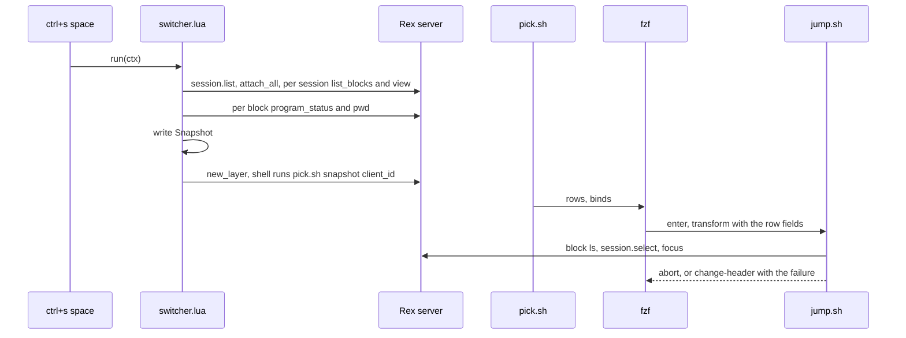
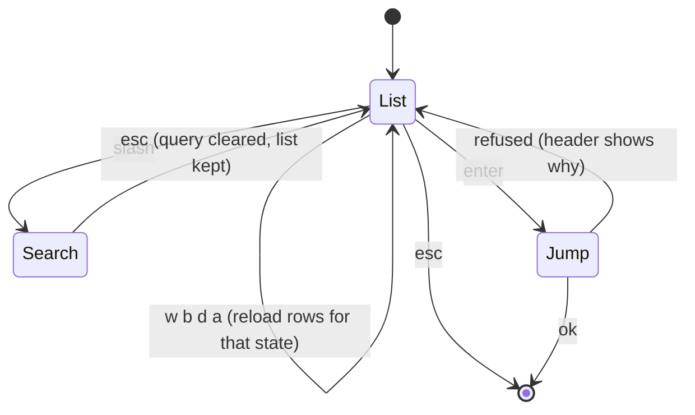

# Plan: Rex agent and terminal switcher

From `intent.md` (2026-11-04). Status: accepted.

## Design

### Domain terms

- **Pane**: one Rex block in a tab. It is one row in the panel.
- **State**: the most urgent state among the block's `program_status` records, in the order `blocked`, `error`, `done`, `working`, `idle`. A block with no record is `shell`. The row's message is the `msg` of the record that won.
- **Row**: one tab-separated line: `state`, `session / tab`, `program`, `cwd`, `message`, then the hidden `session_id`, `window_id`, `block_id`. fzf shows the first five fields.
- **Snapshot**: the file of rows that Lua writes when the panel opens. Filters and search read it. They never ask Rex again.
- **Switcher**: the floating panel and the scripts behind it.
- **List mode / search mode**: list mode binds `w`, `b`, `d`, `a`, `j`, `k` as keys. Search mode types them as text. `/` enters search mode, `esc` leaves it.
- **Jump**: select the session and tab in the app, then focus the pane.
- Not in `GLOSSARY.md` yet: Pane, State, Row, Snapshot, Switcher, Jump. None of them is on an `Avoid:` list. They are added to the glossary on acceptance.

### Diagrams





### Signatures

The change adds no Ruby classes. The "objects" are one Lua module, one Lua action and three shell scripts. Each has one job and a plain contract.

`rex/.config/rex/switcher_rows.lua` is pure. It needs no `rex` global, so `luajit` can run it in a test.

```lua
-- Turns collected panes into Snapshot lines.
-- panes: { { session_id, session, window_id, tab, block_id, program?, cwd?, records? } ... }
-- records: the block's program_status records. The row takes the most urgent one:
-- blocked, error, done, working, idle. No records means state shell.
-- Replaces tabs and newlines inside fields with spaces. Returns one string per pane, 8 fields each.
-- Sort order of rows: blocked, error, done, working, idle, shell.
function SwitcherRows.lines(panes) end
```

`rex/.config/rex/switcher.lua` is the glue. It is the only Lua file that touches `rex`.

```lua
-- Collects every pane in Rex, writes the Snapshot, opens the floating picker.
-- ctx: { session_id, block_id, client_id, origin }
rex.action({ name = "agent_switcher", title = "Agent switcher", keywords = "agents panes switch jump", run = ... })
```

`rex/.config/rex/switcher/rows.sh <w|b|d|a> <snapshot>` prints the rows for one filter, stdout only. `w`, `b` and `d` keep rows whose state field is `working`, `blocked` or `done`. `a` keeps all rows. No match prints one sentinel row: empty ids and the text `No panes match`. An unknown filter exits 1.

`rex/.config/rex/switcher/jump.sh <client_id> <session_id> <window_id> <block_id>` performs the jump. It prints an fzf action on stdout and always exits 0:
- empty `block_id` (the sentinel row): prints nothing and makes no `rex` call.
- the pane is gone (`rex block ls -s <session_id>` lacks it): prints `change-header(Pane no longer exists)`.
- `rex -C <client_id> do session.select session_id=.. window_id=..` fails: prints `change-header(<one-line Remote Control hint>)`.
- `rex focus <block_id>` fails (the pane closed after the check): prints `change-header(Pane no longer exists)`.
- otherwise prints `abort`.

`rex/.config/rex/switcher/pick.sh <snapshot> <client_id>` is only wiring: it runs fzf with the binds below and removes the snapshot on exit. `pick.sh esc` is the one other entry point: it prints the `esc` action described below and nothing else.
- `--disabled --delimiter '\t' --with-nth 1..5 --prompt '> '` and a `start` bind that loads the `a` rows and sets the header.
- `w`, `b`, `d`, `a`: `reload(rows.sh <f> <snapshot>)+change-prompt(...)`. `j` and `k`: `down` and `up`.
- Each filter key also runs `change-header(<filter name>, snapshot taken at open)`. The header, not the prompt, carries the filter name, so leaving search mode needs no stored state.
- `/`: `enable-search+unbind(w,b,d,a,j,k,/)+change-prompt(/ )`.
- `esc`: `transform(pick.sh esc)`. `pick.sh esc` reads `$FZF_PROMPT`. A prompt that starts with `/ ` prints `disable-search+clear-query+rebind(w,b,d,a,j,k,/)+change-prompt(> )`. Any other prompt prints `abort`.
- `enter`: `transform(jump.sh <client_id> {6} {7} {8})`.

`rex/.config/rex/init.lua` keeps every current binding. `ctrl+s>space` now runs `agent_switcher`, and `require("switcher")` loads the action. `shift+cmd+k` stays on `session.switch`.

Not checked: this dotfiles repository declined Steep and `rbs_rails`, and the change adds no Ruby production code.

### Complexity

- Open: 1 `session.list`, 1 `session.attach_all`, then per session one block list and one view, and per block one `program_status` and one `pwd`. That is about 1 + 1 + 2 × 23 + 2 × 90 = 228 in-process calls. A probe of the same walk with `program_status` only (23 sessions, 90 panes) took 71 ms wall time through `rex do`.
- Open spawns one process: the shell that runs `pick.sh`. The old shell loop spawned about 90 and took about 3 s.
- A filter key runs `rows.sh` once: one `awk` pass over about 90 lines. It makes no `rex` call.
- Enter makes 3 `rex` calls: `block ls`, `do session.select`, `focus`.

### Invariants

- A pane with no `program_status` record has state `shell`. Enforced in `SwitcherRows.lines`.
- Every Snapshot row has exactly 8 fields. Tabs and newlines inside a field become spaces. Enforced in `SwitcherRows.lines`.
- A filter keeps rows by the state field, never by the display text. A message that says "blocked" does not match `b`. Enforced in `rows.sh`.
- Filter keys never call `rex`. Enforced by `rows.sh`, which only reads the snapshot.
- Enter on the sentinel row, on a gone pane, when `session.select` fails or when `focus` fails never closes the panel. Enforced in `jump.sh`: it prints `abort` only after `focus` succeeds.
- `esc` in search mode keeps the list and the filter. Enforced in `pick.sh`: leaving search mode never reloads.
- `init.lua` keeps every current binding except `ctrl+s>space`. Enforced by the config test.

### Alternatives

- **One shell script that collects with the `rex` CLI** (the reference pattern, about 90 spawns). It is the smallest diff, but the same walk measured about 3 s per open. Rejected for open time. The CLI collector stays as the fallback if `attach_all` fails inside an action.
- **Many small scripts with a mode state file and `reload` through a data layer**. Each key spawns `mode.sh`, `list.sh`, `rows.sh` and `filter.sh`. The mode state couples the scripts by file name. Rejected: more files and moving parts for the same behaviour. This plan keeps its testable contracts (small scripts, stdout is the interface) but drops the state files, because the list itself holds the filter.
- **Pure Lua picker, no fzf**. Rex has no list widget with single-key filters and search. Rejected.

## Design decisions

- Lua collects the data. The reference pattern collects in shell, but the 3 s open time fails the "quickly jump" goal. `intent.md` fixes the behaviour, not the collector.
- `enter` uses `transform`, and `jump.sh` prints the fzf action. The panel stays open on a refusal and the failure message shows in the header. This needs fzf 0.45 or newer. The installed fzf is 0.74.5.
- `jump.sh` always exits 0, so a failure never breaks fzf. The failure is the printed action.
- Pane labels come from Rex tab and session labels, which this migration set to the Herdr names.
- No conflict with `intent.md`'s `## Decisions`.

## Integration points

- Rex Lua API: `rex.action`, `rex.call`, `rex.block.call`, `rex.session.new_layer`, `rex.layout.block`, `rex.json`.
- Rex server API: `session.list`, `session.attach_all`, `session.list_blocks`, `session.view`, block methods `program_status` and `pwd`.
- Rex CLI: `rex block ls`, `rex -C <client> do session.select`, `rex focus`.
- `fzf` 0.74.5, `jq`, `awk`, and `luajit` for the Lua test (skipped when absent).
- Stow: the new `rex` package is declared in `packages.conf`. Etienne runs `stow rex` himself.

## Files that change

- `rex/.config/rex/init.lua` — new: the current bindings, `require("switcher")`, and `ctrl+s>space` bound to `agent_switcher`.
- `rex/.config/rex/switcher.lua` — new: the collector and the action.
- `rex/.config/rex/switcher_rows.lua` — new: the pure row builder.
- `rex/.config/rex/switcher/rows.sh`, `jump.sh`, `pick.sh` — new: the three scripts.
- `test/rex_switcher_rows_test.rb`, `test/rex_switcher_scripts_test.rb`, `test/rex_config_test.rb` — new tests.
- `packages.conf` — add `rex` to `STOW`.
- `README.md` — one line for the `rex` package, if the README lists packages.
- `GLOSSARY.md` — the new terms, in their own commit after acceptance.

## Order of work

1. Spike in Rex, before any file: write a throwaway Lua file in the scratchpad that defines an action. Run it with `rex do <file> --action <name>`. The action calls `session.attach_all`, walks all sessions, and opens a disposable floating layer that runs a command and exits. Record: whether `attach_all` works inside an action; which fields `session.list_blocks`, `session.view`, `pwd` and `program_status` return, with a record list longer than one; whether the layer closes when its command exits. If `attach_all` fails inside an action, switch the collector to the CLI fallback. If the layer stays open, `pick.sh` closes it with `rex block close`, and the plan notes it in `## Risks`.
2. Write the acceptance test for criterion 1 (`b` lists only blocked agents) in `test/rex_switcher_scripts_test.rb`. Run it. Watch it fail.
3. Write `rows.sh` until the filter tests pass: `w`, `b`, `d`, `a`, the sentinel, the unknown filter.
4. Write the `jump.sh` tests, then `jump.sh`: live pane, gone pane, select refused, sentinel.
5. Write the `pick.sh` argv test with a stub `fzf`, then `pick.sh`.
6. Write the `SwitcherRows.lines` test (`luajit`), then `switcher_rows.lua`.
7. Write `switcher.lua` from the spike's facts, and `init.lua` with the config test first.
8. Add `rex` to `packages.conf`. Run `stylua --check`, `shellcheck -x -S warning`, rubocop and the full suite through `bin/test`.
9. Check in Rex (rule 22). The running Rex server reads its config file at start, so the agent cannot load the worktree config by setting `REX_CONFIG`. Run `rex config check` against the worktree file, and run the action with `rex do <worktree>/rex/.config/rex/init.lua --action agent_switcher`. Record the output. The key presses (`ctrl+s space`, `b`, `/`, `esc`, Enter) are checked by Etienne after `stow rex` and a config reload; the final account says so.

## Risks

- `session.attach_all` may behave differently inside an action than under `rex do`. The spike (step 1) answers it. The fallback is a CLI collector in `rows.sh`, at about 3 s per open, or a parallel one at 0.2 to 0.5 s.
- Lua inside Rex may not be the same dialect as `luajit`. The pure module uses plain Lua 5.1 syntax only. The by-hand check covers the real runtime.
- Rex shows the app's tab and the session's active window out of step in some cases (open feedback). `session.select` takes `window_id`, so the tab switch goes through the app. The by-hand check confirms the pane lands focused.
- The snapshot goes stale while the panel is open. A pane that closes is caught at jump time. A state change shows only on the next open. Accepted, and said in the panel header.
- The floating layer must close when `pick.sh` exits. The spike (step 1) opens a disposable layer to confirm it, and `pick.sh` closes it with `rex block close` if it does not.
- A block can hold several `program_status` records, for example a working root with a blocked child, and records can report `error`. `SwitcherRows.lines` takes the most urgent record, so `b` cannot miss a blocked pane.
- `rex focus` may need `-s <session>` to reach a pane in another session. Step 4 settles it against the real CLI help.
- The panel does not run `stow`. The old `~/.config/rex/init.lua` stays until Etienne moves it aside.
- Rejected: state files and a data layer (see Alternatives), a cached status daemon (adds a process nobody asked for).

## Proof

- `b` lists only blocked agents → `test/rex_switcher_scripts_test.rb` `test_rows_for_b_keep_only_blocked_panes`
- `w` lists only working agents, `d` only done agents → `test/rex_switcher_scripts_test.rb` `test_rows_for_w_keep_only_working_panes`, `test_rows_for_d_keep_only_done_panes`
- `a` lists every pane, shells and idle agents included → `test/rex_switcher_scripts_test.rb` `test_rows_for_a_keep_every_pane`
- `/` then `caren` lists only rows that mention Caren → `test/rex_switcher_scripts_test.rb` `test_search_matches_any_visible_column` (real `fzf --filter caren` over the rows)
- `esc` returns to list mode with the same filter → `test/rex_switcher_scripts_test.rb` `test_esc_in_search_mode_leaves_search_without_reloading`, `test_esc_in_list_mode_aborts`
- Enter on a pane in another session shows that pane, focused → `test/rex_switcher_scripts_test.rb` `test_jump_selects_the_session_and_window_then_focuses_the_pane`, and check: the by-hand run in Rex (step 9)
- No matching pane shows "No panes match" and Enter does nothing → `test/rex_switcher_scripts_test.rb` `test_no_match_prints_the_sentinel_row`, `test_jump_on_the_sentinel_row_makes_no_rex_call`
- Remote Control off prints a hint and the panel stays open → `test/rex_switcher_scripts_test.rb` `test_jump_refused_by_session_select_keeps_the_panel_open`
- The pane closed after the list was built → `test/rex_switcher_scripts_test.rb` `test_jump_to_a_gone_pane_says_so_and_stays_open`
- `ctrl+s space` opens the panel, `shift+cmd+k` keeps `session.switch` → `test/rex_config_test.rb` `test_ctrl_s_space_opens_the_switcher`, `test_shift_cmd_k_keeps_session_switch`
- The new `init.lua` keeps every other current binding → `test/rex_config_test.rb` `test_every_other_current_binding_is_kept`
- Invariant: a pane with no record has state `shell`, every row has 8 fields, and the most urgent record wins, enforced by `SwitcherRows.lines` → `test/rex_switcher_rows_test.rb` `test_a_pane_without_a_record_is_a_shell`, `test_every_row_has_eight_fields`, `test_a_blocked_child_record_beats_a_working_root`
- Invariant: a filter matches the state field, not the message, enforced by `rows.sh` → `test/rex_switcher_scripts_test.rb` `test_a_message_that_says_blocked_does_not_match_b`
- Invariant: filter keys never call `rex`, enforced by `rows.sh` → `test/rex_switcher_scripts_test.rb` `test_rows_never_call_rex`
- Invariant: the panel closes only after `focus` succeeds, enforced by `jump.sh` → `test/rex_switcher_scripts_test.rb` `test_jump_aborts_only_after_focus_succeeds`, `test_jump_when_focus_fails_stays_open`

Per changed file, the unit tests expected, named as behaviour:
- `rex/.config/rex/switcher_rows.lua`: `lines sorts blocked, error, done, working, idle, shell`, `lines turns tabs and newlines into spaces`, `lines marks a pane without a record as shell`, `lines takes the most urgent record and its message`
- `rex/.config/rex/switcher/rows.sh`: `keeps one state per filter`, `keeps every row for a`, `prints the sentinel when nothing matches`, `refuses an unknown filter`
- `rex/.config/rex/switcher/jump.sh`: `selects then focuses`, `refuses a gone pane`, `refuses when select fails`, `refuses when focus fails`, `ignores the sentinel row`
- `rex/.config/rex/switcher/pick.sh`: `passes the binds for w, b, d, a, slash, esc and enter to fzf`, `esc prints the search-exit actions for a search prompt and abort for the list prompt`, `removes the snapshot on exit`
- `rex/.config/rex/init.lua`: `keeps the current bindings`, `binds ctrl+s space to the switcher`
- `rex/.config/rex/switcher.lua`: no unit test. It is glue over the Rex runtime. The spike and the by-hand check cover it.

Test setup: `rex`, `fzf` and `jq` are PATH stubs in a per-test bin directory, in the style of `test/herdr_open_column_test.rb`. The stub `rex` logs its argv and answers from canned output. Real `jq`, `awk` and `fzf --filter` are used where the test is about their behaviour. The Lua test runs `luajit` and skips when it is missing.

---
Domain skills applied: software-design, glossary, diagrams, object-oriented-design.

## Critique

### Round 1 (codex terra)

- Step 9 cannot load the worktree config with `REX_CONFIG`; the running Rex server reads it at startup → fixed (step 9 now uses `rex config check` and `rex do <file> --action`; the key presses are left to Etienne after `stow rex`, and the Risks and final account say so)
- `program_status` returns several records and supports `error`; a working root can coexist with a blocked child → fixed (State is the most urgent record: blocked, error, done, working, idle; the message comes from the winning record; Proof adds a mixed-record test)
- `jump.sh` does not handle `rex focus` failing after the check → fixed (a failing `focus` prints a change-header action that says the pane no longer exists; invariant and a focus-race test added)
- The spike does not create a floating layer or observe its closure → fixed (step 1 opens a disposable layer and records whether it closes; `pick.sh` falls back to `rex block close`)
- The fzf exit transition is underspecified → fixed (exact actions for `/` and `esc`, the filter name moves to the header, and `pick.sh esc` is tested for both prompts)
