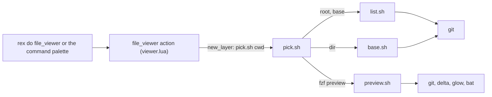

# Plan: Changed-files viewer for Rex

From `intent.md` (2026-11-04). Status: accepted.

## Design

### Domain terms

- **Viewer** — the floating Rex layer, opened by the `file_viewer` action, that lists the files an agent changed and previews the one picked. Avoid: file browser.
- **Changed file** — a path that differs from the base, in the working tree, or is untracked. Status letters: `M`, `A`, `D`, `?`.
- **Base** — the merge-base of `HEAD` and the base branch, as a commit. With no base branch it is `HEAD`.
- **Root** — the git toplevel of the focused pane's directory.
- **View** — how the preview shows a file. The `default` view is markdown rendered, an untracked file as highlighted content, anything else as a diff. The `alternate` view is the other one.
- **Notice** — a one-line message ("No changed files", "Not a git repository") that closes on any key.

### Diagrams



### Signatures

Scripts, not classes. The usage line is the public message. Only `viewer.lua` and `pick.sh` know Rex or fzf.

```text
base.sh <dir>
  Prints "<root><TAB><base sha>". Exit 1 and "Not a git repository" on stderr outside a repository.
  Base branch order: origin/HEAD, main, master. None found: HEAD.

list.sh <root> <base>
  Prints "<status><TAB><path>" rows, sorted by path; nothing when there are no changes.
  Sources: git diff --no-renames --name-status <base>, and git ls-files -o --exclude-standard as "?".

preview.sh <root> <base> <view> <status> <path>
  Writes the rendering of one file to stdout. <view> is "default" or "alternate".
  D, either view                 -> git diff <base> -- path | delta
  default, *.md                  -> glow -s auto -w $FZF_PREVIEW_COLUMNS ./path
  default, ?                     -> bat
  default, other                 -> git diff <base> -- path | delta
  alternate, *.md, not ?         -> git diff <base> -- path | delta
  alternate, ? or other          -> bat
  A tool missing from PATH falls back to cat or a plain git diff.
  The script runs in <root> and hands every renderer "./<path>" or "-- <path>", so a path that starts with "-" is safe.

pick.sh <dir>        opens the viewer: base.sh, list.sh, then fzf
pick.sh toggle       prints "change-prompt(<view>> )+change-preview(<command for that view>)", from $FZF_PROMPT
pick.sh notice <msg> prints the message, waits for one key
```

```lua
-- viewer.lua: the only new file that uses `rex`. Registers one action, no public functions.
rex.action({ name = "file_viewer", title = "Changed files", keywords = "files diff changes review",
  run = function(ctx) end }) -- opens new_layer running pick.sh with the focused pane's cwd
-- cwd: rex.block.call(terminal, "pwd", { block_id = ctx.block_id, session_id = ctx.session_id }),
--      decoded by switcher_rows.path; any failure, or a missing ctx.block_id, gives "" and so the notice
```

`init.lua` gains `require("viewer")` and no key bind: Etienne asked for none for now, and herdr owns the `ctrl+s` prefix.

Fzf binds: `j`/`k` move, `ctrl+d` is `preview-half-page-down`, `ctrl+u` is `preview-half-page-up`, `v` toggles the view, `q` and `esc` abort. The list runs with `--disabled`, so letters are binds, as in the switcher.

Not checked: this repository has no Steepfile.

### Complexity

- Open: three to five git calls in `base.sh` (root, up to three ref probes, merge-base), two in `list.sh`, one fzf process. Linear in the number of changed files.
- Each cursor move: one preview process, one git call and one renderer. Cost follows the size of that file.
- The action costs one `pwd` call to Rex. No refresh while the viewer is open.

### Invariants

- `list.sh` prints every committed, uncommitted and untracked change once, and no unchanged file. Enforced in `list.sh`.
- A deleted file always previews as a diff, in both views. Enforced by the first rule of `preview.sh`.
- Markdown renders through `glow` in the default view and as a diff in the alternate view. Enforced in `preview.sh`.
- The base is the merge-base, so a commit on main after the branch point is not listed. Enforced in `base.sh`.
- The view lives only in the fzf prompt and in the preview command that `toggle` installs. `toggle` is its own inverse. There is no state file.
- A path with a space, bracket, unicode character or leading dash survives from the list to the preview: binds carry only placeholders and exported variables, and renderers get `./path`. A path with a tab or newline is not supported.
- A notice never starts fzf. Outside a repository, or with no changes, fzf has no call.
- The viewer only reads. It never writes to the repository or the index.

### Alternatives

- **One `view.sh` with four modes.** Fewer files. Rejected: open, list, preview and toggle logic share one file, and each rule is tested only through the script's CLI.
- **Git and rendering in Lua through `rex.exec`.** One fewer process. Rejected: Rex cannot run Lua in the test suite, so the logic has no test.
- **The herdr binary in a pane.** Rejected by Etienne in the intent.

## Design decisions

- No key bind (Etienne, 2026-11-06). The action runs from the command palette or `rex do file_viewer`.
- The toggle key is `v`, as in the herdr viewer.
- Markdown renders with `glow -s auto`, so it follows the terminal's light or dark scheme, like the herdr style note.
- Layer bounds are 5 percent from each edge, a larger area than the switcher, for reading prose.
- `viewer.lua` repeats an 8-line cwd helper rather than refactor `switcher.lua`, which stays untouched. `switcher_rows.path` decodes the file URL.
- The PR targets `rex-agent-switcher`, as the intent says; `deliver` passes it as the base. The viewer itself knows no stack, so at runtime its base is the default branch.
- Stacked branches list everything since the default branch, so a branch stacked on another shows that branch's commits too. Acceptable: stacking is out of scope.
- No conflict with the `## Decisions` of `intent.md`.

## Integration points

- Rex: `rex.action`, `rex.bind`, `rex.session.new_layer`, `rex.block.call(terminal, "pwd")`.
- `fzf`, `git`, `glow`, `delta`, `bat` on `PATH`. All are installed; none is added.
- `switcher_rows.path` from the agent switcher.

## Files that change

- `rex/.config/rex/viewer.lua` — new: the `file_viewer` action.
- `rex/.config/rex/viewer/base.sh`, `list.sh`, `preview.sh`, `pick.sh` — new scripts.
- `rex/.config/rex/init.lua` — require `viewer`; no bind.
- `test/rex_viewer_scripts_test.rb` — new.
- `test/rex_config_test.rb` — one test that `viewer` is required and `file_viewer` has no bind.
- `GLOSSARY.md` — the new terms.

## Order of work

1. Write the acceptance tests for the list and the previews in `test/rex_viewer_scripts_test.rb`, run them, watch them fail.
2. Write `base.sh` and `list.sh`; make the list tests pass.
3. Write `preview.sh`; make the preview tests pass.
4. Write `pick.sh` with `toggle` and `notice`; make its tests pass.
5. Write `viewer.lua`, edit `init.lua`, extend `rex_config_test.rb`.
6. Run shellcheck on the scripts, rubocop on the tests, then the full test run.
7. Open `pick.sh` in a Rex split on this worktree and check the real rendering by eye.

## Risks

- `toggle` reads `$FZF_PROMPT` inside a `transform` bind, exactly as the switcher's `esc` does, so the contract is already in use. The preview command itself holds the view as a literal word, so the preview needs no environment variable.
- Whether the layer closes and returns focus when `pick.sh` exits. Rex behaviour; only a manual check proves it, after Etienne restows and reloads the config.
- The layer's `pwd` may be empty for a pane that never reported one. The viewer then shows "Not a git repository".
- A path with a tab or newline breaks the line-based list. Not supported.
- The base is computed once, so it goes stale if the agent commits while the viewer is open. Accepted in the intent (no live refresh).

## Proof

- Running the file_viewer action in an agent pane opens a layer that lists the files the agent changed, committed or not → `test/rex_viewer_scripts_test.rb` `test_list_has_committed_uncommitted_and_untracked_files`, and `test/rex_config_test.rb` `test_the_file_viewer_is_required_and_has_no_key_bind` (a text check of the require; the action itself is checked by hand)
- Selecting `docs/changes/x/plan.md` shows it rendered as markdown → `test/rex_viewer_scripts_test.rb` `test_default_view_renders_markdown_with_glow`; styling by eye in step 7
- A changed Ruby file shows its diff first, the toggle shows the highlighted file → `test/rex_viewer_scripts_test.rb` `test_default_view_shows_code_as_a_diff`, `test_alternate_view_shows_code_with_bat`, `test_toggle_flips_the_view_both_ways`
- A created, uncommitted file appears in the list and opens as content → `test/rex_viewer_scripts_test.rb` `test_list_has_committed_uncommitted_and_untracked_files`, `test_default_view_shows_an_untracked_file_with_bat`
- A deleted file appears in the list and opens as a diff → `test/rex_viewer_scripts_test.rb` `test_list_marks_a_deleted_file`, `test_a_deleted_file_is_a_diff_in_both_views`
- With no changes the viewer shows "No changed files" and closes on a key → `test/rex_viewer_scripts_test.rb` `test_no_changes_shows_a_notice_and_never_starts_fzf`
- Outside a repository the viewer shows "Not a git repository" and closes on a key → `test/rex_viewer_scripts_test.rb` `test_outside_a_repository_shows_a_notice_and_never_starts_fzf`
- The close key removes the layer and returns focus to the agent → `test/rex_viewer_scripts_test.rb` `test_esc_and_q_abort_fzf`, `test_ctrl_d_and_ctrl_u_scroll_the_preview`; the layer and focus by hand: check: run `rex do file_viewer` after restow and reload, press `q`
- Invariant: the base is the merge-base, enforced by `base.sh` → `test/rex_viewer_scripts_test.rb` `test_a_commit_on_main_after_the_branch_point_is_not_listed`
- Invariant: a path with a space or a leading dash survives list to preview, enforced by exported variables in `pick.sh` → `test/rex_viewer_scripts_test.rb` `test_a_path_with_a_space_or_a_leading_dash_reaches_the_preview`
- Invariant: the viewer only reads → `test/rex_viewer_scripts_test.rb` `test_the_viewer_leaves_the_repository_unchanged`

Per changed file, the unit tests expected:
- `base.sh`: prints root and base inside a repository, exits 1 outside one, falls back to `HEAD` with no base branch.
- `list.sh`: lists changed files sorted by path, prints nothing for a clean repository.
- `preview.sh`: picks the tool by view, status and extension, falls back when a tool is missing.
- `pick.sh`: `toggle` flips the prompt, `notice` waits for one key, the binds hold no path.
- `test/rex_config_test.rb`: `viewer` is required, no key binds `file_viewer`, every other binding stays.

Tests added while building, beyond the lines above: `test_base_prefers_origin_head_over_main`, `test_list_prints_nothing_for_a_clean_repository`, `test_alternate_view_shows_tracked_markdown_as_a_diff`, `test_an_untracked_markdown_file_renders_with_glow_and_alternates_to_bat`, `test_a_missing_tool_falls_back_to_cat_or_a_plain_git_diff`, `test_the_binds_move_scroll_toggle_and_close`, `test_the_binds_and_the_preview_hold_no_path`, `test_the_toggled_preview_command_renders_the_other_view`, `test_an_empty_directory_argument_shows_the_not_a_repository_notice`, `test_notice_waits_for_one_key`, `test_each_script_prints_its_usage_without_arguments`, `test_a_failing_list_shows_a_notice_and_never_starts_fzf`.

Test setup: real temporary git repositories through `isolated_git`; `fzf`, `glow`, `delta` and `bat` are PATH stubs that log their arguments, as in `test/rex_switcher_scripts_test.rb`.

---
Domain skills applied: software-design, glossary, diagrams, ruby-style (test helpers), rails-testing (Minitest).

## Critique

### Round 1 (Codex)

- The PR is not stacked on `rex-agent-switcher`, and the viewer uses `origin/HEAD`, `main` or `master` → dismissed: the stacking in the intent concerns the PR base, not the runtime. This branch sits on `origin/rex-agent-switcher` (a rebase, not an ancestor of the local ref); `deliver` targets that branch. A viewer cannot know a stack, so its runtime base is the default branch. The design decisions now say so.
- The focused-pane root has no implementation contract → fixed (the Signatures name the ids passed to `pwd`, the decoder, and the empty-cwd path to the notice)
- A path that starts with a dash is read as an option by the renderers → fixed (renderers get `./path` in the root; the leading-dash path is tested)
- A path with a tab or newline breaks the line-based list → dismissed: git quotes such paths, they are rare, and a NUL-safe mapping adds a moving part for no real use; the invariant now names them as unsupported
- Toggle state is not settled → fixed (`toggle` installs the preview command with the view as a literal and reads `$FZF_PROMPT` only inside a `transform`, as the switcher already does; no state file)
- The config proof overclaims live behaviour → fixed (the test is renamed to a bind and require check; the action is a manual acceptance check)
- Preview scrolling lacks an exact implementation and proof → fixed (`preview-half-page-down` and `preview-half-page-up` named, with a test of both binds)
- The git-call complexity claim is not true for fallback paths → fixed (the claim now says three to five calls)
