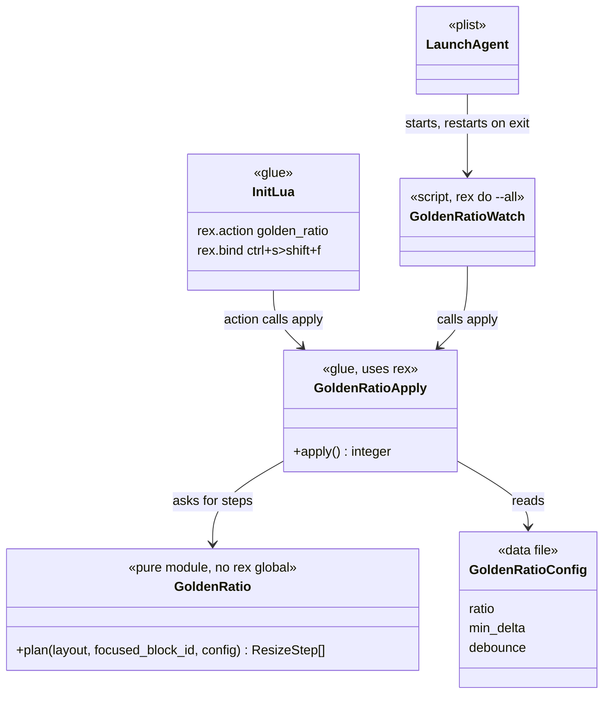
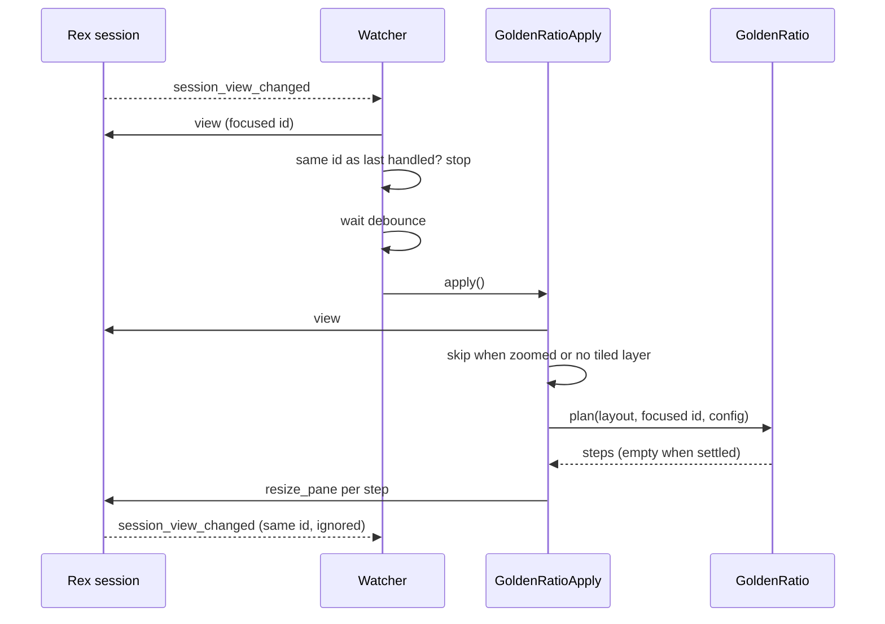

# Plan: Golden ratio for the focused Rex pane

From `intent.md` (2026-11-04). Status: accepted.

## Design

### Domain terms

- **Golden target**: the share of the tab (0.618 by default) that the focused pane takes on each axis.
- **Focus path**: the splits from the root of a window's tiled layout down to the focused block, each with the side (`before` or `after`) that holds the block.
- **Resize step**: one `rex.session.resize_pane` argument table, `{ direction, before_block_id, after_block_id, ratio }`. `ratio` is the share of the `before` side.
- **Settled**: every split on the focus path is within `min_delta` of its target.
- **Watcher**: the `rex do --all` process that runs `golden_ratio_watch.lua`.

No glossary entry is needed: these words stay inside this change.

### Diagrams

Before: `init.lua` binds keys and requires `switcher` and `project`. Nothing resizes panes. The new files sit beside them.





### Signatures

`golden_ratio.lua` is pure and never touches the `rex` global. Annotations are LuaLS comments, because the project's Ruby `#:` form does not apply to Lua.

```lua
---@alias ResizeStep { direction: "horizontal"|"vertical", before_block_id: string, after_block_id: string, ratio: number }

--- Plans the resizes that give the focused block the golden share of the layout, outermost split first.
--- Returns {} when the block is absent, the layout is one leaf, or every split is within config.min_delta.
---@param layout table  a tiled layer layout: { rect, block_id } or { rect, split = { direction, ratio, before, after } }
---@param focused_block_id string
---@param config { ratio: number, min_delta: number }
---@return ResizeStep[]
function GoldenRatio.plan(layout, focused_block_id, config) end
```

`golden_ratio_apply.lua` is the only glue module. It requires `golden_ratio` and `golden_ratio_config`.

```lua
--- Resizes the focused pane of the focused window's tiled layer in one session. Returns the number of resize calls.
--- Does nothing for a zoomed window or a window with no tiled layer.
--- Every Rex call inside carries session_id, because a timer's calls do not default to the event's session.
---@param session_id string|nil  the session to act on; nil means the script's own session
---@return integer
function GoldenRatioApply.apply(session_id) end
```

`golden_ratio_config.lua` returns `{ ratio = 0.618, min_delta = 0.02, debounce = 0.12 }`.

`golden_ratio_watch.lua` is a script with no exports. It registers one `rex.on("session_view_changed", ...)` handler.

Checked by: Not checked: Lua code. Steep and RBS do not apply; LuaLS annotations stand in.

### Complexity

- `plan` visits the focus path once and one leaf search per sibling subtree: O(n) in layout nodes, at most depth d steps.
- One `apply` makes one `view` call and at most d `resize_pane` calls. Each resize raises `session_view_changed` once.
- The watcher does O(1) work per event. Its own resizes keep the same focused id, so it makes no further `apply` call. A repeated `apply` on a settled layout makes 0 resizes.

### Invariants

- The product of the focused side's shares on each axis equals the target, at any depth. Enforced in `GoldenRatio.plan`.
- `config.ratio` stays within 0.05 and 0.95, or `plan` raises. A step share is `ratio^(1/k)`, which is never below `ratio`, so no per-step clamp is needed and the product stays exact at any depth. Enforced in `GoldenRatio.plan`.
- `plan` returns `{}` for a single-leaf layout and for a settled layout. Enforced in `GoldenRatio.plan`.
- `plan` never reads the `rex` global. Enforced by the luajit test, which defines none.
- A zoomed window and a floating layer stay unchanged. Enforced in `GoldenRatioApply.apply`.
- The watcher acts only when the focused block id differs from the last one it handled, per session. It stores the new id before it resizes. Enforced in `golden_ratio_watch.lua`.

### Alternatives

- **B: one `golden.lua` run through `rex do`, with `init.lua` shelling out to it.** Rejected. Every key press starts a process. It relies on `rex do --action` not registering the watcher handler, which is unverified. It gives up the pure-module unit seam.
- **C: watcher polls with `rex.every` and skips events.** Rejected. A focus change was verified to raise `session_view_changed`, so polling adds latency and idle wake-ups for no gain. It stays as the fallback if a UI-driven focus change turns out not to raise the event.
- **A (chosen): pure module, one glue module, one watcher script.** It matches the `switcher_rows` and `switcher` split on `rex-agent-switcher`, and the pure part is tested through luajit.

## Design decisions

- The config table lives in its own file, `golden_ratio_config.lua`, not inside `init.lua`. The watcher is a separate `rex do` process and cannot see values set in `init.lua`. `init.lua` and the watcher both require the file, so one edit reaches both. This satisfies the "config table" decision in `intent.md`.
- `plan` takes the config table, not a bare ratio, so the `min_delta` skip lives in the pure module and is testable.
- The key is `ctrl+s>shift+f`. Rex matches keys unshifted, so "capital F" is `shift+f`.
- The watcher debounces with `rex.after`: a newer focus change cancels the pending timer, one timer per session. The handler passes `ctx.session_id` into `apply` and `apply` into every call, because a timer's API calls default to the script's session, not the event's.
- Focusing another block ends a zoom (checked in a throwaway session). A watcher resize after a focus move therefore sees an unzoomed window and runs. The zoom guard protects the key action and any resize while a block stays zoomed, which is what the intent decision asks.
- The LaunchAgent runs `/bin/sh -c 'exec "$HOME/.../rex" do "$HOME/.config/rex/golden_ratio_watch.lua" --all --autostart=false'`. A plist cannot expand `$HOME`, and the shell keeps the username out of the repository. `--autostart=false` stops it from starting a second Rex server. `KeepAlive` with a `ThrottleInterval` retries until the Rex server runs.
- The plist is `rex/Library/LaunchAgents/com.eirvandelden.rex-golden-ratio.plist`, so Etienne's stow links the file into the existing `~/Library/LaunchAgents`.
- `rex.action` takes a table (`rex.action({ name = ... })`), as the Rex docs and `switcher.lua` show. The config test matches that form.
- The session view has no top-level focused block. `apply` and the watcher read the window named by `active_window_id`, falling back to the first window, and use that window's `focused_block_id`. `golden_ratio_apply.lua` also exports `focused_block_id(session_id)` for the watcher.
- A step resizes the split by choosing the focused block and the first leaf of the sibling subtree. Their lowest common ancestor is exactly the split on the path, so `resize_pane` moves that split only.

## Integration points

- `rex.session.view{}` and `rex.session.resize_pane{}`, verified against `rex api describe`.
- The `session_view_changed` event: verified in a throwaway session that `session.focus_block` raises it. The plan's live test also drives focus through the API.
- `rex do` scripts load modules beside the script through `require`: verified with a probe script.
- Branch `rex-agent-switcher` creates the `rex` stow package and `init.lua`. This change rebases onto it before the first edit.
- `launchctl bootstrap` loads the plist. It needs the plist linked into `~/Library/LaunchAgents`, which only Etienne's `stow` does.

## Files that change

- `rex/.config/rex/golden_ratio.lua`: new, the pure `plan`.
- `rex/.config/rex/golden_ratio_config.lua`: new, the config table.
- `rex/.config/rex/golden_ratio_apply.lua`: new, the `apply` glue.
- `rex/.config/rex/golden_ratio_watch.lua`: new, the watcher script.
- `rex/.config/rex/init.lua`: require `golden_ratio_apply`, define the `golden_ratio` action, bind `ctrl+s>shift+f`.
- `rex/Library/LaunchAgents/com.eirvandelden.rex-golden-ratio.plist`: new, starts the watcher at login.
- `test/rex_golden_ratio_test.rb`: new, luajit unit tests of `plan`.
- `test/rex_golden_ratio_config_test.rb`: new, `init.lua` binding and plist contents.
- `test/rex_golden_ratio_live_test.rb`: new, integration test in a throwaway Rex session.

## Order of work

1. Rebase the branch onto `origin/rex-agent-switcher`, so the `rex` package and `init.lua` exist.
2. Write the live integration test for three side-by-side panes. Run it. Watch it fail.
3. Write the `plan` unit tests, then `golden_ratio.lua` until they pass.
4. Add `golden_ratio_config.lua` and `golden_ratio_apply.lua`. The live test for the action passes.
5. Add the `init.lua` action and binding, with its config test.
6. Add `golden_ratio_watch.lua`. The live watcher test passes: a focus move resizes, and the watcher makes one resize round per focus change.
7. Add the plist, with its test. Lint it with `plutil -lint`.
8. Run `stylua --check`, luajit tests, the full suite and the linters.
9. If `~/Library/LaunchAgents/com.eirvandelden.rex-golden-ratio.plist` is linked, run `launchctl bootstrap gui/$(id -u)` on it and check `launchctl print`. If the link is missing, report `Decision needed:` — Etienne must run `stow`; never run it.

## Risks

- A UI-driven focus change, such as a mouse click, may not raise `session_view_changed`. API focus does. The live test uses the API. The fallback is `rex.every` polling.
- If `rex do --all` stops at login because the Rex server is not up yet, `KeepAlive` retries every `ThrottleInterval`.
- A zoomed window stays unchanged until the next focus change after unzoom. Accepted.
- Two watchers (an old one and a new one) would resize twice. `launchctl bootstrap` fails if the label already loads, so a second copy cannot start.
- `resize_pane` always raises the revision, even for an unchanged border. The `min_delta` skip avoids useless calls.

## Proof

- With three side-by-side panes, `ctrl+s F` gives the focused pane about 61.8% of the width → `test/rex_golden_ratio_live_test.rb` `test_apply_gives_the_focused_pane_the_golden_width`
- A nested pane ends at about 61.8% of both axes → `test/rex_golden_ratio_test.rb` `test_nested_focus_gets_the_golden_share_on_both_axes`, and `test/rex_golden_ratio_live_test.rb` `test_apply_gives_a_nested_pane_the_golden_share_after_real_resizes`, which reads the final pane rectangles from `rex session inspect`
- The watcher resizes the session that changed → `test/rex_golden_ratio_live_test.rb` `test_the_watcher_resizes_the_session_that_changed`, with two throwaway sessions under one `--all` script
- A focus move enlarges the new pane without a keypress → `test/rex_golden_ratio_live_test.rb` `test_the_watcher_resizes_after_a_focus_move`
- A one-pane tab stays unchanged → `test/rex_golden_ratio_test.rb` `test_a_single_pane_needs_no_steps`
- A zoomed window stays unchanged when the key action runs → `test/rex_golden_ratio_live_test.rb` `test_apply_skips_a_zoomed_window`
- A focus move out of a zoomed pane unzooms the window, and the watcher then resizes → `test/rex_golden_ratio_live_test.rb` `test_the_watcher_resizes_after_a_focus_move_ends_a_zoom`
- A split within `min_delta` is not resized again → `test/rex_golden_ratio_test.rb` `test_a_settled_layout_needs_no_steps`
- The watcher does not resize in a loop → `test/rex_golden_ratio_live_test.rb` `test_the_watcher_makes_one_resize_round_per_focus_move`
- The watcher runs after login and restarts on exit → `test/rex_golden_ratio_config_test.rb` `test_the_plist_runs_the_watcher_at_load_and_keeps_it_alive`; check: `launchctl print gui/$(id -u)/com.eirvandelden.rex-golden-ratio` shows `state = running`
- Invariant: `config.ratio` outside 0.05 to 0.95 is refused, enforced by `GoldenRatio.plan` → `test/rex_golden_ratio_test.rb` `test_a_ratio_outside_the_allowed_range_is_refused`
- Invariant: the product of shares per axis equals the target at any depth, enforced by `GoldenRatio.plan` → `test/rex_golden_ratio_test.rb` `test_the_shares_on_each_axis_multiply_to_the_target` and `test_a_twenty_deep_path_still_multiplies_to_the_target`
- Invariant: `plan` needs no `rex` global, enforced by the luajit run → `test/rex_golden_ratio_test.rb` `test_plan_runs_without_a_rex_global`
- The key binds `golden_ratio` → `test/rex_golden_ratio_config_test.rb` `test_ctrl_s_shift_f_runs_golden_ratio`

Per changed file, the unit tests expected, named as behaviour:
- `golden_ratio.lua`: `plan` gives three flat panes the golden width, handles nested layouts, flips the share when the focused block is on the `after` side, returns no steps for one pane, a missing block or a settled layout, and refuses a ratio outside 0.05 to 0.95.
- `init.lua`: the action exists and the key binds it, with every earlier binding kept.
- The plist: it names the label, runs the watcher with `--all --autostart=false`, sets `RunAtLoad` and `KeepAlive`, and passes `plutil -lint`.

Test setup: `plan` tests use Ruby hashes serialised to JSON and run through `luajit`, as `rex_switcher_rows_test.rb` does, and skip when `luajit` is missing. The live tests create a throwaway Rex session with `rex new`, split panes, call the action or run the watcher with `rex do ... --for`, read `rex session inspect`, and kill the session. They skip when no `rex` server answers.

---
Domain skills applied: software-design, diagrams, sandi-metz-rules (small modules), glossary.

## Critique

### Round 1 (Codex terra)

- The watcher's timer passes no session id, so in `--all` mode `apply` can query or resize the wrong session → fixed (`apply` takes `session_id`; the handler passes `ctx.session_id`; a two-session live test is added)
- The 0.05 to 0.95 step clamp contradicts the "however deep" acceptance criterion; at depth 20 it gives 35.8% → fixed (the per-step clamp is removed, `config.ratio` is validated instead, and a twenty-deep test is added)
- The zoom guard cannot hold for the watcher focus test, because `session.focus_block` ends the zoom → fixed (checked live: focus ends a zoom; the plan records that the watcher then resizes an unzoomed window, the zoom test targets the key action, and a test covers the unzoom-then-resize path)
- The nested-layout proof tests only the pure planner, not the border Rex picks → fixed (a live nested same-axis test reads the final pane rectangles after real `resize_pane` calls)
