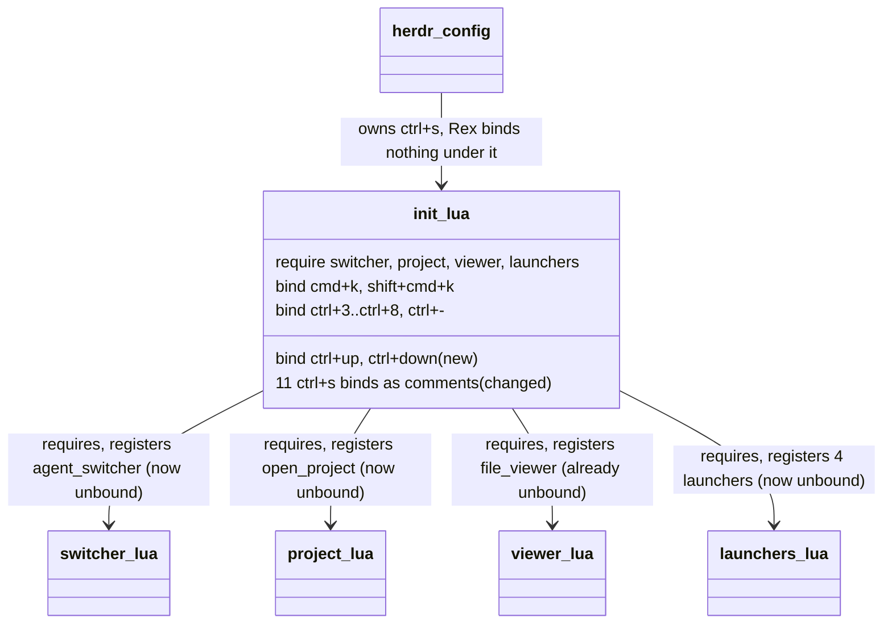

# Plan: Consolidate the live Rex init.lua into the repo

From `intent.md` (2026-11-06). Status: accepted.

## Context

`~/.config/rex/init.lua` is a plain file, so `stow rex` refuses to link `rex/.config/rex/init.lua` over it. Verified on 2026-11-06: `stow -n -v rex -t "$HOME"` reports `cannot stow .../rex/.config/rex/init.lua over existing target .config/rex/init.lua since neither a link nor a directory`.

The live file differs from the repo file in four ways:

- It has the six `ctrl+s` chords commented out, with the note `-- Disabled: herdr uses ctrl+s as its prefix; rex chords would swallow it.`
- It has `rex.bind("ctrl+up", "client.prompt.previous")` and `rex.bind("ctrl+down", "client.prompt.next")`.
- It lacks the repo's `require` lines and the `ctrl+s>o`, `ctrl+s>f`, `ctrl+s>shift+f`, `ctrl+s>g` and `ctrl+s>shift+g` binds.
- Its commented `ctrl+s>space` bind targets `session.switch`; the repo's targets `agent_switcher`. The repo comment keeps `agent_switcher`, the action the switcher registers.

herdr sets `prefix = "ctrl+s"` in `herdr/.config/herdr/config.toml:8`.

`test/rex_config_test.rb` asserts that the `ctrl+s` binds exist (`KEPT`, `LAUNCHER_KEYS` and four tests). It passes today (10 runs, 0 failures). It must change with `init.lua`, because the agreed behaviour changes.

## Design

### Domain terms

- **Switcher** (glossary): the floating Rex panel of the `agent_switcher` action. After this change no key opens it, so its glossary entry loses "opened by `ctrl+s space`".
- **herdr prefix**: `ctrl+s`, from `herdr/.config/herdr/config.toml`. A working term, not a new glossary entry.
- **Live file**: `~/.config/rex/init.lua` as a plain file, outside the repo. Used as in `intent.md`, not a new glossary entry.
- No avoided word is used. `open_project` is named "the project action". The only other appearance of an avoided word is the existing test identifier that step 1 renames.

### Diagrams

### Signatures

Not affected: `init.lua` stays a flat script of `require` and `rex.bind` calls; no Lua function or Ruby class is added. The test class gets new test methods only, no new helper.

Not checked: this repository has no Steep setup for its tests or Lua files.

### Complexity

Not affected: Rex reads `init.lua` once at load. The change removes 11 active `rex.bind` calls and adds 2. The new text scan reads the 10 `*.lua` files in `rex/.config/rex/` once per test run.

### Invariants

- No active `rex.bind` in any `rex/.config/rex/*.lua` file binds `ctrl+s` or a key that starts with `ctrl+s>`. Enforced by `test_no_lua_file_binds_ctrl_s`.
- `ctrl+up` binds `client.prompt.previous` and `ctrl+down` binds `client.prompt.next`. Enforced by `test_ctrl_up_and_ctrl_down_move_between_prompts`.
- Every bind that does not use `ctrl+s` keeps its action and options. Enforced by `test_every_other_current_binding_is_kept`.
- The seven unbound actions (`agent_switcher`, `open_project`, `file_viewer` and the four launchers) stay registered, and the loaded config binds none of them and no `ctrl+s` key. Enforced by `test_the_loaded_config_registers_every_action_and_binds_no_ctrl_s_key`, which loads `init.lua` and every module it requires under luajit (verified on 2026-11-06 to load without the `switcher` stub). The require-line tests cover the same ground as text when `luajit` is absent.

### Alternatives

- **Minimal diff (chosen)**: comment out each `ctrl+s` bind in place, under the live file's note; add the two prompt binds; change the existing test file only. It keeps the file order and a small diff.
- **Regression guard (partly taken)**: read the prefix from herdr's config, load every module under luajit without the switcher stub, and add a new test that checks every live Rex file on the machine is a stow link. Rejected in part: the live-file test reads the real `$HOME`, so it is not hermetic and proves nothing in CI; reading herdr's config couples the test to its line format. Taken: the text scan covers every `*.lua` file in `rex/.config/rex/`, and the luajit loader drops the `switcher` stub so the loaded config proves every action stays registered.
- **One "disabled" block at the end of `init.lua`**: rejected, it moves lines and makes the diff larger with no reader gain.

## Design decisions

- The 11 commented binds stay in two places: the six chords and `ctrl+s>o` where they are now, the four launcher binds after `require("launchers")`. Each group gets the same note.
- The note text is the live file's note, with "Rex" capitalised: `-- Disabled: herdr uses ctrl+s as its prefix; Rex chords would swallow it.`
- `ctrl+up` and `ctrl+down` go after `ctrl+-`, before `require("launchers")`, as in the live file.
- The glossary entry for **Switcher** becomes false after this change. The plan corrects its key reference in `GLOSSARY.md` and keeps the term and its "Avoid" list. This is a correction of a fact, not a new term.
- No conflict with `intent.md`'s `## Decisions`: the `ctrl+s` binds become comments, the rest of the repo file stays, and Claude trashes the live file.

## Integration points

- herdr: owns `ctrl+s` (`herdr/.config/herdr/config.toml`). Not changed.
- GNU stow: `install/tasks/50_stow_all.sh` stows `rex`. Not changed.
- Rex app: reads `~/.config/rex/init.lua` on start and on `rex config reload`.
- `trash` (`/opt/homebrew/bin/trash`) for the live file.

## Files that change

- `rex/.config/rex/init.lua` — comment out the 11 `ctrl+s` binds under the herdr note; add the `ctrl+up` and `ctrl+down` binds.
- `test/rex_config_test.rb` — update the header comment, `KEPT`, and the `ctrl+s` tests; add the `ctrl+s` scan and the prompt-key test.
- `GLOSSARY.md` — **Switcher** entry: replace "opened by `ctrl+s space`" with "run as the `agent_switcher` action".
- `~/.config/rex/init.lua` — moved to the trash with `trash`. Outside the repo, so not in any commit.

## Order of work

1. Change `test/rex_config_test.rb`:
   - Header comment (lines 8–11): say that herdr owns `ctrl+s`, so no Rex Lua file binds a `ctrl+s` key, and every other binding stays.
   - `KEPT`: remove the five `ctrl+s>` entries; add `"ctrl+up" => [ "client.prompt.previous", nil ]` and `"ctrl+down" => [ "client.prompt.next", nil ]`.
   - Remove the `LAUNCHER_KEYS` constant.
   - Add `test_no_lua_file_binds_ctrl_s`: for every `rex/.config/rex/*.lua`, refute any `BIND` match whose key matches `/\Actrl\+s(>|\z)/`. The message names the file and key and says "herdr owns ctrl+s".
   - Add `test_ctrl_up_and_ctrl_down_move_between_prompts`.
   - Rename `test_ctrl_s_space_opens_the_switcher` to `test_the_switcher_is_required_and_has_no_key_bind`: assert `require("switcher")`, refute `agent_switcher` among bound actions.
   - Rename the `open_project` test (`test_ctrl_s_o_opens_the_project_...`) to `test_the_project_action_is_required_and_has_no_key_bind`: assert `require("project")`, refute `open_project` among bound actions.
   - Rename `test_viewer_keys_run_worktree_viewer` to `test_the_viewer_launchers_run_worktree_viewer`: drop the two `ctrl+s` fetches, keep the two `launchers.lua` matches.
   - Replace `test_launcher_actions_are_registered_and_bound` with `test_the_loaded_config_registers_every_action_and_binds_no_ctrl_s_key`. Keep its `skip` without `luajit`. Remove `package.loaded["switcher"] = {}` from `lua_loader`. Rename `LAUNCHERS` to `UNBOUND_ACTIONS` and list all seven actions. Assert every one is registered, none is among the bound actions, and no bound key matches `/\Actrl\+s(>|\z)/`. Rename `load_launchers` to `load_config` and update its comment.
2. Run `ruby test/rex_config_test.rb`. Watch the `ctrl+s` scan, the prompt-key test and the unbound tests fail for the right reason.
3. Change `rex/.config/rex/init.lua` as the design says. Run the test file again until green.
4. Update the **Switcher** entry in `GLOSSARY.md`.
5. Run the linters: `stylua --check rex/.config/rex/init.lua`, `luajit -b rex/.config/rex/init.lua /dev/null`, `rubocop test/rex_config_test.rb`. Then run the full suite with `bin/test`.
6. If the `rex` CLI is on `PATH`, run `REX_CONFIG=rex/.config/rex/init.lua rex config check`. If it is not, record that in the report.
7. Re-read the diff. Commit.
8. Last step, once the repo file is final: `trash ~/.config/rex/init.lua`. Then run `stow -n -v rex -t "$HOME"` from the worktree and confirm no conflict line for `.config/rex/init.lua`. Do not run `stow` without `-n`.

## Risks

- After the trash, `~/.config/rex/init.lua` is absent until Etienne stows `rex` from the main checkout after the merge. A running Rex keeps its loaded config. A Rex restart or `rex config reload` in that window loads no `init.lua`, so the `ctrl+3`–`ctrl+8`, `ctrl+-` and prompt binds are gone until the stow. Etienne should not reload Rex before the stow.
- A dry run from the worktree shows links into `.worktrees/rex-init-consolidate/`. The real stow must run from `~/Developer/dotfiles` after the merge, or the links point at a worktree that gets removed.
- The switcher, the project action, the viewer launchers and lazygit lose every key. They stay reachable through Rex's action list only. Rebinding them is out of scope (intent).
- `client.prompt.previous` and `client.prompt.next` are Rex client actions. The repo test checks only the text. The live file already used them, which is the evidence they work.

## Out of scope

- New keys for the switcher, project, viewer and lazygit actions.
- Any other file in `rex/.config/rex/`.
- Running `stow` or `install.sh` for real: Etienne does that.

## Proof

- `stow -n -v rex -t "$HOME"` reports no conflict for `.config/rex/init.lua` → check: after `trash ~/.config/rex/init.lua`, run `stow -n -v rex -t "$HOME"` from the worktree; exit 0 and no `cannot stow` line.
- The repo `init.lua` has no active `ctrl+s` bind → `test/rex_config_test.rb` `test_no_lua_file_binds_ctrl_s`
- Pressing `ctrl+up` in Rex moves to the previous prompt, and `ctrl+down` to the next → `test/rex_config_test.rb` `test_ctrl_up_and_ctrl_down_move_between_prompts`; then check: Etienne presses both keys in Rex after the stow and `rex config reload`.
- Pressing `ctrl+s` reaches herdr unchanged → `test/rex_config_test.rb` `test_no_lua_file_binds_ctrl_s`; then check: Etienne presses `ctrl+s` in a herdr pane inside Rex after the stow and sees the herdr prefix act.
- Invariant: every non-`ctrl+s` bind keeps its action and options, enforced by the `KEPT` table → `test/rex_config_test.rb` `test_every_other_current_binding_is_kept`
- Invariant: the seven unbound actions stay registered and unbound, enforced by the `require` lines in `init.lua` → `test/rex_config_test.rb` `test_the_loaded_config_registers_every_action_and_binds_no_ctrl_s_key`, `test_the_switcher_is_required_and_has_no_key_bind`, `test_the_project_action_is_required_and_has_no_key_bind`

Per changed file, the unit tests expected, named as behaviour:

- `rex/.config/rex/init.lua`: covered by the `test/rex_config_test.rb` tests above, plus `test_the_viewer_launchers_run_worktree_viewer`, `test_the_file_viewer_is_required_and_has_no_key_bind` and `test_shift_cmd_k_keeps_session_switch`, unchanged.
- `test/rex_config_test.rb`: the test file itself.
- `GLOSSARY.md`: no test.

Test setup: none new. The tests read the Lua files as text; the luajit loader test loads the real modules with a stub `rex` and skips without `luajit`.

---
Domain skills applied: dotfiles-maintenance (stow and symlink rules), glossary, software-design.

## Critique

### Round 1 (codex exec -p terra)

- The plan omits the live file's `ctrl+s>space` target, `session.switch` instead of `agent_switcher` → fixed (Context lists it as a fourth difference and keeps `agent_switcher`)
- The planned tests do not prove the unbound actions stay registered, because the loader stubs `switcher` → fixed (the loader drops the stub; a luajit test asserts all seven actions are registered and unbound)
- The plan uses the avoided word "picker" → fixed (Domain terms and step 1 name `open_project` the project action; the old identifier is shortened)
