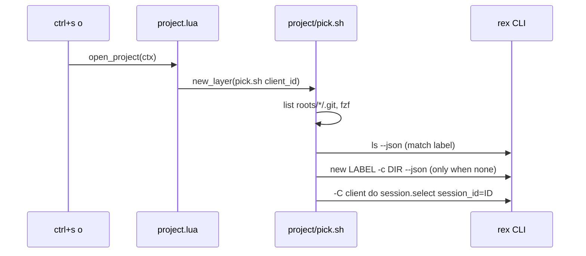

# Plan: Open a project session in Rex from the keyboard

From `intent.md` (2026-11-04). Status: accepted.

## Design

### Domain terms

- Project: a folder directly under a root that holds a `.git` entry, file or directory. Its folder name is the session label.
- Root: a folder scanned one level deep. The defaults are `~/Developer` and `~/Sites`. `REX_PROJECT_ROOTS` (colon separated) overrides them, so tests never touch the real home.
- Picker: the floating fzf layer that lists projects.
- Reused from the switcher: session, client, Remote Control.

### Diagrams

### Signatures

`rex/.config/rex/project.lua` (new, about 30 lines): registers the action `open_project` and opens a floating layer that runs `project/pick.sh` with the client id. It is the only new file that uses the `rex` global. It holds its own small `client_id_of`, a copy of the one in `switcher.lua`, so the switcher files stay untouched. It also resolves the focused pane's directory (`pwd` call, falling back to the foreground process) and passes it as the layer's `cwd`.

`rex/.config/rex/project/pick.sh <client_id>` (new, about 35 lines): lists projects, asks fzf, then opens or reuses the session and selects it. Reads `REX_PROJECT_ROOTS`. Exits 0 in every case. Each fzf row is `name<TAB>absolute-path`. fzf shows column 1 only and the script reads column 2 as the folder. Rows come in root order, `~/Developer` first, then `~/Sites`. A duplicate name shows twice and both rows map to one session.

`rex/.config/rex/init.lua` (edit): `require("project")` and `rex.bind("ctrl+s>o", "open_project")`.

`rex/.config/rex/.luarc.json` (new): declares the `rex` global.

Not affected: no Ruby classes. Checked by: none, no RBS in this change.

### Complexity

- Listing is one loop over the roots with an `-e dir/.git` test: O(entries in the roots), no recursion.
- A pick runs at most three `rex` calls: `ls`, `new` (only for a new label), `select`. The count does not grow with the number of sessions.

### Invariants

- Only folders with a direct `.git` entry are listed, and nothing nested. Enforced by the listing loop in `pick.sh`.
- A pick never creates a second session with an existing label. Enforced by the `rex ls --json` label match before `rex new`.
- Escape makes no `rex` call: the script ends when fzf prints nothing.
- A refused `session.select` leaves the new session in place and prints the Remote Control hint.

### Alternatives

- Reuse `switcher/jump.sh`: it needs a block id and runs `rex focus`, which a new session cannot supply. Adapting it would add branches to a tested script. A single `rex -C <client> do session.select` call in `pick.sh` is smaller.
- Split into `list.sh`, `open.sh` and a shared `select_session.sh` (the testable design): five new files and an edit to `jump.sh` and its tests, which live in another change. Rejected as more surface than the behaviour needs. `pick.sh` is tested end to end through stubs instead.
- Put the action in `switcher.lua`: no new Lua file, but it edits a file owned by the stacked change and mixes two features.

## Design decisions

- No reuse of `jump.sh` (the intent said "when it fits"): it does not fit, for the reason above.
- The layer starts in the focused pane's directory, as `intent.md` says, although the picker does not use it. The cost is one `pwd` call in `project.lua`.
- `client_id_of` is copied, not shared. A later change can extract it once both features have landed.
- No conflict with `intent.md`'s `## Decisions`.

## Integration points

- `rex ls --json` returns `{"sessions": [{"label", "session_id"}]}` (checked on this machine).
- `rex new LABEL -c DIR --json` creates a session in `DIR` and prints it as JSON (`rex new --help` lists both flags). The `session_id` field name is assumed and checked in a real run.
- `rex -C <client> do session.select session_id=<id>`, the call `switcher/jump.sh` already makes. It needs Remote Control.
- `fzf` and `jq`, installed.

## Files that change

- `rex/.config/rex/project.lua` — new action `open_project`, layer cwd from the focused pane.
- `rex/.config/rex/project/pick.sh` — the picker and session logic.
- `rex/.config/rex/init.lua` — require `project`, bind `ctrl+s>o`.
- `rex/.config/rex/.luarc.json` — Lua language server global.
- `test/rex_project_script_test.rb` — new, tests `pick.sh` with `rex` and `fzf` stubs.
- `test/rex_config_test.rb` — add the `ctrl+s>o` binding and the `project` require.

## Order of work

1. Write `test/rex_project_script_test.rb` with the first acceptance case (picking creates a session and selects it). Run it and watch it fail.
2. Write `project/pick.sh` until that case passes.
3. Add the remaining script cases one at a time: reuse, Escape, git filter, refused select.
4. Add the binding test in `test/rex_config_test.rb`, watch it fail, then add `project.lua`, the `init.lua` lines and `.luarc.json`.
5. Run linters on every touched file, then the full suite.
6. Check in Rex by hand and record the evidence.

## Risks

- `rex new --json` field names are assumed from the old config. The test stub mirrors them, so confirm with one real run in step 6.
- Rex may refuse `session.select` when the picker runs from a layer. `switcher/jump.sh` makes the same call from a layer, so the risk is low.
- `init.lua` also changes in `rex-prefix-keybindings`, which adds about 18 prefix bindings at the same insertion point. On rebase, keep that whole block and place `ctrl+s>o` after it.
- Two folders with one name share one session. Accepted in `intent.md`.

## Proof

- Pressing `ctrl+s` then `o` opens a floating picker → `test/rex_config_test.rb` `test_ctrl_s_o_opens_the_project_picker`, plus `check: REX_CONFIG=<worktree>/rex/.config/rex/init.lua rex config check` loads the config and lists `ctrl+s>o`.
- The picker lists `dotfiles` and `eirvandelden.github.io`, not `conductor`, `private` or `archive` → `test/rex_project_script_test.rb` `test_lists_only_folders_with_a_git_entry_from_every_root`.
- Picking `dotfiles` with no such session creates one in the folder and selects it → `test/rex_project_script_test.rb` `test_picking_a_new_project_creates_its_session_and_selects_it`.
- Picking `dotfiles` with a session open selects it and creates no second one → `test/rex_project_script_test.rb` `test_picking_an_open_project_only_selects_its_session`.
- Escape closes the picker and creates nothing → `test/rex_project_script_test.rb` `test_escape_makes_no_rex_call`.
- With Remote Control off the session exists and a hint prints → `test/rex_project_script_test.rb` `test_a_refused_select_keeps_the_session_and_prints_a_hint`.
- Invariant: nothing nested is listed, enforced by the listing loop → `test/rex_project_script_test.rb` `test_nested_repositories_are_not_listed`.
- Invariant: no second session per label, enforced by the label match → `test/rex_project_script_test.rb` `test_picking_an_open_project_only_selects_its_session`.
- Query count: a pick makes at most three `rex` calls → `test/rex_project_script_test.rb` `test_a_pick_makes_at_most_three_rex_calls`.

Per changed file, the unit tests expected:
- `rex/.config/rex/project/pick.sh`: lists git repos from every root, skips non-git folders, creates a session for a new label, reuses an open one, exits quietly on Escape, prints the hint on a refused select.
- `rex/.config/rex/init.lua`: binds `ctrl+s>o` to `open_project` and requires `project`.
- `rex/.config/rex/project.lua` and `.luarc.json`: configuration, no tests.

Test setup: Minitest, same pattern as `test/rex_switcher_scripts_test.rb`. Temporary roots hold fixture folders, set through `REX_PROJECT_ROOTS`. `rex` and `fzf` are stubs on `PATH` that log their arguments. The `fzf` stub logs its stdin, prints the row in `FZF_SELECTION` as the pick, and exits 130 when that is empty, as a cancelled fzf does. `jq` is real. Stub helpers are copied, not shared, so the existing test file stays untouched.

---
Domain skills applied: software-design, glossary, diagrams.

## Critique

### Round 1 (codex terra)

- The plan drops the focused-directory requirement → fixed (`project.lua` resolves the focused pane's directory and passes it as the layer cwd)
- The picker has no selected-row contract → fixed (rows are `name<TAB>absolute-path`, fzf shows column 1, root order is fixed, duplicate names documented)
- The test reuse cannot exercise selection → fixed (the new test file has its own fzf stub with `FZF_SELECTION` and exit 130 on cancel)
- The live proof via `rex keymap` is not executable from this worktree → fixed (the check is now `rex config check` with `REX_CONFIG` pointing at the worktree file)
- The `rex new` attribution to the old config is wrong → fixed (the plan cites `rex new --help`, and the `session_id` field is checked in a real run)
- The rebase risk is understated → fixed (Risks now names the 18-binding block and says to keep it whole)
