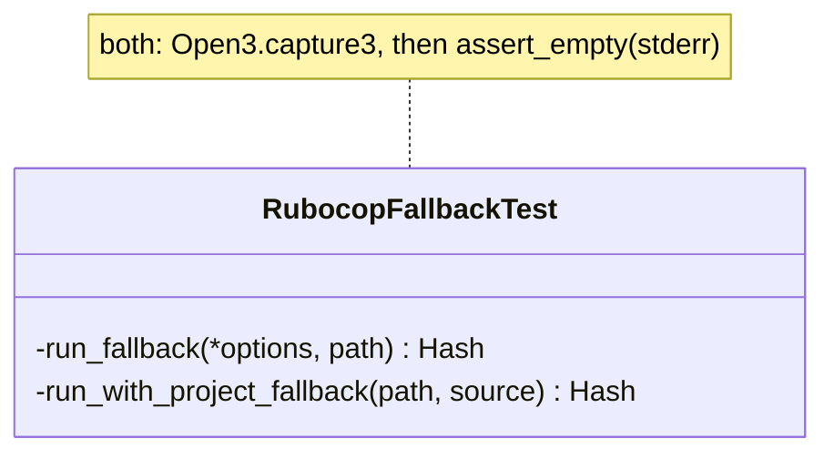
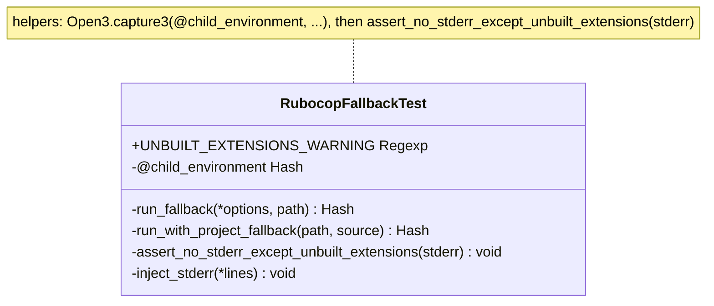

# Plan: RuboCop fallback test fails on RubyGems load warnings

From `intent.md` (2026-11-23). Status: accepted.

## Design

### Domain terms

- **Unbuilt-extensions warning** — the stderr line RubyGems writes when an installed gem has a native extension that is not built. Source: `rubygems/basic_specification.rb`, `"Ignoring #{full_name} because its extensions are not built. Try: gem pristine #{name} --version #{version}"`. `intent.md` calls it a "notice". The glossary already gives **Notice** another meaning (a one-line message of the worktree viewer), so code and tests say "warning", never "notice".
- **Fallback** — the global RuboCop config `rubocop/.rubocop.yml`, as the test file already uses the word.
- **Injected stderr line** — a line a test makes the RuboCop child process write to stderr, through `RUBYOPT=-r<file>`, where the file runs `warn "<line>"`.

### Diagrams

Before: both helpers demand an empty stderr.



After: both helpers pass the child environment and drop only unbuilt-extensions warnings before the check.



### Signatures

`RubocopFallbackTest` (`test/rubocop_fallback_test.rb`) — checks that the global RuboCop fallback lints plain Minitest, RBS inline and migration files as intended. New and changed members:

```ruby
# One whole stderr line from RubyGems about a gem with unbuilt native extensions.
UNBUILT_EXTENSIONS_WARNING =
  /\AIgnoring \S+ because its extensions are not built\. Try: gem pristine \S+ --version \S+\Z/ #: Regexp

# Fails with the remaining lines when stderr holds anything but unbuilt-extensions warnings.
#: (String stderr) -> void
def assert_no_stderr_except_unbuilt_extensions(stderr)
  assert_empty(stderr.lines.grep_v(UNBUILT_EXTENSIONS_WARNING).join)
end

# Makes every RuboCop child of this test write each line to stderr when it starts.
#: (*String lines) -> void
def inject_stderr(*lines)
  File.write(File.join(@project, INJECT_SCRIPT), lines.map { |line| "warn #{line.dump}\n" }.join)
  @child_environment = { "RUBYOPT" => "#{ENV.fetch('RUBYOPT', '')} -r./#{INJECT_SCRIPT}".strip }
end
```

`INJECT_SCRIPT = "inject_stderr.rb".freeze`. The `-r` path is relative, because `RUBYOPT` splits on spaces and `TMPDIR` may hold one. Both RuboCop helpers already run with `chdir: @project`, so `./inject_stderr.rb` resolves to the project's copy; verified with RuboCop and Ruby 4.0.9.

`setup` sets `@child_environment = {}`. `run_fallback` and `run_with_project_fallback` pass it as the first argument of `Open3.capture3` and call `assert_no_stderr_except_unbuilt_extensions(stderr)` in place of `assert_empty(stderr)`. All of these are private test helpers; the new test methods are the public surface.

Not checked: the dotfiles repository runs no Steep; the `#:` comments are checked only by the fallback's `Style/RbsInline` cops.

### Complexity

One `lines.grep_v` over a stderr of at most a few dozen lines per RuboCop run. No extra process. The four new tests add six RuboCop runs, about 1 second each.

### Invariants

1. A stderr line that is not a whole unbuilt-extensions warning fails the test, and the failure message shows it. Enforced by `assert_no_stderr_except_unbuilt_extensions`, which removes only lines that match the anchored `UNBUILT_EXTENSIONS_WARNING` and asserts the rest is empty.
2. The exit-status-2 skip and the JSON parse stay as they are. Enforced by leaving those lines unchanged.
3. No test changes the process-wide `ENV`. Enforced by passing `@child_environment` to `Open3.capture3` instead.

### Alternatives

1. **Chosen: filter inside the test file.** One anchored constant and one private assertion helper, used by both RuboCop helpers. Regression tests inject a warning through `RUBYOPT`, so they reproduce the bug on every machine, CI included. Smallest change; matches the intent's single in-scope item.
2. **Rejected: a shared helper module `test/rubygems_warnings.rb` with its own unit test file.** Reusable by `question_wording_guard_test.rb` and `worktree_sweep_test.rb` later, but those are out of scope and need no filter today. A second file and a second test file for one regex is speculative generality. Its one gain, unit tests that run where RuboCop is missing, does not matter: CI has RuboCop, and the injected-warning tests run there.
3. **Rejected: silence warnings in the child with `RUBYOPT=-W0`.** `-W0` makes `Kernel#warn` a no-op, so it drops the RubyGems line, but it also drops every real Ruby or RuboCop warning. That breaks the strictness the intent demands.
4. **Rejected: run `gem pristine ffi`.** A system change; the intent puts it out of scope (playbook rule 8).

## Design decisions

- Name the line "unbuilt-extensions warning" in code, not "notice": the glossary term **Notice** means a worktree-viewer message.
- Prove the fix with an injected warning through `RUBYOPT`, not by relying on the real unbuilt `ffi` gem. The real gem exists only on Etienne's machine; the injected one fails before the fix on every machine, CI included. The real `ffi` case stays a manual check.
- Pass the child environment through `@child_environment` rather than mutate `ENV`, so a test cannot leak `RUBYOPT` into another test.
- Keep any `RUBYOPT` the caller already has, and append the `-r` option.

No conflict with intent's `## Decisions`: only the unbuilt-extensions warning is tolerated.

## Integration points

- RubyGems' warning text in `rubygems/basic_specification.rb` (Ruby 4.0.9). A future RubyGems change to that wording makes the tests fail again on a machine with an unbuilt gem; the regression test pins today's wording.
- `bin/test`, which runs the file in its own process with a shared `TMPDIR`.
- CI, which installs RuboCop and its plugins and has no unbuilt gems.

## Files that change

- `test/rubocop_fallback_test.rb` — the `UNBUILT_EXTENSIONS_WARNING`, `INJECT_SCRIPT` and `UNEXPECTED_STDERR_LINES` constants, the assertion helper, the `inject_stderr` helper, `@child_environment` in `setup` and in both `Open3.capture3` calls, and four new tests. The comment above `run_fallback` mentions the tolerated warning.

Nothing else changes. Out of scope: `rubocop/.rubocop.yml`, the installed gems, `question_wording_guard_test.rb`, `worktree_sweep_test.rb`.

## Order of work

1. Add `@child_environment = {}` to `setup`, pass it to both `Open3.capture3` calls, and add `inject_stderr`. Write the four tests in `## Proof`. Run `ruby -Itest test/rubocop_fallback_test.rb -n /unbuilt_extensions_warning/` (every new test name holds that phrase) and watch both tolerance tests fail on the injected warning, while both rejection tests pass.
2. Add `UNBUILT_EXTENSIONS_WARNING` and `assert_no_stderr_except_unbuilt_extensions`. Replace both `assert_empty(stderr)` calls. Update the comment above `run_fallback`.
3. Run `ruby -Itest test/rubocop_fallback_test.rb`: all tests pass on Etienne's machine, where `ffi-1.17.4` has unbuilt extensions.
4. Run `rubocop test/rubocop_fallback_test.rb`, then `bin/test`.

## Risks

- The shell an agent gets may resolve `ruby` to macOS system Ruby 2.6, which cannot load Minitest 6. Run the tests with rv's Ruby 4 first on `PATH` (`PATH="$HOME/.local/share/rv/rubies/ruby-4.0.9/bin:$PATH"`). Never downgrade the test for Ruby 2.6.
- RuboCop may start a child Ruby of its own; `RUBYOPT` reaches it too and repeats the injected line. The filter handles repeats; the other-line test only checks the line is present.
- A regex that is too loose would hide real errors. The pattern is anchored to the whole line and to RubyGems' exact wording.

## Proof

- With `ffi` installed without built extensions, the 16 existing tests pass → `test/rubocop_fallback_test.rb` `test_fallback_tolerates_a_rubygems_unbuilt_extensions_warning` and `test_project_fallback_tolerates_a_rubygems_unbuilt_extensions_warning`; check: `ruby -Itest test/rubocop_fallback_test.rb` on Etienne's machine reports 0 failures.
- Any other stderr line fails the test and shows that line → `test/rubocop_fallback_test.rb` `test_fallback_fails_on_a_stderr_line_other_than_an_unbuilt_extensions_warning` and `test_project_fallback_fails_on_a_stderr_line_other_than_an_unbuilt_extensions_warning`.
- On a machine with clean gems the results are the same as today → check: CI on the pull request is green, with the 16 existing tests unchanged.
- Invariant: no test changes the process-wide `ENV`, enforced by `@child_environment` → check: `grep -nE 'ENV(\[[^]]*\] *=|\.(store|update|merge!|delete|replace))' test/rubocop_fallback_test.rb` prints nothing.

Per changed file, the tests expected:

- `test/rubocop_fallback_test.rb`:
  - `test_fallback_tolerates_a_rubygems_unbuilt_extensions_warning` — inject `Ignoring fake-1.0.0 because its extensions are not built. Try: gem pristine fake --version 1.0.0`; `run_fallback` returns a report whose inspected paths are `[FIXTURE_PATH]`.
  - `test_project_fallback_tolerates_a_rubygems_unbuilt_extensions_warning` — same warning; `run_with_project_fallback(MIGRATION_PATH, MIGRATION_FIXTURE)` returns a report whose inspected paths are `[MIGRATION_PATH]`.
  - `test_fallback_fails_on_a_stderr_line_other_than_an_unbuilt_extensions_warning` — for each line in `UNEXPECTED_STDERR_LINES`, inject the real-shaped warning plus that line; `assert_raises(Minitest::Assertion) { run_fallback }`, and the error message includes that line. `UNEXPECTED_STDERR_LINES` holds three lines: `warning: something else broke`; the warning with a prefix, `note: Ignoring fake-1.0.0 because its extensions are not built. Try: gem pristine fake --version 1.0.0`; and the warning with a suffix, `Ignoring fake-1.0.0 because its extensions are not built. Try: gem pristine fake --version 1.0.0 (and more)`. A loose filter such as `/Ignoring/` fails this test.
  - `test_project_fallback_fails_on_a_stderr_line_other_than_an_unbuilt_extensions_warning` — inject the warning plus `warning: something else broke`; `assert_raises(Minitest::Assertion) { run_with_project_fallback(MIGRATION_PATH, MIGRATION_FIXTURE) }`, and the error message includes that line.

Test setup: the existing temporary project from `setup`. `inject_stderr` writes a one-line-per-warning Ruby file into the project and points `RUBYOPT` at it for this test's RuboCop children only. No gem is changed.

---
Domain skills applied: software-design, glossary, diagrams, ruby-style, rails-testing (Minitest conventions).

## Critique

### Round 1 (codex gpt-6.1-sol, medium)

- Step 1's `-n /stderr/` selects only the rejection test, so it cannot show the tolerance tests failing before the fix → fixed (step 1 runs `-n /unbuilt_extensions_warning/`, a phrase every new test name holds)
- An absolute `-r` path inside `RUBYOPT` breaks when `TMPDIR` holds a space → fixed (`inject_stderr` uses `-r./inject_stderr.rb`, resolved through the helpers' `chdir: @project`; verified with RuboCop on Ruby 4.0.9)
- The proof does not guard the "only the exact warning" decision, since a loose `/Ignoring/` filter passes it, and rejection runs through one helper only → fixed (`UNEXPECTED_STDERR_LINES` adds the warning with a prefix and with a suffix; a new `test_project_fallback_fails_on_a_stderr_line_other_than_an_unbuilt_extensions_warning` covers the second helper)
