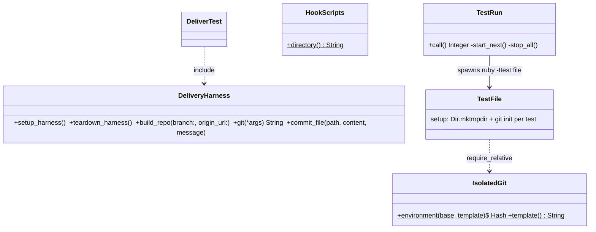
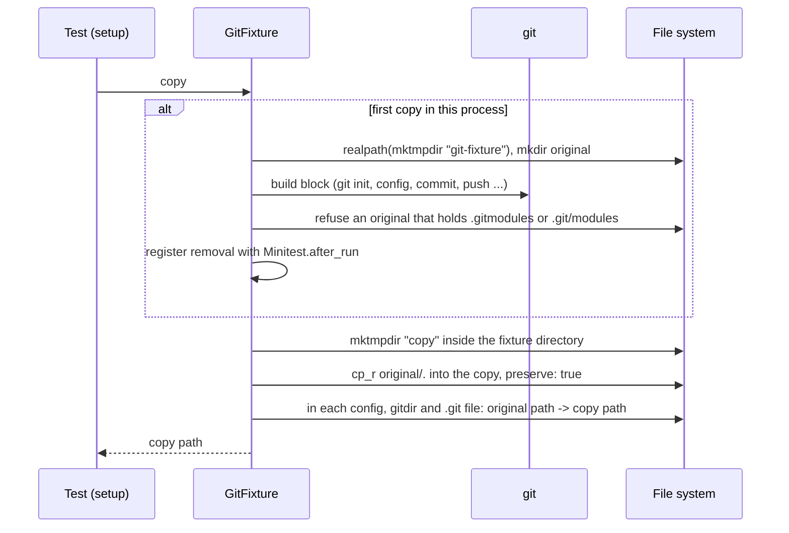

# Plan: Share git fixtures across the tests of a file

From `intent.md` (2026-10-29). Status: accepted.

## Design

### Domain terms

Existing terms from `GLOSSARY.md`, with the same meaning: **Runner** (`bin/test`), **Test file**, **Hooks copy**, **PATH stub**.

New terms. They are not in `GLOSSARY.md` yet, because Etienne has not agreed them (see the report's `Decision needed:` lines):

- **Git fixture** — the git repositories that one test file builds once and then copies for each test. Avoid: template, shared repo.
- **Original** — the directory that the build block of a git fixture fills, once per process. No test gets its path or writes into it. Avoid: template (it already means `GIT_TEMPLATE_DIR` in `IsolatedGit.template` and the PR template in `DeliveryHarness#commit_change_work`), seed (the tests already use it for the clone that pushes the first commit).
- **Fixture copy** — one test's own copy of the original. Every git path that pointed into the original points into the copy.
- **Run root** — the one `dotfiles-test*` directory that the Runner makes for a run. It is the `TMPDIR` of every test file, and the Runner removes it at the end of the run.

### Diagrams

Before:



After:

```mermaid
classDiagram
  class TestRun { +call() Integer  -start_next()  -stop_all()  -remove_run_root() }
  class GitFixture { +initialize() { root }  +copy() String  -original() String  -repoint(copy)  -remove() }
  class IsolatedGit { +environment(base, template)$ Hash  +template()$ String }
  class DeliveryHarness { +setup_harness()  +teardown_harness()  +build_repo(branch:, origin_url:)  +build_original(root, branch, origin_url)$ }
  class TestFile { FIXTURE = GitFixture.new ... ; setup: @repo = FIXTURE.copy }
  TestRun --> TestFile : spawns with TMPDIR = run root
  TestFile --> GitFixture : one copy per test
  DeliveryHarness --> "1..*" GitFixture : one per branch and origin URL
  GitFixture ..> IsolatedGit : require_relative
  DeliverTest ..> DeliveryHarness : include
```



### Signatures

`test/git_fixture.rb`, new. `GitFixture` builds the git repositories of a test file once, then gives each test its own copy of them.

```ruby
class GitFixture
  # Stores the build block; nothing builds yet. The block gets an empty real-path directory and makes
  # the repositories inside it, for example <root>/origin and <root>/repo, or one repository at <root>.
  #: () { (String root) -> void } -> void
  def initialize(&build)

  # A new real-path directory that holds a copy of the original. The first call builds the original.
  # In every git `config`, `gitdir` and `.git` file of the copy, the original's path becomes the copy's
  # path. The copy is removed with the original when the test process ends.
  #: () -> String
  def copy
end
```

Private, not interface: `original` (memoized build; it sets the memo only after the block returns, and on a raise it removes the partial directory), `repoint(copy)` (the textual rewrite), `remove` (`chmod_R u+w`, then `rm_rf`, the same as `HookScripts.remove`). The file starts with `require_relative "isolated_git"`, so every build runs isolated.

`test/delivery_harness.rb`. Public signatures stay. `build_repo` copies instead of building.

```ruby
module DeliveryHarness
  # One git fixture per [branch, origin_url]; private_constant.
  FIXTURES = Hash.new { |all, key| all[key] = GitFixture.new { |root| DeliveryHarness.build_original(root, *key) } }

  # Sets @branch, @fixture_copy, @origin = <copy>/origin and @repo = <copy>/repo.
  #: (?branch: String, ?origin_url: String) -> void
  def build_repo(branch: "my-change", origin_url: PERSONAL_URL)

  # A bare origin at <root>/origin and a work repository at <root>/repo on <branch>, with one commit
  # pushed as main. Runs git with explicit -C paths, because it has no test instance.
  #: (String root, String branch, String origin_url) -> void
  def self.build_original(root, branch, origin_url)

  #: () -> void
  def setup_harness     # no longer makes @origin and @repo

  #: () -> void
  def teardown_harness  # removes @fixture_copy in place of @origin and @repo
end
```

`bin/test`, `TestRun`. Public signatures stay: `#: (Array[String] files, root: String, jobs: Integer) -> void` and `#: -> Integer`.

- `call` makes the run root with `Dir.mktmpdir("dotfiles-test")` before `run_all`.
- `start_next` spawns each file with `{ "TMPDIR" => @run_root }`.
- The `ensure` of `call` runs `stop_all`, then the private `remove_run_root` (`chmod_R u+w`, then `rm_rf`, because a killed file leaves its read-only Hooks copy behind).

Test files adopt it with a constant per repository shape and one line in `setup`:

```ruby
REPOSITORY = GitFixture.new do |repo|
  system("git", "init", "--quiet", "--initial-branch=main", repo, exception: true)
  system("git", "-C", repo, "remote", "add", "origin", "git@github.com:eirvandelden/dotfiles.git", exception: true)
end

def setup
  @repo = REPOSITORY.copy
end
```

Not checked: dotfiles has no Steepfile. The inline `#:` signatures document the types.

### Complexity

Measured on this Mac on 2026-10-29, under the `IsolatedGit` environment, per test, for the DeliveryHarness shape (bare origin plus work repository, one commit, push, branch):

| Path | Time per test | Git processes per test | Files written per test |
|---|---|---|---|
| Today, fresh build | 641 ms | about 12 | 21 |
| Reset of one shared repository | 263 ms | about 6 | 6 |
| In-process `FileUtils.cp_r` of an original | 42 ms | 0 | 21 |

Git process starts dominate the cost, because Defender scans each exec. The copy wins.

- Per test file: one build of each fixture it uses (the cost of one test today), then one in-process copy per test with 0 git processes.
- `deliver_test.rb`: `git init` trace lines go from 60 to 2. Fixture time goes from about 19 s to about 2 s.
- `herdr_worker_scripts_test.rb`: `git init` trace lines go from 154 to the number of shapes it uses (about 4), plus the tests that keep their own builds.
- A copy rewrites only the files named `config`, `gitdir` or `.git`: under 1 ms per copy.
- Runner: one `mktmpdir` and one `rm_rf` per run. No extra process.
- Copies stay on disk until their test file ends, unless the test's own teardown removes them.

### Invariants

- The build block of a fixture runs at most once per process after it succeeds. Enforced by the memo in `GitFixture#original`. Test: `git_fixture_test.rb`.
- A failed build gives no copy and leaves no memo; the next `copy` builds again. Enforced by `original`. Test: `git_fixture_test.rb`.
- No test gets the original's path, so the original stays as built. Enforced by the interface: `copy` returns only new directories. Test: a commit in one copy is absent from the next copy.
- A git path that pointed into the original points into the copy. Enforced by `repoint`, which matches `"<original>/"` and `"<original>"` at a line end, so a sibling whose name starts with the same text never matches. Test: a push from a copy lands in that copy's origin, not in the original's; a linked worktree in the original works in the copy.
- An original holds no submodule, initialized or not, because `.gitmodules` is a tracked file with an absolute URL that the rewrite does not touch. Enforced by a guard in `original` that raises when a `.gitmodules` file or a `.git/modules` directory exists anywhere in it. Test: `git_fixture_test.rb`, one case for each.
- Two tests of a test file give the same result in either order, because each test owns a full copy: hooks, config, stash, reflog and worktree changes stay in that copy. Test: `git_fixture_test.rb`, a child test file run in both orders.
- Every temporary directory of a test file sits under the run root while the Runner runs it. Enforced by the spawn environment in `TestRun#start_next`. Test: `test_runner_test.rb`.
- The run root is gone after a normal run and after INT. Enforced by the `ensure` of `TestRun#call`, after `stop_all`. Test: `test_runner_test.rb`.

### Alternatives

1. **`GitFixture` object, a constant per shape, in-process `cp_r` copy (chosen).** Two calls make the whole interface: `GitFixture.new { |root| ... }` and `#copy`. Each shape is tied to its own constant, so two shapes can never share one original by mistake. Cost: build blocks run in class context, so they call git with explicit paths instead of the test's instance helpers.
2. **`IsolatedGit.fixture_copy(name) { |dir| ... }`, a module function keyed by name.** Rejected. It adds no file, but the name is a magic key: two calls with one name and different blocks silently share the first original. It also gives `IsolatedGit` a second responsibility next to environment isolation.
3. **`Seed` with hard links for files git replaces by rename, real copies for the rest, read-only originals.** Rejected. It writes about 9 files per test instead of 21, but it couples the tests to which files git writes in place (connascence of algorithm with a tool we do not own), makes copies read-only, and needs a `core.checkStat` override. Defender's cost for link events is not measured. The gain over `cp_r` does not pay for that risk.
4. **Reset one shared repository between tests.** Rejected by the measurement: about 6 git processes per test (263 ms against 42 ms), and it cannot restore hooks, stash, reflog or worktrees, so many files would keep their own builds.

## Design decisions

- **Copy, not reset.** The intent leaves this to a measurement in the plan stage. The table in `### Complexity` decides it: the copy costs 42 ms, the reset 263 ms.
- **The bare origin is copied with the work repository, not shared.** The intent says a bare origin that tests only push to "is shared the same way". This plan reads "the same way" as "built once per test file and restored between tests". A copy restores it with 0 git processes; a shared origin would need a ref reset (git processes again) and leaks pushed branches into `origin_branches` assertions. No conflict with `## Decisions`.
- **Every test gets its own repository.** A copy is a full repository, so the intent's "a test that changes hooks, config, stash, reflog or worktrees keeps its own repository" holds for every moved test. No file needs to stay on a fresh build for that reason alone.
- **Which files move.** The intent says to move all files that call `Dir.mktmpdir` and can share (Etienne's decision: all 57 now). The classification below applies "can share" as "builds the same git repository shape in two or more tests". Files with one test or one repository-building test gain nothing from a copy and stay as they are; files with no git repository have nothing to share. Every file, moved or not, gets the run root.
- **No `core.checkStat` override.** A copy keeps mtimes (`preserve: true`) but gets new inodes and ctimes, so git re-hashes the index entries on the first porcelain command and finds them clean. No script outside `test/` uses `diff-index`, `diff-files` or `update-index` (checked with `git grep`), so the override would only change config that scripts under test read.
- **The run root lives in `TestRun`, not in the top-level script.** `TestRun#call` already owns the `ensure` that runs `stop_all`; removing the run root in the same `ensure` keeps the order (stop every file, then remove) in one place.
- **Real paths.** The original's directory is `File.realpath`, so git records one path form and the rewrite needs only that form. Copies are made inside it, so they are real paths too.
- **New glossary terms wait.** The glossary skill adds a term only after Etienne agrees it. Auto mode does not ask, so the four terms above go to the report as decisions.

### File classification

From a read of all 57 files that call `Dir.mktmpdir`, plus the 6 DeliveryHarness users that do not.

Move (shape built in two or more tests):

- Through `test/delivery_harness.rb`, with no edit of their own unless noted: `deliver_test.rb`, `restore_test.rb` (keeps its per-test `insteadOf` config and `commit_change_work`), `ship_test.rb` (keeps its per-test push), `commit_plan_test.rb`, `commit_review_test.rb`, `herdr_open_column_test.rb`, `open_pr_dash_test.rb`, `delivery_harness_test.rb`.
- `herdr_worker_scripts_test.rb`: `repo_on(branch)` copies a fixture per branch; `worktree_creatable!` copies a fixture with the bare origin, push and `info/exclude`. The awkward-path test, the submodule tests and the tests that build their own linked worktrees keep their builds.
- Main repository plus an empty commit: `change_folder_test.rb`, `test_guard_test.rb`, `review_report_check_test.rb`, `auto_accept_test.rb` (no commit), `change_scope_test.rb` (no commit, no remote).
- `consent_guard_test.rb`: empty repository plus remote. The tests that build a second repository keep that build.
- With a bare origin: `gclean_test.rb`, `lefthook_no_fixme_test.rb`, `lefthook_local_hooks_test.rb`, `lefthook_pull_hooks_test.rb`, `lefthook_global_hooks_sync_test.rb`, `branch_guard_test.rb` (its base shape only; the committed `lefthook.yml` that names the per-test log file stays per test).
- With a linked worktree built in setup: `agent_worktree_test.rb` (setup's `create_repository("main")` and `add_worktree(@main, "feature")` become one fixture copy that holds `main` and `main/.worktrees/feature`; `@root` stays per test for `XDG_STATE_HOME`; the tests that call `create_repository` or `add_worktree` themselves keep those calls), `worktree_pane_test.rb` (keeps the directory name `dotfiles`), `worktree_viewer_test.rb`, `worktree_guard_test.rb`, `lefthook_rubocop_git_gem_test.rb`.
- Origin, seed clone and work clone: `worktree_create_test.rb`, `worktree_sweep_test.rb`, `worktree_sweep_on_pull_test.rb`, `worktree_first_skill_test.rb`.
- Empty repository per test: `agent_voice_test.rb`, `global_sig_ignore_test.rb` (its build block sets the same `GIT_CONFIG_GLOBAL` the tests use today).

Stay as they are, with the run root only:

- One test, or one test that builds a repository: `lefthook_posix_sh_test.rb`, `review_push_hook_test.rb`, `bi_test.rb`, `glossary_skill_test.rb`.
- Tests `git init` itself: `isolated_git_test.rb`.
- No git repository in the temporary directory: `isolated_git.rb`, `hook_scripts.rb`, `codex_shim_support.rb`, `architect_agent_test.rb`, `codex_agent_generation_test.rb`, `codex_config_test.rb`, `core_values_test.rb`, `editor_test.rb`, `fill_pr_template_test.rb`, `git_credential_helper_test.rb`, `gh_dash_merge_test.rb`, `glow_style_install_test.rb`, `herdr_quieter_tones_test.rb`, `lefthook_binary_test.rb`, `markdown_hardwrap_hook_test.rb`, `mermaid_show_test.rb`, `node_path_order_test.rb`, `no_hardwrap_rule_test.rb`, `question_rule_mirror_test.rb`, `rubocop_fallback_test.rb`, `rv_ci_fallback_test.rb`, `secrets_loader_test.rb`, `skill_parity_test.rb`, `stow_package_roots_test.rb`, `test_runner_test.rb`.

A file in the move list that fails to pass alone and in the full run after its move, and cannot be fixed within the test's fixture code, goes back to its fresh build. The implementer records it in the PR body with the reason.

## Integration points

- `bin/test` spawns each test file; the new `TMPDIR` reaches every child, so `Dir.mktmpdir`, `Tempfile` and shell `mktemp` in scripts under test all land in the run root.
- `test/isolated_git.rb` sets the git environment; builds of an original run under it, because `git_fixture.rb` requires it.
- `test/hook_scripts.rb`: its Hooks copy is one path per process, so an original may point `core.hooksPath` at it.
- CI runs `bin/test` (`.github/workflows/dotfiles-tests.yml:43`). The workflow file does not change.
- Scripts under test (deliver, ship, restore, herdr scripts, worktree tools, git hooks) see copies instead of fresh repositories. Their code does not change.

## Files that change

- `bin/test` — run root: make it, pass it as `TMPDIR`, remove it after `stop_all`.
- `test/test_runner_test.rb` — tests for the run root.
- `test/git_fixture.rb` — new: `GitFixture`.
- `test/git_fixture_test.rb` — new: unit tests of `GitFixture`.
- `test/delivery_harness.rb` — `build_repo` copies a fixture per branch and origin URL.
- `test/herdr_worker_scripts_test.rb` — `repo_on` and `worktree_creatable!` copy fixtures.
- Each other file in the "Move" list of `### File classification` — a fixture constant and a `copy` in its setup or build helper, nothing else. Assertions stay as they are.

## Order of work

1. Record the baseline before any code change: run `GIT_TRACE=1 bin/test 2>&1 | grep -c "trace: built-in: git init"` and the same for `test/deliver_test.rb` (60 on 2026-10-29). Write both numbers down for the PR body.
2. Write the run-root acceptance tests in `test/test_runner_test.rb`, run them, watch them fail.
3. Add the run root to `bin/test`. Run `test/test_runner_test.rb`, then commit.
4. Write `test/git_fixture_test.rb`, run it, watch it fail (no `GitFixture`).
5. Write `test/git_fixture.rb` until `git_fixture_test.rb` passes. Commit.
6. Move `test/delivery_harness.rb`. Run each of its 8 users alone, then check the `git init` count of `test/deliver_test.rb`. Commit.
7. Move `test/herdr_worker_scripts_test.rb`. Run it alone. Commit.
8. Move the other files in the "Move" list, one file per commit. Run each file alone, twice with different `--seed` values, before its commit.
9. Run the full `bin/test`. Fix leaks in the fixture code of the file that leaks, never in an assertion.
10. Run the INT-then-KILL check by hand (see `## Proof`) and the after count of `git init` for the full run and for `test/deliver_test.rb`.
11. Run `rubocop` on every touched Ruby file. Re-read the full diff.

## Risks

- **Hidden state leaks between tests.** A build block that writes outside its root (a per-test HOME, a stub path, a log file) puts a path into the original that only the first test owns. Mitigation: the blocks receive only the root; per-test paths stay out of the build block (the `branch_guard_test.rb` log file, `lefthook_global_hooks_sync_test.rb`'s HOME symlinks). Each moved file runs alone with two seeds, then in the full run.
- **A path outside `config`, `gitdir` and `.git` files.** A tracked file or a hook in the original that names the original's path is not rewritten. Mitigation: none of the classified shapes does that; submodules, initialized or only recorded in `.gitmodules`, are refused by the guard.
- **Stale index stat in a copy.** A future script that uses plumbing (`diff-index` without `--refresh`) would see false changes. Today no script does.
- **Linked worktrees in an original.** They rely on the rewrite of `gitdir` and `.git` files. `git_fixture_test.rb` proves a linked worktree works in a copy.
- **`TMPDIR` changes for every test file under the Runner.** A test that compares a path with the system temporary directory would change. None was found (`grep TMPDIR test/`: only `glow_style_install_test.rb`, which sets its own).
- **A killed Runner leaves one run root.** The intent accepts that. A standalone `ruby -Itest` run has no run root, so a killed standalone file still leaves its own directories.
- **Read-only Hooks copies under the run root.** Removal does `chmod_R u+w` first, as `HookScripts.remove` does.
- Rejected: hard links (alternative 3), a reset (alternative 4), a name-keyed module function (alternative 2), sharing PATH stubs or HOME between tests (not git fixtures; out of scope).

Out of scope: Defender exclusions or settings, assertions, the Rancher Desktop VM, `sudo fs_usage`, sharing PATH stubs, HOME or `scripts.json` between tests, one original shared across test files.

## Proof

- `bin/test` ends green: 0 failures, 0 errors, 0 skips → check: `bin/test` prints `0 failed` and each file's summary shows `0 failures, 0 errors, 0 skips`.
- `GIT_TRACE=1 bin/test test/deliver_test.rb` shows fewer than 60 lines `trace: built-in: git init` → check: `GIT_TRACE=1 bin/test test/deliver_test.rb 2>&1 | grep -c "trace: built-in: git init"` prints a number under 60 (expected: 2).
- A test file that shares its repository runs two tests in either order with the same result → `test/git_fixture_test.rb` `test_two_tests_that_share_a_fixture_pass_in_either_order`
- After INT then KILL on `bin/test`, `$TMPDIR` holds at most one new `dotfiles-test*` directory → `test/test_runner_test.rb` `test_a_runner_killed_after_an_interrupt_leaves_one_run_root`
- After a normal run, `bin/test` removed its `dotfiles-test*` directory → `test/test_runner_test.rb` `test_a_run_puts_each_file_under_one_run_root_and_removes_it`
- A test that needs its own repository (changes hooks, config, stash, reflog or worktrees) still gets one, and passes → `test/git_fixture_test.rb` `test_hooks_config_stash_and_worktrees_changed_in_one_copy_stay_out_of_the_next`; and check: the moved worktree and hook files pass in `bin/test`.
- The shared fixture helper has unit tests of its public methods, including the reset between tests → `test/git_fixture_test.rb` (the unit tests below).
- Invariant: the run root is gone after INT, enforced by the `ensure` of `TestRun#call` → `test/test_runner_test.rb` `test_an_interrupt_removes_the_run_root`
- Invariant: a build block runs once per process, enforced by `GitFixture#original` → `test/git_fixture_test.rb` `test_the_build_runs_once_for_several_copies`
- Invariant: a push from a copy lands in that copy's origin, enforced by `repoint` → `test/git_fixture_test.rb` `test_a_push_from_a_copy_lands_in_that_copys_origin`
- Invariant: no submodule in an original, enforced by the guard in `original` → `test/git_fixture_test.rb` `test_refuses_an_original_with_a_gitmodules_file` and `test_refuses_an_original_with_an_initialized_submodule`
- Invariant: copies of the DeliveryHarness fixture are independent → `test/delivery_harness_test.rb` `test_build_repo_gives_each_test_its_own_repository_and_origin`
- Baseline and after counts of `git init` → check: step 1 and step 10 of `## Order of work`, both numbers in the PR body.

Per changed file, the unit tests expected, named as behaviour:

- `test/git_fixture.rb`: `GitFixture#copy builds nothing until the first copy`, `#copy returns a new directory each time`, `#copy gives a repository with the original's commits`, `the build runs once for several copies`, `a failed build leaves no copy and builds again on the next call`, `a commit in one copy is absent from the next copy`, `a push from a copy lands in that copy's origin`, `a linked worktree in the original works in the copy`, `refuses an original with a .gitmodules file`, `refuses an original with an initialized submodule`, `a sibling path that starts with the original's path is left alone`, `the original and its copies are gone when the test process ends`, `two tests that share a fixture pass in either order`, `hooks, config, stash and worktrees changed in one copy stay out of the next`.
- `bin/test`: `a run puts each file under one run root and removes it`, `an interrupt removes the run root`, `a runner killed after an interrupt leaves one run root`.
- `test/delivery_harness.rb`: `build_repo gives each test its own repository and origin`, `build_repo with another branch builds another fixture`.

Test setup: `git_fixture_test.rb` builds small originals in its own temporary directory and runs child Minitest files with `ruby -Itest` for the order and cleanup tests; a child file sets `def self.test_order = :alpha` and runs twice with the test names swapped. `test_runner_test.rb` runs the Runner with `TMPDIR` set to the test's `@dir`; the KILL test uses a file that traps INT and records its pid, sends INT then KILL to the Runner, counts `dotfiles-test*` entries in `@dir`, and kills the recorded pid in `ensure`.

---
Domain skills applied: software-design, object-oriented-design, ruby-style, glossary, diagrams.

## Critique

### Round 1 (codex exec -p terra)

- The no-submodule guard checks only `.git/modules`, so an uninitialized submodule recorded in `.gitmodules` keeps an absolute URL outside the copy → fixed (the guard also refuses a `.gitmodules` file; a unit test covers each case)
- The classification says `agent_worktree_test.rb` builds a linked worktree in setup, but the repository and worktree come from helpers → fixed (setup does call `create_repository` and `add_worktree`; the classification now says the two setup calls become one fixture copy, `@root` stays per test, and per-test helper calls stay)
