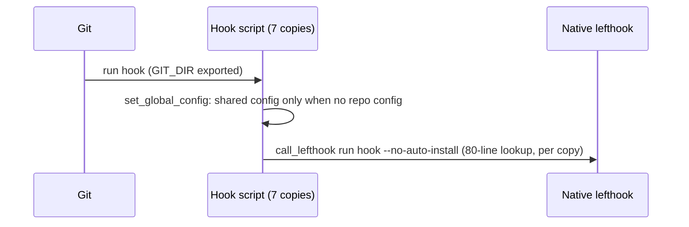
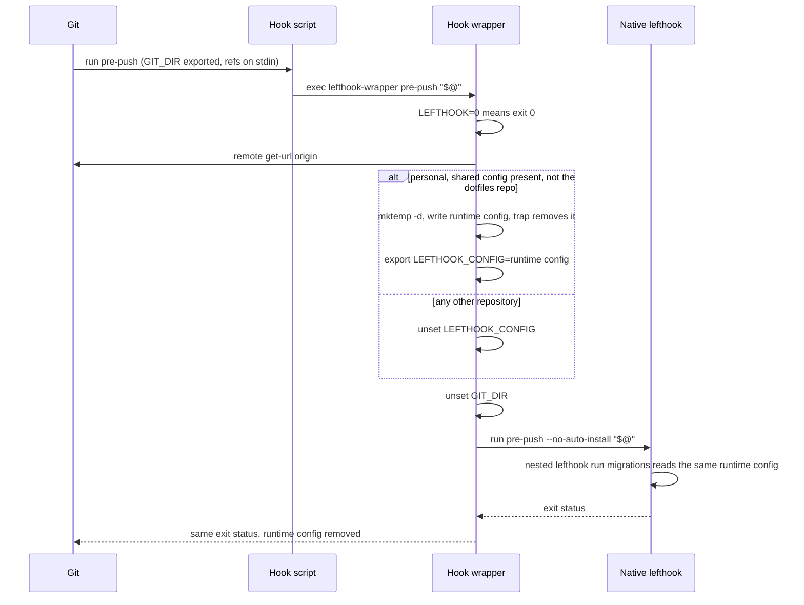
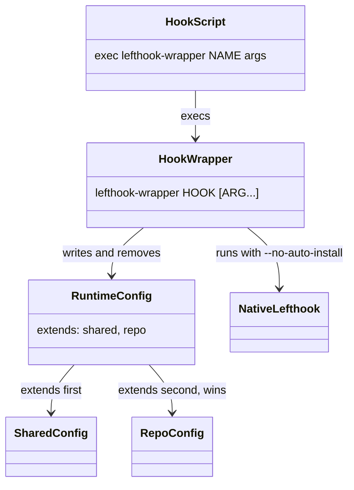

# Plan: Shared lefthook wrapper for personal repositories

From `intent.md` (2026-11-06). Status: accepted.

## Design

### Domain terms

Existing terms: **Hook scripts**, **Hooks copy**, **Native lefthook**, **Binstub**, **Git fixture**, **Fixture copy**, **PATH stub**, **Runner**.

New terms, agreed at the design gate:

- **Hook wrapper** — `git/.config/git/hooks/lefthook-wrapper`, the one script every hook script hands its hook name and arguments to. Avoid: shim, runner.
- **Shared config** — `$HOME/Developer/dotfiles/lefthook.yml`, the lefthook config every personal repository gets.
- **Repo config** — the first of `lefthook.yml`, `.lefthook.yml` or `.config/lefthook.yml` at the git toplevel.
- **Runtime config** — the temporary `lefthook.yml` the hook wrapper writes for one hook run: only `extends:` with the shared config first and the repo config second. Removed when the run ends.
- **Personal repository** — a repository whose `git remote get-url origin` contains `github.com:eirvandelden/` or `github.com/eirvandelden/`; the same rule as `RemoteMatcher.personal?`.

### Diagrams

Before:



After:





### Signatures

No production Ruby. The interface is one shell command.

**Hook scripts** — `pre-commit`, `pre-push`, `commit-msg`, `prepare-commit-msg`, `post-merge`, `post-rewrite`: hand the hook to the hook wrapper. Each file is exactly:

```sh
#!/bin/sh
wrapper="${0%/*}/lefthook-wrapper"
[ -x "$wrapper" ] || { echo "${0##*/}: $wrapper is missing; hooks skipped, restow the git package" >&2; exit 0; }
exec "$wrapper" "${0##*/}" "$@"
```

`post-checkout` keeps its `LEFTHOOK_VERBOSE` trace, its `LEFTHOOK=0` exit and `init_new_worktree "$1"`, which still runs first with `GIT_DIR` set. It loses `set_global_config` and `call_lefthook` and ends with the same guard and `exec "$wrapper" post-checkout "$@"`.

**Hook wrapper** — `git/.config/git/hooks/lefthook-wrapper` (mode 755): runs one git hook through lefthook with the right config and without `GIT_DIR`.

- Usage: `lefthook-wrapper HOOK [ARG...]`. Stdin passes through (pre-push refs).
- Reads: `LEFTHOOK` (`0` exits 0), `LEFTHOOK_VERBOSE` (`1`/`true` means `set -x`), `LEFTHOOK_BIN`, `HOME`, `TMPDIR`.
- Changes: always `unset GIT_DIR`; exports `LEFTHOOK_CONFIG=<tmpdir>/lefthook.yml` in a personal repository, else unsets `LEFTHOOK_CONFIG`. Never touches `GIT_INDEX_FILE` or `GIT_WORK_TREE`.
- Exit status: that of `lefthook run HOOK --no-auto-install ARG...`. The wrapper does not `exec` lefthook, so it stays alive to remove the runtime config.
- Internal parts:
  - Personal check: `case "$(git remote get-url origin 2>/dev/null)" in *github.com:eirvandelden/* | *github.com/eirvandelden/*)`. No origin means not personal.
  - Dotfiles-repo exception: when `git rev-parse --path-format=absolute --git-common-dir` resolves (`pwd -P`) to the shared config's directory `.git`, the wrapper writes no runtime config and unsets `LEFTHOOK_CONFIG`. The dotfiles repo and its worktrees then run only their own branch's `lefthook.yml`, as today.
  - Repo config lookup: first existing of the three names at `git rev-parse --show-toplevel`.
  - Runtime config writer: `mktemp -d "${TMPDIR:-/tmp}/lefthook.XXXXXX"`; each path a single-quoted YAML scalar with `'` doubled; the repo config entry left out when there is none.
  - Cleanup: `trap 'rm -rf "$runtime_dir"' EXIT` and `trap 'exit 129' HUP`, `'exit 130' INT`, `'exit 143' TERM`, so dash also runs the EXIT trap on a signal.
  - `call_lefthook`: the existing lookup chain, moved unchanged from the hook scripts into this one file.
- Runtime config content:

```yaml
extends:
  - '/Users/x/Developer/dotfiles/lefthook.yml'
  - '/path/to/toplevel/lefthook.yml'
```

**PersonalOrigin** — `test/personal_origin.rb` (new): names the fixture origin path that the hook wrapper reads as personal.

```ruby
module PersonalOrigin
  # Relative path of a bare fixture origin; it matches the personal rule and still fetches locally.
  PATH = "github.com/eirvandelden/origin.git" #: String
end
```

Not checked: the dotfiles repository has no Steepfile; test helpers carry inline `#:` comments only.

### Complexity

Per hook run, independent of repo size and number of files or jobs:

- Other repository: 1 `git remote get-url`, then lefthook. Today: 1 `git rev-parse`. Same count.
- Personal repository: `git remote get-url`, one `git rev-parse` for toplevel and common dir, `mktemp -d`, lefthook, `rm -rf`. About 3 extra forks, a few milliseconds.
- Nested `lefthook run migrations`: no extra cost; it inherits `LEFTHOOK_CONFIG`.
- Disk: one directory with one file of about 150 bytes, for the length of the run.

### Invariants

- No lefthook job sees `GIT_DIR`. Enforced by `unset GIT_DIR` in the hook wrapper, before its only lefthook call.
- Every hook-started lefthook run passes `--no-auto-install`. Enforced by the hook wrapper's single `run` line.
- A nested `lefthook run` started by a job never writes hooks. Enforced by the shared config's `no_auto_install: true`, which reaches the nested run through the runtime config.
- A repository that is not personal never gets the shared config, not even an inherited `LEFTHOOK_CONFIG`. Enforced by the wrapper's `else` branch.
- A repo config job wins over a shared job of the same name. Enforced by the `extends:` order (verified on lefthook 2.2.2).
- No runtime config is left after a run. Enforced by the EXIT trap and the signal traps.
- The shell personal rule and `RemoteMatcher.personal?` agree. Enforced by a parity test.
- `GIT_INDEX_FILE` reaches lefthook unchanged, so a partial commit checks the temporary index. Enforced by the wrapper never naming it.

### Alternatives

- **A+ (chosen): hook wrapper.** One lookup chain, two-line-plus-guard hook scripts, temp runtime config with a trap, dotfiles-repo exception from C. Deepest module, fewest moving parts.
- **B: sourced `lefthook-env`.** Rejected: the 80-line lookup chain, with its hard-coded user path, stays copied seven times, and the hooks source a file rather than call one wrapper.
- **C: persistent `<git dir>/lefthook-runtime.yml` with compare and atomic `mv`.** Rejected: six decision points and about 20 tests, plus a state file in every worktree. `mktemp -d` per run already avoids races between concurrent hooks.

## Design decisions

- **Origin read with `git remote get-url origin`, not `git config remote.origin.url`.** The same read as `change-scope`, `auto-accept` and `review-report-fresh`, so "personal" means one thing everywhere. Test fixtures therefore put the bare origin at `<root>/github.com/eirvandelden/origin.git` instead of using `insteadOf`.
- **The wrapper decides `LEFTHOOK_CONFIG` fresh on every run.** An inherited value (a runtime config of another repo, or one Etienne set by hand) is ignored. Simplest rule; keeps work repos clean.
- **Dotfiles-repo exception.** Not in the intent. Without it a dotfiles worktree would extend the main checkout's `lefthook.yml` plus its branch's, so a job removed on a branch would still run. The exception keeps today's behaviour.
- **Only the three `.yml` names.** As the intent says. Only these are in use under `~/Developer`. A personal repo with `lefthook.yaml` or `.toml` would lose its repo config; recorded under Risks.
- **Repositories that are not personal lose the shared fallback.** Today a work repo with no lefthook file gets the shared config. Afterwards lefthook prints "No config files … found" and exits 0. The intent's last acceptance criterion asks for this.
- **`--no-auto-install` scope.** Etienne chose to cover hook-started and nested runs here. A bare `lefthook run` typed in a shell is not intercepted; it becomes a separate follow-up change (see Out of scope).
- **A missing hook wrapper warns and continues.** Etienne chose exit 0 with a restow warning over a blocked commit, for the window between merge and restow.
- **The repair note goes in the pull request body**, not in a file: "Trash `~/.config/git/hooks/pre-commit`, `pre-push` and `post-merge` (plain files), then restow `git` (`stow -R -t "$HOME" git`). Until then, linked hooks skip with a 'restow the git package' warning."
- No conflict with intent's `## Decisions`: personal-only shared config, `remotes:` blocks left alone, runtime config built with `extends:`.

## Integration points

- Git: `core.hooksPath = ~/.config/git/hooks` (`git/.config/git/config`); stow links each hook file and, after a restow, `lefthook-wrapper`.
- Lefthook 2.2.2: `LEFTHOOK_CONFIG`, `extends:`, `--no-auto-install`, `lefthook-local.yml` (still read from the repo root, verified).
- `lefthook.yml` (shared config): unchanged. Its nested `lefthook run migrations` jobs inherit the runtime config.
- `claude/.claude/hooks/remote_matcher.rb`: the Ruby personal rule the parity test compares with.
- `git/.config/git/worktree-tools/worktree-init`: still called from `post-checkout` before the wrapper.

## Files that change

- `git/.config/git/hooks/lefthook-wrapper` — new; the hook wrapper.
- `git/.config/git/hooks/{pre-commit,pre-push,commit-msg,prepare-commit-msg,post-merge,post-rewrite}` — replaced by the four-line hand-off.
- `git/.config/git/hooks/post-checkout` — keeps its prelude and `init_new_worktree`; drops `set_global_config` and `call_lefthook`; ends with the hand-off.
- `test/personal_origin.rb` — new; `PersonalOrigin::PATH`.
- `test/lefthook_wrapper_test.rb` — new; the acceptance and invariant tests below.
- `test/lefthook_global_hooks_sync_test.rb` — fixture origin made personal; one new test (below). `stow_hooks_as_links` already links every child of `hooks/`.
- `test/review_push_hook_test.rb` — also symlink `lefthook-wrapper` next to `pre-push`; origin made personal.
- Fixture origins moved to `PersonalOrigin::PATH` where a test relies on the shared config in a repo without one. Expected: `test/lefthook_local_hooks_test.rb`, `test/lefthook_pull_hooks_test.rb`, `test/lefthook_posix_sh_test.rb`, `test/branch_guard_test.rb` (fallback repos only), `test/lefthook_rubocop_git_gem_test.rb`, `test/worktree_sweep_on_pull_test.rb`. The full suite run after step 4 decides the final list. A test that asserts a repo with its own config ignores the shared jobs (`lefthook_pull_hooks_test`'s `test_repo_with_own_lefthook_config_ignores_global_defaults`, `worktree_sweep_on_pull_test`'s own-config no-sweep test) keeps its non-personal origin, so its assertion still holds and now proves the non-personal rule.

## Order of work

1. Write `test/personal_origin.rb` and the regression test `test_a_pre_push_job_in_a_linked_worktree_does_not_see_git_dir` in `test/lefthook_wrapper_test.rb`. Run it, watch it fail on today's hooks (the `bundle` PATH stub logs a set `GIT_DIR`).
2. Write the other acceptance tests in `test/lefthook_wrapper_test.rb`. Run them; watch the personal-merge, override and not-personal tests fail.
3. Write `lefthook-wrapper`: move `call_lefthook` in, add the personal check, dotfiles-repo exception, runtime config, traps and `unset GIT_DIR`.
4. Replace the seven hook scripts with the hand-off (post-checkout keeps `init_new_worktree`). Run `bin/test test/lefthook_wrapper_test.rb` until green.
5. Run `bin/test`. Move each fixture origin that lost the shared config to `PersonalOrigin::PATH`; add the wrapper link in `review_push_hook_test.rb`. Never weaken an assertion.
6. Add the new sync test and the invariant tests (parity, runtime config removed, partial commit, dotfiles repo, missing wrapper). Run them green.
7. Lint: `shellcheck -s sh -S warning git/.config/git/hooks/*`, `rubocop -c rubocop/.rubocop.yml test/personal_origin.rb test/lefthook_wrapper_test.rb` plus every changed test file. Fix all findings, no disable comments.
8. Run `bin/test` once more, re-read the full diff, commit in small steps (wrapper and hooks; fixture moves; new tests).
9. Manual check in a real personal worktree (any `~/Developer` repo with `origin` on `eirvandelden` and a `lefthook.yml`): `LEFTHOOK_VERBOSE=1 git hook run pre-commit` through a hooks copy pointed at the worktree's tracked hooks (`git -c core.hooksPath=<worktree>/git/.config/git/hooks …`). Confirm the runtime config names both files and is gone afterwards. Record the output in the implement report.

## Risks

- **Restow window.** After merge, the linked hooks need `lefthook-wrapper` linked too; until Etienne restows `git`, every hook prints "hooks skipped, restow the git package" and exits 0, so no check runs. Etienne chose a warning over a blocked commit. The repair note in the PR says so.
- **A repo config with `no_auto_install: false`** overrides the shared config for nested runs, which could install hooks again. Accepted; no personal repo sets it.
- **Repos with `remotes:`** run the shared config twice; the stale remote copy may win a conflict until a follow-up removes the blocks (intent's flagged concern).
- **Other lefthook file names** (`.yaml`, `.toml`, `.json`) in a personal repo would be ignored once `LEFTHOOK_CONFIG` is set. None exist today.
- **Work repos without a lefthook file** print one "No config files … found" line per hook run.
- **Personal rule in two languages** (shell and Ruby). The parity test catches drift.
- **The moved lookup chain keeps its hard-coded `/Users/etienne.vandelden/…lefthook-2.1.10` fallback.** Unchanged content, now in one place; cleaning it is out of scope.

## Out of scope

- A bare `lefthook run` typed in a shell (follow-up change: a `lefthook` PATH wrapper or zsh function).
- Removing `remotes:` blocks from other repositories.
- Running `stow` or touching `~/.config/git/hooks`.
- The Linux `[[ ]]` bug in `lefthook.yml` and the `LEFTHOOK_BIN` test leak.
- Changing the shared job definitions in `lefthook.yml` (the per-job `unset GIT_DIR` stays).

## Proof

- A personal repo with its own `lefthook.yml` runs both the shared jobs and its own jobs on commit → `test/lefthook_wrapper_test.rb` `test_a_personal_repo_with_its_own_config_runs_shared_and_own_jobs`
- A personal repo with no lefthook file runs the shared jobs → `test/lefthook_wrapper_test.rb` `test_a_personal_repo_without_a_config_runs_the_shared_jobs`
- A repo's own job overrides a shared job of the same name → `test/lefthook_wrapper_test.rb` `test_an_own_job_overrides_the_shared_job_of_the_same_name`
- A hook that runs `bundle exec` inside a linked worktree on `pre-push` does not see `GIT_DIR` → `test/lefthook_wrapper_test.rb` `test_a_pre_push_job_in_a_linked_worktree_does_not_see_git_dir`
- `lefthook run` in a repo does not rewrite the global hooks → `test/lefthook_global_hooks_sync_test.rb` `test_pull_in_a_personal_repo_whose_config_lacks_no_auto_install_keeps_global_hooks_linked`, and `test/lefthook_wrapper_test.rb` `test_every_hook_script_passes_its_own_name_and_no_auto_install`
- A repo whose origin is not owned by `eirvandelden` runs only its own config → `test/lefthook_wrapper_test.rb` `test_a_repo_with_another_origin_runs_only_its_own_config`, `test_a_repo_without_origin_runs_only_its_own_config`
- Invariant: the shell personal rule equals `RemoteMatcher.personal?`, enforced by the wrapper's `case` → `test/lefthook_wrapper_test.rb` `test_the_personal_rule_agrees_with_remote_matcher`
- Invariant: no runtime config is left after a run, enforced by the EXIT trap → `test/lefthook_wrapper_test.rb` `test_no_runtime_config_is_left_after_a_hook_run`
- Invariant: `GIT_INDEX_FILE` reaches lefthook, enforced by the wrapper never naming it → `test/lefthook_wrapper_test.rb` `test_a_partial_commit_checks_the_temporary_index`
- Invariant: an inherited `LEFTHOOK_CONFIG` never reaches a repo that is not personal, enforced by the `else` branch → `test/lefthook_wrapper_test.rb` `test_an_inherited_lefthook_config_is_dropped_in_another_repo`
- Invariant: the dotfiles repo and its worktrees run only their own `lefthook.yml`, enforced by the common-dir check → `test/lefthook_wrapper_test.rb` `test_a_dotfiles_worktree_runs_only_its_own_lefthook_yml`
- Invariant: a hook script without its wrapper warns to restow and exits 0, enforced by the guard line → `test/lefthook_wrapper_test.rb` `test_a_hook_without_its_wrapper_warns_to_restow_and_continues`
- Existing behaviour kept: `post-checkout` still runs `worktree-init` → `git/.config/git/worktree-tools/test/post_checkout_hook_test.rb` (unchanged, must stay green)
- Repair note present → check: the PR body holds the trash-then-restow steps.

Per changed file, the unit tests expected (the hook wrapper is the public unit; it is driven through the hook scripts or called directly):

- `git/.config/git/hooks/lefthook-wrapper`: `exits 0 without running lefthook when LEFTHOOK=0`, `passes stdin through to lefthook`, `returns lefthook's exit status`, `writes the repo config entry only when a repo config exists`, `quotes a path holding a space and a single quote`.
- `git/.config/git/hooks/*`: covered by `test_every_hook_script_passes_its_own_name_and_no_auto_install` and `test_a_hook_without_its_wrapper_warns_to_restow_and_continues`.
- `test/personal_origin.rb`: constant only, no test of its own.

Test setup: a git fixture per test file (`GitFixture`), with a bare origin at `<root>/github.com/eirvandelden/origin.git` for personal cases and `<root>/origin.git` for the rest. `HOME` is the test's own directory with `Developer/dotfiles/lefthook.yml` copied from the checkout; `core.hooksPath` points at the hooks copy (`HookScripts.directory`), which now also holds `lefthook-wrapper`. PATH stubs log `bundle` (with `${GIT_DIR-unset}`) and own jobs; a logging lefthook stub records the `run` line; the native lefthook runs the merge cases. `TMPDIR` points at the test's own directory so the runtime config cleanup is observable.

---
Domain skills applied: software-design, glossary, diagrams, dotfiles-maintenance (stow rules), ruby-style (inline RBS on test helpers).
