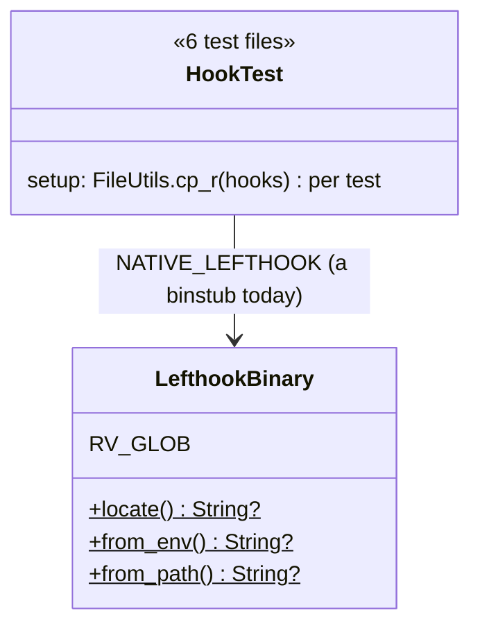
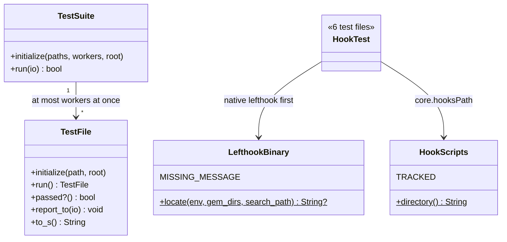
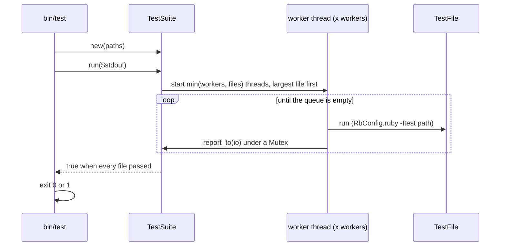

# Plan: Speed up the dotfiles test suite

From `intent.md` (2026-10-21). Status: accepted.

## Design

### Domain terms

The repository has no `GLOSSARY.md`. These terms are new and are not agreed yet; this plan does not write them to a glossary.

- **Native lefthook** — the Go executable `lefthook`: `libexec/lefthook-<os>-<arch>/lefthook` inside a lefthook gem, or a stand-alone binary such as CI's `/usr/local/bin/lefthook`. Avoid: binary (alone).
- **Binstub** — the RubyGems Ruby script `lefthook` on `PATH`. It boots Ruby (about 80 ms on this Mac), then starts the native lefthook. Avoid: shim.
- **Hook scripts** — the seven tracked `sh` files in `git/.config/git/hooks/`.
- **Hooks copy** — the one read-only copy of the hook scripts per test process. A test repository points `core.hooksPath` at it.
- **PATH stub** — an executable that a test writes into its own bin directory to stand in for a tool (for example `stub_real_lefthook`).
- **Test file** — one `test/*_test.rb`, run as its own process with `ruby -Itest <file>`.
- **Runner** — `bin/test`. It runs test files in parallel and fails when one fails.
- **Chained test** — one test that runs the steps of several former tests in one repository. Every former assertion stays, with its own message.
- **Covering test** — the test that still proves the behaviour of a deleted test.

### Diagrams

Before:



After:



Runner sequence:



Not affected (ER, state): no database and no state machine.

### Signatures

`test/lefthook_binary.rb` — finds the lefthook that hook tests give to git, the native lefthook before any binstub.

```ruby
module LefthookBinary
  MISSING_MESSAGE = "..." #: String   names LEFTHOOK_BIN, the gem directories and PATH

  # LEFTHOOK_BIN, then native lefthook in the newest lefthook gem, then the first lefthook on PATH.
  #: (?env: Hash[String, String?], ?gem_dirs: Array[String], ?search_path: String?) -> String?
  def self.locate(env: ENV.to_h, gem_dirs: gem_dirs_newest_first, search_path: ENV["PATH"])
end
```

Private class methods: `from_env(env)`, `native_in(gem_dirs)` (`<dir>/libexec/<platform_dir>/lefthook` when it is an executable file), `on_path(search_path)` (a Ruby scan of `PATH`, no `which` process), `gem_dirs_newest_first` (`Gem::Specification.find_all_by_name("lefthook")` sorted by version, newest first, then the rv rubies glob `~/.local/share/rv/{rubies/*/lib/ruby,gems/ruby}/*/gems/lefthook-*` sorted by `Gem::Version`), `platform_dir` (`"lefthook-#{os}-#{arch}"`, mapped from `Gem::Platform.local` as the gem's own `bin/lefthook` maps it). The public `from_env` and `from_path` go private: only `locate` and `MISSING_MESSAGE` have callers.

`test/hook_scripts.rb` (new) — gives each test process one read-only copy of the hook scripts.

```ruby
module HookScripts
  TRACKED = File.expand_path("../git/.config/git/hooks", __dir__) #: String

  # The directory a test repository points core.hooksPath at; the same path for the whole process.
  #: () -> String
  def self.directory
end
```

Private: `read_only_copy` (realpath of `Dir.mktmpdir` + `/hooks`, `cp_r` with `preserve: true`, then `chmod_R("a-w")`, registers `remove` with `Minitest.after_run`), `remove(directory)` (`chmod_R("u+w")`, then `rm_rf` of the parent).

`test/test_suite.rb` (new; not matched by `*_test.rb`) — the runner's two classes.

```ruby
# One test file, run as its own Ruby process with its output captured.
class TestFile
  #: (String path, root: String) -> void
  def initialize(path, root:)
  #: () -> self
  def run                 # Open3.capture2e(RbConfig.ruby, "-Itest", path, chdir: root)
  #: () -> bool
  def passed?
  #: (IO io) -> void
  def report_to(io)       # "=== <path> ===", then the captured output
  #: () -> String
  def to_s                # the path
end

# Test files run by a fixed number of worker threads, largest file first.
class TestSuite
  #: (Array[String] paths, ?workers: Integer, ?root: String) -> void
  def initialize(paths, workers: Etc.nprocessors, root: File.expand_path("..", __dir__))
  #: (?IO io) -> bool
  def run(io = $stdout)   # prints each report as one block, then "<n> files, <m> failed" and one "FAILED <path>" line per failure
end
```

`bin/test` (new, executable): `exit(TestSuite.new(ARGV.empty? ? Dir.glob(File.join(ROOT, "test/*_test.rb")).sort : ARGV).run)`. It has no flags.

All new code stays Ruby 3.4 compatible, because CI runs Ruby 3.4.

Not checked: the dotfiles repository has no Steepfile. `rubocop-rbs_inline` (in `rubocop/.rubocop.yml`) validates the `#:` annotations.

### Complexity

- `LefthookBinary.locate`: no child process (today it forks `which`). One gem-spec lookup and one glob, once per test file at class load.
- Lefthook start-up per hook fired by a test: about 95 ms before (binstub) and about 15 ms after on the `LEFTHOOK_BIN` path. On the PATH-stub path (probe plus run): about 180 ms before, 25 ms after. A commit fires three hooks.
- Hooks copy: one `cp_r` of seven files per process instead of one per test.
- Hooked repository setups: `branch_guard_test.rb` 50 → about 15; `lefthook_pull_hooks_test.rb` 16 → 7; `lefthook_local_hooks_test.rb` 15 → 8; `lefthook_rubocop_git_gem_test.rb` 6 → 3; `lefthook_posix_sh_test.rb` 3 → 1; `review_push_hook_test.rb` 2 → 1.
- Runner: one process per test file, at most `Etc.nprocessors` (12 here) at once. Wall time is about max(longest file, total time / workers).
- Baseline measured at plan time on this Mac, 12 files at once with `xargs -P 12`: 273 s wall, all 77 files green. `branch_guard_test.rb` (269 s) set the critical path; next were `herdr_worker_scripts_test.rb` 225 s, `deliver_test.rb` 219 s, `worktree_create_test.rb` 183 s and `consent_guard_test.rb` 182 s. After this change the critical path moves to `herdr_worker_scripts_test.rb` (not hook-bound, out of scope); expected wall time is under 4 minutes.

### Invariants

- I1: `locate` returns an executable `LEFTHOOK_BIN` first, then a native lefthook from the gem directories, then the first executable `lefthook` on `PATH`, else nil. Enforced by the `||` order in `locate`. Proved by `test/lefthook_binary_test.rb`.
- I2: No test repository points `core.hooksPath` at the tracked hook scripts, and nothing writes to the hooks copy. Enforced by `HookScripts.directory` (a copy, made read-only). Proved by `test/hook_scripts_test.rb`.
- I3: The hooks copy has the same names, bytes and executable bits as the tracked hook scripts. Enforced by `cp_r(preserve: true)`. Proved by `test/hook_scripts_test.rb`.
- I4: `bin/test` exits non-zero if and only if at least one test file exits non-zero, and prints `FAILED <path>` for each one. Enforced by `TestSuite#run` and `bin/test`'s `exit`. Proved by `test/test_suite_test.rb`.
- I5: At most `workers` test files run at once, and `workers` of them do run at the same time. Enforced by the fixed thread pool. Proved by a bound test in `test/test_suite_test.rb`: three blocking fixtures and two workers; two start, the third waits until one is released.
- I6: Each step of a chained test starts from the state its former test had: a clean index before empty commits and no-change amends, an empty origin before refspec refusals, an empty log before log assertions, unique content per pushed file, and config-changing steps last. Enforced by step order, with a one-line comment per step. Proved by the mutation check in `## Proof`.
- I7: A refused commit or push leaves the repository and the remote unchanged. Git enforces it: a failing hook aborts before any ref changes. A chained test relies on it.

### Alternatives

1. **Smallest diff**: fix `locate`, use the tracked hooks directory in place, a one-file runner script, merge only `branch_guard_test.rb`. Rejected: the in-place hooks directory lets a lefthook auto-install regression rewrite tracked files in the checkout, and a script with no requirable classes cannot get unit tests of its public methods.
2. **Maximum speed**: everything below, plus `command -v` / `test -x` guards before every probe in the seven hook scripts, plus whole-file chains (`lefthook_pull_hooks_test.rb` 15 → 1). Rejected: the hook guards only save forks on the fall-through path, which neither the suite nor a real commit on this Mac takes (under 1 %), yet they touch seven files that `lefthook install` would regenerate. A 15-step chain hides every step behind the first failure and makes order bugs likely.
3. **Chosen: deep test support plus themed merges**: `LefthookBinary.locate` with injected lookups, `HookScripts.directory` (copy once, read-only), `TestSuite`/`TestFile` behind `bin/test`, and chains grouped by theme so each stays short.

## Design decisions

- **The hook scripts do not change.** The intent allows a change "where that cuts the start-up cost". Once tests use the native lefthook, the remaining cost is the `lefthook -h` probe on a binstub. Removing the probe changes behaviour: a binstub whose gem is missing (after an rv Ruby switch, or under `bundle exec` without lefthook in the bundle) fails `-h` today and the hook falls through to the native path; without the probe the hook would fail. Existence guards save nothing measurable. The acceptance criterion "a hook still refuses a commit on main and runs its lefthook commands" is still proved, by the chained test A and its `own-check` log.
- **Hooks copy, not in place.** `lefthook_global_hooks_sync_test.rb` keeps its own per-test copy, because it simulates stow links and watches for a lefthook rewrite; it must own what it watches.
- **Runner name and location**: `bin/test` with its classes in `test/test_suite.rb`, so the classes get unit tests. `bin/` holds repository scripts and is not a stow package.
- **Largest file first** by `File.size`: a heuristic with no stored timings.
- **The three named failures.** The intent names `test/guard_parity_test.rb`, `test/mobile_tooling_test.rb` and `git/.config/git/worktree-tools/test/conductor_scripts_test.rb` as failing. At plan time the first two pass (12 and 4 runs, 0 failures); `conductor_scripts_test.rb` fails (2 failures, 1 error). Step 0 and step 9 run all three by name, the nested one with `cd git/.config/git/worktree-tools && ruby -Itest test/conductor_scripts_test.rb`, and record the failing test names. The criterion holds when each keeps its baseline status and the same failing test names. This change fixes none of them.
- **Two `LEFTHOOK_BIN` logging-stub tests in `lefthook_local_hooks_test.rb` stay as they are.** They are no-ops (`repo_env` clears `LEFTHOOK_BIN`), and a separate agreed branch fixes them.
- **Glossary**: no term is written to a glossary, because auto mode has nobody to agree a term.

## Integration points

- `.github/workflows/dotfiles-tests.yml` runs every `test/*_test.rb` serially on Ubuntu with Ruby 3.4 and a native `/usr/local/bin/lefthook`. It does not change. New tests and helpers must pass there: no lefthook gem, so `locate` falls to `PATH`.
- `lefthook-branch-guard.yml` and the guard commands in `lefthook.yml`: exercised by the chained tests, not edited.
- Ruby's `Gem::Specification`, `Etc.nprocessors`, `Open3`, `Minitest.after_run`: standard library and the existing test gem only. No new dependency.

## Files that change

- `test/lefthook_binary.rb` — new lookup order, gem-directory lookup, Ruby `PATH` scan, keyword injection, private helpers, message.
- `test/lefthook_binary_test.rb` (new) — unit tests of `locate`.
- `test/hook_scripts.rb` (new) — `HookScripts.directory`.
- `test/hook_scripts_test.rb` (new).
- `test/test_suite.rb` (new) — `TestSuite`, `TestFile`.
- `test/test_suite_test.rb` (new) — unit tests plus `bin/test` integration tests on fixture files in a tmpdir.
- `bin/test` (new, mode 755).
- `test/branch_guard_test.rb` — `HookScripts.directory`, chained tests, deletions.
- `test/lefthook_pull_hooks_test.rb` — `HookScripts.directory`, themed chains, one deletion.
- `test/lefthook_local_hooks_test.rb` — `HookScripts.directory`, themed chains.
- `test/lefthook_posix_sh_test.rb` — `HookScripts.directory`, one chained test.
- `test/lefthook_rubocop_git_gem_test.rb` — `HookScripts.directory`, two chains.
- `test/review_push_hook_test.rb` — one chained test (it already uses the tracked `pre-push` through a symlink; that stays).
- `test/worktree_sweep_on_pull_test.rb` — `HookScripts.directory` only.
- `docs/changes/speed-up-test-suite/timing.md` (new) — baseline per-file status and times, serial and `bin/test` timings before and after.
- `docs/changes/speed-up-test-suite/deleted-tests.md` (new) — each deleted test with its covering test, and the mutation-check results.

Merges and deletions, by file:

`test/branch_guard_test.rb` (52 tests):

- A, extending guard on main: empty commit refused, no-change amend refused (clean index), stage a file: commit refused, amend with change refused; `push origin main` refused; switch to `feature`: pushes `feature:main`, `feature:master`, `HEAD:main`, `feature:feature HEAD:main` refused; publish `main` with `LEFTHOOK=0`: `--delete main` refused; commit on feature allowed, empty the log, push `feature:feature` allowed and the log is exactly `own-check\n`; empty commit on feature allowed; pushes `feature:main-fix`, `feature:mainline` and tag `v1` allowed.
- B, extending guard on master: empty commit refused (first, on a clean index, so commit-msg and not pre-commit refuses it), then stage a file: commit refused, then `push origin master` refused.
- C, merges in the main checkout on main: merge commit allowed, merge that changes no files allowed, conflicted merge concluded, squash commit refused (last). Every merge scenario uses its own branch (`merge-a`, `merge-b`, `conflict`, `squash`), so no merge is already up to date, and each allowed merge asserts two parents. `diverge` and `conflicting_branch` take the branch name and unique file names.
- D, merges in a linked worktree on main: merge commit, merge that changes no files, conflicted merge concluded, each on its own branch and each asserting two parents. Helpers get a `dir:` keyword where needed.
- E, `--no-verify` on main: empty commit allowed, then no-change amend allowed.
- F, fallback config on main: empty commit refused, amend with change refused; on feature: `feature:main` and `feature:feature HEAD:main` refused; publish main: `--delete main` refused; `main-fix`, `mainline` and tag allowed.
- G, fallback merges: merge commit allowed, conflicted merge concluded, each on its own branch and each asserting two parents.
- Unchanged: `a_change_to_the_guard_file_reaches_a_repo_that_extends_it`, `lets_the_first_empty_commit_on_an_unborn_main_through`, `the_guard_file_defines_only_the_guard_commands`, `the_fallback_config_duplicates_the_guard_commands_exactly`.
- Deleted (master twins and fallback twins). Every `master` clause keeps one test: the pre-commit clause (B commit), the commit-msg clause (B empty commit), the pre-push branch clause (B push) and the pre-push `refs/heads/master` arm (A `feature:master`). `MERGE_HEAD` does not depend on the branch name.

| Deleted test | Covering test |
|---|---|
| `…refuses_an_amend_that_stages_a_change_on_master` | B commit (pre-commit master clause) + A amend with change |
| `…refuses_an_amend_that_stages_no_change_on_master` | B empty commit (commit-msg master clause) + A no-change amend |
| `…refuses_a_squash_merge_commit_on_master` | B commit + C squash step |
| `…allows_a_merge_commit_on_master` | C merge step |
| `…allows_concluding_a_conflicted_merge_on_master` | C conflicted step + B |
| `…allows_concluding_a_conflicted_merge_on_master_in_a_linked_worktree` | D conflicted step + B |
| `…refuses_a_push_deleting_master` | A `feature:master` (same `refs/heads/master` arm) + A `--delete main` |
| `the_fallback_config_refuses_an_empty_commit_on_master` | F empty commit + B + `the_fallback_config_duplicates_the_guard_commands_exactly` |
| `the_fallback_config_refuses_a_push_of_a_feature_branch_to_master` | F `feature:main` + A `feature:master` + duplicates test |
| `the_fallback_config_refuses_a_push_deleting_master` | F `--delete main` + A + duplicates test |

`test/lefthook_pull_hooks_test.rb` (16 tests → 7): migrations (new migration, changed schema, migration name with a command on a new line); yarn context (`package.json` with no lockfile installs nothing, then `yarn.lock` runs yarn, then `package.json` beside `yarn.lock` runs yarn); npm context, its own repository (`package-lock.json` runs npm, then `package.json` beside it runs npm, not yarn) — `client-dependencies` in `lefthook.yml` picks npm whenever `package-lock.json` exists, so the two contexts cannot share a repository; Gemfile (`Gemfile.lock` through `bi`, root Gemfile deleted, nested Gemfile, Gemfile name with a command on a new line); readme only; rebase path with a local commit; own `lefthook.yml` ignores the defaults. Empty the log before each pull. Delete `test_pull_on_non_main_branch_still_fires_hooks`: its body is identical to `test_new_migration_file_triggers_db_migrate` and it pulls on the same branch; covered by the migrations chain.

`test/lefthook_local_hooks_test.rb` (15 tests → 8): fallback commit cases (unknown word, binary-only change, conflict markers refused); `--no-auto-install` on commit then push; fixme push refused; hard-wrap warnings (`.md`, `.markdown`, one-line paragraph — skips without markdownlint); hard-wrap skips (no markdownlint, package not stowed); `npx --no` (stylelint, eslint); plus the two `LEFTHOOK_BIN` logging-stub tests unchanged.

`test/lefthook_posix_sh_test.rb` (3 → 1): empty commit refused, push from main refused, then `feature:main` refused.

`test/lefthook_rubocop_git_gem_test.rb` (6 → 3): the fixture test unchanged; commits (clean passes; fixable committed fixed with nothing unstaged; unfixable blocked and HEAD unchanged, last, so its staged offense never meets the "nothing unstaged" assertion), each with its own file path; pushes (clean passes, unfixable blocked and remote unchanged).

`test/review_push_hook_test.rb` (2 → 1): push with an open pull request refused first, then push with none succeeds.

## Order of work

0. Baseline: run every `test/*_test.rb` serially (as CI does) and with `xargs -P "$(sysctl -n hw.ncpu)"`, plus `conductor_scripts_test.rb` by name; record each file's status, failing test names and time, and both wall times, in `timing.md`.
1. Write `test/lefthook_binary_test.rb`: native lefthook in a fake gem dir plus a binstub stand-in on `PATH` returns the native one. Run it, watch it fail (`locate` takes no keywords and prefers `PATH`).
2. Rewrite `test/lefthook_binary.rb` until it passes; add the remaining `locate` unit tests.
3. Write `test/hook_scripts_test.rb`, watch it fail; add `test/hook_scripts.rb`.
4. Switch the six hook test files to `HookScripts.directory`; run each file.
5. Write `test/test_suite_test.rb` (unit tests, then `bin/test` on fixtures), watch it fail; add `test/test_suite.rb` and `bin/test`.
6. Chain and delete in `branch_guard_test.rb`, one chain per commit. After each chain, run the mutation check for the clauses it covers.
7. Chain and delete in the other five files, one file per commit; run each file after its change.
8. Write `deleted-tests.md` with the deletion table and mutation results.
9. Run the full suite with `bin/test` three times and serially once; compare each file's status with the baseline; record times in `timing.md`.
10. Run `rubocop` on every touched Ruby file; check `git status --porcelain git/.config/git/hooks` is empty.

## Risks

- **Parallel interference**: tests that share real paths (the bundler cache in `lefthook_rubocop_git_gem_test.rb` is per process; any test that keeps the real `HOME`). The plan-time `xargs -P 12` run passed all 77 files, and step 9 runs `bin/test` three times.
- **Load-sensitive waits**: `worktree_sweep_on_pull_test.rb` has a 20 s `DEADLINE`. If it flakes under 12 workers, stop and report; raising deadlines is a separate decision.
- **Read-only hooks copy**: if lefthook or git writes into `core.hooksPath` during a test, that test now fails loudly. That is wanted, but it surfaces at step 4, not later.
- **Chained tests stop at their first failing step**; later steps go unreported until it is fixed. Per-step messages name the former test.
- **Native lefthook version**: the newest gem version wins; the binstub also runs the newest, so behaviour matches.
- **Linux CI**: no lefthook gem, so `locate` returns `/usr/local/bin/lefthook` as today. `platform_dir` must map `x86_64-linux` to `lefthook-linux-x64`; a unit test covers the mapping through `locate` with a fake gem dir named for the local platform.
- Rejected: editing the hook scripts (see `## Design decisions`); in-file parallelism with `parallelize_me!` (not in the intent's scope); rewriting the Ruby `gh` and `herdr` stubs that make `herdr_worker_scripts_test.rb` and `deliver_test.rb` slow (not hook-bound, out of scope — a follow-up).

Out of scope: `.github/workflows/`, the hook scripts, `lefthook_global_hooks_sync_test.rb`, `conductor_scripts_test.rb`, Defender and VM settings (recommendations in the final report: exclude `$TMPDIR` and `~/Developer` from real-time scanning; stop the idle VM).

## Proof

- The parallel runner runs the full suite in under 5 minutes → check: `time bin/test` on this Mac, recorded in `timing.md` (three runs, each under 300 s).
- The runner exits non-zero and prints the failing file names → `test/test_suite_test.rb` `test_bin_test_exits_non_zero_and_names_the_failing_file`.
- With a native lefthook in the gem directory, `locate` returns it, not the binstub → `test/lefthook_binary_test.rb` `test_locate_prefers_the_native_lefthook_in_a_gem_dir_over_a_lefthook_on_path`.
- With no native lefthook and only a `lefthook` on `PATH`, `locate` returns that one → `test/lefthook_binary_test.rb` `test_locate_returns_the_lefthook_on_path_without_a_native_one`.
- A merged test still fails when any of its original behaviours breaks → check: a coverage matrix in `deleted-tests.md` with one row per former test (52 + 16 + 15 + 3 + 6 + 2): the chain and step that now holds its assertion, a targeted mutation of the config or stub it exercises (for example drop `|| [ "$branch" = "master" ]` in one hook, drop the `refs/heads/master` arm, widen it to `refs/heads/main*`, drop a `MERGE_HEAD` line, remove the `own-check` command, swap npm and yarn in `client-dependencies`), and the observed failure of that chain. Mutations run on scratch copies (an `extends:` copy of the guard, a copied `lefthook.yml`), never on tracked files. A former test whose behaviour has no mutation that makes its chain fail stays a separate test.
- Each deleted test is listed with its covering test → check: `deleted-tests.md` holds every row of the deletion tables above.
- A hook still refuses a commit on `main` and runs its lefthook commands → `test/branch_guard_test.rb` chained test A (commit refused; `own-check` log) and `test/lefthook_posix_sh_test.rb` chained test.
- Every file that passes today still passes, and the three failing files fail the same way → check: step 9 status comparison against `timing.md`'s baseline, every `test/*_test.rb` plus the three named files run by name, with matching failing test names.
- Invariant: I1 lookup order, enforced by `LefthookBinary.locate` → `test/lefthook_binary_test.rb` (all four tests).
- Invariant: I2/I3 hooks copy is a read-only, identical copy, enforced by `HookScripts.directory` → `test/hook_scripts_test.rb` `test_directory_is_a_read_only_copy_of_the_tracked_hooks`.
- Invariant: I5 at most `workers` files run at once, enforced by the thread pool → `test/test_suite_test.rb` `test_run_never_runs_more_files_than_workers` (three blocking fixtures, two workers; a marker file per start, a release file per fixture).

Per changed file, the unit tests expected, named as behaviour:

- `test/lefthook_binary.rb`: `locate prefers an executable LEFTHOOK_BIN`, `locate prefers the native lefthook in a gem dir over a lefthook on PATH`, `locate takes the newest gem version`, `locate returns the lefthook on PATH without a native one`, `locate returns nil when nothing is found`.
- `test/hook_scripts.rb`: `directory is not the tracked directory`, `directory has the tracked names, bytes and executable bits`, `directory is not writable`, `directory returns the same path on a second call`.
- `test/test_suite.rb`: `TestFile#run captures output and status`, `TestFile#passed? is false for a non-zero exit`, `TestFile#report_to writes a header and the output`, `TestSuite#run returns true when every file passes`, `TestSuite#run returns false and prints FAILED lines`, `TestSuite#run starts the largest file first` (one worker), `TestSuite#run never runs more files than workers`.
- `bin/test`: `exits zero when every file passes`, `exits non-zero and names the failing file`.

Test setup: fixtures are plain Ruby scripts and fake gem directories written into `Dir.mktmpdir`, never under `test/`, so CI's glob never runs them. `locate` gets `env:`, `gem_dirs:` and `search_path:` injected; no test changes the process `ENV`. The hook test files keep their existing temporary repositories and stubs.

---
Domain skills applied: software-design, ruby-style, rails-testing (Minitest conventions), object-oriented-design, dependencies (no new dependency), glossary, diagrams.

## Critique

### Round 1 (codex exec -p terra)

- The plan replaced the criterion about the three named failures with a new baseline and left out the nested `conductor_scripts_test.rb` → fixed (Design decisions and Proof now run all three files by name before and after and compare failing test names; plan-time status recorded: two pass, `conductor_scripts_test.rb` fails)
- Branch-guard chain B left `change.txt` staged before its empty commit, so pre-commit and not commit-msg refused it → fixed (the empty commit runs first, on a clean index)
- Chains C, D and G reused `feature` after merging it, so later merges were already up to date → fixed (one branch per merge scenario, and each allowed merge asserts two parents)
- The pull-hook JavaScript chain could not prove the yarn-adjacent and no-lockfile cases once `package-lock.json` existed → fixed (a yarn-context chain and a separate npm-context repository; `lefthook_pull_hooks_test.rb` now 16 tests to 7)
- The RuboCop commit chain left the rejected offense in the work tree before the "nothing unstaged" assertion → fixed (the unfixable commit runs last)
- One mutation per chain does not prove every merged behaviour, and the test counts were wrong → fixed (a matrix row and a targeted mutation per former test; a behaviour with no failing mutation stays a separate test; counts corrected to 16 and 15)
- The runner proof showed overlap but not the `workers` bound → fixed (bound test with three blocking fixtures and two workers)
- The runner should put children in process groups and forward INT and TERM → dismissed: Ctrl-C in a terminal already reaches every child, because the children share the foreground process group; the intent asks for no signal handling, and a killed runner leaves only temporary directories
