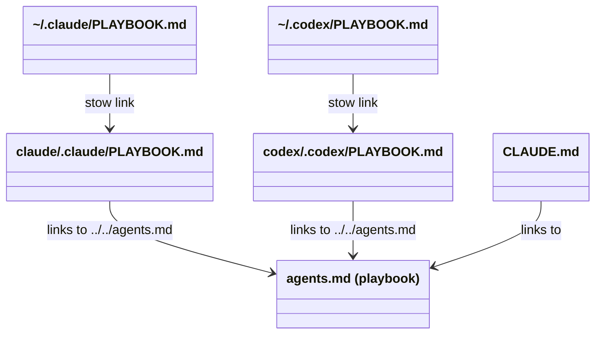
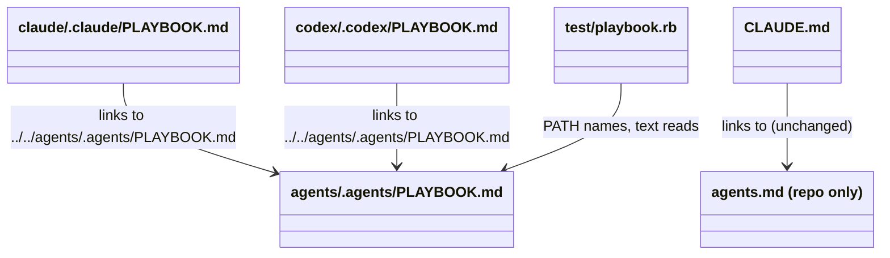

# Plan: Split the playbook from this repository's agents.md

From `intent.md` (2026-11-06). Status: accepted.

## Design

### Domain terms

- **Playbook**: the shared rule file that every Claude and Codex session imports as `PLAYBOOK.md`. Its new source is `agents/.agents/PLAYBOOK.md`.
- **Import link**: one of the two tracked symlinks `claude/.claude/PLAYBOOK.md` and `codex/.codex/PLAYBOOK.md`. Stow links `~/.claude/PLAYBOOK.md` and `~/.codex/PLAYBOOK.md` to them.
- **Repo agents file**: the root `agents.md`. It describes this repository only. Root `CLAUDE.md` stays a symlink to it.
- The glossary (`GLOSSARY.md`) has none of these terms yet, and no word of the intent is in an `Avoid:` list.

### Diagrams

Before: the playbook is the repo agents file, so a session in this repository loads it twice.



After: the import links reach the playbook in the `agents` package; `CLAUDE.md` reaches the new repo agents file.



### Signatures

New test helper `test/playbook.rb`, the one place a test names the playbook file. It follows the `HookScripts` and `LefthookBinary` idiom: a module in `test/`, a frozen path constant, a memoised reader, its own `*_test.rb`.

```ruby
# The shared playbook every agent imports as PLAYBOOK.md. Tests read it here, so a move touches one line.
module Playbook
  PATH = "agents/.agents/PLAYBOOK.md" #: String

  #: () -> String
  def self.text
    @text ||= File.read(File.expand_path("../#{PATH}", __dir__))
  end
end
```

No production Ruby class changes. The two hook files change only a comment.

Not checked: this repository has no Steep setup.

### Complexity

Not affected: no runtime path changes. `Playbook.text` reads the file once per test process. The citation scan reads each tracked text file once.

### Invariants

- Both import links resolve to `Playbook::PATH`. Enforced by the links themselves; proved by `test/playbook_test.rb`.
- No tracked file reads or cites root `agents.md` as the playbook. Enforced by the citation scan in `test/playbook_test.rb`.
- Root `agents.md` holds no playbook text. Proved by `test/repo_agents_file_test.rb`.
- Every command and linter that root `agents.md` names exists in the repository. Proved by `test/repo_agents_file_test.rb`.

### Alternatives

- **A. Shared test helper `Playbook` (chosen).** Eleven test files read `Playbook.text` or `Playbook::PATH`. The next move of the playbook is a `git mv`, two link targets and one line. It costs one helper file and its test, which the repo idiom already expects.
- **B. Per-file literal swap (rejected).** Replace `"agents.md"` with `"agents/.agents/PLAYBOOK.md"` in about fifteen places. The diff is smaller, but the next move repeats the same edit in every file, and nothing stops a new test from adding a sixteenth literal.
- **C. Read through the Claude import link `claude/.claude/PLAYBOOK.md` (rejected).** It reads what Claude loads, but the link tests already fail on a dangling link, and the expected target still needs a second literal. Chaining the Codex link to the Claude link was rejected too: Codex would then depend on the `claude` package, which the shared `agents` package exists to prevent.

## Design decisions

- `## 9. Keyboard` follows `## 8.` as the last numbered section. The intent asks for a `Keyboard` section and fixes neither number nor place. The playbook numbers every section, and no test or hook parses §8 as the last one.
- "Under one page" means at most 40 lines for root `agents.md`. The intent leaves the measure open.
- Root `agents.md` lists the packages of the `STOW` array in `packages.conf`, on one line. A test parses that array, so a new package without a line in `agents.md` fails the suite.
- The linters `agents.md` lists are the `lefthook.yml` pre-commit commands that this repository's own files trigger: `rubocop` (config `rubocop/.rubocop.yml`), `shellcheck`, `shellcheck-zsh`, `yamllint` and `no-hardwrap` (markdownlint). A test checks that each listed name is a `lefthook.yml` command key.
- `install.sh:11` and `install/utils.sh:6` say "Strategy (see agents.md)". That Homebrew-first strategy lives in neither file, only in the `dotfiles-maintenance` skill (`SKILL.md` and `references/repository-layout.md`). Both comments point to `agents/.agents/skills/dotfiles-maintenance/SKILL.md`, as the intent says.
- Citations that name the playbook by its import name use `PLAYBOOK.md`: `claude/.claude/hooks/consent-guard.rb:3`, `claude/.claude/hooks/markdown-hardwrap.rb:5`, and the comments in `test/gem_install_rule_mirror_test.rb`, `test/markdown_rule_mirror_test.rb` and `test/test_rule_mirror_test.rb`. `SKILLS-INDEX.md:3` names the source path `agents/.agents/PLAYBOOK.md`, since it is read in the repository.
- These stay unchanged, because each means a repository's own agents file, which is now correct: `herdr/.config/herdr/scripts/hand-off-plan.sh:217` ("Read the applicable agents.md"), `neovim/.config/nvim/lua/plugins/ai.lua:14` (avante's per-project `instructions_file`), every uppercase `AGENTS.md` in a skill, and the `agents.md` entry of `LIVE_PATHS` in `test/artifact_chain_skills_test.rb`.
- `LIVE_PATHS` in `test/artifact_chain_skills_test.rb` gains `agents/.agents/PLAYBOOK.md`. Verified on Ruby 4.0.9: its `Dir.glob(File.join(path, "**/{*,.*}"))` never descends into a hidden package directory such as `agents/.agents` or `claude/.claude`, so the playbook is scanned today only because it is a root file entry. The explicit entry keeps that coverage.
- The move and the new repo agents file are separate commits, so git records a pure rename for the playbook. `CLAUDE.md` dangles between those two commits; the second commit follows at once, and only the merged result matters to a session.
- The glossary terms above are not written to `GLOSSARY.md` in the plan stage: the plan stage of this change was told to touch nothing but `plan.md`. See Risks.
- No conflict with intent's `## Decisions`: one shared playbook at `agents/.agents/PLAYBOOK.md`, a repo-only `agents.md` with packages, stow rules, test and lint commands and the skill link, no mirrored-rule or drift-test documentation, the keyboard note as the last commit.

## Integration points

- Claude Code imports `@PLAYBOOK.md` from `~/.claude/CLAUDE.md`; `~/.claude/PLAYBOOK.md` is a stow link to `claude/.claude/PLAYBOOK.md` in the main checkout. After the merge the tracked link resolves to the new path with no re-stow.
- Codex imports `@/Users/etienne.vandelden/.codex/PLAYBOOK.md` from `codex/.codex/AGENTS.md`; same chain through `codex/.codex/PLAYBOOK.md`.
- `claude/.claude/CLAUDE.md` and `codex/.codex/AGENTS.md` stay unchanged.
- `agents` is in `STOW_SHARED` in `packages.conf`, linked file by file. A later re-stow creates `~/.agents/PLAYBOOK.md`; no tool reads it, and it does no harm. This change runs no `stow`.
- CI (`.github/workflows/dotfiles-tests.yml`) runs `bin/test` on Ubuntu, a case-sensitive file system: links and paths must match case exactly.

## Files that change

- `agents.md` → `agents/.agents/PLAYBOOK.md` — `git mv`, content unchanged until the last commit.
- `claude/.claude/PLAYBOOK.md` — symlink target becomes `../../agents/.agents/PLAYBOOK.md` (relative, never absolute).
- `codex/.codex/PLAYBOOK.md` — same symlink target.
- `agents.md` (new) — repo agents file, at most 40 lines, one line per paragraph and list item. Parts: what the repository is (GNU Stow packages, symlinked into `~/` and `~/.config/`); the packages of the `STOW` array; skill sources live in `agents/.agents/skills/<name>/`, linked into `claude/.claude/skills/`; the private `dotfiles-work` overlay at `~/Developer/dotfiles-work` installs into the `STOW_SHARED` packages file by file; never run `stow` or `stow -R` without an explicit request; tests `bin/test` (all `test/*_test.rb`), `bin/test test/<file>_test.rb` (one file), and `ruby claude/.claude/test/statusline_command_test.rb`; linters run by `lefthook.yml` pre-commit as listed in Design decisions; a link to `agents/.agents/skills/dotfiles-maintenance/SKILL.md` for everything else. No work-repository names: the repository is public.
- `test/playbook.rb` (new) — the `Playbook` module above.
- `test/playbook_test.rb` (new) — link, helper, citation-scan and keyboard tests.
- `test/repo_agents_file_test.rb` (new) — tests for root `agents.md`.
- `test/agent_voice_test.rb`, `test/approval_word_test.rb`, `test/autonomy_contract_test.rb`, `test/delivery_contract_test.rb`, `test/gem_install_rule_mirror_test.rb`, `test/intent_interview_depth_test.rb`, `test/markdown_rule_mirror_test.rb`, `test/pull_request_flow_test.rb` (lines 25, 33, 146), `test/question_rule_mirror_test.rb`, `test/worktree_rule_mirror_test.rb` — add `require_relative "playbook"` and read `Playbook.text` instead of `File.read(File.join(<root>, "agents.md"))`. `question_rule_mirror_test.rb` reads lines with `Playbook.text.lines(chomp: true)`. `gem_install_rule_mirror_test.rb` and `markdown_rule_mirror_test.rb` drop `PLAYBOOK_PATH` for `Playbook.text`.
- `test/test_rule_mirror_test.rb` — `PLAYBOOK = Playbook::PATH`; comment on line 5 names `PLAYBOOK.md`.
- `test/pull_request_flow_test.rb:155` — scans `File.join(REPO_ROOT, Playbook::PATH)` and keeps root `agents.md`; split the array over two lines if the line passes 120 characters.
- `test/artifact_chain_skills_test.rb:11` — add `agents/.agents/PLAYBOOK.md` to `LIVE_PATHS`; keep `agents.md`.
- `SKILLS-INDEX.md:3` — "the core playbook (`agents/.agents/PLAYBOOK.md`)".
- `claude/.claude/hooks/consent-guard.rb:3` — "(playbook `PLAYBOOK.md` section 7)".
- `claude/.claude/hooks/markdown-hardwrap.rb:5` — "`PLAYBOOK.md` rule 26".
- `install.sh:11`, `install/utils.sh:6` — "Strategy (see the dotfiles-maintenance skill, agents/.agents/skills/dotfiles-maintenance/SKILL.md):".
- `agents/.agents/PLAYBOOK.md` — new last section `## 9. Keyboard`, last commit only.

## Order of work

1. Write `test/playbook.rb` and the two import-link tests in `test/playbook_test.rb`. Run `bin/test test/playbook_test.rb`. Watch both fail: the links resolve to root `agents.md`.
2. `git mv agents.md agents/.agents/PLAYBOOK.md`. Repoint both import links with `ln -sfn ../../agents/.agents/PLAYBOOK.md` inside each package directory (tracked symlinks in the worktree; approved by the intent). Run the link tests green.
3. Switch the eleven test files to `Playbook` and add the `LIVE_PATHS` entry. Add `test_text_is_the_file_at_path`. Run each touched test file, then `bin/test`. Commit: move, links, helper and test switch together, so the suite stays green.
4. Write `test/repo_agents_file_test.rb`. Run it; watch it fail (no root `agents.md`). Write root `agents.md`. Run green. Commit.
5. Write `test_no_tracked_file_cites_root_agents_md_as_the_playbook`. Run it; watch it fail on `SKILLS-INDEX.md`, the two hook comments, the two install comments and the three test comments. Repoint each citation. Run green; run `bin/test`. Commit.
6. Write the keyboard test. Run it; watch it fail. Add `## 9. Keyboard` to `agents/.agents/PLAYBOOK.md`. Run green; run `bin/test`. Commit last.
7. Run linters on every touched file: `rubocop` on the Ruby files, `shellcheck -x -S warning install.sh install/utils.sh`, markdownlint no-hardwrap on the Markdown files. Re-read the full diff.
8. Verify the load path by hand: `readlink claude/.claude/PLAYBOOK.md codex/.codex/PLAYBOOK.md`, `realpath` both, `head -1` of each resolves to the playbook title, and `head -1 CLAUDE.md` shows the repo agents file title. Record the output as evidence.

Out of scope: wording changes to the playbook other than the Keyboard section; documenting mirrored rules or drift tests; copying `dotfiles-maintenance` content; editing `~/Developer/AGENTS.md`; creating `~/.agents/PLAYBOOK.md`; running `stow`; fixing the `LIVE_PATHS` hidden-directory glob gap (separate branch).

## Risks

- A live session keeps loading the playbook through the main checkout until the merge. After it, `~/.claude/PLAYBOOK.md` and `~/.codex/PLAYBOOK.md` resolve through the tracked links with no re-stow. A wrong link target breaks every agent session in every repository, so step 8 checks it by hand as well as by test.
- An absolute link target would break on every other checkout and in CI; the targets stay relative.
- The playbook still names `SKILLS-INDEX.md`, `docs/open-questions.md` and other paths relative to the repository root. They read the same from the new location; changing the wording is out of scope.
- The citation scan is a heuristic. It matches lowercase `agents.md` not preceded by `/`, `.` or a word character, on a line that also says "playbook", plus "see agents.md", "agents.md rule/section <number>", and `File.read(File.join(<root>, "agents.md"))` (a test reading root `agents.md` with no "playbook" on the line, as in `approval_word_test.rb:49` and `intent_interview_depth_test.rb:118`). `pull_request_flow_test.rb:155` lists root `agents.md` as a live file to scan, not as the playbook, and does not match. A new phrasing can pass it. It skips `docs/changes/` and its own file.
- `LIVE_PATHS` globbing misses every hidden package directory (`claude/.claude`, `agents/.agents`, `codex/.codex`, `git/.config`, `herdr/.config`). This is a pre-existing gap, proposed for a separate branch, not fixed here.
- The glossary terms (Playbook, Import link, Repo agents file) are not yet in `GLOSSARY.md`.
- Rejected: Alternatives B and C above.

## Proof

- In a session in this repository the playbook text loads once: root `agents.md` no longer contains it → `test/repo_agents_file_test.rb` `test_root_agents_md_is_not_the_playbook`, `test_root_claude_md_still_links_to_root_agents_md`
- Both import links resolve to `agents/.agents/PLAYBOOK.md` → `test/playbook_test.rb` `test_claude_import_link_resolves_to_the_playbook`, `test_codex_import_link_resolves_to_the_playbook`
- Root `agents.md` names the stow packages, the skill source, the `dotfiles-work` overlay and the no-`stow` rule → `test/repo_agents_file_test.rb` `test_names_every_stow_package`, `test_names_the_skill_source_the_work_overlay_and_the_no_stow_rule`
- Root `agents.md` lists `bin/test` and the linters, each checked against the repository → `test/repo_agents_file_test.rb` `test_every_listed_test_command_exists`, `test_every_listed_linter_is_a_lefthook_command`
- Root `agents.md` links the `dotfiles-maintenance` skill → `test/repo_agents_file_test.rb` `test_links_the_dotfiles_maintenance_skill`
- Root `agents.md` is under one page → `test/repo_agents_file_test.rb` `test_fits_on_one_page`
- Every test that read root `agents.md` as the playbook reads the new path, and the full suite is green → `test/playbook_test.rb` `test_no_tracked_file_cites_root_agents_md_as_the_playbook`; check: `bin/test` exits 0
- No file in the repository cites root `agents.md` as the playbook → `test/playbook_test.rb` `test_no_tracked_file_cites_root_agents_md_as_the_playbook`
- The playbook has a `Keyboard` section: Dvorak, arrow keys on a separate layer, name the arrow keys, never `hjkl`; it arrives in the last commit → `test/playbook_test.rb` `test_the_playbook_keyboard_section_names_dvorak_and_the_arrow_keys`; check: `git log -1 --stat` shows only `agents/.agents/PLAYBOOK.md` and `test/playbook_test.rb`
- Invariant: both import links resolve to `Playbook::PATH`, enforced by the tracked links → `test/playbook_test.rb` `test_claude_import_link_resolves_to_the_playbook`, `test_codex_import_link_resolves_to_the_playbook`
- Invariant: no tracked file reads or cites root `agents.md` as the playbook, enforced by the citation scan → `test/playbook_test.rb` `test_no_tracked_file_cites_root_agents_md_as_the_playbook`
- Invariant: root `agents.md` holds no playbook text, enforced by the repo agents file test → `test/repo_agents_file_test.rb` `test_root_agents_md_is_not_the_playbook`
- Load path by hand → check: `readlink` and `realpath` of both import links, `head -1` of each and of `CLAUDE.md` (Order of work step 8)

Per changed file, the unit tests expected:

- `test/playbook.rb`: `Playbook.text is the file at PATH` (`test_text_is_the_file_at_path` in `test/playbook_test.rb`).
- `agents.md` (new): the seven tests of `test/repo_agents_file_test.rb` named above. `test_root_agents_md_is_not_the_playbook` refutes the playbook title `# Etienne van Delden – Personal and Work Rails Playbook` and `## 7. AI Agent Workflow`. `test_fits_on_one_page` asserts at most 40 lines. `test_names_every_stow_package` parses the `STOW=(...)` array of `packages.conf`, comments dropped. `test_every_listed_test_command_exists` asserts `bin/test` is executable and `claude/.claude/test/statusline_command_test.rb` exists. `test_every_listed_linter_is_a_lefthook_command` asserts each listed linter is a `pre-commit` command key in `lefthook.yml`.
- `agents/.agents/PLAYBOOK.md`: the keyboard test asserts a `## <n>. Keyboard` heading, and that its section names Dvorak, the arrow keys on a separate layer, and `hjkl` only as the thing never to name.
- The eleven switched test files: no new tests; their existing tests must stay green on the moved text.

Test setup: every new test file starts with `require "minitest/autorun"` and `require_relative "isolated_git"` (enforced by `test/isolated_git_test.rb`). The link tests compare `File.realpath` of each import link with `File.expand_path(Playbook::PATH, File.realpath(<repo root>))`, which needs no file at that path, so step 1 fails on the comparison instead of raising `Errno::ENOENT`; they also assert `File.readlink` is relative. The citation scan reads `git ls-files -z` from the repository root, skips binary files, `docs/changes/` and `test/playbook_test.rb`. No fixtures, no faked boundaries.

---
Domain skills applied: dotfiles-maintenance, software-design, diagrams, glossary, ruby-style, rails-testing (test placement only).

## Critique

### Round 1 (codex exec -p terra)

- The first link test raises `Errno::ENOENT` instead of failing, because it calls `File.realpath` on `Playbook::PATH` before the move creates the file → fixed (Test setup now compares each link real path with the expanded `Playbook::PATH` under the real repo root, which needs no file there)
- The citation scan skips `docs/changes/`, while the criterion says no file in the repository cites root `agents.md` as the playbook → dismissed: `deliver` removes `docs/changes/<slug>/` before the pull request opens, so this change's own intent and plan never reach main; the only other change folder in the tree, `docs/changes/herdr-delivery-test-system/`, holds no such citation today, and a change folder records history, not live instructions
- The plan says twelve switched test files, but it names eleven and the code confirms eleven; `test/artifact_chain_skills_test.rb` changes separately and does not read the playbook → fixed (Alternatives, Order of work and Proof now say eleven)
