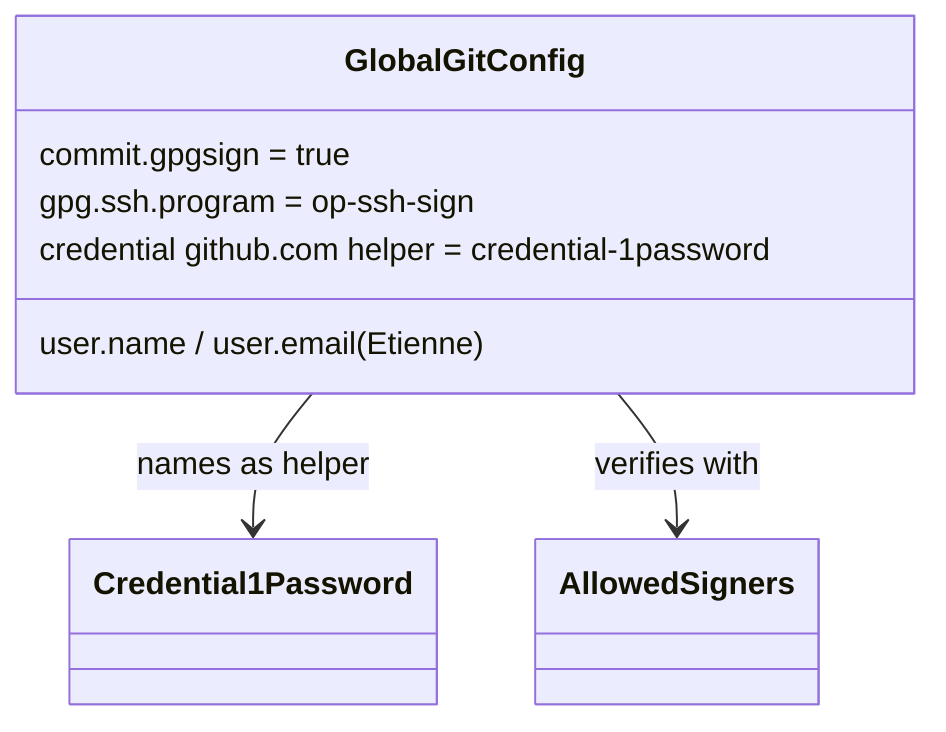
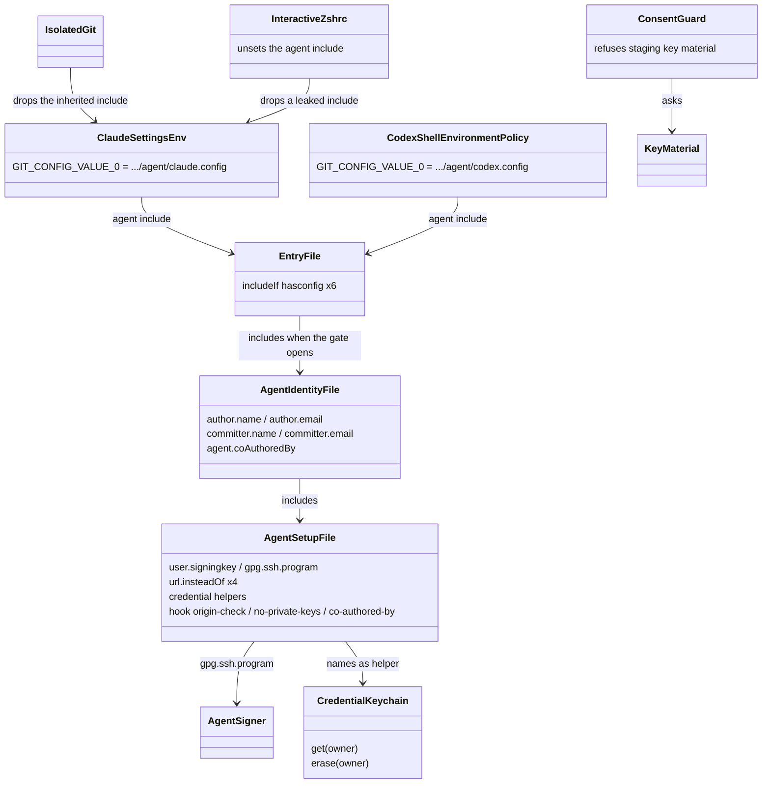
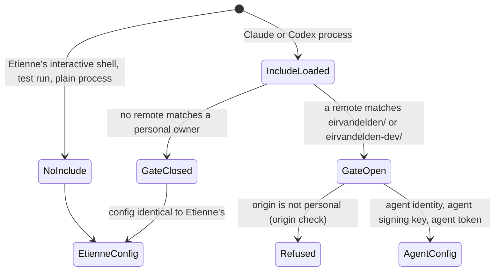
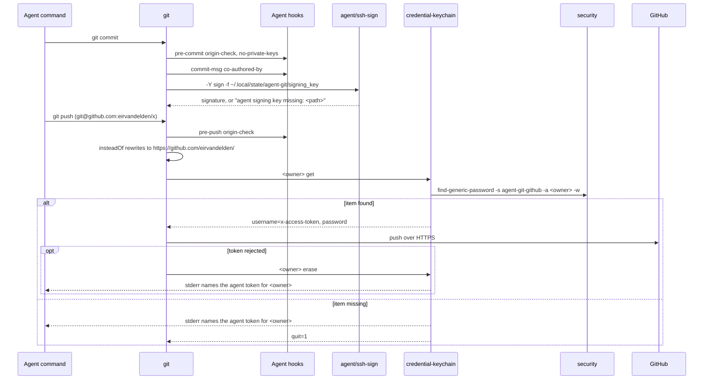

# Plan: Unattended agent commits and pushes

From `intent.md` (2026-11-23). Status: accepted.

## Design

### Domain terms

Existing terms: **Personal owner**, **Personal repository**, **Change scope**, **Git fixture**, **PATH stub**, **Coordinator**.

New terms, for `GLOSSARY.md` (step 13 of the order of work):

- **Agent include** — the one command-scope config entry that every Claude and Codex process carries: `GIT_CONFIG_COUNT=1`, `GIT_CONFIG_KEY_0=include.path`, `GIT_CONFIG_VALUE_0=<entry file>`. Avoid: agent env, agent variables.
- **Entry file** — the file the agent include names, one per tool: `git/.config/git/agent/claude.config` or `codex.config`. It holds only the personal gate.
- **Personal gate** — the `includeIf "hasconfig:remote.*.url:<pattern>"` sections of an entry file: one per personal owner and URL form (`git@github.com:`, `ssh://git@github.com/`, `https://github.com/`), six in all. It opens on any remote, not only on `origin`; the origin check covers the difference. Avoid: personal check.
- **Agent identity file** — `agent/claude-identity.config` or `agent/codex-identity.config`: author, committer and `agent.coAuthoredBy` of one tool. It includes the agent setup file.
- **Agent setup file** — `agent/personal.config`, shared by both tools: signing, the HTTPS rewrite, the credential helpers and the agent hooks.
- **Agent hooks** — the three config-based git hooks (`hook.<name>.event`/`.command`) in the agent setup file: the origin check, the key check and the co-author trailer. They run next to any `.git/hooks` hook, lefthook's included.
- **Origin check** — the agent hook that refuses a commit or a push when the gate is open but `origin` is not a personal repository.
- **Agent signing key** — `~/.local/state/agent-git/signing_key`, a `0600` ed25519 private key outside every stow package and every repository. GitHub knows it as a signing key only.
- **Agent signer** — `agent/ssh-sign`, the `gpg.ssh.program` of the agent setup file: `/usr/bin/ssh-keygen` with no SSH agent.
- **Agent token** — a fine-grained PAT for one personal owner with `contents:write`, in the login Keychain as service `agent-git-github`, account = the owner.
- **Agent commit** — a commit whose author name ends in ` (agent)`.

### Diagrams

Before: every git process, agent or not, reads the same global config.



After: the agent include adds files that load only behind the personal gate.







### Signatures

Config files and shell scripts are shown by shape. Ruby is shown with inline RBS.

`claude/.claude/settings.json` — a new top-level `env` key that holds the agent include and nothing else:

```json
"env": { "GIT_CONFIG_COUNT": "1", "GIT_CONFIG_KEY_0": "include.path", "GIT_CONFIG_VALUE_0": "~/Developer/dotfiles/git/.config/git/agent/claude.config" }
```

`codex/.codex/config.toml` `[shell_environment_policy.set]` — the same three keys, value `~/Developer/dotfiles/git/.config/git/agent/codex.config`. The existing `NODE_REPL_...` line stays.

The paths point into the main checkout, like the existing `credential-1password` helper. So the files work right after the merge, before any restow, and git never meets a missing include. git expands `~` in an `include.path` from the environment (verified with git 2.56.1).

`git/.config/git/agent/claude.config` (entry file); `codex.config` is the same except that it names `codex-identity.config`:

```ini
[includeIf "hasconfig:remote.*.url:git@github.com:eirvandelden/**"]
  path = claude-identity.config
[includeIf "hasconfig:remote.*.url:ssh://git@github.com/eirvandelden/**"]
  path = claude-identity.config
[includeIf "hasconfig:remote.*.url:https://github.com/eirvandelden/**"]
  path = claude-identity.config
# the same three sections for eirvandelden-dev
```

`git/.config/git/agent/claude-identity.config`:

```ini
[author]
  name = Claude (agent)
  email = noreply@anthropic.com
[committer]
  name = Claude
  email = etienne@vandelden.family
[agent]
  coAuthoredBy = Claude <noreply@anthropic.com>
[include]
  path = personal.config
```

`codex-identity.config`: author `Codex (agent) <codex@openai.com>`, committer `Codex <etienne@vandelden.family>`, `coAuthoredBy = Codex <codex@openai.com>`.

`git/.config/git/agent/personal.config` (agent setup file; `D` stands for `~/Developer/dotfiles/git/.config/git/agent`):

```ini
[user]
  signingkey = ~/.local/state/agent-git/signing_key
[gpg]
  format = ssh
[gpg "ssh"]
  program = D/ssh-sign
[commit]
  gpgsign = true
[url "https://github.com/eirvandelden/"]
  insteadOf = git@github.com:eirvandelden/
  insteadOf = ssh://git@github.com/eirvandelden/
[url "https://github.com/eirvandelden-dev/"]
  insteadOf = git@github.com:eirvandelden-dev/
  insteadOf = ssh://git@github.com/eirvandelden-dev/
[credential "https://github.com"]
  helper =
  helper = "!D/credential-keychain"
[credential "https://github.com/eirvandelden/"]
  helper =
  helper = "!D/credential-keychain eirvandelden"
[credential "https://github.com/eirvandelden-dev/"]
  helper =
  helper = "!D/credential-keychain eirvandelden-dev"
[hook "agent-origin-check"]
  event = pre-commit
  event = pre-push
  command = D/origin-check
[hook "agent-no-private-keys"]
  event = pre-commit
  command = D/no-private-keys
[hook "agent-co-authored-by"]
  event = commit-msg
  command = D/co-authored-by
```

The trailing `/` keeps `eirvandelden/` apart from `eirvandelden-dev/`. The bare `github.com` section stops any other GitHub owner with `quit=1`, so 1Password is never reached behind the gate. Each empty `helper =` comes before the helper it clears for. Config-based hooks run next to the `.git/hooks` hook, so lefthook keeps running. All three facts verified with git 2.56.1.

`git/.config/git/agent/ssh-sign` (POSIX sh, agent signer): for `-Y sign`, it finds the `-f <path>` argument. A missing private file prints `agent-git: agent signing key missing: <path>. See D/README.md.` on stderr and exits 1. Otherwise, and for every other mode (`-Y verify`, `find-principals`, `check-novalidate`), it runs `SSH_AUTH_SOCK= exec /usr/bin/ssh-keygen "$@"`. With no SSH agent, ssh-keygen never asks 1Password, even when `signing_key.pub` remains and the private file is gone.

`git/.config/git/agent/credential-keychain` (POSIX sh), arguments `[<owner>] <action>`, as git appends the action:

- `<owner> get` — `security find-generic-password -s agent-git-github -a <owner> -w`. Success: `username=x-access-token` and `password=…` on stdout. Failure: `agent-git: no agent token for <owner> in the login Keychain (service agent-git-github). See D/README.md.` on stderr, `quit=1` on stdout, exit 0.
- `get` without an owner — `agent-git: no agent token for this GitHub owner; agents push only to eirvandelden and eirvandelden-dev.` on stderr, `quit=1`.
- `<owner> erase` — `agent-git: GitHub rejected the agent token for <owner> (service agent-git-github); it is expired or revoked. Renew it: see D/README.md.` on stderr, exit 0. It never deletes the Keychain item.
- `store` — exit 0, no output.

The token goes to stdout for git only, never to stderr or a log.

`git/.config/git/agent/origin-check` (POSIX sh): `git remote get-url origin` must contain `github.com:<owner>/` or `github.com/<owner>/` for `eirvandelden` or `eirvandelden-dev` (the `RemoteMatcher.personal?` rule). Else it prints `agent-git: the agent configuration is active, but origin is not a personal repository (<url>). Agent commits and pushes stop here.` and exits 1.

`git/.config/git/agent/no-private-keys` (POSIX sh): refuses a staged path whose base name is `master.key` or that matches `config/credentials/*.key`, and a staged blob with a line matching `^-----BEGIN ([A-Z0-9]+ )*PRIVATE KEY-----$` (`git grep --cached -l -E`). It names each path. The pattern does not match its own text.

`git/.config/git/agent/co-authored-by` (POSIX sh), argument: the message file. It reads `git config --get agent.coAuthoredBy` and exits 0 when unset. It exits 0 when the message already holds a `Co-Authored-By:` line with the same `<email>` (Claude Code's own `Claude Opus … <noreply@anthropic.com>` counts). Else it runs `git interpret-trailers --in-place --trailer "Co-Authored-By: <value>" <file>`.

`git/.config/git/agent/README.md` — one-time setup for Etienne: create the agent signing key with `ssh-keygen -t ed25519 -N '' -f ~/.local/state/agent-git/signing_key` and `chmod 600`, register it on GitHub as a signing key, create both agent tokens with an expiry, store them with `security add-generic-password -s agent-git-github -a <owner> -T /usr/bin/security -w` (it prompts, so no token reaches shell history), apply main protection, renew an expired token.

`git/.config/git/allowed_signers` — one new line: `etienne@vandelden.family namespaces="git" ssh-ed25519 <agent public key>`. The principal is the agent committer email; `%GK` tells the two keys apart.

`zsh/.config/zsh/.zshrc` — interactive shells only: when `GIT_CONFIG_VALUE_0` ends in `/git/.config/git/agent/claude.config` or `/codex.config`, unset `GIT_CONFIG_COUNT`, `GIT_CONFIG_KEY_0` and `GIT_CONFIG_VALUE_0`. A herdr-app core started from an agent shell leaks its environment into every terminal; this line keeps Etienne's terminals free of the agent include. The Claude Bash tool is not affected: its shell snapshot exports only `PATH` (checked in `~/.claude/shell-snapshots/`), and each command inherits Claude's own environment. Codex runs non-interactive shells, which do not read `.zshrc`.

`claude/.claude/hooks/key_material.rb` (new) — finds private key material that a staging command would add.

```ruby
# Private key material that git could stage in one working tree.
module KeyMaterial
  PRIVATE_KEY_LINE = /^-----BEGIN (?:[A-Z0-9]+ )*PRIVATE KEY-----$/
  MAX_BYTES = 65_536

  # Paths, relative to the top level, of unignored untracked, modified or already staged files
  # that hold key material. Empty outside a git repository.
  #: (String directory) -> Array[String]
  def self.stageable_in(directory)

  # True for a master.key or config/credentials/*.key path, or a file of at most MAX_BYTES
  # with a private key line.
  #: (String path) -> bool
  def self.key_material?(path)
end
```

`claude/.claude/hooks/consent-guard.rb` — `never_allowed_reason` gains one more reason. A command with a `git` invocation whose subcommand is `add` or `stage`, or `commit` with `-a`, `--all` or a short cluster holding `a`, is refused when `KeyMaterial.stageable_in` is non-empty for that invocation's directory. The directory is `command_directories(words, working_directory).last`, then each `-C <dir>` before the subcommand, applied in order (relative to the previous one). The reason names each path and says: move it out of the repository or add it to `.gitignore`. The consent marker does not unlock it. New private helpers:

```ruby
#: (Array[String] words, String working_directory) -> String?
def key_material_reason(words, working_directory)

# The directory one git invocation runs in: base, then each -C option before the subcommand.
#: (Array[String] invocation, String base) -> String
def git_directory(invocation, base)
```

`test/isolated_git.rb` — `IsolatedGit.environment` drops inherited `include.path` and `includeIf.*` entries before it appends the quiet settings, and renumbers the rest from 0. Without this, a test that adds a `git@github.com:eirvandelden/…` remote would sign with the real agent signing key.

```ruby
#: (Hash[String, String] base, String template) -> Hash[String, String]
def self.environment(base, template)

#: (Hash[String, String] base) -> Array[[String, String]]
def self.inherited_entries(base)   # private_class_method
```

`bin/protect-main` (new Ruby script, repository-local, not stowed) — reports and applies the `protect main` ruleset.

```ruby
# The "protect main" ruleset on the repositories of the personal owners.
class MainProtection
  #: (Array[String] owners, ?runner: ^(*String) -> [String, Process::Status]) -> void
  def initialize(owners, runner: ...)

  # One line per non-archived repository: protected, missing, bypassable, unverified or unavailable.
  # protected = an active ruleset (fetched in full by id) that covers main or ~DEFAULT_BRANCH with
  # pull_request, non_fast_forward and deletion rules and an empty bypass_actors list.
  #: () -> Array[String]
  def report

  # Creates the ruleset on one repository: target ~DEFAULT_BRANCH, rules deletion,
  # non_fast_forward and pull_request (0 approvals), no bypass actors.
  #: (String repository) -> String
  def apply(repository)
end
```

`bin/protect-main` with no argument prints the report. `bin/protect-main --apply <owner>/<repo>` changes one repository. Owners come from `RemoteMatcher::PERSONAL_OWNERS`. A ruleset whose `bypass_actors` field is absent in the answer (hidden from the token) is `unverified`, never `protected`.

Not checked: dotfiles has no Steepfile; it declined Steep and rbs_rails. The inline `#:` signatures stay for the editor.

### Complexity

- Every git command in an agent process reads one more file (the entry file) and matches six patterns per remote URL. With the gate open, it reads two more small files. No extra process.
- A gated commit costs one agent signer run (it replaces `op-ssh-sign`), and three hook scripts: `origin-check` (one `git remote get-url`), `no-private-keys` (one `git diff --cached`, one `git grep --cached`, O(staged bytes)) and `co-authored-by` (one `git config`, one `grep`, at most one `git interpret-trailers`).
- A gated push costs one `origin-check` and one `security` call; a rejected token one more `erase` call.
- The consent guard runs `KeyMaterial.stageable_in` only for a staging command: one `git ls-files` and one `git diff --cached`, plus at most 64 KiB read per candidate. Other commands pay nothing.
- `bin/protect-main` report: one `gh repo list` per owner, one `gh api …/rulesets` per repository and one `gh api …/rulesets/<id>` per ruleset.
- No database, no queries.

### Invariants

1. Behind a closed gate, an agent process has Etienne's config: no author, committer, signing, URL, credential or hook key is added. Enforced by the `includeIf hasconfig` sections. Proof: `test/agent_git_config_test.rb`.
2. The environment holds no secret: exactly the three agent include keys, with a path under `git/.config/git/agent/`. Enforced by the two config blocks. Proof: `test/agent_git_config_test.rb`.
3. Behind an open gate, an agent commit is signed by the agent signing key through the agent signer with no SSH agent, never `op-ssh-sign`. Enforced by `personal.config` and `ssh-sign`. Proof: `test/agent_git_config_test.rb`.
4. Behind an open gate, no GitHub HTTPS request reaches `credential-1password`. Enforced by the helper order in `personal.config`. Proof: `test/agent_credential_keychain_test.rb`.
5. A missing agent signing key or agent token fails with a message that names it, and never falls back. Enforced by `ssh-sign` and `credential-keychain`. Proof: both test files above.
6. The agent configuration never commits or pushes in a repository whose `origin` is not personal. Enforced by `origin-check`. Proof: `test/agent_hooks_test.rb`.
7. Every gated agent commit carries one `Co-Authored-By` trailer for its tool, in every repository, with or without lefthook. Enforced by `co-authored-by`. Proof: `test/agent_hooks_test.rb`.
8. Both entry files cover every personal owner in all three URL forms; `personal.config` and `origin-check` name every owner. Enforced by `test/personal_owners_parity_test.rb`.
9. Tests never load an inherited agent include, and Etienne's interactive shells never keep a leaked one. Enforced by `IsolatedGit.environment` and `.zshrc`. Proof: `test/isolated_git_test.rb`, `test/agent_git_config_test.rb`.
10. No agent stages key material, and no gated commit holds it. Enforced by the consent guard and `no-private-keys`. Proof: `test/consent_guard_test.rb`, `test/agent_hooks_test.rb`.
11. An agent token cannot update `main`. Enforced by the GitHub ruleset with no bypass actors. Proof: the live push to `main`.
12. The agent signing key path lies outside the checkout. Proof: `test/agent_git_config_test.rb`.

### Alternatives

1. **Environment only** (the intent's In scope wording): `GIT_AUTHOR_*`, `GIT_COMMITTER_*` and nine `GIT_CONFIG_KEY_n` entries per tool. Rejected: environment variables have no remote condition, so agent commits in work repositories get the agent author, Etienne's personal email and the personal agent signing key. That breaks the constraint "Personal repositories only" and playbook rule 15. The work half could not undo it from a git config file.
2. **Scoped include** (chosen): the environment carries one path; the personal gate decides; the origin check closes the fork-remote gap. Same behaviour in personal repositories, no change anywhere else. Costs five small config files, five short scripts and one parity test.
3. **A `git` wrapper on PATH for agents**: rejected. Neither tool's env setting can prepend to PATH safely, a wrapper misses absolute `/usr/bin/git` calls, and it adds a program that could be replaced on PATH, which the 1Password helper avoids on purpose.

For the trailer and the key check, jobs in the shared `lefthook.yml` were rejected for config-based hooks: lefthook reaches only repositories that pull the shared config, and only after a refetch of up to 24 hours.

## Design decisions

- Identity uses `author.*`/`committer.*` config keys in the gated identity file, not `GIT_AUTHOR_*`/`GIT_COMMITTER_*` environment variables. This conflicts with the wording of the intent's In scope list. The observable behaviour in personal repositories is the same; the change keeps work repositories untouched, which the intent's constraints and rule 15 require. Raised as a decision for Etienne in the report.
- The committer name is the bare tool name (`Claude`, `Codex`), per "the committer is the tool name with `etienne@vandelden.family`". The author name carries ` (agent)`.
- The gate opens on any remote with a personal-owner URL (git's `hasconfig` knows only `remote.*.url`). The origin check refuses agent commits and pushes where `origin` is not personal, so a work repository with a personal fork remote gets no agent commit.
- The agent signing key lives in `~/.local/state/agent-git/`, not `~/.ssh/`: the Claude sandbox settings deny `~/.ssh`, and no stow package targets `~/.local/state`.
- One agent signing key serves both tools. `%GK` separates it from Etienne's key; the author separates Claude from Codex.
- The agent signer clears `SSH_AUTH_SOCK`: ssh-keygen asks the SSH agent first, even with a private key path.
- The key guard has two layers: the consent guard refuses the staging command (the acceptance criterion), and the `no-private-keys` agent hook refuses a gated commit, `git commit -a` from a script included.
- The `.zshrc` unset changes a file of Etienne's shell setup but not its behaviour; it only removes a leaked agent include.
- Main protection is a GitHub ruleset per repository: GitHub has no account-wide ruleset for a user. `bin/protect-main` reports by default and changes one repository per call, so each change is one approval. A repository that cannot get the ruleset is a blocker for its owner's agent token, not an accepted gap.
- The setup steps live next to the files, in `git/.config/git/agent/README.md`, and every agent message points there.

## Integration points

- git 2.56.1: `GIT_CONFIG_COUNT` command scope, `includeIf hasconfig:remote.*.url`, `author.*`/`committer.*`, config-based hooks (`hook.<name>.event`/`.command`), `url.insteadOf`, credential helper protocol (`get`, `erase`, `quit=1`).
- Claude Code `settings.json` `env`; Codex `[shell_environment_policy.set]`. Both apply to every shell command, whatever starts the tool (herdr, herdr-app, Rex, a plain terminal); no launcher sets `CLAUDE_CONFIG_DIR` or `CODEX_HOME` (checked with `git grep`).
- macOS `security` and the login Keychain; `/usr/bin/ssh-keygen -Y sign`.
- GitHub: signing keys, fine-grained PATs, repository rulesets (`gh api repos/<owner>/<repo>/rulesets` and `…/rulesets/<id>`), commit verification (`gh api repos/<owner>/<repo>/commits/<sha> --jq .commit.verification`).
- `claude/.claude/hooks/consent-guard.rb` (runs in Claude and Codex), `RemoteMatcher::PERSONAL_OWNERS`.
- `~/Developer/dotfiles-work`: the work-repository intent (step 0).

## Files that change

- `git/.config/git/agent/claude.config`, `codex.config` — new; the personal gate.
- `git/.config/git/agent/claude-identity.config`, `codex-identity.config` — new; agent identity per tool.
- `git/.config/git/agent/personal.config` — new; signing, HTTPS rewrite, credential helpers, agent hooks.
- `git/.config/git/agent/ssh-sign`, `credential-keychain`, `origin-check`, `no-private-keys`, `co-authored-by` — new POSIX sh scripts.
- `git/.config/git/agent/README.md` — new; one-time setup and renewal steps.
- `git/.config/git/allowed_signers` — the agent public key (after Etienne creates the key).
- `claude/.claude/settings.json` — new `env` block.
- `codex/.codex/config.toml` — three keys in `[shell_environment_policy.set]`.
- `zsh/.config/zsh/.zshrc` — unsets a leaked agent include.
- `claude/.claude/hooks/key_material.rb` — new; key material detection.
- `claude/.claude/hooks/consent-guard.rb` — refuses staging key material.
- `test/isolated_git.rb` — drops inherited includes.
- `bin/protect-main` — new; ruleset report and apply.
- `GLOSSARY.md` — the new terms.
- Tests: `test/agent_git_config_test.rb`, `test/agent_credential_keychain_test.rb`, `test/agent_hooks_test.rb`, `test/key_material_test.rb`, `test/protect_main_test.rb` (new); `test/consent_guard_test.rb`, `test/isolated_git_test.rb`, `test/personal_owners_parity_test.rb` (extended).

## Order of work

0. Coordinator, before the implement stage: check `~/Developer/dotfiles-work/docs/changes/` for the work-repository intent. If none exists, start it as intent's first decision says: its own pane and agent in `dotfiles-work`, seeded with this plan's `## Design` (the scoped include, so the work half adds its own gate). Nothing of the work half goes into this repository.
1. Write `test/agent_git_config_test.rb` `test_an_agent_commit_in_a_personal_repository_is_signed_by_the_agent_key` (temporary HOME, generated test key, the agent include from `settings.json`), run it, watch it fail.
2. Add the five config files and `ssh-sign` under `git/.config/git/agent/` and the `env` block in `settings.json`; make the step 1 test pass. Add the remaining `agent_git_config_test.rb` tests and make them pass.
3. Add the Codex keys to `config.toml`; extend `test/personal_owners_parity_test.rb`.
4. Extend `test/isolated_git_test.rb` with the inherited-include case, watch it fail, change `IsolatedGit.environment`.
5. Write `test/agent_credential_keychain_test.rb` with `security` and `op` PATH stubs, watch it fail, write `credential-keychain`.
6. Write `test/agent_hooks_test.rb`, watch it fail, write `origin-check`, `no-private-keys` and `co-authored-by`.
7. Write `test/key_material_test.rb` and the new `test/consent_guard_test.rb` cases, watch them fail, write `key_material.rb` and the consent guard reason.
8. Add the `.zshrc` unset and its test in `test/agent_git_config_test.rb`.
9. Write `test/protect_main_test.rb` with a `gh` PATH stub, watch it fail, write `bin/protect-main`.
10. Write `git/.config/git/agent/README.md`.
11. Run `bin/test`, `rubocop`, `shellcheck` on the five scripts and `yamllint` on touched YAML. Run `bin/test` once from inside a Claude session too, where the real agent include is in the environment.
12. Stop and ask Etienne (one message) for the one-time setup in `README.md`: create the agent signing key, both agent tokens, the Keychain items, and approve registering the signing key on GitHub. Then add the agent public key (the `.pub` file, public) to `allowed_signers`.
13. Add the new terms to `GLOSSARY.md`.
14. Run `bin/protect-main` and show the report. Stop and ask Etienne before each `--apply` (or for one approval of the listed repositories). A repository reported `unavailable` or `unverified` is a blocker: stop and ask Etienne to limit that owner's agent token to selected repositories, or to change the plan.
15. Live checks, recorded with `delivery-evidence`. Before the merge, the checkout path in the agent include does not hold the new files yet, so point `GIT_CONFIG_VALUE_0` at a scratch copy of `git/.config/git/agent/` whose `D` paths are rewritten to the scratch copy. Use the sandbox repositories from the Decision lines in the report. Check each acceptance criterion marked "live" under Proof. The push to `main` runs from a fresh clone with no `.git/hooks` (no `lefthook install`), so no local hook stops it; the evidence is GitHub's rule-violation answer.
16. Ask Etienne to make one commit in a plain Ghostty shell in the sandbox and show `git log --format='%G? %GK %an'` for it.
17. After the merge, `finish` notes one smoke check: a new Claude pane commits in a personal repository with no prompt.

Out of scope: work repositories (the `dotfiles-work` intent), a per-session trailer, Etienne's own 1Password setup, hosted agents, merging and deployment, `gh` CLI authentication (it keeps the 1Password plugin), restowing, the shared `lefthook.yml`.

## Risks

- A remote written through an SSH host alias (`github-personal:eirvandelden/x`) does not open the gate; agents there keep the 1Password prompt.
- A command that sets its own `GIT_CONFIG_COUNT` replaces the agent include for that command and falls back to the 1Password prompt. Nothing in this repository does that after the `IsolatedGit` change.
- `--no-verify` skips the agent hooks; the consent guard asks before it.
- `!git commit` typed in a Claude session runs with the agent include and becomes an agent commit.
- A Keychain item made without `-T /usr/bin/security`, or a locked login Keychain, shows a macOS dialog. `README.md` gives the exact command.
- GitHub may not show Verified unless the committer email is verified on the account and the key is registered for signing. Step 15 checks it.
- Rulesets on private repositories of a free account may be unavailable. Step 14 makes that a blocker.
- A new personal repository has no ruleset until `bin/protect-main --apply` runs on it.
- `allowed_signers` is global, so the agent key verifies as good in every repository. It adds trust only.

## Proof

- An agent in an unattended pane commits with no 1Password prompt; `git log --show-signature` shows a good signature → `test/agent_git_config_test.rb` `test_an_agent_commit_in_a_personal_repository_is_signed_by_the_agent_key`; live: commit in the sandbox with `GIT_TRACE=1` showing `ssh-sign` and no `op-ssh-sign`.
- `git log --author=agent` lists the agent commit; `%G? %GK` shows the agent key on it and Etienne's key on his → `test/agent_git_config_test.rb` `test_the_agent_key_and_etiennes_key_are_told_apart`; live: step 16.
- An agent pushes a branch to an `eirvandelden` and an `eirvandelden-dev` repository with no prompt → `test/agent_credential_keychain_test.rb` `test_each_owner_gets_its_own_agent_token_and_never_1password`; live: two branch pushes in step 15.
- An agent push to `main` of a personal repository is rejected by GitHub → `test/protect_main_test.rb` `test_apply_creates_a_ruleset_with_no_bypass_actors`; live: push to `main` of the protected sandbox repository from a hook-free clone, rejected by GitHub.
- With the signing key file missing, the commit fails with a message that names the key, and no prompt → `test/agent_git_config_test.rb` `test_a_missing_agent_signing_key_fails_and_names_it` (the `.pub` file kept, `SSH_AUTH_SOCK` set to a stub agent socket path); live: step 15 with the key moved aside.
- With the PAT missing or expired, the push fails with a message that names the token, and no prompt → `test/agent_credential_keychain_test.rb` `test_a_missing_agent_token_stops_git_and_names_it`, `test_a_rejected_agent_token_is_named_on_erase`; live: step 15 with a Keychain account that does not exist.
- Staging a private key file or a `master.key` is refused by the guard → `test/consent_guard_test.rb` `test_staging_a_private_key_is_refused`, `test_staging_a_master_key_is_refused`, `test_committing_all_with_an_unignored_private_key_is_refused`, `test_staging_with_git_dash_c_checks_that_repository`; `test/agent_hooks_test.rb` `test_a_staged_private_key_is_refused_at_commit`.
- A commit Etienne makes in his own shell still signs through 1Password and carries his name → `test/agent_git_config_test.rb` `test_without_the_agent_include_the_commit_signs_through_op_ssh_sign` (stub `op-ssh-sign`), `test_an_interactive_shell_drops_a_leaked_agent_include`; live: step 16.
- A Codex session commit carries the author `Codex (agent)` and a `Co-Authored-By` trailer → `test/agent_git_config_test.rb` `test_the_codex_include_gives_the_codex_author`; `test/agent_hooks_test.rb` `test_a_codex_commit_gets_the_codex_trailer`; live: one `codex exec` commit in the sandbox.
- A pane started from herdr, herdr-app or Rex gets the agent configuration → check: in a Claude pane and a Codex pane started from each of herdr, herdr-app and Rex, run `git -C <sandbox> config --get author.name` and expect `Claude (agent)` or `Codex (agent)`.
- Invariant: behind a closed gate the config equals Etienne's → `test/agent_git_config_test.rb` `test_a_repository_without_a_personal_remote_keeps_etiennes_config` (no remote, a non-personal GitHub remote, a non-GitHub remote).
- Invariant: the environment holds only the agent include → `test/agent_git_config_test.rb` `test_both_tools_carry_only_the_agent_include`.
- Invariant: no commit or push where origin is not personal → `test/agent_hooks_test.rb` `test_a_personal_fork_remote_on_a_foreign_origin_refuses_the_commit`, `test_a_personal_fork_remote_on_a_foreign_origin_refuses_the_push`.
- Invariant: every gated agent commit carries one trailer, with or without lefthook → `test/agent_hooks_test.rb` `test_an_agent_commit_without_lefthook_gets_one_co_authored_by_trailer`, `test_an_existing_same_email_trailer_is_not_repeated`.
- Invariant: both entry files cover every personal owner in all three URL forms → `test/personal_owners_parity_test.rb` `test_the_personal_gate_covers_every_personal_owner`, `test_the_agent_setup_file_and_origin_check_name_every_personal_owner`.
- Invariant: tests never load an inherited agent include → `test/isolated_git_test.rb` `test_the_helper_drops_an_inherited_include`.
- Invariant: the agent signing key path lies outside the checkout → `test/agent_git_config_test.rb` `test_the_agent_signing_key_lies_outside_the_checkout`.
- Invariant: no GitHub HTTPS request behind an open gate reaches 1Password → `test/agent_credential_keychain_test.rb` `test_another_github_owner_stops_with_quit_and_never_1password`.

Per changed file, the unit tests expected:

- `git/.config/git/agent/ssh-sign`: `signs with the key and no SSH agent`, `a missing private key names the path`, `verify passes through`.
- `git/.config/git/agent/credential-keychain`: `get prints the token for the owner`, `get without an owner quits`, `a missing item quits and names the token`, `erase names the rejected token`, `store does nothing`.
- `git/.config/git/agent/origin-check`: `a personal origin passes`, `a foreign origin refuses`, `no origin refuses`.
- `git/.config/git/agent/no-private-keys`: `a staged private key refuses`, `a staged master.key refuses`, `a staged credentials key refuses`, `an ordinary commit passes`.
- `git/.config/git/agent/co-authored-by`: `adds one trailer`, `keeps an existing same-email trailer`, `does nothing without agent.coAuthoredBy`.
- `claude/.claude/hooks/key_material.rb`: `KeyMaterial.key_material? is true for an OpenSSH private key`, `is true for a PEM private key`, `is true for master.key`, `is false for a public key`, `is false for a file over the size limit`; `KeyMaterial.stageable_in lists an unignored untracked key`, `skips an ignored master.key`, `lists an already staged key`, `is empty outside a repository`.
- `claude/.claude/hooks/consent-guard.rb`: the four staging cases above, plus `staging an ordinary file is allowed`, `repeated relative -C options resolve in order`, `the consent marker does not unlock key staging`.
- `test/isolated_git.rb`: `drops an inherited include`, `keeps other inherited entries and renumbers them`.
- `bin/protect-main` (`MainProtection`): `report marks a repository without the ruleset as missing`, `marks a ruleset with bypass actors as bypassable`, `marks hidden bypass actors as unverified`, `marks an inactive or non-main ruleset as missing`, `marks a 403 upgrade answer as unavailable`, `skips archived repositories`, `apply sends the ruleset body to one repository`.
- `zsh/.config/zsh/.zshrc`: `an interactive shell drops a leaked agent include`, `a non-interactive shell keeps it`, `an unrelated GIT_CONFIG_COUNT stays`.

Test setup: temporary HOME per test with the checkout linked at `~/Developer/dotfiles`, a test key made with `ssh-keygen -N ''` at run time (never committed), PATH stubs for `security`, `op`, `op-ssh-sign` and `gh` that log their calls, git fixtures with a `git@github.com:eirvandelden/x.git` remote that is never contacted, and `IsolatedGit` for global and system config. Private key headers are built at run time, so no test file holds one.

---
Domain skills applied: software-design, glossary, diagrams, object-oriented-design, ruby-style, dotfiles-maintenance.

## Critique

### Round 1 (codex gpt-6.1-sol, medium)

- The personal gate opens on any remote, so a work repository with a personal fork remote gets personal identity and signing → fixed (the origin check agent hook refuses commits and pushes where `origin` is not personal; new invariant 6 and tests)
- A herdr-app core started from an agent shell leaks the agent include into Etienne's terminals; a workaround is not enough → fixed (`.zshrc` unsets a leaked agent include in interactive shells; the Claude Bash tool snapshot exports only PATH, so agents keep it; tests added)
- A repository that cannot get a ruleset must not become an accepted gap → fixed (step 14 makes `unavailable` and `unverified` a blocker and asks Etienne to narrow that owner's token)
- The ruleset report reads only the list endpoint, which lacks rules, conditions and bypass actors → fixed (`MainProtection#report` fetches each ruleset by id and checks enforcement, branch coverage, rules and bypass actors; hidden bypass actors are `unverified`)
- The staging guard misses `git -C` because `command_directories` follows only `cd` and `pushd` → fixed (new `git_directory` applies each `-C` option; tests for `-C` and repeated relative `-C`)
- The trailer from the shared lefthook config does not reach every agent commit → fixed (the trailer and the key check moved to config-based git hooks in the agent setup file, verified with git 2.56.1 to run next to `.git/hooks`; `lefthook.yml` no longer changes)
- The live push to `main` stops at the local pre-push hook before GitHub sees it → fixed (step 15 pushes from a fresh clone with no hooks and records GitHub's rule-violation answer)
- A private key path does not stop ssh-keygen from asking the SSH agent first → fixed (the agent signer `ssh-sign` clears `SSH_AUTH_SOCK` and names a missing private key; test keeps the `.pub` file)
- The order of work has no hand-off of the work-repository intent → fixed (step 0 for the coordinator)
