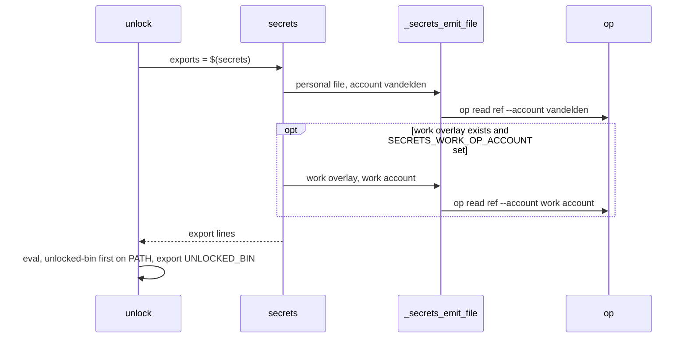
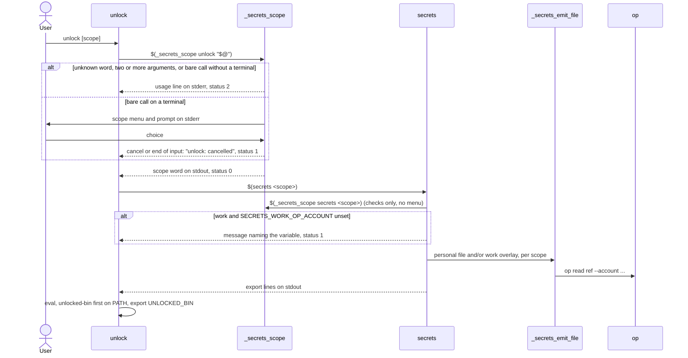

# Plan: Unlock personal, work or both secrets

From `intent.md` (2026-10-22). Status: accepted.

## Context

`unlock` and `secrets` in `zsh/.config/zsh/functions/secrets.zsh` always read both 1Password mapping files: the personal file `~/.config/secrets/1password.env` (account `vandelden`) and the optional work overlay `~/.config/secrets/1password.work.env` (account from `SECRETS_WORK_OP_ACCOUNT`). This change adds a scope argument (`personal`, `work`, `both`) to both functions. A bare call on a terminal shows a scope menu on stderr. A bare call without a terminal prints a usage line. `unlock` still applies nothing when anything fails, and the codex shim and `UNLOCKED_BIN` handling stay as they are.

## Design

### Domain terms

There is no `GLOSSARY.md` yet. Etienne agreed these terms at the design gate; the Accept step writes them into a new `GLOSSARY.md`.

- **Scope**: which secrets to load: `personal`, `work` or `both`.
- **Scope menu**: the numbered list "cancel, personal, work, both" that a bare call shows on a terminal.

Existing words keep their meaning: personal file, work overlay, personal account (`vandelden`), work account (`SECRETS_WORK_OP_ACCOUNT`), caller (`unlock` or `secrets`, the command the user typed).

### Diagrams

Before:

After:

### Signatures

All in `zsh/.config/zsh/functions/secrets.zsh`. Contracts replace RBS, since these are zsh functions.

- `_secrets_scope <caller> [scope]` — turns the caller's arguments into one valid scope, or prints one stderr message that names the caller.
  - Stdout: exactly one word, `personal`, `work` or `both`, only on status 0.
  - Stderr: the scope menu, its prompt and every message.
  - Status 0: scope printed. Status 1: cancel, or end of input at the menu (`<caller>: cancelled`). Status 2: unknown word, two or more arguments, or a bare call without a terminal on stdin; prints `usage: <caller> [personal|work|both]`.
  - Checks the word with a `case` (`personal|work|both)`), not a zsh glob in `[[ ]]`, so `shellcheck -s bash` parses it.
- `_secrets_scope_menu <caller>` — shows the scope menu and prints the chosen scope.
  - `local PROMPT3="<caller>: scope? "`, then `select choice in cancel personal work both; do [[ -n "$choice" ]] && break; done`. zsh `select` prints its list and `PROMPT3` to stderr (verified in a pty); an invalid number leaves `choice` empty and asks again.
  - Empty `choice` (end of input) or `cancel`: prints `<caller>: cancelled` on stderr, status 1. Otherwise prints the scope, status 0.
- `secrets [scope]` — prints the export lines for one scope.
  - First line after `set -euo pipefail`: `scope="$(_secrets_scope secrets "$@")" || return $?`.
  - Then the `op` check, then `case "$scope"`:
    - `personal`: `_secrets_load_personal`.
    - `work`: `_secrets_load_work`.
    - `both`: `_secrets_load_personal`, then `_secrets_load_overlay` (today's optional block, unchanged: warn and skip when the account is unset).
  - Status 0 when loaded; the resolver's 1 or 2; 1 on a load failure.
- `_secrets_load_personal` — emits the personal file from the personal account; `secrets: config not found: <file>` and status 1 when the file is missing. Nested in `secrets` like `_secrets_emit_file`, reading its locals by dynamic scope.
- `_secrets_load_work` — emits the work overlay from the work account. Status 1 with `secrets: SECRETS_WORK_OP_ACCOUNT is unset; the work scope needs it` when the account is empty, and with `secrets: config not found: <file>` when the overlay is missing. Never reads the personal file. Nested like the above.
- `_secrets_load_overlay` — today's optional overlay block, moved into a nested function unchanged.
- `unlock [scope]` — loads one scope into the current shell and puts unlocked-bin first on PATH.
  - `scope="$(_secrets_scope unlock "$@")" || return $?`, then `exports="$(secrets "$scope")" || return 1`. The rest is unchanged.
- `_secrets_emit_file` — unchanged.

Not checked: the change is zsh, and the Ruby test files in this repository carry no RBS.

### Complexity

P is the number of mapping lines in the personal file, W in the work overlay. Before, every call made P + W `op read` calls (or P without the work account).

- `personal`: P reads. `work`: W reads. `both`: P + W, or P with a warning when the work account is unset.
- Cancel, usage error, or `work` without the account: 0 reads.
- The resolver runs twice on the `unlock` path (once with the menu, once to check only). Both are O(1) and call no `op`. The menu adds one subshell.

### Invariants

1. The stdout of `secrets` holds export lines only. Enforced by `select` writing to stderr and every message using `print -u2`. Test: `test_eval_secrets_on_a_terminal_shows_the_menu_on_stderr_and_evals_only_exports`.
2. A command shows the scope menu at most once. Enforced by `unlock` passing the resolved scope to `secrets`. Test: `test_a_bare_unlock_on_a_terminal_shows_the_menu_once`.
3. Cancel, a usage error or a missing work account means zero `op` reads, no environment or PATH change, and a non-zero status, so `unlock && codex` does not run codex. Enforced by `|| return $?` and `|| return 1` in `unlock` before `eval`. Tests: the cancel, usage and work-account tests.
4. Scope `personal` never passes the work account to `op`; scope `work` never passes `vandelden`. Enforced by the `case` in `secrets`. Tests: the two `op_calls` acceptance tests.

### Alternatives

- **Menu in `secrets`** (least change): `secrets` parses the argument and shows the menu; `unlock` only passes `"$@"`. Rejected: the usage line must name `unlock|secrets` because `secrets` cannot know its caller, and `secrets` grows a fourth job.
- **Scopes as data**: tables map each scope to sources (file, account, required/optional) and `secrets` loops over them. Rejected: three parallel associative arrays plus a separate ordered list for the menu (zsh does not keep key order), with typos failing silently; more abstract than a three-arm `case`.
- **Shared scope resolver** (chosen): messages name the command the user typed, and the menu runs once. Cost: the scope is checked twice on the `unlock` path, and load failures still say `secrets:`.

## Design decisions

- Cancel returns status 1, a usage error returns 2. `unlock` passes the resolver's status on with `|| return $?`; a `secrets` failure stays `|| return 1`.
- The work-account check lives in `secrets` (`_secrets_load_work`), next to the `both` warning, so the account rule stays in one place. Its message starts with `secrets:` even under `unlock`; it still names the variable, as the criterion asks.
- `both` keeps today's bare behaviour: the work overlay is optional, and an unset work account warns and skips it.
- `work` needs no personal file; `personal` ignores the overlay even when it exists.
- The menu shows before the `op` check, so a missing `op` surfaces after the choice. Accepted: the choice costs one keystroke.
- Agents that call `unlock` from a shell without a terminal rely on the usage line to pick a scope — Etienne's decision at plan review.
- No second-model critique — Etienne skipped it at plan review.
- No conflict with `intent.md`'s `## Decisions`.

## Integration points

- `test/codex_unlock_test.rb` and `test/codex_shim_support.rb` call bare `unlock` through Open3 (no terminal). After this change that is a usage error, so they name a scope.
- `claude/.claude/HEADROOM.md` says "run `unlock` before `claude`". Still true on a terminal (the menu shows). No change. `test/home_assistant_mcp_test.rb` and `test/journal_mcp_test.rb` assert that text and need no change.
- The codex shim (`zsh/.config/zsh/unlocked-bin/codex`), `.zprofile` and `paths.zsh` do not change.

## Files that change

- `zsh/.config/zsh/functions/secrets.zsh` — scope argument, resolver, menu, per-scope loaders, header usage comment.
- `test/secrets_loader_test.rb` — existing tests name a scope; new Open3 acceptance and unit tests.
- `test/secrets_scope_menu_test.rb` (new) — pseudo-terminal tests for the scope menu, using `CodexShimSupport` fixtures and Ruby stdlib `pty` and `expect`.
- `test/codex_unlock_test.rb` — `unlock_then` and the headroom script use `unlock both`.
- `GLOSSARY.md` (new) — written at the Accept step of the plan stage, not by `implement`.

## Order of work

1. Write `test_unlock_personal_exports_the_personal_secrets_and_reads_nothing_from_the_work_account` (overlay present, account set). Run it and watch it fail: today `unlock personal` ignores the word and reads the work account.
2. Make the existing tests name a scope. Today's functions ignore arguments, so the suite stays green except step 1's test.
   - `test/secrets_loader_test.rb`: `run_secrets(scope, extra_env = {})` runs `secrets <scope>`. The two overlay tests use `both`; the personal, Home Assistant and journal mapping tests use `personal`. Every `run_unlock` script uses `unlock personal`, including the alias test.
   - `test/codex_unlock_test.rb`: `unlock_then` and the headroom heredoc use `unlock both` (they assert the work token).
3. Add `_secrets_scope` (argument checks only, no menu yet), the per-scope loaders and the `case` in `secrets`, and the two-step `unlock`. Make step 1 green, then add and green the other Open3 tests in `## Proof`.
4. Write `test/secrets_scope_menu_test.rb` with a private `run_on_terminal(script, *answers)` helper: `PTY.spawn` with `shell_env`, `expect(/scope\? /, 5)` before each answer, read to EOF, rescue `Errno::EIO` (Linux), close on timeout. Run its tests and watch them fail. Add `_secrets_scope_menu` and wire it into `_secrets_scope` for a bare call on a terminal. Make them green.
5. Update the header usage comment of `secrets.zsh`.
6. Run `shellcheck -S warning -s bash zsh/.config/zsh/functions/secrets.zsh`, `rubocop` on the touched Ruby files, then `bin/test`.
7. Manual check in a real interactive zsh (rule 22), after `source zsh/.config/zsh/functions/secrets.zsh`: bare `unlock`, choose 2, confirm a personal variable is set; bare `unlock`, choose 1, confirm `$?` is 1 and PATH is unchanged; `eval "$(secrets)"`, choose 2. This checks `select` inside `$(...)` under ZLE, which the pty tests (`zsh -f -c`) do not cover. Record the result.

## Risks

- `select` inside `$(...)` in a real interactive shell with ZLE is not covered by the pty tests. Step 7 checks it by hand.
- Pty tests depend on timing. Each read has a timeout, and the helper waits for the prompt before it answers.
- Callers without a terminal: the repository, `~/.claude` skills and plugins, and `~/.agents/skills` hold no bare `unlock` outside the tests (searched). An agent that runs bare `unlock` from its Bash tool has no terminal, so it gets the usage line naming the three scopes and applies nothing. Etienne decided the usage line is enough for agents to retry with a scope; `HEADROOM.md` does not change.
- Ctrl-C at the menu ends the subshell; `unlock` sees a non-zero status and applies nothing.

Out of scope: short aliases such as `unlockp`; changes to the mapping files, the 1Password accounts or the codex shim; per-secret selection; `HEADROOM.md` wording.

## Proof

- `unlock personal` exports the personal secrets, reads nothing from the work account, no menu → `test/secrets_loader_test.rb` `test_unlock_personal_exports_the_personal_secrets_and_reads_nothing_from_the_work_account`
- `unlock work` exports the work secrets, reads nothing from the personal account, no menu → `test/secrets_loader_test.rb` `test_unlock_work_exports_the_work_secrets_and_reads_nothing_from_the_personal_account`
- `unlock both` exports both sets → `test/secrets_loader_test.rb` `test_unlock_both_exports_both_sets`
- `unlock` on a terminal lists "cancel, personal, work, both" in order and loads the choice → `test/secrets_scope_menu_test.rb` `test_a_bare_unlock_on_a_terminal_lists_cancel_personal_work_both_and_loads_the_choice`
- Choosing cancel changes neither the environment nor PATH → `test/secrets_scope_menu_test.rb` `test_choosing_cancel_changes_neither_the_environment_nor_path`
- `unlock` without a terminal prints a usage line naming personal, work and both, and applies nothing → `test/secrets_loader_test.rb` `test_a_bare_unlock_without_a_terminal_prints_the_usage_and_applies_nothing`
- `eval "$(secrets)"` on a terminal shows the menu on stderr and evals only exports → `test/secrets_scope_menu_test.rb` `test_eval_secrets_on_a_terminal_shows_the_menu_on_stderr_and_evals_only_exports`
- `unlock work` with `SECRETS_WORK_OP_ACCOUNT` unset fails naming the variable → `test/secrets_loader_test.rb` `test_unlock_work_without_the_work_account_fails_naming_the_variable_and_applies_nothing`
- `unlock bogus` fails with the usage line and applies nothing → `test/secrets_loader_test.rb` `test_unlock_with_an_unknown_scope_prints_the_usage_and_applies_nothing`
- Invariant: the menu shows at most once per command, enforced by `unlock` passing the resolved scope → `test/secrets_scope_menu_test.rb` `test_a_bare_unlock_on_a_terminal_shows_the_menu_once`
- Invariant: cancel never runs the next command of `unlock &&`, enforced by `|| return $?` in `unlock` → `test/secrets_scope_menu_test.rb` `test_choosing_cancel_changes_neither_the_environment_nor_path` (script runs `unlock && print ran`)
- Real interactive shell → check: step 7 by hand.

Per changed file, the unit tests expected:

- `test/secrets_loader_test.rb`: `test_bare_secrets_without_a_terminal_prints_the_secrets_usage_and_no_exports`, `test_unlock_with_two_scopes_prints_the_usage_and_applies_nothing`, `test_unlock_work_needs_no_personal_file`, `test_unlock_work_without_the_work_overlay_fails_and_applies_nothing`, `test_unlock_both_without_the_work_account_warns_and_loads_personal` (the renamed `test_an_unnamed_work_account_skips_the_overlay_instead_of_reading_it_as_personal`, now on `both`), `test_unlock_personal_ignores_the_work_overlay_without_a_work_account`.
- `test/secrets_scope_menu_test.rb`: `test_end_of_input_at_the_menu_cancels`, `test_an_invalid_choice_asks_again`, `test_choosing_work_loads_only_the_work_scope`.

Test setup: Open3 tests keep `secrets_loader_test.rb`'s logging `op` stub and its `@config` mapping files; `run_unlock` gains no new parameters. Menu tests include `CodexShimSupport` (both mapping files, `SECRETS_WORK_OP_ACCOUNT=employer`, a stub `op`) and assert on `FIZZY_PAT` (personal) and `MCP_EMAIL_SERVER_AUTH_TOKEN` (work). No real 1Password vault is touched.

---
Domain skills applied: software-design, glossary, diagrams, ruby-style (test helpers), rails-testing (Minitest conventions).
