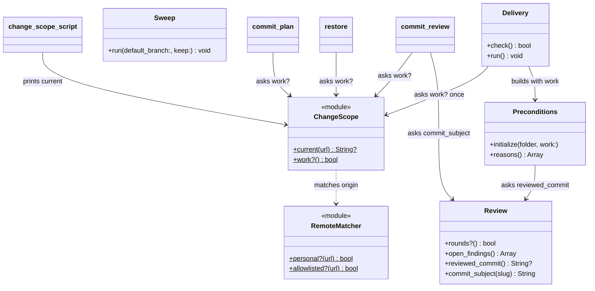
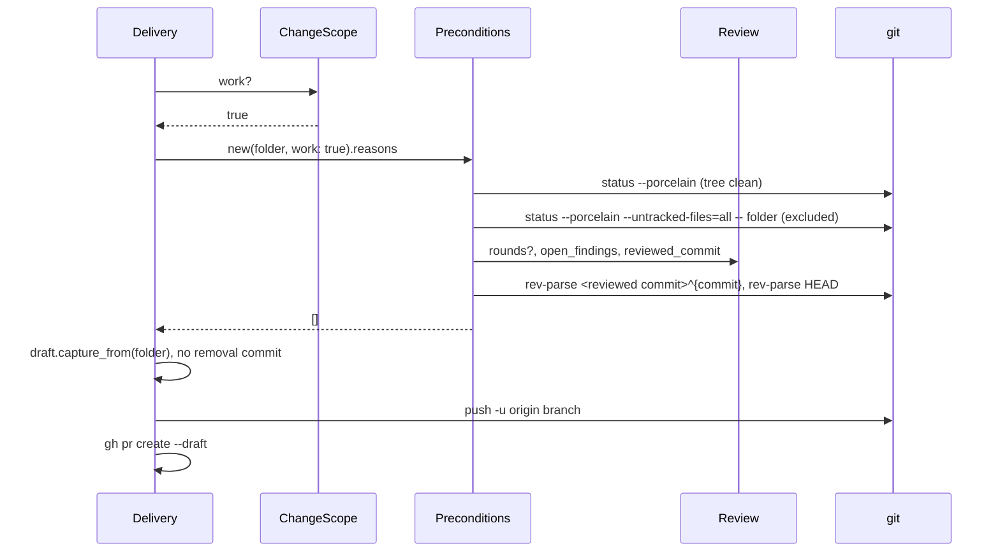

# Plan: Work-repo change artefacts stay local

From `intent.md` (2026-11-10). Status: accepted.

## Design

### Domain terms

- **Personal repository** (glossary): used as defined.
- **Change scope** (new): `personal` or `work`, as `agents/.agents/skills/finish/scripts/change-scope` prints it from the origin URL. It is not the glossary's **Scope**, which names the secrets `unlock` loads. Never write bare "scope" for this concept. Avoid: work scope, repo scope.
- **Work repository** (new): a repository whose change scope is `work`: its origin matches an entry of `~/.claude/consent-guard-allowed-remotes.txt`. Avoid: employer repo.
- **Change folder** (new): `docs/changes/<slug>/`, as `plan/scripts/change-folder` prints it.
- **Change artefact** (new): `intent.md`, `plan.md` or `review.md` in a change folder. Avoid: change document. The old spelling "artifacts" stays only inside the existing removal subject `Remove change artifacts for <slug>`, which `restore` matches.
- **Local artefact** (new): a change artefact that no commit holds. On a work repository `.git/info/exclude` hides it.
- **Round**, **finding** (existing in `review_file.rb`): a `## Round` heading of `review.md` and a `- [ ] Important:` or `- [ ] Nit:` line under it.
- **Reviewed commit** (new): the short SHA in the last `## Round <n> — <time> — <sha>` heading of `review.md`. The heading may end in `(claude)` or `(codex)`.

### Diagrams



`change_scope_script`, `commit_plan`, `commit_review` and `restore` stand for the top-level scripts `change-scope`, `commit-plan`, `commit-review` and `restore`. `Sweep` uses no change scope: its new rule holds on every repository.



### Signatures

`agents/.agents/skills/finish/scripts/change_scope.rb` (new): the one mapping from an origin URL to a change scope.

```ruby
module ChangeScope
  # "personal", "work", or nil for an origin RemoteMatcher does not know.
  #: (?String? url) -> String?
  def self.current(url = origin_url)

  # True only when the change scope is exactly "work"; an unknown origin is not work.
  #: -> bool
  def self.work?
end
```

`origin_url` is a private class method (`git remote get-url origin`, nil on failure). `change-scope` prints `ChangeScope.current`, or refuses with today's message `unknown remote; finish refuses to guess.` when it is nil. It loses its own `if`/`elsif`.

`agents/.agents/skills/review/scripts/review_file.rb`, class `Review`: what the review.md of a change says. Two new public methods:

```ruby
# The short SHA at the end of the last "## Round" heading, before any "(claude)" or "(codex)"; nil when none.
#: -> String?
def reviewed_commit

# "docs: review findings for <first finding>", cut at a word boundary so the subject stays at most 72 characters.
# The first finding is the text between "Important: " or "Nit: " and " — `" on the first finding line of the file.
# A file with no finding answers "docs: review with no findings for <slug>".
#: (String slug) -> String
def commit_subject(slug)
```

`agents/.agents/skills/review/scripts/commit-review` (script): the round check and the open-finding check stay first and keep exit 1. Then, on a work repository, it prints `Nothing committed: <path> stays local on a work repository.` and exits 0. Otherwise it commits as today, with `review.commit_subject(slug)` as the subject.

`agents/.agents/skills/plan/scripts/commit-plan` (script): the two acceptance refusals stay. Then, on a work repository, it prints `Nothing committed: <intent> and <plan> stay local on a work repository.` and exits 0. Otherwise it commits as today.

On a work repository both `commit-plan` and `commit-review` also warn on stderr, and still exit 0, when `git status --porcelain --untracked-files=all -- <folder>` prints a line: `<folder>/ is not ignored: add docs/changes to .git/info/exclude, or a git add . will stage it.` That surfaces a missing setup at the first stage, not only at delivery.

`agents/.agents/skills/deliver/scripts/restore` (script): right after `change-folder` resolves, on a work repository it prints `Nothing to restore: <folder>/ stays local on a work repository.` and exits 0. It does not fetch, check the tree or rebase.

`agents/.agents/skills/deliver/scripts/deliver`:

```ruby
class Preconditions
  # work: is required, so no caller can fall back to the committed checks by omission.
  #: (String folder, work: bool) -> void
  def initialize(folder, work:)

  # [tree_reason, exclusion_reason, review_reasons, freshness_reason, scope_reason], flattened and compacted.
  #: -> Array[String]
  def reasons
end

class Delivery
  #: -> void
  def initialize   # adds @work = ChangeScope.work? and @preconditions = Preconditions.new(@folder, work: @work)

  #: -> bool
  def check        # @preconditions.reasons

  #: -> void
  def run          # unchanged; prepare uses @preconditions.reasons and runs remove_folder only unless @work
end
```

`check` and `prepare` share the one `@preconditions`. Today each builds its own `Preconditions`, so a `work:` passed in one path only would leave full delivery on the committed checks, where `review-report-fresh` passes vacuously.

Private methods of `Preconditions`:

- `exclusion_reason`: only when `@work`. When `git status --porcelain --untracked-files=all -- <folder>` prints a line, it answers `docs/changes is not in .git/info/exclude: add it once for this repository.` Verified: an excluded folder prints nothing; an untracked one prints `?? docs/changes/<slug>/<file>`.
- `freshness_reason`: `@work ? local_freshness_reason : committed_freshness_reason`. `committed_freshness_reason` is today's `review-report-fresh` call.
- `local_freshness_reason`: nil unless the review has rounds (`review_reasons` reports that case). It answers `The review is not fresh: run /review again.` plus the reviewed commit and HEAD, unless `git rev-parse --verify --quiet <reviewed commit>^{commit}` equals `git rev-parse HEAD`.
- `review`: memoises `Review.new(File.read(path))` when the file exists; `review_reasons` reuses it.

`git/.config/git/worktree-tools/lib/sweep.rb`, class `WorktreeTools::Sweep`: removes merged worktrees, and counts untracked change artefacts as clean. `run` does not change. It never passes `--force`. Instead, the `git status` of `clean?` and the `git worktree remove` of `remove_worktree` both run with a command-scoped exclusion of `docs/changes/`, so git itself refuses any other dirt, also dirt that appears between the two calls. Private methods:

```ruby
# A temporary excludes file: the current global excludes (core.excludesFile, else
# $XDG_CONFIG_HOME/git/ignore or ~/.config/git/ignore), then "docs/changes/". Written once per run.
def excludes_file

# ["-c", "core.excludesFile=<excludes_file>"], put before every status and worktree remove call.
def artefact_exclusion

def clean?(dir)    # git <artefact_exclusion> -C dir status --porcelain prints nothing
```

`remove_worktree` runs `git <artefact_exclusion> worktree remove dir`. Verified with git 2.56: `git -c core.excludesFile=<file with docs/changes/> worktree remove` removes a worktree that holds only untracked `docs/changes/` files, and refuses one that also holds an untracked file elsewhere. The global excludes are copied into the file because `core.excludesFile` replaces them; without the copy a globally ignored `.DS_Store` would block removal.

Not changed in code, tests only:

- `claude/.claude/hooks/consent-guard.rb`: `change_folder?` reads only `ls-files` and `ls-tree HEAD`, so an untracked or excluded folder already passes `gh pr create`. Its header comment changes to say that on a work repository the folder is never tracked.
- `git/.config/git/worktree-tools/review-report-fresh`: it exits 0 when the folder is not in HEAD, which is always the case on a work repository. Its header comment gains one sentence that says so.

Test support in `test/delivery_harness.rb`:

```ruby
WORK_URL = "git@github.com:employer/their-app.git".freeze   # no employer name in the public repo

# Writes @home/.claude/consent-guard-allowed-remotes.txt with "employer/their-app".
#: -> void
def allow_work_remote

# Appends "docs/changes" to <common dir>/info/exclude.
#: -> void
def exclude_change_folders
```

Not checked: this repository has no Steep setup for shell tasks.

### Complexity

No database; counts are subprocesses.

- `ChangeScope.current`: 1 `git remote get-url` and 1 read of the allowlist file. `commit-plan`, `commit-review` and `restore` each call it once; `change-scope` keeps the same cost as today.
- `Review#reviewed_commit` and `Review#commit_subject`: one pass over the lines of `review.md`, no process.
- `deliver` on a work repository: adds 1 `git remote get-url`, 1 `git status -- <folder>` and 2 `git rev-parse`; it drops `review-report-fresh`, `git rm` and the removal `git commit`. On a personal repository it adds only the `git remote get-url`. `scope_reason` still runs `change-scope` as today.
- `Sweep`: one temporary excludes file per run, plus 1 `git config --get core.excludesFile`. The status and removal calls per worktree stay the same in number.

### Invariants

- On a work repository no workflow script makes a commit that touches `docs/changes/`. Enforced by the `ChangeScope.work?` exits in `commit-plan` and `commit-review`, and by `remove_folder` only unless `@work` in `Delivery#prepare`.
- `commit-review` exits 1 while a finding is open, on every repository. Enforced by the open-finding refusal, which runs before the work exit.
- A personal repository, and an origin `change-scope` does not know, commit artefacts as today. Enforced by `ChangeScope.work?`, true only for the exact answer `work`. `deliver` still refuses an unknown origin through `scope_reason`.
- On a work repository `deliver` refuses while the change folder is not excluded. Enforced by `Preconditions#exclusion_reason`.
- On a work repository `deliver` refuses unless the reviewed commit is HEAD. Enforced by `Preconditions#local_freshness_reason`.
- On a personal repository the review commit subject never reads `Review for <slug>` and is at most 72 characters. Enforced by `Review#commit_subject`.
- `Sweep` never removes a worktree with a tracked change or an untracked file outside `docs/changes/`, and never passes `--force`. Enforced by `clean?` and by git's own clean check in `git worktree remove`, both under `artefact_exclusion`.
- On a work repository the workflow text never tells an agent to commit `plan.md` or `review.md`. Enforced by the skill and agent text; contract tests in `test/pull_request_flow_test.rb`.
- The consent guard refuses `gh pr create` only while the index or HEAD holds the change folder. Enforced by the unchanged `change_folder?`.

### Alternatives

1. **Per-script check, shared `ChangeScope` helper** (chosen). Each script asks `ChangeScope.work?` and branches once. One file maps the origin to a change scope, and `change-scope` itself uses it, so nothing derives the scope twice.
2. **Per-script copy of the check** (rejected). The same three-line `work_repository?` copied into `commit-plan`, `commit-review`, `restore` and `deliver`. Smallest diff, but four places to change when detection changes.
3. **One artefact-storage object** (rejected). A `ChangeArtefacts.current` factory that returns `Committed` or `Local`, each with `keep`, `delivery_reasons`, `remove`, `removed?` and `restore`, and `RemovalCommit` moved out of `restore`. It is the deepest module, but it adds four files, gives `Local` methods that ignore their arguments, and moves working personal code with no behaviour change. The intent asks for no personal lifecycle change beyond the subject, so the move risks the personal path for no gain.

## Design decisions

- `deliver` checks freshness on a work repository from the reviewed commit in `review.md`. Intent says `deliver` "checks review freshness" and `review-report-fresh` "passes on work scope". `review-report-fresh` stays as it is for the pre-push hook; `deliver` does its own local check, so its freshness is not vacuous.
- Local freshness means the reviewed commit is HEAD. That is stricter than `review-report-fresh`, which allows later commits that touch only the change folder; on a work repository no commit touches the folder, so the two agree.
- The subject for a review with no findings is `docs: review with no findings for <slug>`. Intent does not cover this case.
- The review subject is cut at a word boundary to at most 72 characters. A finding is often a full sentence.
- `commit-plan` and `commit-review` warn about an unignored folder but do not refuse; only `deliver` refuses. A refusal in `commit-plan` would block the plan stage on a setup step, while the warning already names the risk.
- The exclusion check asks git whether the folder is ignored, not which file ignores it. A `.gitignore` entry protects against `git add .` as well; only the risk matters, not its source.
- `Sweep` uses a command-scoped exclusion instead of `--force`, so git keeps the final say on unrelated dirt.
- On a work repository the plan skill skips `git push -u origin HEAD` after `commit-plan`, since the branch holds no commit yet. Pushing would create an empty branch on the work origin.
- `Sweep` applies its rule on every repository, not only on work ones. Intent says "treats untracked files under `docs/changes/` as clean" with no scope limit.
- No conflict with intent's `## Decisions`: the exclude stays Etienne's one-time step, the descriptive-subject rule covers every repository, sweep ignores only `docs/changes/`, the subject comes from the first finding.

## Integration points

- `RemoteMatcher` (`claude/.claude/hooks/remote_matcher.rb`) and the allowlist file supplied by `dotfiles-work`. `change_scope.rb` loads it with `require_relative "../../../../../claude/.claude/hooks/remote_matcher"`, the path `change-scope` and `auto-accept` already use.
- The pre-push hook in `lefthook.yml` runs `review-report-fresh --skip-without-pr`; unchanged.
- The stage scripts `herdr/.config/herdr/scripts/start-review.sh` and `rex/.config/rex/scripts/start-review.sh` embed the reviewer prompt that runs `commit-review`.
- `gh pr create` through the consent guard; `git worktree remove` through `Sweep`.

## Files that change

Code:

- `agents/.agents/skills/finish/scripts/change_scope.rb` (new) — `ChangeScope.current` and `work?`.
- `agents/.agents/skills/finish/scripts/change-scope` — print `ChangeScope.current`.
- `agents/.agents/skills/review/scripts/review_file.rb` — `reviewed_commit`, `commit_subject`.
- `agents/.agents/skills/review/scripts/commit-review` — work exit, new subject.
- `agents/.agents/skills/plan/scripts/commit-plan` — work exit.
- `agents/.agents/skills/deliver/scripts/deliver` — `work:` on `Preconditions`, `exclusion_reason`, `local_freshness_reason`, no removal on work; header comment.
- `agents/.agents/skills/deliver/scripts/restore` — work exit; header comment.
- `git/.config/git/worktree-tools/lib/sweep.rb` — `excludes_file`, `artefact_exclusion`, `clean?`, `remove_worktree`.
- `claude/.claude/hooks/consent-guard.rb` — header comment only.
- `git/.config/git/worktree-tools/review-report-fresh` — header comment only.

Tests:

- `test/delivery_harness.rb` — `WORK_URL`, `allow_work_remote`, `exclude_change_folders`.
- `test/review_file_test.rb` (new), `test/change_scope_test.rb`, `test/commit_review_test.rb`, `test/commit_plan_test.rb`, `test/deliver_test.rb`, `test/restore_test.rb`, `test/worktree_sweep_test.rb`, `test/consent_guard_test.rb`, `test/review_report_check_test.rb`.
- `test/consent_guard_test.rb` — `start_change` gains `stage: true`; the work test passes `stage: false` and asserts the index holds no artefact.
- `test/pull_request_flow_test.rb` — contract tests: the implement skill, the implementer agent and the review skill say what happens to `plan.md` and `review.md` on a work repository.
- `test/herdr_worker_scripts_test.rb`, `test/rex_worker_scripts_test.rb` — the plan-stage prompt names the work-repository case.
- `test/autonomy_contract_test.rb` and the tests above — update only a text assertion that the new text breaks; never weaken one.

Text (each says what happens on a work repository and keeps the personal flow):

- `agents/.agents/PLAYBOOK.md` rules 5, 16 and 17 (`claude/.claude/PLAYBOOK.md` is an import link to it). Check `claude/.claude/core-values.yml` for mirrored text.
- `agents/.agents/skills/intent/SKILL.md` — the pane reads the local `intent.md` on a work repository.
- `agents/.agents/skills/plan/SKILL.md` — `commit-plan` commits nothing on a work repository; skip the push then.
- `agents/.agents/skills/implement/SKILL.md` — on a work repository every `plan.md` edit stays local: the Proof additions and the departures of line 53, and the bugfix line `Reproduction: committed` of line 55. The code or test commit holds only code or tests.
- `claude/.claude/agents/implementer.md` and `test-writer.md` — the same rule for their `plan.md` edits. Then regenerate `codex/.codex/agents/*.toml` with `bin/generate-codex-agents`; `test/codex_agent_generation_test.rb` guards the drift.
- `herdr/.config/herdr/scripts/hand-off-plan.sh`, `rex/.config/rex/scripts/hand-off-plan.sh` — the header comment and `accepted_then_push` say that on a work repository `commit-plan` commits nothing and the push is skipped.
- `agents/.agents/skills/review/SKILL.md` — `commit-review` behaviour per change scope; the new subject; fix commit subjects describe the fix.
- `agents/.agents/skills/code-review/SKILL.md` — fix commit subjects describe the fix.
- `agents/.agents/skills/deliver/SKILL.md` — no removal commit and nothing to restore on a work repository; the exclusion and local freshness checks.
- `agents/.agents/skills/finish/SKILL.md` — line 12 no longer claims `deliver` always removed the folder; the §3 work ADR step says the change folder stays local and the PR body stays the source.
- `claude/.claude/agents/reviewer.md`, `codex/.codex/agents/reviewer.toml`, `herdr/.config/herdr/scripts/start-review.sh`, `rex/.config/rex/scripts/start-review.sh` — `commit-review` exits 0 without a commit on a work repository.
- `git/.config/git/worktree-tools/README.md` — sweep counts untracked `docs/changes/` files as clean.

## Order of work

1. Add `WORK_URL`, `allow_work_remote` and `exclude_change_folders` to `test/delivery_harness.rb`. Write the acceptance test for the first criterion in `test/commit_plan_test.rb`, run it, watch it fail.
2. Add `change_scope.rb` with its unit tests; switch `change-scope` to it; `test/change_scope_test.rb` stays green.
3. Add the work exit to `commit-plan`. The first acceptance test goes green.
4. Add `Review#reviewed_commit` and `Review#commit_subject` with `test/review_file_test.rb`.
5. Write the `commit-review` acceptance tests (work: nothing committed; personal: descriptive subject), watch them fail, then change `commit-review`. Replace `test_the_commit_subject_names_the_slug`, whose assertion encodes the old subject the intent removes.
6. Write the `deliver` work tests, watch them fail, then change `Preconditions` and `Delivery`. The stale-review test runs both `deliver` and `deliver --check`.
7. Write the `restore` work test, watch it fail, then add the work exit.
8. Write the four `worktree-sweep` tests, watch the first fail, then change `Sweep`.
9. Add `stage:` to `start_change`. Add the consent guard and `review-report-fresh` work tests; they pass on the unchanged code. Update both header comments.
10. Write the contract and prompt tests, watch them fail, then update the skill, agent, playbook, hand-off prompt and README text. Run `bin/generate-codex-agents`.
11. Run `bin/test`, `rubocop`, `shellcheck` on the two `start-review.sh` files, and `markdownlint` on the changed Markdown. Re-read the diff; grep it for an employer name before each commit.

## Risks

- `Sweep`'s excludes file replaces `core.excludesFile` for its git calls. A global excludes path it fails to resolve makes globally ignored files count as dirt, so a worktree stays: the safe direction.
- A work repository whose `info/exclude` lacks `docs/changes` shows `?? docs/` in `git status`. `commit-plan` and `commit-review` warn but succeed; an accidental `git add .` can then stage the artefacts until `deliver` refuses. Intent makes the exclude Etienne's step.
- On a work repository a fix committed after the last round blocks `deliver` until a new round runs. The review loop re-reviews after every fix, so the normal path holds.
- A long first finding gives a subject cut at 72 characters, which may end mid-phrase.
- Rejected: writing `.git/info/exclude` from a script (out of scope per intent); the artefact-storage object (see Alternatives).

Out of scope: writing `.git/info/exclude`; branches whose artefacts are already committed; the personal removal and restore lifecycle; how `intent.md` and `plan.md` get accepted.

## Proof

- On `employer/their-app`, accepting a plan leaves `intent.md` and `plan.md` uncommitted and `git log` shows no commit that touches `docs/changes/` → `test/commit_plan_test.rb` `test_on_a_work_repository_intent_and_plan_stay_uncommitted`
- On `employer/their-app`, a clean review leaves `review.md` uncommitted and nothing is committed for it → `test/commit_review_test.rb` `test_on_a_work_repository_a_converged_review_stays_uncommitted`
- On `employer/their-client`, `deliver` opens the draft PR and the branch has no commit that adds or removes `docs/changes/<slug>/` → `test/deliver_test.rb` `test_on_a_work_repository_a_closed_review_ends_in_a_draft_pr_without_artefact_commits`
- On a work repository, `gh pr create` is allowed by the guard while the untracked folder exists → `test/consent_guard_test.rb` `test_creating_a_pull_request_on_a_work_repository_with_an_excluded_change_folder_is_allowed`
- On a personal repository, the review commit subject describes the change, not "Review for <slug>" → `test/commit_review_test.rb` `test_the_commit_subject_names_the_first_finding`
- A merged worktree holding only untracked `docs/changes/<slug>/` files is removed by `worktree-sweep` → `test/worktree_sweep_test.rb` `test_removes_a_merged_worktree_holding_only_untracked_change_artefacts`
- A merged worktree holding a modified tracked file, or an untracked file outside `docs/changes/`, is left alone → `test/worktree_sweep_test.rb` `test_keeps_a_merged_worktree_with_a_modified_tracked_file`, `test_keeps_a_merged_worktree_with_an_untracked_file_outside_docs_changes`
- Invariant: a globally ignored file does not block removal, enforced by the global excludes copied into `excludes_file` → `test/worktree_sweep_test.rb` `test_removes_a_merged_worktree_with_artefacts_and_a_globally_ignored_file`
- Invariant: on a work repository the implement and review text keeps `plan.md` and `review.md` out of commits, enforced by the skill and agent text → `test/pull_request_flow_test.rb` `test_on_a_work_repository_the_workflow_text_keeps_plan_and_review_local`
- Invariant: the plan-stage prompt names the work-repository case → `test/herdr_worker_scripts_test.rb` and `test/rex_worker_scripts_test.rb` `test_the_plan_prompt_says_commit_plan_commits_nothing_on_a_work_repository`
- Invariant: `commit-review` exits 1 while a finding is open on a work repository, enforced by the open-finding refusal before the work exit → `test/commit_review_test.rb` `test_on_a_work_repository_an_open_finding_still_refuses`
- Invariant: `deliver` refuses an unexcluded change folder on a work repository, enforced by `Preconditions#exclusion_reason` → `test/deliver_test.rb` `test_on_a_work_repository_refuses_a_change_folder_that_is_not_excluded`
- Invariant: `deliver` and `deliver --check` both refuse a review older than HEAD on a work repository, enforced by `Preconditions#local_freshness_reason` on the shared `@preconditions` → `test/deliver_test.rb` `test_on_a_work_repository_refuses_a_review_older_than_head`
- Invariant: `commit-plan` warns about an unignored change folder on a work repository and still exits 0 → `test/commit_plan_test.rb` `test_on_a_work_repository_warns_when_the_change_folder_is_not_ignored`
- Invariant: `deliver` refuses an open finding on a work repository, enforced by `Preconditions#review_reasons` → `test/deliver_test.rb` `test_on_a_work_repository_refuses_an_open_finding`
- Invariant: `restore` changes nothing on a work repository, enforced by its work exit → `test/restore_test.rb` `test_on_a_work_repository_there_is_nothing_to_restore`
- Invariant: the pre-push check passes a work branch whose artefacts are untracked, enforced by `folder_in_head?` in `review-report-fresh` → `test/review_report_check_test.rb` `test_a_work_branch_with_untracked_artefacts_passes`
- Invariant: a personal repository still commits artefacts and removes the folder as today, enforced by `ChangeScope.work?` → the existing personal tests in `test/commit_plan_test.rb`, `test/commit_review_test.rb`, `test/deliver_test.rb` and `test/restore_test.rb` stay green.

Per changed file, the unit tests expected:

- `agents/.agents/skills/finish/scripts/change_scope.rb`: `ChangeScope.current answers personal for the own account`, `answers work for an allowlisted origin`, `answers nil for an unknown origin`, `ChangeScope.work? is false for an unknown origin` (in `test/change_scope_test.rb`).
- `agents/.agents/skills/review/scripts/review_file.rb`: `Review#reviewed_commit answers the SHA of the last round`, `ignores a trailing (claude)`, `answers nil without a round`; `Review#commit_subject names the first finding`, `takes a Nit when it comes first`, `cuts a long finding at a word boundary within 72 characters`, `names the slug when no round has a finding` (in `test/review_file_test.rb`).
- `agents/.agents/skills/review/scripts/commit-review`: the acceptance tests above, plus `test_commits_only_review_md_when_other_files_are_staged` stays green.
- `agents/.agents/skills/deliver/scripts/deliver`: the work tests above; the personal tests stay green.
- `git/.config/git/worktree-tools/lib/sweep.rb`: the four sweep tests above; `test_removes_a_merged_clean_worktree_and_its_branch` stays green.

Test setup: the existing `DeliveryHarness` repository with a bare origin, stubbed `gh` and a HOME of its own. Work cases call `build_repo(origin_url: WORK_URL)`, `allow_work_remote` and, except in the unexcluded case, `exclude_change_folders`, then write the artefacts as untracked files. The sweep tests use the existing sweep fixture, add files to a merged worktree, and point `XDG_CONFIG_HOME` at a test directory for the globally ignored case. The consent guard test uses its own `allow_remotes` and `start_change(..., stage: false)`. The employer name is always `employer/their-app`.

---
Domain skills applied: software-design, glossary, diagrams, ruby-style, object-oriented-design.

## Critique

### Round 1 (codex gpt-6.1-sol)

- Sweep's second status read gates the force flag on any dirt, so code changed after clean? would be deleted → fixed (Sweep drops the force flag; status and worktree remove run under a command-scoped core.excludesFile exclusion of docs/changes/, so git refuses other dirt; probe verified)
- Full delivery builds Preconditions in prepare without work:, so the local freshness check runs only in check mode → fixed (work: is required; Delivery builds one @preconditions for check and prepare; the stale-review test runs both)
- The implement skill and the implementer agent still require plan.md edits in code commits → fixed (implement SKILL lines 53 and 55, implementer.md and test-writer.md keep plan.md edits local on a work repository; Codex agents regenerated; contract test added)
- The exclusion check does not prove the info/exclude setup, and only delivery checks it → fixed (commit-plan and commit-review warn on an unignored folder at the first stage)
  - The provenance part is dismissed: any git ignore rule protects against git add . equally, and intent asks for no script to read or write the exclude file.
- start_change always stages docs, so the assumed unstaged consent-guard fixture does not exist → fixed (start_change gains stage: true; the work test passes stage: false and asserts an empty index)
- The hand-off prompts and the finish work ADR step still describe committed or removed artefacts → fixed (both hand-off-plan.sh files and finish SKILL §3 updated, with prompt tests in the herdr and rex worker tests)
